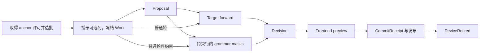

# 动态投机解码设计

目标是让同一个 decode batch 中的每条请求都能选择本轮值得验证的 draft 数，并把这项选择兑现成更少的计算和通信。高接受率请求可以一直用满配置窗口，低接受率请求可以只推进一个 target token。优化指标是单位墙钟时间交付的 token 数，同时关注每条请求的延迟。

本文定义目标行为和模块合同。当前 dev 已有逐行 extent、固定窗口和按采用前缀提交的基础，下面的自适应策略、紧凑验证和新许可属于待实现能力。[实施计划](dynamic-speculative-verification-implementation.md)给出代码入口、切换顺序和验收方法。当前生产路径见[投机执行](../maintainer/speculative-decoding.md)、[并发执行](../maintainer/concurrent-execution.md)和[Context 管理](../maintainer/context-management.md)。

## 需求与适用范围

| 架构 | 本次覆盖的生成组合 | 决定实现方式的特点 |
|---|---|---|
| Qwen3.5 系列 | 已带 MTP 的模型，35B-A3B 的 DFlash，Qwen3.8-27B 的 DFlash2 | Dense GQA、GDN、单机词表决策，部分部署有 CPU expert。Masked draft context 可以有待追加的 target features。 |
| Qwen4Exp | Flash Next 的 MTP，单机与双机 | GDN、QSA、四流 HC 和 PLE。Host/SSD PLE 有异步 producer，Device PLE 可进入完整设备图。 |
| GLM5Next | 双 Spark 的 MTP 或 DFlash2，覆盖现有两种 recipe | KDA 和 FFN 在全局批次运行，Kpool MLA 按 ADP owner 运行。MTP 可复用首步 selection，DFlash2 自己的 GQA 按 heads 做 TP。 |

每个实例仍然加载一个选定的投机后端和一个 proposal head。改造针对生成中的 decode。Prefill、媒体、强制 control、Replay 和前缀恢复沿用各模型的数学流程，它们必须为下一次任意长度的 decode 建好正确的状态。Causal scoring 独立执行。权重格式和模型注册入口可以直接沿用。

### 为什么要同时预测接受量和测量耗时

双 Spark 上 Qwen3.8 Flash Next 的固定 MTP3 在小说、代码和结构化语料上分别交付 2.02、3.51 和 3.73 token/轮。同一配置对这三类请求的额外验证列有不同价值。[已发布的同配置数据](../performance/qwen3.8-flash-next.md#dual-spark)

GLM-5.3-Flash FP4 Local 有一组可以直接复核的 DFlash2 数据。双 Spark、full head、7 个 draft、20k–80k 输入，39 条工具请求的 decode 期间为独占服务，共 3,768 轮。第 1 至 7 位的累计接受次数依次为 2,849、2,040、1,406、962、645、461、320。满窗实测 89.00 ms/step。保持同一个 proposal block 和原有轮次起点，只截取日志中的接受前缀，可算出短窗要达到的盈亏点。

| 验证的 draft 数 | 按原轨迹计算的许可输出 token/轮 | 短窗要胜过满窗所需的 step 时间 |
|---:|---:|---:|
| 7 | 3.304 | 89.00 ms，满窗实测 |
| 5 | 3.097 | 低于 83.42 ms，至少省 5.58 ms |
| 3 | 2.671 | 低于 71.93 ms，至少省 17.07 ms |

短窗列是反事实估计。实际换窗后，下轮起点、expert 路由和输出长度都可能变化。这个例子给出了第一项实测要回答的具体问题。资料来自 2026-11-09 本地日志摘录 `.agent-tmp/glm-dflash-mtp-log-review/exclusive-truncation.json`，上表所需的原始计数已列在正文。

## 一轮 decode 的合同

设请求的 Main 已执行输入 `[0,F)`，`x[F]` 是已知、待执行的 anchor。下标 `i` 表示逻辑请求，在物理行重排和双 rank 执行期间保持同一身份。

| 量 | 定义 | 决定时刻 |
|---|---|---|
| `K`、`Wmax=K+1` | 部署的 draft 上限及最大 target 输入宽度。它们与并发、模型、并行放置共同决定启动资源。 | 启动 |
| `vᵢ` | 本轮授权 target 验证的 draft 前缀长度。`0 ≤ vᵢ ≤ K`。 | 生成本轮 proposal **之前**，由协调端 Session 冻结 |
| `gᵢ` | backend 实际形成的有效候选 ID 数。交给 verifier 的是前 `vᵢ` 个，故 `vᵢ ≤ gᵢ`。完整 masked block 的 hidden 列或物理 padding 不计为候选。 | backend 生成 |
| `aᵢ` | 在选定前缀中，target 从第一位开始连续接受的 draft 数，`0 ≤ aᵢ ≤ vᵢ`。 | 设备侧 acceptance |
| `cᵢ` | Frontend 处理 EOS、stop、预算和取消之后，Session 最终采用的输出数。正常生成有 `cᵢ ≤ aᵢ+1`。 | 输出 preview 后，经模型 commit 接受 |

有效 target 输入为 `[anchor,d₁,…,dᵥ]`。第 `j` 个 draft 用上一输入的 target logits 验证。全部通过时，用最后输入的 logits 采 bonus。第一个拒绝处采 correction。正常结果包含 `aᵢ+1` 个候选输出。一次真实 batch 有 `B` 行、`N=B+Σvᵢ` 个有效 target token。执行 `cᵢ>0` 的提交后，Main 前沿为 `F+cᵢ`，最后一个采用的输出成为新 anchor。

**一次被 stop 截断的提交。** 某行验 5 个，target 接受 `d₁,d₂,d₃` 后给出 correction，而 stop 把输出截到 `d₂`。本轮 `v=5,a=3,c=2`。发布的两个输出是 `d₁,d₂`，Main 正式采用的两个输入是旧 anchor 和 `d₁`。因此 KV coverage 前移两列、SSM fold 前两条记录，continuation 取第二个输入的真实特征。`d₂` 留作下一输入。

| 情形 | 本轮行为 |
|---|---|
| `v=0` 的真实行 | target 处理一个 anchor，从第一列 target 分布产生一个输出。若整批均为零，走 ordinary。混合批中该行仍有 state、页表和采样身份。 |
| padding 行或填充 token | 有效长度为零。不得访问所选 State、历史页、候选分布、grammar 或 CPU expert。无状态矩阵可消费已经初始化的有限填充值。 |
| `v>0,a=0`、正常继续 | 第一位被拒，仍有一个 correction，`c=1`。 |
| `c=0`、取消或失败 | 不发布输出和新前沿。已经提交的 reader、传输及设备工作必须退役，仍有引用的源状态须受保护。 |
| 预算只剩一个输出、恢复后的受保护首步、即将强制 control | 使用 Runtime 给出的本轮模型输出预算。一个输出的预算只允许 anchor。强制输入由自身的 Work 推进。 |
| 跨请求命中同一 checkpoint | 共享可恢复的模型内容。新请求独立建立预测统计。原请求暂停再恢复时携带自己的统计。 |

### 决策、执行与发布的所有权

普通轮直接以 anchor 运行 Target。无约束行直接使用其采样参数。受限请求可以把 CPU mask 构造与 GPU 计算重叠。

1. **Engine/Scheduler** 维护请求、公平性、取消、可供模型生成的输出预算和本轮逻辑成员。Frontend 从候选前缀构造 grammar masks，并在输出时决定采用多少 token。
2. **模型 Session** 把各 history 前沿、恢复保留、owner、预算和可用容量转换成本轮可选范围，调用公共长度策略。Session 使用模型准备好的执行目录选出可执行的物理计划，持有请求预测状态及本轮事务。
3. **ContextDirectory** 对所有参与 rank、记录类型、COW 和元数据进行联合评估、授予及结算。ResourceManager 处理必需工作的回收与恢复权利。
4. **Executor** 接管 owning Work 和 frame，负责命令排序、decision 交接及所有参与 rank 的退役。**RankProgram** 物化本 rank 的视图，执行指定的图或 eager 计算。各 **Op** 定义可接受的布局、数值、读写域和局部分派。
5. `ResultReady` 交付已验证前缀。`CommitReceipt` 后 Session 采用前沿，Frontend 正式发布。`DeviceRetired` 后最后消费者结束，frame 可复用，整批耗时可以结算。同一 ticket 的行、几何和读写租约在这个区间内冻结。[Engine 提交合同](../maintainer/engine-architecture.md#提交发布与退役)

## 准入与容量不足

选批时先回答“这个请求能否再生成一个 token”，再决定“本轮还值得多验几列”。设模型 context 上限为 `Ctxt`。只有剩余模型输出预算 `Rᵢ≥1` 且 `Fᵢ<Ctxt` 的行才能申请 anchor。此时行的数学上限为 `hᵢ=min(K,Rᵢ−1,Ctxt−Fᵢ−1)`。

**必需许可。** 选批之前，按 `Fᵢ+1` 及该 backend 为这一输入建立完整提交所需的需求取得许可。授予包含源/目的状态保护、必要 COW 和该请求已有的 recovery 保留。只有这部分的短缺可以驱动原有的回收、等待和抢占。许可与 sequence generation、residency、前沿和 Runtime unit 绑定。

**可选增长。** 对已选成员，Session 先取得可用 compute frame，再按策略希望的 `vᵢ≤hᵢ` 向目录申请差额。Main 最远写到 `Fᵢ+1+vᵢ`，MTP 由模型换算成自身前沿，DFlash 分别核算 paged history、cyclic state 与待追加特征。没有额外物理需求的列可以直接使用。需要新容量时，优先整批一次授予。短缺时在实际增长需求变化处缩短，按请求收益分配可立即取得的份额。可选增长没有驱逐前缀、启动迁移或侵占恢复保留的权限。

例如 `F=63` 且最后一页已经私有可写，64-token 页内仍可执行 anchor。下一列需要新页。即使该页无法授予，这条请求仍可 ordinary decode。如果已有页是共享尾页，anchor 的 COW 本身属于必需需求，由目录判断。所有 rank 的最终范围在 `prepare_write` 和提交前落实。拒绝后缀按实际采用前沿和 recovery 保留结算。[Context 目录](../../src/models/common/context/directory.h) · [History 增长与结算](../../src/models/common/context/directory/history.cpp)

## 两种生成机制

### MTP 按实际深度生成

第 `j` 步只为 `vᵢ≥j` 的成员产生第 `j` 个候选。最终生成深度为 `max(vᵢ)`，与 target 矩形桶是否向上取整独立。例如 `[3,1,0]` 只需要三次 proposal forward，活跃行数依次为 `2,1,1`。某一步即使只有一行，也要承担该步 decoder、head 和必要 collective 的成本。计划为每步提供活跃成员到本轮稳定行的映射，递归 hidden、历史尾部和上一候选按同一请求寻址。

MTP 的 canonical 配对是 `H[p]` 与 `x[p+1]`。Main 在 `F` 时，MTP history 前沿为 `max(F−1,0)`。非根 decode 的首步可以用真实 conditioning 和 anchor 建立一个可复用配对，之后的递归 hidden 只用于提案。提交 `c` 个输入时，模型记录这行的首个真实配对是否已经物化并可采用，再用真实 Main features 补齐其余配对。对于 `v=0,c=1` 的混合行，仍须得到正确的一步 history。该行可以走 history-only 计算，无需为维护 history 运行词表 head。

对 `F>0` 的 decode，设可复用的首配对数为 `r`。仅当 `c>0` 且首配对真实有效时 `r=1`，其余取零。需要修补 `c−r` 个真实配对，提交后的 MTP history 前沿为 `max(F+c−1,0)`。即使草稿连续全中，后续递归 hidden 仍要由实际 Main conditioning 替代。

Qwen3.5 使用 Main hidden，Qwen4Exp 保留 final HC mixer 前的四流 conditioning 和相应 RoPE/PLE 尾部，GLM 使用 Main final RMSNorm hidden。GLM 若启用 MTP selection reuse，首步的选块和可见边界按原请求保存，后续即使活跃行压紧也必须取同一份选择。[MTP 前沿](../maintainer/speculative-decoding.md#mtp-的稳定前沿) · [GLM MTP](../maintainer/glm5next-model.md#mtp)

### DFlash 和 DFlash2 保持非因果块，裁剪输出头

对 `vᵢ>0` 的请求保留后端配置的合法 proposal block，通常为 anchor 加 `K` 个 mask。每个 draft 层都按该 block 的完整可见域计算 hidden。请求的 target 验证长度只决定抽取哪些候选。完整掩码块位于临时计算区，其位置遵守 draft Op 的合同，写入正式 history 的权限仍以实际提交为准。Qwen3.5 的 DFlash v1 现用 target 的 `valid_columns` 构造 proposal，这里要显式拆开。[现有入口](../../src/models/qwen3_5/program/decode.cpp)

完整 block 的 residual 就绪后，从每条请求提取第 `1..vᵢ` 列做最终 norm 和 head。DFlash 对相应列生成 one-hot proposal。DFlash2 对这些列做 top-k、必要的跨 rank 合并和 selector 投影，再从 anchor 顺序采样，让实际候选 ID 及其稀疏 FP32 `q` 一直存活到 acceptance 完成。Selector 的每个位置依赖前驱，所需前缀完整即可。整个 batch 的 `v` 都为零时跳过 proposal。部分请求选择零时可从 proposal 成员表中排除。

裁剪 head 保持完整主干的数学可见域。head 的实际列数可以改变数值分派，例如 Spark 的 MXFP8 top-k 在 16 列以内有 A16 路线，更大形状可用 A8。分布正确性以此次前向产生的 `p` 和本次抽样使用的 `q` 为准。跨形状不要求词表 logits 或随机输出逐位相等。[Spark head 分派](../../src/ops/linear/topk/keys/dgx_spark/mxfp8.cu) · [条件 selector](../../include/ninfer/ops/candidate_selector.h)

GLM 在采用后将真实特征物化为各 draft 层的 cyclic KV。Qwen3.5 家族允许一段已采用特征暂存于 lane 的 pending plane，附有明确的待追加区间。下一轮覆盖该区之前先追加。连续 ordinary 期间也须维持这个存储上限。形成可恢复 checkpoint、暂停或转移尚有待写区间时，先完成模型规定的 normalization，或者选择账本 Replay 能完整重建的恢复路径。

## Target 的两种物理布局

`v[]` 是唯一的逐行验证长度。`P`、`L` 延续全局与 ADP 本地物理行桶的含义。物理表示由计划目录选择，eager 与 Graph 共享寻址合同。

- **矩形。** 行跨度 `W≥max(1+vᵢ)`，真实请求 `b` 的第 `j` 个输入在 `b×W+j`。Dense contraction 的物理列数是 `P×W`。B1、等长行和已调优的小矩形直接使用连续视图。短逻辑宽度可以装入较大的桶，MTP 仍按计划的实际深度结束。
- **紧凑。** 按固定的执行行序计算 `offset[0]=0`、`offset[b+1]=offset[b]+1+vᵢ`，位置为 `offset[b]+j`。全局物理 token 桶 `Q≥N`，唯一的全局填充尾部为 `[N,Q)`。若控制区有补齐行，其起止 offsets 同为 `N`。各层共享 offsets 和需要的 token→行映射。
- **顺序。** Qwen 使用逻辑成员顺序。GLM 按 owner 稳定分组，保留物理行到逻辑成员、owner 局部行到全局行的双向映射。返回 mask、结果、提交和观测均用逻辑成员。lane、持久 State offset、页表行、ticket 内 record 行、压紧后的 token 下标各自独立。

**同一批次的例子。** 四行按执行序验 `[7,3,1,0]`。以仅物化送验前缀的 DFlash2 head 为例，两条 token 轴各有自己的分段。

| 执行行 | ADP owner | 送验 draft | Head 的候选列 | Target 的输入列 |
|---|---:|---:|---|---|
| A | 0 | 7 | `[0,7)` | `[0,8)` |
| B | 0 | 3 | `[7,10)` | `[8,12)` |
| C | 1 | 1 | `[10,11)` | `[12,14)` |
| D | 1 | 0 | 空 | `[14,15)`，只有 anchor |

Target 的矩形需要 32 列，紧凑布局可进 16 列桶。局部有效 token 分别为 12 和 3，两侧用共同的本地桶 12 执行相应等长 gather，再按映射恢复全局顺序。全局主干只需 16 列，其中第 15 列（从零编号）是 padding。候选数为 11，行 D 无需 proposal head，却有真实 KV 和 state 提交需求。两种布局都只执行一次整批 target forward。按长度拆成多次整模 forward 会重复读取层权重并增加 collective。

| 消费者 | 按哪一条轴工作 |
|---|---|
| Linear、LM head、HC/mHC、Embedding、逐点与 MoE | 在物理 token 轴上处理矩阵。矩形中的无效后缀、紧凑布局的填充尾部都不得进行 expert assignment。offload 执行按真实 active tokens 决定是否流式加载，workspace 和 Graph 覆盖物理几何。 |
| Dense GQA、QSA、Kpool MLA | 每个查询取自己请求的页表、逻辑位置和可见边界。QSA/Kpool 的压缩组不能跨请求，prepare、selection 与 readout 共用行映射。GLM 局部 MLA 回到全局 token 顺序后再执行 TP 主干。 |
| GDN、KDA、因果卷积 | 每行从自己的初态开始，按段内顺序递推。单列真实行可以存在于 speculative 批。仍须留下该行能按实际采用数提交的 records。 |
| PLE | 用该请求的前两个 ID、当前位置及已生成前驱建 n-gram。按段处理因果卷积。SSD/Host producer 收到真实身份与 ID，预取、seal、消费及释放受 ticket 保护。Device 表按现有分片方式参与计算。 |
| Vocabulary、grammar、输出 | 同一请求的 anchor/候选前缀、penalty overlay 和 bonus 列可直接定位。只读回约束行所需的候选，Host 构建 `vᵢ+1` 列掩码，与 target forward 重叠。 |

### 跨阶段的地址与寿命

临时 activation 与 logits 采用当轮物理布局。**跨阶段数据以写入者声明的视图读取**。Target 生成的 hidden/features 连同行起点交给 commit。records 按层使用稳定的 `[record_capacity,Wmax]` 行列槽，实际写 `[0,1+vᵢ)`。fold 消费同一物理记录的 `[0,cᵢ)`。例如 `W=4,Wmax=8` 时，第二行的紧凑等宽激活从第 4 列起，固定 records 从第 8 列起。改变 Tensor 形状不能改变其中任何一个地址。

当 `cᵢ>0` 时，最后要保存的 target hidden 位于 `row_start+cᵢ−1`，对应的是已采用前缀的最后一个**输入**。当 `cᵢ=0` 时不取最后列。对输出 token 做 penalty 计数使用 licensed IDs 的前 `cᵢ` 个，和从 record 平面做状态 fold 是两项不同的操作。

GLM KDA 的 K/V 投影直接写 replay records，递推可以与这些 K/V 同址。卷积写端和递推读端必须同时支持真实 stride 或段映射。QSA raw keys/坐标、Kpool raw keys/gates 和 PLE records 都按真实行提取 tail。未采用后缀不能成为 checkpoint coverage。零提交按各字段既有的复制或空操作语义处理。ReplaySSM 的精确关系是从相同初态重放**同一次** verify 实际消费的 represented inputs，与该次前缀轨迹逐位相同。[GLM KDA 绑定](../../src/models/glm5next/execution/kda.cpp) · [GDN fold](../../include/ninfer/ops/gdn_replay.h) · [KDA fold](../../include/ninfer/ops/kda_replay.h)

各 bucket 借用启动时按可达工作集准备的 frame、bounded Host staging 和 workspace。一个 ticket 的 records、候选 `q`、grammar masks、行映射、pending hidden 和通信视图持续到各自最后一个消费者。收回图和 frame 遵循 Executor 退役边界。控制侧预测状态与这些设备地址分开保存。

## CUDA Graph 与分布式执行

Graph 表达物理工作及其依赖。请求的长度向量、采样参数、接受向量和上下文身份作为设备数据传入。协调端冻结一次全 rank 计划，worker 按计划选本地 executable。允许 attention 内部按本地上下文更新兼容的 child。通信参与者、消息尺寸和 collective 次序由所选图段确定。[当前通信图段](../../src/models/common/graph.cpp)

| 图段 | 目录持有的几何 | 回放行为 |
|---|---|---|
| MTP 生成 | 首步/递归主体、当步活跃行容量，以及该模型实际需要的局部行容量 | 预先准备逐步映射。只发起有人生成的步骤，scratch 通过稳定行或显式 gather/scatter 衔接。真实 conditioning 和递归 hidden 分开。 |
| DFlash 主干与 head | 主干按 proposal 成员行容量和固定 block。裁剪后的 head/selector 按候选列容量及行边界 | GLM 的 DFlash2 走 TP，主干图与 target MLA 的 ADP 本地容量可以独立复用。 |
| Target 与 decision | ordinary、测得值得的规则矩形、紧凑 token 桶。decision 按它实际消费的 logits/行布局 | Target 各层尽可能在完整图中执行。Host grammar 在 decision 处交接。QSA/Kpool 的 child 继续按 profile 更新。 |
| Commit | fold、tail、计数和发布按稳定行槽。昂贵的 history-only 修补可以调用共享的已准备 token 桶 | Commit 消息到达时 `c[]` 已知。修补只处理需要的真实配对/特征，涉及 collective 的图段在所有参与 rank 上一致发起。 |

紧凑目录以配置的驻留并发 `C` 及 `C×Wmax` 为上界。全局 token 容量 1 至 8 精确覆盖，之后沿用现有行桶每个翻倍区间取四档的规则，并包含最后端点。每个全局桶 `Q` 可容纳 `min(C,Q)` 个真实行，这给出行控制区上界。ADP2 每个 `Q` 以去重的 `ceil(Q/2)、ceil(3Q/4)、Q` 为本地 token 容量候选，取能覆盖较重 owner 的最小一档。本地行容量同样由本地 token 容量和 `C` 限定。空 owner 按共同的通信尺寸参与，局部 padding 不访问 State。

准备期先保证每个合法逻辑计划均能落入一个可达物理桶，再选取值得单独捕获的矩形快路。eager 可直接采用精确几何。启动时对容量乘积、设备 I32 下标、各 view 的末地址和各 rank 消息上界分别做溢出检查。模型准备层负责几何与高水位，算子自己负责能执行的数值和布局范围。

例如现有 GLM MTP 的 round、decision、commit 在 `C=8` 时每 rank 有 88 个顶层 executable。把四档宽度直接乘入 round 和 decision 会得到 152 个，`C=32` 时则从 224 变为 384 个。这是按现有桶计算的目录数量，显存还需实测。新目录在捕获前能列出图数和各段覆盖域，再用既有图校准测每 rank 的实际增量、启动耗时和 Context 余量。小均宽路径可保留整轮融合。动态路径按粗粒度图段顺序发射，整批的几何选择不增加设备读回。[批次目录](../../src/models/common/batch.cpp) · [GLM 图目录](../../src/models/glm5next/program/graphs.cpp) · [启动校准](../../src/models/common/graph_preparation.cpp)

## 如何选择验证长度

### 估计增加一列的价值

令 $s_i(j)$ 表示前 $j-1$ 位已被接受的条件下，第 $j$ 位也被接受的概率。走到并通过该位置的概率 $S_i(j)$，以及没有终止截断时的期望产出 $L_i(v)$，分别为

$$
S_i(j)=\prod_{\ell=1}^{j}s_i(\ell), \qquad
L_i(v)=1+\sum_{j=1}^{v}S_i(j).
$$

每多验证第 $j$ 位，期望增加 $S_i(j)$ 个输出。举例而言，当目前整个 batch 每毫秒产生 0.20 个输出时，存活概率为 0.10 的额外一列，单独比较时只有在增加耗时小于 0.50 ms 才值得。若多条请求一起触发新的 MTP 步或通信桶，须比较整组新增收益与整组耗时。

预测器使用每请求逐位置的“到达次数”和“通过次数”。生成成功的行，以 target 的 `aᵢ` 更新。验 5、接受 2 时，前两位各有一次成功，第三位有一次失败，第四、五位未到达。验 2 且两位都接受，第三位以后均无观测。Frontend 的 stop 截断不会把已接受位变成拒绝。失败、取消或只有恢复/control 工作的行不给质量标签。

请求近期观测随轮次衰减，样本少的深位向同一模型、backend、head 及采样类别的先验收缩。计算式为 `(通过权重 + 先验权重 × 先验接受率) / (到达权重 + 先验权重)`，到达与通过采用同一衰减。没有同类数据时，用一次成功、一次失败的弱先验初始化各位置，首个具备预算的正常轮按固定窗口取样，再用真实到达的标签更新。衰减周期和已标定先验的权重由按时间顺序的验证数据选定。

满窗全中和长期停在零档的请求都有有界的上探机会。以请求的合格 decode 轮次计算探测间隔，轮转选择到期请求，每批最多提升一行，并服从 Context 授予。未提交的计划不消耗探测次数。探测与模型抽样使用独立的选择依据。预测状态随请求迁移，同一前缀的新请求从先验开始。

### 为实际执行计划计价

策略选择 `Σᵢ Lᵢ(vᵢ) / 预计整步毫秒` 最大的候选。分母对应**同一个**长度向量和物理计划，包括 proposal、target、decision 和退役前必要的提交工作。MTP 有新增深度和该深度活跃行数的价格。DFlash 有 block 启动和 head 列数的价格。Target 考虑物理桶、有效 token、上下文区间、ADP 的局部负载以及 MoE 部署形态。同桶多一列也可能多读 expert。额外列是否值得由实际曲线判断。

候选包含 ordinary、所有可达的统一逻辑深度和异构前缀。对给定 MTP 深度上界或 DFlash block，依次取各行下一位置中存活概率最高者，更新总收益、各深度活跃行数和各 owner 的 token 计数，给可用的矩形与紧凑布局计价。ADP 存在本地桶上界时，只在该 owner 额度内推进。统一深度候选单独参加比较，以覆盖一次支付整步成本才划算的情形。只保存最佳位置再重建向量。每次合并至多 `B×K` 个位置，用行首堆的成本为 `O(BK log(B+1))`。MTP 最多比较 5 个深度上界，部署的布局候选数量有界。该搜索属于有界近似，混合负载用真实吞吐判定效果。

同部署、同 recipe/head 的稳定 bench 提供成本先验。新部署缺少样本时从预算允许的固定窗口出发，按有界探测补上 ordinary 与相邻深度的成本。控制侧从 `DeviceRetired.execution.latency.total_ns` 对整批更新一次，按可达几何和粗上下文分区保留有界统计。GPU timing 可用时提供阶段归因。提交前的策略与容量规划单独量 CPU 时间，其中实际暴露在关键路径上的部分也属于服务成本。成本差异处在观测波动内时选择切换开销小的可用计划。请求排队和启动预热单独归因。

### 采样正确性

给定已冻结的 `vᵢ`，使用现有 target 过滤、词表和 penalty 合同。对 one-hot proposal，正温度下接受概率为 `p(d)`。对 DFlash2 的实际稀疏 proposal，接受概率为 `min(1,p(d)/q(d))`，拒绝后从归一化 `max(p−q,0)` 采样。全部接受后从 target 的 bonus 列采样。贪心行按调整后的 target argmax 决定前缀。RNG 的 seed、逻辑位置和 purpose 属于采样算法，物理 token 下标、owner、rank 或桶都不能成为随机键。[采样合同](../../include/ninfer/ops/speculative_accept.h) · [词表分片决策](../../include/ninfer/ops/vocabulary.h)

执行本轮时不得根据已经抽中的 `q(d)` 决定该 token 是否进入验证。若 `p=q=(0.8,0.2)`，保留抽到的 A、抽到 B 时转为独立 target 抽样，会把 A 的概率从 0.8 提到 0.96。策略使用已完成轮次的有效标签。Grammar 仍由 Frontend 基于冻结的前缀生成 `vᵢ+1` 个位置的 mask，真正走到 dead end 才按既有输出合同处理。

## 配置、观测与完成标准

公共配置增加 `speculative.length_policy = "fixed" | "adaptive"`，CLI 对应 `--spec-length-policy`，缺省 `fixed`。`draft_tokens` 表示配置窗口上限。`fixed` 对每行申请预算允许的最大前缀，`adaptive` 按上述策略挑选。两者都遵守资源和输出硬边界。`backend=none` 时直接 ordinary，策略不创建执行资源。PPL 按现有 scoring purpose 运行。可用于强制特定长度向量的测量入口属于开发验证。

请求进展与批次工作采用不同的观测粒度。

- **请求行。** 正常结果记录生成 `g`、送验 `v`、接受 `a`、采用的 draft `min(a,c)` 和全部采用 `c`。接受率为 `Σa/Σv`，无送验样本时显示未测量。`attempted_per_position[j]` 表示送验窗口覆盖该位置，训练条件概率的“到达”按首拒位置另计。硬上限原本为零、容量裁剪和策略主动选择零均可区分。
- **执行批次。** 记录真实 `B`、`N`、物理 target 列、布局、proposal 步/有效列、owner 负载和退役耗时。每行每轮平均进展的分母包含普通轮和混合批的零 draft 行。排序后的接受率会随裁剪上升，判断收益要看实际交付量、完整 step 和服务 makespan。引擎保留有界汇总，长期历史由观测者采集。

完成意味着三种架构的现有组合都能在同一实例中连续改变验证长度，在混合 batch、终止及恢复后保持正确的模型前沿。短窗口在设备上确实减少对应工作。等长快路、异构收益、Graph 内存和 CPU 决策开销均有同条件数据。最终效果以固定语料的实际交付速度、目标并发的 step 和请求延迟共同判断。具体交付顺序见[实施计划](dynamic-speculative-verification-implementation.md)。
