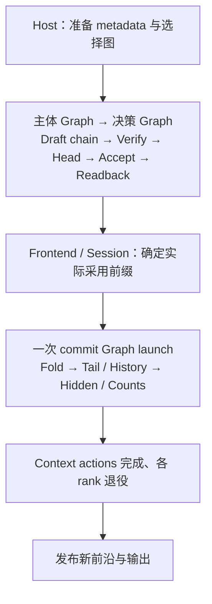

# GLM5Next Decode CUDA Graph 接入设计

本文定义完整 decode round 的图组装、上下文相关节点更新、固定资源与实施步骤。
图路径承接已有 eager Text、Vision 和 MTP 执行。

模型数学与数值表示由[模型参考](../../maintainer/glm5next-model.md)和
[量化参考](../../maintainer/glm5next-quantization.md)维护；MTP 配对、前沿和提交关系见
[MTP 设计](mtp.md)，attention 的选择与历史合同见 [Kpool Sparse MLA](kpool-sparse-mla.md)。
资源借用、目录发布和退役遵循[引擎架构](../../maintainer/engine-architecture.md)及
[Context 存储合同](../../maintainer/paged-kv-cache.md)。

## 1. 目标与执行边界

普通 decode 和 MTP 各保留完整计算主体图，采样/accept 使用独立的小图。
两者连续提交到同一 stream；无约束路径不新增同步或分布式消息。计算与 NCCL 通信一起捕获；
Indexer、Sparse MLA 使用图内可更新 child node，保留当前针对不同形状和上下文的分派。
Eager 与 Graph 调用同一份模型计算，不分别维护层循环和状态算法。

采用全局计算容量 G 与统一的本地 attention 容量 C 组织图。实际 owner 分布通过
Device 行映射表达；MLA 边界执行 pack、等长 AllGather 和 unpack，KDA、MoE、mHC、
head 保持全局 G 行。图目录按容量组合构建，不枚举 owner 数量向量。

| 路径 | 图内工作 | 图外边界 |
|---|---|---|
| 普通 decode | 主体：Device 输入、Main、canonical history、head；决策：采样与读回 | Host metadata、结果解释与提交 |
| 无约束 MTP | 主体：固定 K 步 draft、verify 输入、Main verify、head；决策：accept 与读回 | 前端确定真正采用的输出前缀 |
| 有约束 MTP | draft、draft 读回、完整 Main verify、head；mask 就绪后执行 decision 图 | Host grammar 计算 |
| MTP commit | KDA fold、Main tail、MTP candidate 采用与 history repair、hidden 保存、token counts 更新 | Context actions、退役与发布 |
| 单 token control | 复用普通主体图，关闭 head 节点；执行 Main 和必要的 history 维护 | 控制账本与 Context 生命周期 |
| Prefill、Replay、长 control、causal scoring、Vision encoder | 沿用 eager 执行 | 本阶段不捕获这些路径 |

普通 decode 和 MTP 都在主体之后提交 decision 图。需要 grammar 时，只有 decision
等待 mask；主体继续执行。媒体编码发生在 prefill，Vision 请求进入 decode 后使用
相同的图，不增加媒体类型变体。

无约束 MTP 的执行流程：



Commit 保持独立：accept 产生的候选可能被 EOS、输出预算或取消进一步截短。
模型状态必须按真正采用的数量提交；Host 结果返回也不等于最后的异步执行已经退役。

## 2. 所有权与文件组织

| 所有者 | 职责 |
|---|---|
| Frontend | grammar、输出语义及候选前缀的解释 |
| Session | Main/MTP 前沿、实际采用数量、Context 预留、事务与发布 |
| Executor / RankWorker | Work 与 decision/commit 分发、执行许可、全 rank 完成与错误处理 |
| RankProgram | G/C 容量选择、图目录、更新与回放；行映射、固定 frame、staging、stream、event 及借用生命周期 |
| execution | 模型数学、层顺序、全局/局部 Tensor 绑定、MLA pack/unpack 与通信交接 |
| Op | 实际 kernel 分派、支持范围、workspace、Graph 更新所需的执行标识与拓扑合同 |
| Core | CUDA Graph、event、stream 等通用资源封装 |

图 key 和 CUDA node handle 属于 Program，不写入 Work 或 Session。
模型只依据 Op 的公开合同组织输入，不复制 Op 的分派阈值或 kernel 名称。
Session 继续规划真实请求与 owner；padding 槽位仅是 Program 的执行存储，不拥有
请求身份、State 或 History，也不增加 ContextDirectory 的逻辑资源预留。

目标文件组织：

| 位置 | 内容 |
|---|---|
| `src/models/common/graph.{h,cpp}` | 从 Qwen4Exp 提取已有通用 GraphSegment，管理捕获、回放和通信统计 |
| `src/models/glm5next/program/graphs.{h,cpp}` | round/decision/commit 图目录、组装和局部节点更新 |
| `src/models/glm5next/program/graph_inputs.{h,cpp}` | 启动捕获所用的合法临时 Context 与 metadata |
| `src/models/glm5next/execution/{text,mtp,mla}.*` | 可共同用于 eager/capture 的 Device 计算边界 |
| `src/models/glm5next/execution/batch.h` 与 `program/inputs.cpp` | 区分全局 G 行与本地 C 槽位，准备行映射和有效 metadata |
| `src/models/glm5next/program/{frame,resources,planning}.*` | 固定存储、容量与生命周期 |
| `src/models/glm5next/startup.*` | probe、Graph 校准、正式准备与资源观察 |
| `src/ops/softmax_attention/kpool_mla/` | Indexer/MLA 执行标识与更新支持，沿用现有 target 分派 |
| `src/ops/indexing/` 与对应公共头 | State-field gather、带 Device 行选择的 BF16 pack/unpack 等数据搬运接口 |

公共 GraphSegment 仅提取现有跨模型机制；Qwen 的图目录、PLE/offload 组合继续由
Qwen 实现。GLM 不依赖 Qwen 私有的执行类。

## 3. 执行接口整理

### 3.1 Host preparation 与 Device round

将当前混合在 `forward()`、`prepare_mtp()`、`decide()` 中的职责整理为三段：

1. Host preparation：解析 Work，选择 G/C，确定真实行到局部槽位的映射，准备 metadata 并上传。
2. Device round：固定输入输出上的模型计算、通信、结果读回。
3. Completion/commit：解释完成事件，接收实际采用数量，提交状态并退役。

Device round 不依赖捕获时的请求对象。T/G/C 与执行模式属于静态调用形状；实际 B、
owner 数量、行映射、每行位置、有效数量、State offsets 和采样值由本轮 metadata 表达。
各 rank 根据同一 Work 和同一容量表确定 G/C，无需增加一轮分布式尺寸协商。

Main 的 head 投影属于计算结束部分，不等待 grammar mask；只有最终采样和接受判断
依赖 mask。Eager 与 Graph 共用这一组织。

### 3.2 MLA 的局部执行边界

在现有 MLA 实现内明确以下顺序：

```text
全局 G 行 → Pack 为本地 C 行
          → Prepare → Query projection → Indexer → Sparse MLA → Output projection
          → AllGather 为 R×C 槽位 → Unpack 为全局 G 行
```

execution 绑定这些操作所需的借用视图和 workspace scope。Program 能在 Indexer、
Sparse MLA 两处分别插入 child definition；eager 则调用相同的 Op。Pack、prepare、query/O
投影、通信和 unpack 留在主体图；局部 child 更新不新增 launch。

绑定过程不提交 kernel。TextRun 的输入、输出角色在绑定时就确定，不再依赖先执行
`stem()` 后交换 Tensor 才得到正确的 MLA 地址。局部图与外层执行使用同一布局函数，
不在 Program 再算一套临时 Tensor 偏移。

MTP 首步和后续步骤使用各自固定的输入、递归 hidden、tail slot。启用 selection reuse
时，后续步骤使用 query-only 路线并消费首步 selection，不为这些步骤添加 Indexer。

## 4. 容量、行映射与外层图变体

### 4.1 G/C 容量选择

设 R 为 ADP rank 数，B 为实际全局请求数，n_r 为 rank r 的 owner 行数，满足
`sum(n_r)=B`。Program 选择：

```text
G = global_bucket(B)
C = attention_bucket(max_r(n_r))
```

当前最大 B 为 8，两个容量表均保留 1..8，故 G=B、C=max(n_r)。扩大并发后，使用
有序容量桶保持小尺寸精确、大尺寸适度 padding；目录和 backing 规划共用同一容量表。
全局分桶只影响 G，不把 KDA、MoE、mHC、head 扩大到 R×C。

整个 round 固定 G/C，覆盖 draft、verify、decision 和 commit。不同 draft 步的有效
行数以及采用后的行数用 metadata 表达，不为每一步另选 C。实例全空闲时不运行图。
单 rank 时 C=G，可直接绑定相同布局并省去重排与通信。

### 4.2 Key 与 Device 数据

图目录只保留静态物理形状与数学主体的差异：

| 图 | Key | 内容 |
|---|---|---|
| 普通主体 | G/C | Main、history、可关闭的 head |
| MTP 主体 | G/C | 固定 K 步 draft、Main verify、head |
| 普通决策 | G | sample、读回 |
| MTP 决策 | G | accept、读回 |
| MTP commit | G/C | fold、tail、hidden/counts，可关闭的 history repair |

R、K、模型几何、表示、optimized head、selection reuse 在实例内固定。
采样模式、grammar、实际 draft 长度 D、是否 repair、owner 向量不进入 key。

Verify 的全局物理形状为 W×G，局部 MLA 为 W×C，其中 `W=K+1`。MTP 始终展开
配置的 K 步；每行的 `valid_columns` 和 `extents` 限定实际读写与接受范围。无效行
使用合法的 embedding ID，不推进 State、History 或 token counts。全零 draft 的普通
执行由 Session 的 Work 语义选择，不能由 Program 另造采样/深度变体。

Control 复用普通主体图并关闭 head。Commit 保留一份图，按本 rank 是否需要
history repair 启用相应节点；节点关闭不改变前后依赖，也不关闭 collective。Core
只提供 kernel/copy/memset section 的启停；段内数学和启停条件仍归模型 Program。

请求身份保留在 Host；行映射、State offsets、页表、positions、valid columns、
每行 extents/accepted counts、采样参数和 masks 是 Device 数据。上下文长度只影响
Indexer/MLA child 的执行标识。全部采用零列时不提交数学状态更新。

### 4.3 局部槽位与通信

全局行继续按 owner 紧凑排列，先有 B 个真实行；若 G>B，其余为全局 padding。
每个 rank 有 C 个局部槽位，前 n_r 个绑定本 rank 的真实行，其余无效。Program 准备
Device I32 行映射及相应 metadata：

- `local_to_global[C]`：本地槽位对应的全局行；无效槽位使用明确的无效标记。
- `global_to_gather[G]`：全局行对应的 AllGather 槽位 `r*C+j`；无效全局行不消费输出。
- 局部 C 行的 positions、valid columns、table rows、State offsets 和 record selectors。

每次 MLA 调用执行：

1. 从全局 `[H,T,G]` 按映射 pack 为连续 `[H,T,C]`，无效槽位输入置零。
2. 使用 T/C 物理形状计算本地 MLA；无效槽位的 valid columns 为零，不读写请求历史。
3. 各 rank 以相同 count 对 `[H,T,C]` 输出执行 AllGather，得到 `[H,T,C,R]`。
4. 按逆映射恢复 `[H,T,G]`，无效全局行置零，再进入全局 residual/mHC 或后续计算。

Pack/unpack 使用通用 indexing 数学接口；Op 不解释 rank、owner 或请求身份。
所有 padding staging 都有合法地址。不能以伪造 live State/Page 支撑空槽，数学 Op
必须在访问对应历史或字段前处理零有效长度；投影计算本身仍可能按完整 C 执行。

例如 B=8、owners=(6,2)，选择 G=8、C=6。两 rank 各有六个局部槽位，通信汇集十二个
槽位，再恢复八个有效行；(2,6) 直接复用同一图。B=8、owners=(4,4) 使用 C=4 的图。
没有本地 owner 的 rank 以全零有效长度执行既定图和通信，保持 collective 顺序。

各 rank 从同一 Work 选择共同容量，启动按相同目录顺序捕获。保持已有 compute 与
communication stream 依赖，捕获结束前重新汇流。Indexer/MLA child 仅包含本地 Op，
其上下文更新不改变 NCCL 的静态缓冲区、count 或参与者。

NCCL 要求参与同一次操作的 ranks 一致地捕获和回放对应图，见
[NCCL CUDA Graph 合同](https://docs.nvidia.com/deeplearning/nccl/user-guide/docs/usage/cudagraph.html)。

### 4.4 目录规模与成本

根据可达的 B、`ceil(B/R)<=max(n_r)<=B` 和容量表生成去重后的 G/C 组合。
构建过程不枚举 owner 向量、实际 D 或采样模式。容量组合上界为全局桶数乘本地桶数，rank 数
影响可达范围、通信与存储，不产生 owner 分布的组合增长。

以 G 保留每个实际 B、C 在 1..8 精确而之后使用 16/32/64 桶为例，仅容量组合数量为：

| 最大 B | ADP ranks | G/C 组合数 |
|---:|---:|---:|
| 8 | 2 | 24 |
| 8 | 4 | 32 |
| 64 | 2 | 148 |
| 64 | 4 | 252 |

最大并发 8、ADP2、MTP3 时，每 rank 共 88 个 executable：24×2 个主体、
24 个 commit、8×2 个决策。K 改变主体的节点数，不增加 executable 数。Indexer/MLA
child definition 不单独 instantiate。

表中较大规模用于说明容量增长，不固定未来的调优桶。Graph 校准构建实际配置的完整
目录。局部定义只保留当前更新所需对象，不随历史长度累积。

主要成本为 MLA 空槽计算、pack/unpack 与填充通信。通信逻辑 payload 的填充系数为
`R*C/B`，不等于延迟倍数；当前双机默认使用等长 AllGather。KDA、MoE、mHC、head
只承担自身 G 桶的计算，不处理 ADP 额外的 R×C 空槽。后续改变通信实现时，保持
“owner 唯一输出恢复为全局 G 行”的边界，当前不增加多套通信策略的自动选择。

这一容量规整方法参考了
[SGLang DP attention 的 MAX_LEN](https://github.com/sgl-project/sglang/blob/main/python/sglang/srt/layers/dp_attention.py)
及 [vLLM 的 DP Graph 尺寸协调](https://docs.vllm.ai/en/latest/api/vllm/v1/worker/gpu/dp_utils/)。
GLM 的全局与局部计算通过上述边界连接，padding 范围限定在相应执行容量内。

## 5. Indexer / Sparse MLA 节点更新

### 5.1 既有基础与变化项

当前 Indexer 对固定 T/B 保留固定数量的 Graph slots，每个 slot 四个 kernel node，
不足的实际工作用 idle kernel 补齐。Sparse MLA 保留 factor、attention、merge、factor
的节点结构。节点数量与 T/B 有关，不能把整个调用一概视作四个节点。
这里 Op 接口的 B 对应本地容量 C；实际 n_r 变化只更新 metadata。

上下文变化仍会改变以下捕获参数：

| Op | 变化内容 |
|---|---|
| Indexer | score pitch、partition/merge 数、workspace 子区域、kernel specialization、grid |
| Sparse MLA | attention 路线、tile、split 数、临时布局、kernel specialization、grid |

现有独立 Op Graph 更新测试可作为基础；模型还需验证它们嵌入外层 executable 后的
child 更新。CUDA 要求对应 child 的拓扑、节点类型和插入顺序匹配，更新还受 kernel
与属性限制，不能只检查节点数量。见
[cudaGraphExecChildGraphNodeSetParams](https://docs.nvidia.com/cuda/cuda-runtime-api/cuda_runtime_api/group__CUDART__GRAPH.html)。

### 5.2 Op 提供执行标识

在 Kpool 公共接口中为 Indexer 和 Sparse MLA 分别增加 Graph profile 查询。查询消费
现有 profile、storage（适用时）、envelope、固定 T/C 和设备信息；调用实际执行使用的
planner/selector，返回只用于精确相等比较的标识。

合同为：在其他绑定不变时，标识相等表示可复用当前捕获的 kernel、launch 参数和
scratch 布局；标识变化要求更新。标识覆盖所有影响捕获的派生字段，不只包含路线名，
也不使用可能碰撞的短 hash 作为唯一相等依据。调用方不读取内部字段或推导阈值。

数学执行、workspace 容量查询和 Graph profile 查询共用 Op 内部规划来源。
后续 target 调优只修改 Op 的 planner/selector，不要求模型同步修改上下文区间。

### 5.3 回放更新流程

每个 attention 调用位置分别保存 Indexer/MLA child handle 与已安装标识：

1. 从本轮实际有效行得到该调用的可见长度上界。
2. 查询 Op 执行标识；相等时直接复用。
3. 变化时，在同一组固定 Tensor 与 workspace backing 上捕获对应局部定义。
4. 用 `update_child` 更新外层 executable；只有成功后更新已安装标识。
5. 启动外层图，局部节点随其执行，不另做 attention graph launch。

原始外层 definition 随 executable 保留，保证 child handle 有效。替换用 definition
在更新完成后可释放。运行期不新增外层 executable，也不按上下文重新申请 Device
backing；局部 capture/update 的成本单独观察。

更新在 Program 的串行控制路径执行，并遵守当前 frame 的借用与退役关系。失败由
Graph/Op 保留原始原因，Program 补充调用位置和形状，走已有执行失败清理。

### 5.4 可见长度与 workspace

Main 使用本 rank 所拥有行的有效可见长度上界；每个 draft 步单独使用该步有效行的
MTP 上界。不能把全局最长 Main verify 的 envelope 无条件传给所有本地调用。
上下文缩短或切换请求时也重新查询标识，恢复对应的小上下文优化路线。
无效局部槽位不贡献 envelope；整个本地调用无有效列时使用零上界，仍保留相同 T/C
拓扑。C 改变时选择对应外层图，不把跨 C 的拓扑变化伪装成上下文 child 更新。

MTP selection reuse 保留首步 IDs/count/selection_end。之后 query ordinal 变化不推进
冻结 E，也不重新运行 Indexer。执行 envelope 只是资源与分派上界，不替代实际的 E。

固定 workspace 需要覆盖目录内所有形状和合法 profile 的峰值，包括变化后的
scratch 地址、局部 T/C 和全局 T/G 形状以及非单调路线；峰值由 Op 容量查询提供。
模型不以某一个捕获时观测峰值替代完整容量合同，也不直接套用 Qwen 的上下文分桶。

## 6. 固定输入、状态与 decision

### 6.1 Metadata 与 State 搬运

页表矩阵、State backing、frame、workspace 和权重在正式准备后保持地址稳定。
请求恢复、COW、owner 迁移及新的 State 绑定通过 Device offsets/表项生效。
Sparse MLA 的 TMA descriptor 引用最终 backing 的基址与容量，正式图不沿用 probe descriptor。

将 Main/MTP metadata 整理为少量固定上传区域；Host 完整准备后再提交 H2D。
共享字段只保存一份，draft 步只保存确实不同的 IDs、positions 和有效长度。
Pinned 源在传输完成前保持不变；Device 槽位在其消费者退役前不复用。

全局与本地 frame 分工如下：

| 数据 | 执行域 |
|---|---|
| Main hidden、递归 MTP hidden、head/采样结果、KDA records | 全局 G 行 |
| Main MLA raw records、MTP candidate/递归 tail、冻结 selection | 本 rank 的 C 槽位 |
| MLA 输入/输出与 AllGather 临时激活 | C、R×C 与 G 之间转换，按最后一次消费复用 |

行映射在整个 round 与 commit 期间冻结。Main verify 按局部槽位写 raw records；commit
将实际全局 accepted counts 映射到 C 槽位后执行 tail 提取与 MTP history repair。
KDA fold、全局 hidden 保存和 token counts 更新仍消费全局行的采用数量。
History repair 的真实 conditioning、IDs 和 positions 同样经过映射，不能把局部 slot
当作全局行号。Selection reuse 始终引用本地冻结 selection 的同一槽位。

Pack/unpack 激活 staging 在顺序执行的层和图之间共享，records/selection/tail 则保持
到最后一次 verify/commit 消费。空槽不发布结果、不推进前沿、不修改 canonical counts；
资源统计中的请求数、处理与接受 token 数均来自真实有效行，不使用 G 或 R×C 代替。

在 indexing family 增加与 State-field scatter 对称的 gather：按 Device I64 offsets
读取字段到连续输出，按明确的有效行输入处理空行，逐位复制 BF16。用于 previous Main
hidden 与 MTP canonical seed，替换捕获请求实际地址的逐行 memcpy。

首 token、零有效配对、source/destination 不同等情况通过 Device metadata 表达。
特别是 history prepare 不写入的空行，也要正确保留 canonical tail；不能依赖捕获时
恰好 source==destination。source 与 destination 的写权限仍遵守已有 State 合同。

MTP 首步 candidate tail 单独保存，后续递归 tail 使用固定槽位；selection 和 Main
records 保持到对应最后一次消费完成。Commit 按实际采用数量执行 fold、tail 提取、
candidate 采用和必要的真实 hidden history repair，再保存最终 Main hidden。

### 6.2 采样数据

Proposal 的 greedy 配置与有效物理行参数固定独立保存。请求采样配置、mask 指针、
token-count 引用通过固定 Device 配置数组传入，不捕获 Host 请求对象。
目标词表统一 Top20 候选与 AllGather；实际 greedy/随机采样由 Device 配置决定。
Draft proposal 保持固定 greedy/MAX 路线。普通决策和 MTP acceptance 共享公共分布式
词表计算，buffer 与其生命周期仍由模型 Program 持有。
Acceptance 修改独立的临时 frontier，不修改本轮不可变的 base positions。

分布式 vocabulary acceptance 对已提交 token counts 是只读的，直接引用稳定数组，
删除当前整份词表计数的复制。单 rank acceptance 会修改临时 counts，保留独立 scratch，
以 Device lane 选择初始化，不能把这条路径改成直接修改 canonical counts。

### 6.3 约束 MTP

```text
计算图：Draft chain → Draft D2H → external ready event → Main verify → Head
Host：                            获取 Draft → 生成 grammar masks
决策图：                          计算与 masks 就绪 → Accept → Readback
```

中途 draft-ready event 使用可在图外观察的 external event node。Host 读取只覆盖
实际 draft prefix 的 pinned 输出，并可与 target 计算重叠；无约束路径关闭 D2H 节点。
External event 保留在主体图，不因该次是否读回而复制主体。

沿用 `DecisionNeeded/DecisionInput/DecisionConsumed`。上传已提交不等于 staging 可立即
复用；Program 保持输入借用到传输完成。完成事件按本轮执行阶段消费，不能把上一轮
ready 状态当作本轮结果。Target 输出也保留到 decision 图完成。

## 7. 启动、计费与销毁

复用现有 RankPreparation 阶段：

```text
Materialize → PrepareProbe → Calibrate → Allocate
            → PrepareExecution → CheckMemory → Activate
```

Probe 与正式准备使用同一个 G/C 图目录、最大 K、模型表示及通信结构。
Probe 只申请少量合法 State/page，保留完整固定执行表与 workspace 容量；每个可能
实际读写的位置必须有效，写入不能与不应修改的历史 alias。无需物化最大上下文历史。
Probe 的行映射与真实行数量一致，不把所有 R×C 槽位都标成真实请求。

固定资源单独计入 local metadata、pack/unpack 与通信 staging、局部 records/tail。
这些资源按目录的最大所需容量准备，跨图复用，不乘图对象数量；Context Pool 的逻辑
State/Page 需求继续按真实请求计算。Graph 对象自身的占用由实际目录校准。

校准分别记录准备前、图就绪、图释放后的内存：

- 准备增量：图与相关惰性资源带来的增长。
- 释放后保留量：CUDA/module 等仍驻留的资源。
- 重建估计：图就绪相对释放后的额外占用。

释放 probe 后重新观察可用容量，再扣除重建估计确定正式 Context Pool。已驻留的
开销体现在新快照里，不重复扣除。正式构建记录真实占用并走已有最终检查和容量纠偏。
公共资源报告保留这些含义，不增加手工固定的 GLM Graph 预算。

图目录在启动阶段实例化与上传；预热覆盖实际首次使用的计算和通信资源。
回放通过公共 GraphSegment 记录真实通信工作，不把捕获时的调用再次计为执行。
结果与 retirement 计时覆盖实际图回放；需要图内阶段耗时时使用已有 event 机制，
不增加阶段间同步。

销毁顺序：停止新提交，解析或丢弃未决事务，退役 compute/communication 和所有读回，
释放 executable/definition，再释放 frame、Context、workspace、参数和权重。
启动捕获或节点更新失败也由这些 owner 完成清理。

## 8. 实施步骤

### S1：整理可捕获的 Device 执行体

- 分开 Host preparation、Device round 和 completion/commit；eager 调用同一实现。
- 稳定 TextRun/MtpRun 的 Tensor 角色，区分全局 G 与局部 C，提供 MLA 调用边界。
- 实现行映射、pack/AllGather/unpack，接通局部 records/tail 与全局提交数量的映射。
- 补齐 State gather，整理 metadata、空槽合同和采样 counts 的使用。
- 提取通用 GraphSegment；保持模型特有图目录独立。

产出：完整 eager 行为继续成立，Device 计算不捕获请求身份或 Host 地址分支。
复用已有数值/事务测试检查重排、空槽、首次配对、部分提交与独立 source/destination。
数据搬运逐位保持表示；数学计算按 Op 精度合同验收，允许不同物理形状选择不同实现。

### S2：完整普通 decode 与局部更新

- 实现 Op Graph profile 查询及嵌入外层图的 child 更新。
- 建立 G/C 主体目录与按 G 保存的决策图；control 关闭 head，owner 分布只更新 metadata。
- 接通 probe、校准、正式图准备与资源报告。
- 验证同一 G/C 下交换 owner、空 rank、混合上下文，以及跨 C 和上下文缩短时的选择。

产出：普通 decode 使用主体和决策两次连续回放；长度变化保留主体 executable。

### S3：MTP、约束决策与 commit

- 捕获固定 K 的 draft→verify 主体，accept 单独捕获；支持不同每行 extents。
- 整轮保持 G/C 与行映射，验证本地 frozen selection、candidate 和 records 的提交对应。
- 加入 draft-ready event、decision 图及与 target 重叠的 grammar 交接。
- 捕获一份 commit，按需启停 history repair 节点；维持 Context actions 和发布边界。
- 贯通全零 draft、部分接受、输出截短、取消与 Vision 续接。

产出：已支持的 decode/MTP 路径按语义使用完整 round/decision/commit 图；继续保持
canonical frontier、frozen selection 与 ReplaySSM records 的现有合同。

### S4：统一审查与验收

本机与 Spark 完整构建。复用现有 Op 独立数学参考，验证嵌入图后不同 kernel 路线、
split、scratch 布局及零有效行；覆盖增长和缩短，不只验证长上下文方向。
行映射测试覆盖 (6,2)↔(2,6)、平衡与偏斜分布、空 owner 和槽位复用；确认 padding
不访问真实请求的 State/Page，ADP 空槽不扩大全局 MoE 行域，目录的真实资源需求不变。
Eager/Graph 一致性用于检查组装与生命周期，不代替数值参考。

双 Spark 实际 GLM 推理覆盖普通/MTP、混合 extents、greedy/随机/约束、不同 owner
分布、部分提交、丢弃、恢复/迁移及 Vision 后续 decode。复用既有事务与真实入口，
重点验证同一 executable 在改变页表与 State offsets 后使用新绑定。

性能先固定相同权重、KV 类型、输入、采样、head、K 与上下文配置，保留修改前 eager
的代表点证据，分别观察布局调整后的 eager 成本与 Graph 回放收益。以稳定
`ms/decode step` 为主，测 B=1/4/8、MTP3，并补普通 decode 与较长 draft 的代表点；
分别看常用和长上下文以及平衡/偏斜分布。报告计算、commit、pack/unpack、填充通信、
局部更新成本，以及图数量、启动时间和 Graph 占用。
首次准备与稳定回放分开，不以接受率变化代替执行效率结论。

完成条件是：数值与状态合同成立；支持的 decode 没有逐层 Host launch 或按上下文
重建整图；资源有界且计费正确；实际数据足以说明稳定回放及节点切换的成本。
