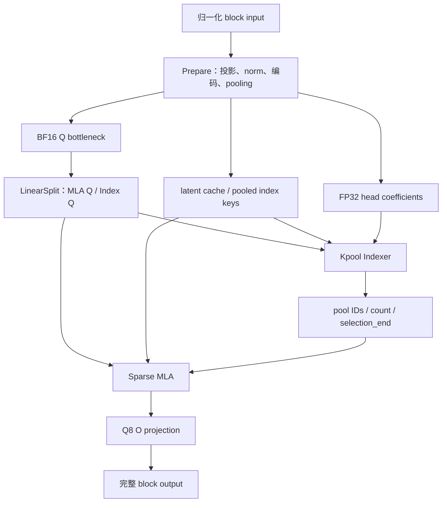
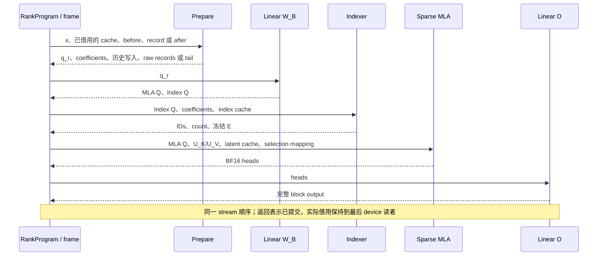

# Kpool Sparse MLA 计算链与 Op 设计

本文维护 GLM5Next Kpool Sparse MLA 的权重绑定、存储规划、调用链与实现组织。
公共计算合同在 [kpool_mla.h](../../../include/ninfer/ops/kpool_mla.h)，资源规划合同
在 [kpool_mla_layout.h](../../../include/ninfer/ops/kpool_mla_layout.h)。语义以头文件
为准，本文不维护第二份函数声明。DGX Spark 的 BF16 计算链和布局已实现；FP8
计算与模型集成仍待完成，逐点 roofline 状态见 [MLA 清单](mla-checklist.md)。
模型数学以[模型参考](../../maintainer/glm5next-model.md#4-sparse-mla-与-kpool4-indexer)为准，
表示与精度以[数值约定](../../maintainer/glm5next-quantization.md#3-mlaindexer-cache-与计算政策)为准。

## 1. Family 边界与几何

本 family 与 QSA 平行，位于 SoftmaxAttention 下。共同边界是：Prepare 产生历史，
Indexer 产生选择，Attention 直接消费选择；状态出口明确区分 update 与 record，
接受前缀另由 tail 提取完成。每个公开 Op 有完整数学和写域，可以独立调用、验证和调优。

| 归属 | 负责内容 |
|---|---|
| Kpool MLA family | 准备投影＋norm＋历史写入、learned pooling、加权评分与选择、完整 sparse MLA、tail 提取 |
| Linear family | Q bottleneck 之后的 Q_b／Index Q 合并投影，以及最终 O projection |
| Core 容器 | 逻辑页组、存储 planes、StateImage 字段、布局与非 owning views |
| 模型计算组织 | Op 顺序、投影需求、MTP selection 复用、完整分支输出的通信交接 |
| Session／ContextDirectory | owner、源与目标身份、页预留与 COW、前沿采用、checkpoint 与资源保护 |

Op 不分配页、不选择请求 owner、不决定接受长度，也不发布模型前沿。
接口只接收数学输入、借用的资源和明确 metadata；实现约束由对应 Op 校验和报告。
所有权沿用[Engine 架构](../../maintainer/engine-architecture.md)、
[Paged KV context store](../../maintainer/paged-kv-cache.md)和[Op 开发规范](../../maintainer/op-development.md)。

首个实例的参数如下。模型从 config／权重绑定得到实际参数，Op 判断是否支持；
不在 Engine 或模型入口复制下层支持规则。

| 参数 | 当前值 |
|---|---:|
| 输入 hidden H / Q bottleneck Rq | 4096 / 1536 |
| MLA heads Hq / QK 维度 Dq / V 维度 Dv | 64 / 256 / 256 |
| latent 维度 Dc | 512 |
| Indexer heads Hi / key 维度 Di | 32 / 128 |
| pool size / selected pools | 4 / 512 |
| page tokens / 最大原 token 上下文 | 64 / 1048576 |
| 本轮支持的本地 batch | B=1..8；T 为正物理宽度 |
| 使用位置 | Main 11 层、MTP 1 层，各层独立历史内容和 selection |
| 双 Spark 放置 | 一个 DP 副本内 MLA／Indexer 按请求 ADP2，owner 执行完整 heads |

当前为 NoPE，没有 MLA 或 Indexer RoPE。已实现的 Main/MTP 计算使用 BF16 latent；
Indexer、raw tail、raw records 固定 BF16。E4M3FN-G128-FP32-scale latent 已有布局规划，
但 Prepare encoder 和 MLA decoder 尚未实现；此 profile 的后续计算仍采用 BF16
操作数／FP32 累加。布局可表达性不表示执行支持。

## 2. 权重、投影与执行链

矩阵按逻辑 `W[N,K]` 表示；native Tensor 第零维连续，`M=T*B, m=t+T*b`。
x 是分支 input norm 之后的 BF16 `[H,T,B]`，本 family 不重复执行 input norm。
Main 的四流 residual 由 mHC 持有，不传入本 family。

### 2.1 合并权重与连续前缀

准备投影为 BF16 contiguous parent `W_A[2336,4096]`：

| 行区间 | 源角色 | 用途 |
|---|---|---|
| `[0,512)` | `kv_a_proj_with_mqa` | latent，512 维 RMSNorm |
| `[512,640)` | `indexer.wk` | raw index key，128 维 affine LayerNorm |
| `[640,768)` | `index_kpool_compress_gate` | raw pool gate |
| `[768,2304)` | `q_a_proj` | Q bottleneck，1536 维 RMSNorm |
| `[2304,2336)` | `indexer.weights_proj` | FP32 raw head coefficients |

按逻辑宽度，行序为 `[latent:Dc | index K:Di | pool gate:Di | Q_a:Rq | coefficients:Hi]`。
最后 Hi 行不包含 sigmoid、softmax、query scale 或 `1/sqrt(Hi)`。

| 投影需求 | W_A view | 公开 query 输出 | 使用位置 |
|---|---|---|---|
| Full | `[0,2336)` | q_r、head_coeff | 普通计算、MTP draft 首步 |
| QueryAndHistory | `[0,2304)` | q_r | 复用 selection 的 MTP 步骤 |
| History | `[0,768)` | 无 | canonical MTP history 更新 |

三个需求都生成 latent、raw index K、raw gate 并维护相同历史。History 三段投影在
一次 Prepare 中完成；只读 view 共享同一 parent，不复制驻留权重、不在执行期 packing。
使用位置显式选择投影需求，Op 不根据 prefill/decode/draft 阶段推断需求。

Q 投影为 BF16 contiguous `W_B[20480,1536]`，前 16384 行为 MLA Q_b，后 4096 行
为 Index Q。LinearSplit 直接写出两份连续输出；复用 selection 时只使用 MLA Q 前缀。

KV_b 按 head 拆为 U_K/U_V：各 head 逻辑 `[256,512]`，native BF16 `[512,256,64]`，
latent 轴连续。源 KV_b 每个 head 的行序为 `[K256,V256]`，converter 保值拆分。
保留因子表示，不与 Q_b/O 相乘生成更大的权重。

`W_O[4096,16384]` 为独立 Q8-G32/FP16 Linear，计算许可 `A16Only`。
W_A、W_B、U_K/U_V、norm gain/bias 和 pool APE 保留源 BF16 words。
Gamma 使用直接 gain；APE native 布局为 `[128,4]`。

### 2.2 完整数据流



| 数据 | Native 形状与表示 |
|---|---|
| x / block output | BF16 `[4096,T,B]` |
| q_r | BF16 `[1536,T,B]` |
| head_coeff | FP32 `[32,T,B]` |
| MLA query / attention output | BF16 `[256,64,T,B]` |
| Index query | BF16 `[128,32,T,B]` |

Prepare 包含 projection、norm、编码和状态写入，直接消费投影的 FP32 结果；
普通 Linear 的 BF16 出口不是其内部必经表示。U_K 映射、latent attention、U_V
映射同属完整 Sparse MLA Op；q_latent、softmax partial 和 latent result 保持私有。
W_B 与 W_O 的纯投影继续由 Linear 承担。

## 3. 历史存储与页布局

Kpool 只压缩 Indexer key。主 MLA 每 token 保留一个 512 维 latent，所有 heads
共用；不保存展开的 K/V。完整 pooled keys 属于 growing history，未完成 pool 的
raw K/gate 属于定长 StateImage。两类状态使用相同原 token frontier。

### 3.1 共享逻辑页组

每页 P=64 个原 tokens、16 个完整 pools。单层 page-major planes：

| Plane | Native Tensor | tokens_per_row |
|---|---|---:|
| BF16 latent | BF16 `[512,64,1]` | 1 |
| 或 FP8 latent codes | E4M3FN `[512,64,1]` | 1 |
| FP8 latent scales | FP32 `[4,64,1]` | 1 |
| pooled index keys | BF16 `[128,16,1]` | 4 |

只实例化所选 latent profile。Plane 基址为 256 B 对齐；页内紧密排列，latent row
stride 为 1024/512 B，scale row 为 16 B，index row 为 256 B。同一逻辑页的全部层
按 layer 顺序、每层按表中所选 planes 顺序打包成一份 256 B 对齐记录，scales 不插在
latent rows 之间。
记录内偏移和总大小统一由 `plan_kv_page_layout()` 产生；记录之间可以离散放置。

Main 的 11 层共享一个逻辑 history pool，MTP 层使用另一个。二者的 page namespace、
执行表、frontier 独立；每个 history pool 内全部层及 planes 共用 page-group ID，
统一 reserve、保护、截短和释放。它们与 State 共同使用 owner rank 的 Context 容量，
不各自划定物理配额；四 token 的 Kpool 分组则是 Indexer 的数学分组。

现有 [KVPlaneGeometry](../../../src/core/paged_kv_geometry.h) 的 `tokens_per_row=1/4`
可承载以上布局。Core 管理存储几何，消费者使用专门的 latent/index typed views。

### 3.2 四 token 连续读取

page_offsets 为 Device I64 `[logical_pages,table_rows]`，条目是相对 Context backing
的 byte offset；页项连续，行跨度显式。选中 logical pool g 时：

```text
logical_page  = g / 16
pool_in_page  = g % 16
record_offset = page_offsets[logical_page, table_rows[b]]
index row     = pool_in_page
latent rows   = 4*pool_in_page + {0,1,2,3}
```

一次页表寻址定位四条连续 latent，不跨页。四 token payload 为 BF16 4096 B，或
FP8 codes 2048 B＋另一 plane 的 64 B scales。Selection 保留 pool IDs，消费者直接
按组加载，不先展开 token IDs 或构造全局 gather buffer。未完成 tail 按有效数 mask。
实际地址为 `arena + record_offset + plane_offset + row*row_stride + feature_offset`。
固定层的跨页地址必须读取映射，不能按单层 payload 或整个 backing 容量外推。

### 3.3 Latent codec 与后续 FP8

使用[已定 codec](../../maintainer/glm5next-quantization.md#3-mlaindexer-cache-与计算政策)：
BF16 每 token 为 1024 B；FP8 每 token 为 512 个 codes＋4 个 FP32 scales，共 528 B。
FP8 分组沿每 token 连续 128 维，不跨 token 共享 scale，无 Hadamard 或基底旋转。

后续 FP8 encoder 消费 FP32 RMSNorm 结果，前面不插入 BF16 舍入。Consumer 在片上按实际
code/scale 解码为 BF16 operand，同一 operand 同时服务 QK 和 latent 加权累加。
当前窗口的新 token 也经过同一编码／解码边界。精确舍入、零和极小值规则只在数值
文档维护；实现时 Prepare 与 MLA 应使用同一 codec。

## 4. 公共 views 与身份

类型、公式、读写域和 alias 规则以 [kpool_mla.h](../../../include/ninfer/ops/kpool_mla.h)
为唯一接口来源。接口把借用资源分成四组：

| 资源 | 类型／语义 | 创建与存活 |
|---|---|---|
| Growing history | `KpoolMlaCacheView` 的 latent／index planes，消费者使用对应 Const view | RankProgram backing＋目录页借用；覆盖后续 query 与 checkpoint |
| Raw tail | `KpoolTailStateView`／`ConstKpoolTailStateView` 的 K/gate 字段 | Canonical 位于 StateImage；provisional 可位于 frame；由各自 owner 保持 |
| 本轮实际记录 | `KpoolRawRecordWriteView`／`KpoolRawRecordReadView` | Frame 保持到接受结果和 tail 提取退役 |
| 选择结果 | `KpoolBlockSelection` 的 IDs/count/E | Frame 保持到最后一次 Sparse MLA 消费；MTP 复用期间冻结 |

Batch 中的 token ordinal、page-table row，State 的 I64 byte offset，以及 frame 的
record row／selection row 是不同身份，不互相推导。`KpoolMlaBatchView` 接收 Device
positions/valid_columns/table_rows；`KpoolExecutionEnvelope` 只是 Host 资源上界。
没有本地任务可以不调用，固定 Graph 中则用零有效长度表达空行。

### 4.1 单层和多层 tail

同一 tail view 的两个 `StateFieldView` 同时描述字段和层数。Prepare 使用
`tail.layer(l)`，extract 使用完整多层 view；不再设置一组平行的 AllLayers 类型。
层数取自字段布局。Source/destination 可以有不同 backing 与布局，按各自 offsets
寻址；绑定 frame 中的暂存字段不要求申请完整模型 StateImage 或 StateId。

### 4.2 Raw records

读取视图为两份 BF16 `[Di,W,R,L]`；W 为窗口容量、R 为 record 行容量、L 为层数。
四个轴直接表达几何；紧密布局的物理 outer index 为 `layer*R+b`。
允许正且不重叠的显式外层 strides。R 不是当前活动 B，满足 `1<=B<=R<=8`。

Prepare 取一个 layer 的前 B 行作为 `[Di,W,B]` 写视图。每行的 base position、
available prefix 和本次 write offset 由 frame 管理；本轮所有 layers 共享这组
metadata。生产期间和等待接受结果期间，record 行身份固定。后续批次压缩不能
改变这份在途 records 的解释。

### 4.3 Selection 与复用映射

Selection 是独立的二维表：IDs `[512,Nselection]`，count/E 各 `[Nselection]`。
Indexer 的输出行数为 `T*B`，行号 `m=t+T*b`；consumer 单独接收
`selection_rows[T,B]`。普通调用用自身行号，MTP 后续步骤可以映射到仍存活的首步行。

Logical pool IDs 不含 physical page 地址，搬迁后无需重写 IDs。一次消费者的地址
借用覆盖实际执行，后续消费者读取已更新的页表。Selection 不携带请求／层身份；
模型负责将其与正确 cache 配对，不能跨请求或跨层误用。

## 5. Prepare 的两个状态出口

`kpool_mla_prepare_record/update` 共用头文件中的完整数学合同。第 2 节的投影需求
与状态出口是两个独立维度，合计六种合法组合：

| 出口 | Before | 新历史 | 对外 raw records | After |
|---|---|---|---|---|
| record | 只读 | 写入 caller 提供的可写页 | 发布本轮实际 K/gate words | 无 |
| update | 读取必要旧 tail | 写入 caller 提供的可写页 | 无 | 发布本次结束位置的 tail |

record 适合后续需要选择已接受前缀的窗口；update 适合已确定输入或独立 provisional
目标。它们不替调用方决定哪些内容可采用。对暂存位置的物理写入不扩大逻辑 coverage。

Prepare 输出的 q_r/head_coeff 与 raw records 是可观察出口；projection 的 FP32
结果、norm staging 和 update 内部 raw buffers 属于私有实现。融合时保留实际 raw
BF16 边界，避免给 norm 输入增加一次 BF16 落点。当前实现组织见第 11 节。

## 6. Indexer 的交接

`kpool_indexer` 消费 Index Q、FP32 head coefficients 和只读 index plane，发布
IDs/count/E。评分、精确选择、全选及无效行合同在头文件中维护；它不读取 latent，
不输出 attention bias，也不替 Sparse MLA 展开 token IDs。

Consumer 同流直接消费这些输出。Indexer workspace 结束后可复用；selection 必须
独立于 workspace，MTP 后续步骤仍需它。其 E 是本次选择的冻结边界，不随 query
新位置或历史追加而变化。

## 7. Sparse MLA 的完整边界

`kpool_sparse_mla` 接收 query、U_K/U_V、只读 latent planes、selection 和显式
selection-row 映射，输出完整 BF16 heads。U_K 映射、latent attention、必要的
分片归并和 U_V 映射都在同一 Op 内，不分别暴露成模型调用。

冻结 E 决定 incomplete tail 的范围。例如 E=10，仅含 tail tokens 8、9；后续
位置为 10、11 的 query 复用该行时，不能自动加入新 token。Attention 使用的
latent tail 与 Prepare pooling 所需的 raw tail 是不同资源，MLA 不接收 raw tail。

Indexer score 仅决定集合，O projection 独立执行。q_latent/u、softmax partial、
解码 tile 是私有资源，workspace 查询负责完整覆盖，不由模型计算其尺寸。

## 8. 接受前缀与 growing history

`kpool_tail_extract` 的 word-copy／零填充公式和零接受行为已进入公共头。每次可
处理一个层集合；before/after 与 records 的 L 对齐，Main/MTP 的不同 frontier
分别处理。零接受行不复制到新 image，调用方继续采用原来源。

F1=F0+a 处的有效历史是：

```text
latent      : [0,F1)
pooled keys : [0,floor(F1/4))
raw tail    : [4*floor(F1/4),F1)
```

例如从 F0=63 准备到 69、只采用到 65：[60,64) 的 pool 有效；[64,68) 即使已经
物理写入也不可见；新 tail 只保存位置 64 的实际 raw words。Rejected suffix 不
扩大 coverage，后续续写在具有写权限且旧读者退役后覆盖它。

Checkpoint 同时保留对应 growing prefixes、tail 和其他模型状态。页共享、COW、
读者保护、预留、table 更新和 frontier 发布由 Session／ContextDirectory 协调；
仅截短 cache 不能恢复非四 token 边界的 raw tail。

## 9. MTP、ADP 与模型交接

Main/MTP history 和 tail 分离、请求 owner 相同。本实例 Main 各 MLA 层独立选择，
不跨层共享 selection。一轮 MTP draft 的调用为：

| 位置 | Prepare | W_B | Indexer／selection |
|---|---|---|---|
| 首步 | Full | MLA Q＋Index Q | 产生新 selection |
| 后续步骤 | QueryAndHistory | 仅 MLA Q 前缀 | 复用首步 IDs、count 和 E |
| canonical history 更新 | History | 不执行 | 不执行 |

复用步骤仍维护 provisional latent、pooled keys 和 tail。Frozen selection 及其
映射不能被覆盖，被引用的 cache 历史保持到最后消费者完成。复用不按新位置追加 tail。

Canonical MTP history 使用真实 Main conditioning；递归 draft hidden 不因 token
被接受就成为真实 Main hidden。需要重建的部分从真实 conditioning 经过 stem 与
input norm，再用 W_A 前 768 行一次产生历史；不执行 Q、attention、FFN 或 head。
模型负责 token/conditioning 对应关系及 Main/MTP ordinal，Op 只消费已提供的输入。

完整的输入移位、跨 chunk 配对、首步真实 conditioning 历史的采用，以及其余
canonical history 的补齐由 [MTP 执行设计](mtp.md#6-各种执行情况)规定。

| 所有者 | 资源与决策 |
|---|---|
| ModelShard／Parameters | 不可变权重、已绑定 views、模型数值参数 |
| RankProgram | cache/state backing、frame、records、selection、scratch、Graph 与执行依赖 |
| 模型 Session／目录 | 请求 owner、source/destination、采用长度、frontier、checkpoint 和读写权限 |
| Ops | 已给定 views 上的数学与状态写入，自己的能力校验和路线选择 |

MLA owner 完成 O projection 后，模型把完整 `[4096,T,B]` 输出交给后续 TP/EP 或
mHC／普通 residual。Op 不携带 rank、world size 或 communicator；并行放置和通信
边界见[双 Spark 分工](parallel.md#1-首版并行分工)。

## 10. 内存规划、链路寿命与 Graph

### 10.1 三类布局和一类 workspace

[kpool_mla_layout.h](../../../include/ninfer/ops/kpool_mla_layout.h) 提供 Host-only 规划／
绑定接口。它们不分配 backing、不读 Device payload，不根据模型名称推断层数：

| 入口 | 规划结果 | 调用方怎样组合 |
|---|---|---|
| `plan_kpool_mla_cache_layout(spec)` | 多层 `KVPageLayout`＋layer 绑定 | 作为 History 的页记录几何；分配／映射后调用 `layout.layer(records,l)` |
| `append_kpool_tail_fields(builder,Di,L)` | 两个 StateField IDs | 加入完整 StateImage 或独立 frame tail schema；用 Core field view 绑定 |
| `plan_kpool_raw_records(builder,Di,W,R,L)` | 两份 `[Di,W,R,L]` TensorRegion | 加入 frame LayoutBuilder；`write_view/read_view` 绑定相同 regions |
| `plan_kpool_block_selection(builder,N)` | IDs/count/E 的三个 TensorRegion | 加入 frame LayoutBuilder；`bind` 后供 Indexer 写、MLA 读 |

Cache planner 使用 `plan_kv_page_layout()`，不重写对齐／溢出算法；State planner
使用 `StateImageBuilder`，frame planner 使用 `LayoutBuilder`。Plan 接受无地址几何，
bind 才取得 residency。模型不手算 plane 偏移、不另建一套 byte-size 公式。
布局能被表达与 kernel 能执行是两个事实；后者由 Op 及其 workspace 查询判断。

当前实例的主要容量如下，均不含目录管理、frame metadata、末端对齐或分配器余量：

| 资源 | 容量 |
|---|---:|
| 单层一个 64-token cache 页组 | BF16 68 KiB；FP8 37 KiB |
| Main 11 层一个页组 | BF16 748 KiB；FP8 407 KiB |
| 一行单层 canonical tail | K/gate 各 768 B，共 1536 B |
| Raw records | `512*W*R*L` B；如 W=4096、R=8、L=11 为 176 MiB |
| Selection table | `2056*Nselection` B payload，三个 planes 另计对齐间隙 |

Main 与 MTP 使用不同 history，canonical tail 字段可以加入同一 owner image，但
各自 source/destination 和 frontier 独立。临时 draft tail 可单独规划小 image；
不为了它申请包含 KDA 等其他字段的完整 image。

### 10.2 Frame 中间结果与复用

M=T*B 是物理列数。下表为 Full 普通链的显式中间结果；planner 依实际调用序列
和最后读者决定复用，不能只按函数返回时刻判定生命周期结束：

| 数据 | 大小 | 最后读者／保留条件 |
|---|---:|---|
| x | `8192*M` B | Prepare；是否还被其他分支借用由模型决定 |
| q_r | `3072*M` B | W_B；之后可以复用 |
| head_coeff | `128*M` B | Indexer；QueryAndHistory／History 不申请 |
| MLA Q | `32768*M` B | Sparse MLA；与该 Op 输出不能原位覆盖 |
| Index Q | `8192*M` B | Indexer；复用 selection 时不申请 |
| MLA heads | `32768*M` B | O projection；O 前已有 BF16 出口 |
| block output | `8192*M` B | 通信／mHC post／MTP residual，寿命由模型链决定 |
| raw records | 见上表 | 接受前缀已确定且 tail_extract 退役之后 |
| selection | 见上表 | 最后一次普通／MTP 复用消费之后 |



三种需求对应的公开中间结果分别为：Full 全链；QueryAndHistory 仅 q_r／MLA Q／
MLA heads／output，并借用旧 selection；History 仅更新历史／tail 或发布 raw records。
它们共享权重 parent views，不在执行时 packing。按模型配对关系得到的 History x
仍需经过 MTP stem/input norm，Kpool 不负责此模型顺序。

### 10.3 Workspace 查询

四个计算入口的容量查询已实现，profile 描述该次实际收缩几何，不包含地址。
Prepare 的 absent query_rank/index_heads 为零；形状由调用方实际配置提供，执行
从 operands 得到相同事实。公共约束、区间高水位、alias 覆盖与 256 B cursor 规则
由头文件维护，不在这里重复函数签名。

Prepare、Indexer、Sparse MLA 与 W_B/O 在同流串行时，可以让同一个 scratch arena
覆盖它们各自的峰值；同时活跃的阶段则分别预留。Records/selection/activation 不
属于这些容量查询，不能混入用完即复用的 scratch。未支持的 profile 由容量查询与
执行入口共同拒绝。Tail extraction 固定零 scratch。

### 10.4 Graph 与失败路径

稳定的是 backing、页表、frame metadata 地址、T/B、字段几何与所选投影需求；
Device 输入是 valid lengths、positions、record offsets、page offsets、write offsets、
selection rows 和选择内容。具体历史记录地址不永久捕获到 Graph。

Indexer／MLA 的 envelope 是 Host 上界；改变它需要实际 capture/update launch 参数，
同时保证 workspace 容量。固定 T/B/profile 的节点数量和顺序保持兼容；内部有效
窗口数和分派可以随 envelope 改变，由 Op 补齐固定的节点槽位。未超过已捕获 envelope
时，只更新 Device positions／lengths 即可自然增长；跨档时由 RankProgram 选择或更新
实际 Graph，修改 Host 变量本身不会修改已捕获的 kernel 参数。

Host 可见的不合法 dtype/shape/device/capacity 由所属入口报告；Device 内容有效性
不靠 Host readback 扫描。已提交 CUDA 工作失败时，调用方保留 source/目标/frame
借用并按执行层退出路径 drain，不能因抛出异常提前释放 backing。Op 不承诺回滚
已经发生的 cache 写入；逻辑 frontier／checkpoint 由模型事务决定是否发布。

## 11. 当前实现组织

公开入口、selector 和资源规划属于各自 Op；计算体保留在同一算法子目录：

```text
src/ops/softmax_attention/
  kernels/topk_512.cuh       # QSA 与 Kpool 共用的精确选择体
  kpool_mla/
    sources.cmake
    layout.cpp              # Core planner 的无地址组合与借用绑定
    validation.h            # 本 family 的视图检查
    tail_extract.cu         # 一次调用跨层提取实际 raw words
    prepare/
      prepare.cpp / arguments.h / plan.h
      coordinates.cuh / projection.cuh / post.cuh
      dgx_spark/select.cpp / launch.cu
      unsupported.cpp
    indexer/
      indexer.cpp / arguments.h / plan.h
      score.cuh / select.cuh
      dgx_spark/select.cpp / launch.cu
      unsupported.cpp
    sparse_mla/
      sparse_mla.cpp / arguments.h / plan.h
      factor.cuh / attention.cuh
      dgx_spark/select.cpp / launch.cu
      unsupported.cpp
```

Prepare 复用 Linear 的 BF16 contraction 模板，通过自己的 FP32 output mapping 直接
衔接 norm。有限窗口的 projection staging 与 raw carry 由同一分配配方规划；
post kernel 处理 norm、latent 写入、完整 Kpool4 pooling 和 tail／record 出口。
小列数的 SIMT／MMA 与大列数的 TMA 选择均归 Prepare，模型只选择数学投影需求。

Indexer 将 query tile 的多个 heads 展开为 MMA 行，片上执行 ReLU、带符号 weighting
和 head reduction；完整 score window 接分区 Top512 和多级精确归并。窗口内部复用
keys，长上下文多 batch 可以集中处理一个请求的更多 queries。Scores 与 merged
candidates 在最后读者完成后复用 scratch；同流顺序是该复用的前提。窗口预算、
query tiles 和请求分组阈值由 Indexer selector 唯一维护。

Sparse MLA 在有界窗口内完成 U_K、online softmax attention 和 U_V。因子收缩沿
native latent 维加载，复用多 query 的权重。Attention 每个 pool 解析一次页表，
通过 TMA 读取四条连续 latent，在 head group 的 QK/PV 间共享。小 T 用 KV split
补足并行度；两份 partial 的特定工作区间融合 merge 与 U_V。大 T 仍按每条 query
的真实 selection 读取，不假定相邻集合相同。不分片时 q_latent 在最后读取后原位
变为 u；分片时 partial 保留到独立 merge 或 value map 的最后读者。

每个 selector 决定自己的实例与阈值，launch 文件只绑定具体模板和资源。
复杂 CUDA 计算体进入 non-RDC archive；C++ 入口与布局归 ninfer_ops，数值精度与
链接边界由显式 sources.cmake 保持。未实现的执行 target 在所属 Op 报错，调用方
不需要复制支持判断。Tail extraction 保持一个紧凑的独立 CUDA 源文件。

数学参考和状态验证位于 `tests/ops/softmax_attention/kpool_mla/`；测试与测量共享的
合法输入／布局构造位于 `tools/support/kpool_*_fixture.h`，不向生产代码反向依赖。
`bench/ops/softmax_attention/kpool_mla/` 保留单 Op、组合链和应用负载入口；所有测量
均调用公开合同，不提供强制私有 route 的开关。

## 12. 验收和后续

命令与测量口径见 [bench/README.md](../../../bench/README.md#kpool-mla)，资格运行方式
见 [tests/README.md](../../../tests/README.md)。当前完成项、roofline 缺口、FP8 与模型
接入任务统一维护在 [MLA 清单](mla-checklist.md)，不在此重复实验记录或进度。
