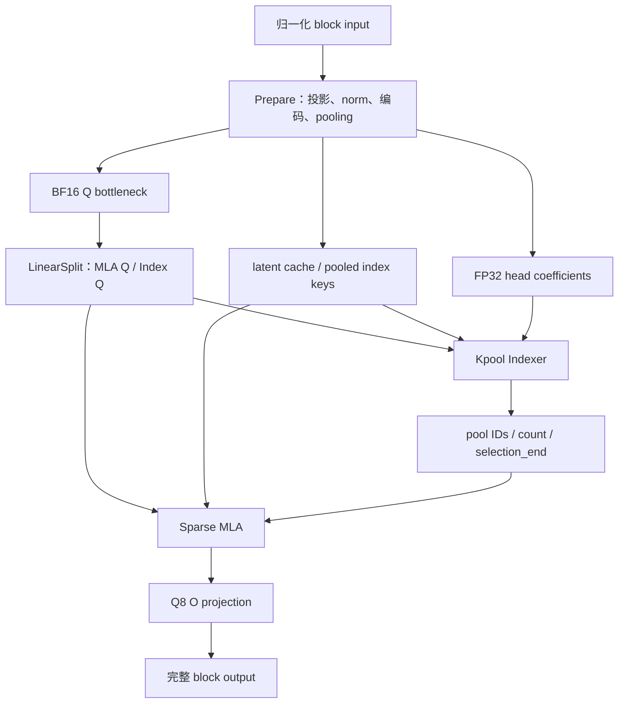

# Kpool Sparse MLA 计算链与 Op 设计

本文定义 GLM5Next 的 Kpool Sparse MLA family：输入准备、learned pooling、Indexer、
latent attention，以及接受前缀后的 tail 恢复。以下接口和实现方案尚待落地。
模型数学以[模型参考](../../maintainer/glm5next-model.md#4-sparse-mla-与-kpool4-indexer)为准，
表示与精度以[数值约定](../../maintainer/glm5next-quantization.md#3-mlaindexer-cache-与计算政策)为准。

## 1. Family 边界与几何

本 family 与 QSA 平行，位于 SoftmaxAttention 下。共同边界是：Prepare 产生历史，
Indexer 产生选择，Attention 直接消费选择；状态出口明确区分 update 与 record，
接受前缀另由 tail 提取完成。每个公开 Op 有完整数学和写域，可以独立调用、验证和调优。

| 归属 | 负责内容 |
|---|---|
| Kpool MLA family | 准备投影＋norm＋历史写入、learned pooling、加权评分与选择、完整 sparse MLA、tail 提取 |
| Linear family | Q bottleneck 之后的 Q_b／Index Q 合并投影，以及最终 O projection |
| Core 容器 | 逻辑页组、存储 planes、StateImage 字段、布局与非 owning views |
| 模型计算组织 | Op 顺序、投影需求、MTP selection 复用、完整分支输出的通信交接 |
| Session／ContextDirectory | owner、源与目标身份、页预留与 COW、前沿采用、checkpoint 与资源保护 |

Op 不分配页、不选择请求 owner、不决定接受长度，也不发布模型前沿。
接口只接收数学输入、借用的资源和明确 metadata；实现约束由对应 Op 校验和报告。
所有权沿用[Engine 架构](../../maintainer/engine-architecture.md)、
[Paged KV context store](../../maintainer/paged-kv-cache.md)和[Op 开发规范](../../maintainer/op-development.md)。

首个实例的参数如下。模型从 config／权重绑定得到实际参数，Op 判断是否支持；
不在 Engine 或模型入口复制下层支持规则。

| 参数 | 当前值 |
|---|---:|
| 输入 hidden H / Q bottleneck Rq | 4096 / 1536 |
| MLA heads Hq / QK 维度 Dq / V 维度 Dv | 64 / 256 / 256 |
| latent 维度 Dc | 512 |
| Indexer heads Hi / key 维度 Di | 32 / 128 |
| pool size / selected pools | 4 / 512 |
| page tokens / 最大原 token 上下文 | 64 / 1048576 |
| 本轮支持的本地 batch | B=1..8；T 为正物理宽度 |
| 使用位置 | Main 11 层、MTP 1 层，各层独立历史内容和 selection |
| 双 Spark 放置 | 一个 DP 副本内 MLA／Indexer 按请求 ADP2，owner 执行完整 heads |

当前为 NoPE，没有 MLA 或 Indexer RoPE。Main/MTP 使用相同 storage profile：
BF16 latent 或 E4M3FN-G128-FP32-scale latent；Indexer、raw tail、raw records 固定 BF16。
FP8 只改变 latent 存储，矩阵计算保持 BF16 操作数／FP32 累加的数值政策。

## 2. 权重、投影与执行链

矩阵按逻辑 `W[N,K]` 表示；native Tensor 第零维连续，`M=T*B, m=t+T*b`。
x 是分支 input norm 之后的 BF16 `[H,T,B]`，本 family 不重复执行 input norm。
Main 的四流 residual 由 mHC 持有，不传入本 family。

### 2.1 合并权重与连续前缀

准备投影为 BF16 contiguous parent `W_A[2336,4096]`：

| 行区间 | 源角色 | 用途 |
|---|---|---|
| `[0,512)` | `kv_a_proj_with_mqa` | latent，512 维 RMSNorm |
| `[512,640)` | `indexer.wk` | raw index key，128 维 affine LayerNorm |
| `[640,768)` | `index_kpool_compress_gate` | raw pool gate |
| `[768,2304)` | `q_a_proj` | Q bottleneck，1536 维 RMSNorm |
| `[2304,2336)` | `indexer.weights_proj` | FP32 raw head coefficients |

按逻辑宽度，行序为 `[latent:Dc | index K:Di | pool gate:Di | Q_a:Rq | coefficients:Hi]`。
最后 Hi 行不包含 sigmoid、softmax、query scale 或 `1/sqrt(Hi)`。

| 投影需求 | W_A view | 公开 query 输出 | 使用位置 |
|---|---|---|---|
| Full | `[0,2336)` | q_r、head_coeff | 普通计算、MTP draft 首步 |
| QueryAndHistory | `[0,2304)` | q_r | 复用 selection 的 MTP 步骤 |
| History | `[0,768)` | 无 | canonical MTP history 更新 |

三个需求都生成 latent、raw index K、raw gate 并维护相同历史。History 三段投影在
一次 Prepare 中完成；只读 view 共享同一 parent，不复制驻留权重、不在执行期 packing。
使用位置显式选择投影需求，Op 不根据 prefill/decode/draft 阶段推断需求。

Q 投影为 BF16 contiguous `W_B[20480,1536]`，前 16384 行为 MLA Q_b，后 4096 行
为 Index Q。LinearSplit 直接写出两份连续输出；复用 selection 时只使用 MLA Q 前缀。

KV_b 按 head 拆为 U_K/U_V：各 head 逻辑 `[256,512]`，native BF16 `[512,256,64]`，
latent 轴连续。源 KV_b 每个 head 的行序为 `[K256,V256]`，converter 保值拆分。
保留因子表示，不与 Q_b/O 相乘生成更大的权重。

`W_O[4096,16384]` 为独立 Q8-G32/FP16 Linear，计算许可 `A16Only`。
W_A、W_B、U_K/U_V、norm gain/bias 和 pool APE 保留源 BF16 words。
Gamma 使用直接 gain；APE native 布局为 `[128,4]`。

### 2.2 完整数据流



| 数据 | Native 形状与表示 |
|---|---|
| x / block output | BF16 `[4096,T,B]` |
| q_r | BF16 `[1536,T,B]` |
| head_coeff | FP32 `[32,T,B]` |
| MLA query / attention output | BF16 `[256,64,T,B]` |
| Index query | BF16 `[128,32,T,B]` |

Prepare 包含 projection、norm、编码和状态写入，直接消费投影的 FP32 结果；
普通 Linear 的 BF16 出口不是其内部必经表示。U_K 映射、latent attention、U_V
映射同属完整 Sparse MLA Op；q_latent、softmax partial 和 latent result 保持私有。
W_B 与 W_O 的纯投影继续由 Linear 承担。

## 3. 历史存储与页布局

Kpool 只压缩 Indexer key。主 MLA 每 token 保留一个 512 维 latent，所有 heads
共用；不保存展开的 K/V。完整 pooled keys 属于 growing history，未完成 pool 的
raw K/gate 属于定长 StateImage。两类状态使用相同原 token frontier。

### 3.1 共享逻辑页组

每页 P=64 个原 tokens、16 个完整 pools。单层 page-major planes：

| Plane | Native Tensor | tokens_per_row |
|---|---|---:|
| BF16 latent | BF16 `[512,64,1]` | 1 |
| 或 FP8 latent codes | E4M3FN `[512,64,1]` | 1 |
| FP8 latent scales | FP32 `[4,64,1]` | 1 |
| pooled index keys | BF16 `[128,16,1]` | 4 |

只实例化所选 latent profile。Plane 基址为 256 B 对齐；页内紧密排列，latent row
stride 为 1024/512 B，scale row 为 16 B，index row 为 256 B。同一逻辑页的全部层
按 layer 顺序、每层按表中所选 planes 顺序打包成一份 256 B 对齐记录，scales 不插在
latent rows 之间。
记录内偏移和总大小统一由 `plan_kv_page_layout()` 产生；记录之间可以离散放置。

Main 的 11 层共享一个逻辑 history pool，MTP 层使用另一个。二者的 page namespace、
执行表、frontier 独立；每个 history pool 内全部层及 planes 共用 page-group ID，
统一 reserve、保护、截短和释放。它们与 State 共同使用 owner rank 的 Context 容量，
不各自划定物理配额；四 token 的 Kpool 分组则是 Indexer 的数学分组。

现有 [KVPlaneGeometry](../../../src/core/paged_kv_geometry.h) 的 `tokens_per_row=1/4`
可承载以上布局。Core 管理存储几何，消费者使用专门的 latent/index typed views。

### 3.2 四 token 连续读取

page_offsets 为 Device I64 `[logical_pages,table_rows]`，条目是相对 Context backing
的 byte offset；页项连续，行跨度显式。选中 logical pool g 时：

```text
logical_page  = g / 16
pool_in_page  = g % 16
record_offset = page_offsets[logical_page, table_rows[b]]
index row     = pool_in_page
latent rows   = 4*pool_in_page + {0,1,2,3}
```

一次页表寻址定位四条连续 latent，不跨页。四 token payload 为 BF16 4096 B，或
FP8 codes 2048 B＋另一 plane 的 64 B scales。Selection 保留 pool IDs，消费者直接
按组加载，不先展开 token IDs 或构造全局 gather buffer。未完成 tail 按有效数 mask。
实际地址为 `arena + record_offset + plane_offset + row*row_stride + feature_offset`。
固定层的跨页地址必须读取映射，不能按单层 payload 或整个 backing 容量外推。

### 3.3 Latent codec

使用[已定 codec](../../maintainer/glm5next-quantization.md#3-mlaindexer-cache-与计算政策)：
BF16 每 token 为 1024 B；FP8 每 token 为 512 个 codes＋4 个 FP32 scales，共 528 B。
FP8 分组沿每 token 连续 128 维，不跨 token 共享 scale，无 Hadamard 或基底旋转。

Encoder 消费 FP32 RMSNorm 结果；FP8 前不插入 BF16 舍入。Consumer 在片上按实际
code/scale 解码为 BF16 operand，同一 operand 同时服务 QK 和 latent 加权累加。
当前窗口的新 token 也经过同一编码／解码边界。精确舍入、零和极小值规则只在数值
文档维护，Prepare 与 MLA 使用同一 codec 实现。

## 4. 公共 views 与身份

声明放在 `include/ninfer/ops/kpool_mla.h`，下列 C++ 片段均位于 `ninfer::ops`。
所有结构只借用 views；按值传入的输出 view 写其设备 backing，不转移所有权。

### 4.1 Batch、cache 与资源上界

```cpp
enum class KpoolMlaStorage {
    BFloat16,
    Fp8E4m3fnGroup128F32,
};

struct KpoolMlaBatchView {
    Tensor positions;     // Device I32 [T,B], original-token ordinals.
    Tensor valid_columns; // Device I32 [B], 0 <= n[b] <= T.
    Tensor table_rows;    // Device I32 [B].
};

struct KpoolMlaLatentCacheView {
    PagedPlaneView data;   // Latent field in the packed page record.
    PagedPlaneView scales; // Empty for BF16; FP32 [4,64,1] for FP8.
    KpoolMlaStorage storage = KpoolMlaStorage::BFloat16;
};

struct KpoolIndexCacheView {
    PagedPlaneView keys; // BF16 [128,16,1] in the same record and I64 page-offset table.
};

struct ConstKpoolMlaLatentCacheView {
    ConstPagedPlaneView data;
    ConstPagedPlaneView scales;
    KpoolMlaStorage storage = KpoolMlaStorage::BFloat16;

    ConstKpoolMlaLatentCacheView() = default;
    ConstKpoolMlaLatentCacheView(const KpoolMlaLatentCacheView& view);
};

struct ConstKpoolIndexCacheView {
    ConstPagedPlaneView keys;

    ConstKpoolIndexCacheView() = default;
    ConstKpoolIndexCacheView(const KpoolIndexCacheView& view);
};

struct KpoolMlaCacheView {
    KpoolMlaLatentCacheView latent;
    KpoolIndexCacheView index;
};

struct KpoolExecutionEnvelope {
    std::uint32_t max_visible_tokens; // Host resource bound, in original tokens.
};
```

组合 cache 的 planes 必须借用同一 backing 与 I64 page-offset table，页跨度均为 64。
Prepare 接收可写 views，Indexer／MLA 分别接收对应的只读 view。上述转换只借用同一
资源和布局，不复制 payload；单独的 Indexer／MLA 只接收自己使用的 planes。

每个活跃行的 positions 连续、非负；padding 不消耗 ordinal。有效 `p+1` 必须在
table 可寻址范围和本 Op 支持的上下文域内；Indexer／MLA 还要求它不超过 envelope。
当前 envelope 在 `[0,1048576]` 内，是资源上界，不代替每 query 的可见长度；
零上界只允许所有行无效。
物理 B 为正；没有本地任务时可不调用，有固定 Graph 行时用零有效长度表达。

State record offset、table row、batch row、record row、selection row 是不同身份。
调用方在提交前完成所需页的物化、COW 和映射发布，并保护写权限与执行借用至退役。
Op 不接收 request ID、rank 或 allocator；只消费已提供的同一请求／层的正确历史。

### 4.2 Tail 与 records

```cpp
struct ConstKpoolTailStateView {
    ConstStateFieldView raw_keys;
    ConstStateFieldView raw_gates;
};

struct KpoolTailStateView {
    StateFieldView raw_keys;  // BF16 [128,3], with Device I64 record offsets.
    StateFieldView raw_gates; // BF16 [128,3], without APE; same record selection.
};

struct KpoolRawRecordWriteView {
    Tensor raw_keys;  // BF16 [128,W,B], one layer.
    Tensor raw_gates; // BF16 [128,W,B].
    Tensor offsets;  // Device I32 [B].
};

struct ConstKpoolTailAllLayersView {
    ConstStateFieldView raw_keys;
    ConstStateFieldView raw_gates;
};

struct KpoolTailAllLayersView {
    StateFieldView raw_keys;  // BF16 [128,3] per layer, L layers in the field schema.
    StateFieldView raw_gates; // Same record selection; independent field/layer offsets.
};

struct KpoolRawRecordReadView {
    Tensor raw_keys;       // BF16 [128,W,L*R].
    Tensor raw_gates;      // BF16 [128,W,L*R].
    Tensor base_positions; // Device I32 [R], ordinal F0 at record column zero.
    Tensor valid_columns;  // Device I32 [R], available prefix u.
    std::int32_t layers;
    std::int32_t record_capacity;
};
```

L 为本次包含的层数，R 为 record 行容量，`1<=B<=R<=8`。跨层 outer index 固定为
`layer*R+b`，不能用活动 B 代替 R。Prepare 获得该层前 B 行 view；records 从生产到
接受结果退役保持行身份与顺序。Engine 其他批次的行压缩不改变这份在途 records。

W 为正；写入满足 `0<=offset[b]`、`offset[b]+n[b]<=W`。连续累积时，本次起点为
`base_positions[b]+offset[b]`。Frame 管理这些 metadata，Op 不自行推进 valid length。
Tail 字段内 feature 连续，层偏移由 StateFieldLayout 描述；records 的外层使用显式、正且
不重叠的 strides。持久 source 使用对应 ConstStateFieldView，目的使用可写 view，不能将
临时 record offsets 的 I32 索引与持久记录的 I64 byte offsets 混用。

Canonical tail 绑定 Context 中的 StateImage 字段；draft 临时 tail 绑定 frame backing
中的相同字段形状。Before/after 可以使用不同 backing 和字段布局，offsets 分别相对
各自 backing。Op 检查访问合同，不要求临时 tail 注册为 StateId 或分配完整 image。

### 4.3 Selection

```cpp
struct KpoolBlockSelection {
    Tensor pool_ids;       // Device I32 [512,Nselection].
    Tensor pool_counts;    // Device I32 [Nselection].
    Tensor selection_end;  // Device I32 [Nselection], frozen exclusive end E.
};
```

Indexer 写 `Nselection=T*B`，行号 `m=t+T*b`。Sparse MLA 接收 Device I32
`selection_rows[T,B]`，普通执行映射到本列，复用时可以引用先前仍存活的 selection 行。

Selection 保存 logical pool IDs，不保存 physical page IDs。它是 frame 数据，与
被引用的 cache 历史一起保持有效。一次消费者的地址借用覆盖实际执行；历史记录搬迁
不改变 IDs，后续消费者读取已更新的页表。Selection 不代替 checkpoint 或历史身份。

## 5. Prepare：投影、norm、pooling 与历史写入

### 5.1 参数与输出

```cpp
enum class KpoolMlaPrepareProjection {
    Full,
    QueryAndHistory,
    History,
};

struct KpoolMlaPrepareParameters {
    KpoolMlaPrepareProjection projection;
    Weight a_projection; // BF16 contiguous W_A prefix, A16 computation.
    Tensor query_norm;   // BF16 [Rq]; empty for History.
    Tensor latent_norm;  // BF16 [Dc].
    Tensor index_norm;   // BF16 [Di].
    Tensor index_bias;   // BF16 [Di].
    Tensor pool_ape;      // BF16 [Di,4].
    float rms_epsilon;
    float index_epsilon;
};

struct KpoolMlaPrepareOutputs {
    Tensor q_r;        // BF16 [Rq,T,B], absent for History.
    Tensor head_coeff; // FP32 [Hi,T,B], present only for Full.
};

void kpool_mla_prepare_record(
    const Tensor& x, const KpoolMlaPrepareParameters& parameters,
    const KpoolMlaBatchView& batch, ConstKpoolTailStateView before,
    KpoolMlaCacheView cache, KpoolRawRecordWriteView records,
    KpoolMlaPrepareOutputs outputs, MemoryArena& workspace,
    CudaExecutionView execution);

void kpool_mla_prepare_update(
    const Tensor& x, const KpoolMlaPrepareParameters& parameters,
    const KpoolMlaBatchView& batch, ConstKpoolTailStateView before,
    KpoolMlaCacheView cache, KpoolTailStateView after,
    KpoolMlaPrepareOutputs outputs, MemoryArena& workspace,
    CudaExecutionView execution);
```

Epsilon 来自模型语义，当前 RMS 为 `1e-5`、index LayerNorm 为 `1e-6`，均为有限正数。
投影需求显式传入；未请求的 query_norm、q_r 或 head_coeff 为空，不访问、不计算。
Record/update 均支持三种投影需求。参数、权重布局与输出形状由 Prepare 验证。

### 5.2 计算与舍入

将 W_A 的 FP32 累加结果按第 2 节分段记为 `z_c,z_k,z_g,z_q,z_w`：

```text
c_fp32 = z_c * latent_norm * rsqrt(mean(z_c*z_c) + rms_epsilon)
q_r    = BF16(z_q * query_norm * rsqrt(mean(z_q*z_q) + rms_epsilon))
k_raw  = BF16((z_k-mean(z_k)) * index_norm
              * rsqrt(mean((z_k-mean(z_k))^2) + index_epsilon) + index_bias)
g_raw  = BF16(z_g)
head_coeff = FP32(z_w)
```

只计算本需求中的分段。Projection 与 norm 之间没有 BF16 落点；c_fp32 直接进入
latent encoder。q_r、k_raw、g_raw 是实际 BF16 出口，head_coeff 保持 FP32。

对每个新完成的四 token pool g，沿位置 r、逐 channel d 计算：

```text
logit[r,d] = FP32(g_raw[4*g+r,d]) + FP32(APE[r,d])
prob[r,d]  = softmax_over_r(logit[:,d])
k_pool[g,d] = BF16(sum_r prob[r,d] * FP32(k_raw[4*g+r,d]))
```

Softmax 使用减最大值的稳定形式，FP32 计算；pool 出口不再做 norm、RoPE 或旋转。
即使四个 tokens 全部在本次调用内，也必须消费实际 BF16 raw words。

### 5.3 写域与两个状态出口

活跃行的起点为 `F=positions[0,b]`，长度 n；before 是 F 处的 canonical tail。

```text
latent 写域        = [F,F+n)
pooled key 写域    = [floor(F/4),floor((F+n)/4))
最终 raw tail 范围 = [4*floor((F+n)/4),F+n)
```

第一个完成的 pool 可能同时需要 before 中早于 F 的 raw words 和本次数据；其余
完整 pools 只使用本次 raw words。未完成 pool 不写 index cache。允许提前写完整个
窗口，因果可见性仍由每个 query 的 ordinal 决定。

Record 将本次实际 raw K/gate 逐 word 保存到 `offset[b]+t`，保留 before 不变。
接受前缀必须使用这份实际 records，不能缩短 T 后重跑 producer 来替代。

Update 按第 8 节公式产生 F+n 处的 after，不向调用者暴露完整 records。
普通已采用输入可用 update；provisional draft 也可更新其独立目标。两个出口遵循
同一数学与表示规则，融合／分派不改变数值政策。

对所有 `t>=n[b]`，请求的 q_r/head_coeff 写精确正零，不写对应 cache 或 records。
n=0 不写 after，不读取 state、positions、offsets 或 table selectors 的 payload。
投影可以读取物理 padding x，所以全部物理 x 列须为有效有限 BF16 输入。
未寻址 cache、record 后缀与其他 state 字段保持不变。

## 6. Indexer：评分与精确选择

```cpp
void kpool_indexer(
    const Tensor& index_query, const Tensor& head_coeff,
    const ConstKpoolIndexCacheView& cache, const KpoolMlaBatchView& batch,
    KpoolExecutionEnvelope envelope, MemoryArena& workspace,
    KpoolBlockSelection& out, CudaExecutionView execution);
```

输入为 BF16 `[128,32,T,B]` 的 index_query、FP32 `[32,T,B]` 的 head_coeff。
有效 query p 的 exclusive end 为 `E=p+1`，完整 pool 数为 `C=floor(E/4)`。
对 `g in [0,C)`：

```text
dot[h,g] = sum_d index_query[d,h] * index.K[d,g]
score[g] = sum_h head_coeff[h] * ReLU(dot[h,g])
```

点积采用 BF16 操作数、FP32 累加，ReLU、head 乘法与归约为 FP32。
模型分数为上述 score 除以 64；排序省略这个公共正因子。Head coefficients 带符号，
不能放到 ReLU 内，最终 score 可以为负。不可见候选排除，不能补零参与 TopK。

选择 `min(512,C)` 个不同 pools；计算 score 相同时优先较小 logical g。使用精确
TopK，输出顺序不限。最新完整 pool 不强制入选；Indexer score 不进入主 MLA logits。

C<=512 直接全选，不读取 query、coefficients、keys 或 tables payload，仍写正确
count 与 E；全选边界为 E<=2051。不同 query 可有不同上下文，在同一 kernel 路径内
处理长、短和无效行，不按 batch 最大长度替代逐 query 判断。

有效输出行 count 为选择数，selection_end 为 E，只有前 count 个 IDs 有效。
无效行 count/end 写 I32 零，IDs 内容不限；不读取该行 positions、query、coefficients、
cache 或 table selectors。所有输入保持不变。

## 7. Sparse MLA：直接消费 selection

```cpp
struct KpoolMlaFactors {
    Tensor key_up;   // BF16 [Dc,Dq,Hq], logical U_K[h][Dq,Dc].
    Tensor value_up; // BF16 [Dc,Dv,Hq], logical U_V[h][Dv,Dc].
};

void kpool_sparse_mla(
    const Tensor& query, const KpoolMlaFactors& factors,
    const ConstKpoolMlaLatentCacheView& cache, const KpoolMlaBatchView& batch,
    const KpoolBlockSelection& selected, const Tensor& selection_rows,
    float attention_scale, KpoolExecutionEnvelope envelope,
    MemoryArena& workspace, Tensor& out, CudaExecutionView execution);
```

当前 query/out 均为 BF16 `[256,64,T,B]`，selection_rows 为 Device I32 `[T,B]`。
attention_scale 是有限正数，由模型绑定；当前为 `1/sqrt(Dq)=1/16`，不从 latent
维度 512 推导。此入口包含 U_K、attention、U_V，最终 O projection 在入口之外。

### 7.1 选择集合与冻结边界

有效 query 从 `selection_rows[t,b]` 读取 E、count、IDs，要求 selection 属于正确的
请求、层及历史，且：

```text
0 <= E <= p+1 <= envelope.max_visible_tokens
0 <= count <= min(512,floor(E/4))
IDs[0:count] 互异，且在 [0,floor(E/4)) 内
```

消费者可以独立接受任意合法集合，不验证它是否为本 query 的实际 TopK。

```text
J = union({4*g,4*g+1,4*g+2,4*g+3} for selected g)
    union [4*floor(E/4),E)
```

两部分不重叠，至多 2051 tokens；所有 MLA heads 使用同一 J。E 是 selection 的
冻结边界，不能替换成当前 p+1。例如 E=10 时 tail 是 tokens 8、9，后续 query
复用同一 selection 时不会自动加入 token 10 或 11。

Attention tail 从 latent cache 读取；Prepare 的 raw tail state 仅用于将来的 pooling，
Sparse MLA 不读取它。只有选中 pools 与上述可见 tail 参与计算。

### 7.2 Latent 域计算

令 c_j 是所选 cache profile 实际解读出的 operand，对每 head h：

```text
q_latent_h = transpose(U_K[h]) * query_h
logits[j]  = attention_scale * dot(q_latent_h,c_j)
a[j]       = softmax_over_J(logits)[j]
u_h        = sum_{j in J} a[j] * c_j
out_h      = BF16(U_V[h] * u_h)
```

同一 c_j 同时承担 K/V 的 latent 角色。没有 RoPE、额外 attention bias、output gate、
sink 或强制 self token。表示边界按[latent attention 数值约定](../../maintainer/glm5next-quantization.md#43-latent-域-attention)：
因子投影、QK 和加权累加遵循 BF16/F32 政策，softmax 统计及分块合并为 FP32。
q_latent/u 是私有中间值，可以保留 FP32，不强制全局物化或增加公开 BF16 落点。

空 J 和无效 query 输出精确 BF16 正零，不读取 query/factors/cache payload。
无效 query 还不读取 positions、selection mappings、selection 或 table selectors。
所有私有阶段都遵守此读域；不加载无效第四条 tail，不读取 IDs 的无效后缀。
输入、cache 与 selection 保持不变。

## 8. Canonical tail 与接受前缀

### 8.1 持久状态

前沿 F 处，tail 的前 `F%4` 列保存未完成 pool 的 raw K/gate，按时间顺序排列；
其余列为 BF16 正零。F=0 时全部为零。相位由 F 推导，不另存每层计数或 APE。

Tail 由 [StateImage](../../../src/core/state_image.h) 字段承载，每层两个 BF16
`[128,3]` 字段，共 1536 B；Main 11 层与 MTP 1 层合计 18 KiB payload。
字段采用 StateFieldLayout 的层偏移和 I64 image offsets，不另设 tail 内存池。

### 8.2 精确提取

```cpp
void kpool_tail_extract(
    ConstKpoolTailAllLayersView before, const KpoolRawRecordReadView& records,
    const Tensor& accepted_columns, KpoolTailAllLayersView after,
    CudaExecutionView execution);
```

accepted_columns 为 Device I32 `[B]`，每行 `0<=a<=u<=W`、`0<=F0<=F0+u<=1048576`；
Before 与 records 第零列对应 F0。L/R 匹配实际 views，before/after 各自提供 B 行
record offsets；正接受行必须选择合法字段。可一次提取 Main 全部层，或使用 L=1
的 view；Main/MTP 的不同 frontier 不混入同次调用。

a>0 时：

```text
F1 = F0+a
r  = F1%4
s  = F1-r

for j in [0,3):
    if j >= r:
        after.K/G[:,j] = BF16 +0
    elif s+j < F0:
        old_column = s+j-(F0-F0%4)
        after.K/G[:,j] = before.K/G[:,old_column]
    else:
        after.K/G[:,j] = records.K/G[:,s+j-F0]
```

只做 word copy／零填充，不重新计算浮点结果，不读 rejected suffix 或扫描已完成
pools。零接受是严格 no-op，不读写 state/record payload；即使源目标不同也不复制，
该行继续采用原 image，调用方保护其内容，offsets 可为 `-1`。其含义与 KDA 提交
一致，复用 QSA 机制时须保留此区别。

允许同一行原位提取，先保存所需旧 words 再写。目标不能覆盖其他活动行的 source、
records 或 metadata；只读 source 可共享。只修改 raw K/gate 字段，不触碰 image 的
其他字段。本入口固定零 scratch，不传 arena、无容量查询。

Prepare/update 使用同一公式，将本次实际 raw words 作为临时记录；n=0 不写目标。

### 8.3 Growing history 的采用

F1=F0+a 处的有效历史是：

```text
latent      : [0,F1)
pooled keys : [0,floor(F1/4))
raw tail    : [4*floor(F1/4),F1)
```

例如从 F0=63 准备到 69、只采用到 65：[60,64) 的 pool 有效；[64,68) 即使已经
物理写入也不可见；新 tail 只保存位置 64 的 raw words。Rejected suffix 不扩大
coverage，后续续写可在拥有写权限的区域覆盖它。

Checkpoint 同时保留对应 growing prefixes、tail 和其他模型状态。页共享、COW、
read leases、reservation、table 更新和 frontier 发布由 Session／ContextDirectory
协调；仅截短 cache 不能恢复非四 token 边界的 raw tail。

## 9. MTP、ADP 与模型交接

Main/MTP history 和 tail 分离、请求 owner 相同。本实例 Main 各 MLA 层独立选择，
不跨层共享 selection。一轮 MTP draft 的调用为：

| 位置 | Prepare | W_B | Indexer／selection |
|---|---|---|---|
| 首步 | Full | MLA Q＋Index Q | 产生新 selection |
| 后续步骤 | QueryAndHistory | 仅 MLA Q 前缀 | 复用首步 IDs、count 和 E |
| canonical history 更新 | History | 不执行 | 不执行 |

复用步骤仍维护 provisional latent、pooled keys 和 tail。Frozen selection 及其
映射不能被覆盖，被引用的 cache 历史保持到最后消费者完成。复用不按新位置追加 tail。

Canonical MTP history 使用真实 Main conditioning；递归 draft hidden 不因 token
被接受就成为真实 Main hidden。需要重建的部分从真实 conditioning 经过 stem 与
input norm，再用 W_A 前 768 行一次产生历史；不执行 Q、attention、FFN 或 head。
模型负责 token/conditioning 对应关系及 Main/MTP ordinal，Op 只消费已提供的输入。

完整的输入移位、跨 chunk 配对、首步真实 conditioning 历史的采用，以及其余
canonical history 的补齐由 [MTP 执行设计](mtp.md#6-各种执行情况)规定。

| 所有者 | 资源与决策 |
|---|---|
| ModelShard／Parameters | 不可变权重、已绑定 views、模型数值参数 |
| RankProgram | cache/state backing、frame、records、selection、scratch、Graph 与执行依赖 |
| 模型 Session／目录 | 请求 owner、source/destination、采用长度、frontier、checkpoint 和读写权限 |
| Ops | 已给定 views 上的数学与状态写入，自己的能力校验和路线选择 |

MLA owner 完成 O projection 后，模型把完整 `[4096,T,B]` 输出交给后续 TP/EP 或
mHC／普通 residual。Op 不携带 rank、world size 或 communicator；并行放置和通信
边界见[双 Spark 分工](parallel.md#1-首版并行分工)。

## 10. 内存、容量查询与 Graph

### 10.1 访问与 alias

Activation、query/output、selection 连续，BF16/FP32 activations 和矩阵基址至少
16 B 对齐；参数向量与 Device I32 metadata 自然对齐，I64 record/page offsets 至少
8 B 对齐。State/records 的 feature 连续，正的显式外层 strides 不重叠；cache 使用
第 3 节布局。全部 operands、scratch 与 execution 位于同一 CUDA device。

Prepare/update 和 tail_extract 允许同一行对应 tail 字段完全原位或完全 disjoint，
禁止部分 overlap、跨字段覆盖及目标覆盖其他活动行的 source。目标行之间不能重叠；
原位调用必须完成全部旧 tail 依赖后才能覆盖。Record 不修改 source。

除上述 tail 原位更新，对外写入的 outputs、cache 区域和 records 彼此 disjoint，
并与只读 inputs、权重、metadata 和活跃 scratch disjoint。Alias 按实际访问的记录、
字段和 plane 判断，共用 arena 本身不构成重叠；原位要求实际字段地址相同。
只读 views 可共享 backing。
Record 在同一 Op 内先写后被 pooling 读取是显式生产／消费关系，必须等待对应生产
阶段完成；它不允许其他输入与 records alias。

Host 校验 dtype、shape、stride、alignment、capacity、device 和可见的固定地址关系；
Device counts、offsets、字段／页边界与写入分离由调用方保证，不回读到 Host 校验。
合同规定不访问的行允许使用 `-1` offsets／table selectors；kernel 先检查有效长度、
接受长度或选择数，再读取对应索引并解析地址。活跃访问不能使用无效 offset。
参与数学的输入及所需中间结果须有限；codec 的有效域沿用数值文档，不通过
satfinite 或修改 mask 掩盖 NaN/Inf。

### 10.2 无地址 profile 与容量查询

Profile 描述本次 Op 的实际计算形状，均不含地址。执行从已绑定 operands 的 Host
metadata 得到相同形状，与容量查询共用支持判断、选择及分配规则。

```cpp
struct KpoolMlaPrepareProfile {
    KpoolMlaPrepareProjection projection;
    std::int32_t hidden;
    std::int32_t latent_dim;
    std::int32_t index_dim;
    std::int32_t query_rank;
    std::int32_t index_heads;
    std::int32_t pool_size;
};

struct KpoolIndexerProfile {
    std::int32_t index_heads;
    std::int32_t index_dim;
    std::int32_t pool_size;
    std::int32_t selected_pools;
};

struct KpoolSparseMlaProfile {
    std::int32_t query_heads;
    std::int32_t query_dim;
    std::int32_t value_dim;
    std::int32_t latent_dim;
    std::int32_t pool_size;
    std::int32_t selected_pools;
};

[[nodiscard]] std::size_t kpool_mla_prepare_record_workspace_capacity_bytes(
    const KpoolMlaPrepareProfile& profile, KpoolMlaStorage storage,
    std::int32_t batch_size, std::int32_t min_tokens,
    std::int32_t max_tokens, std::int32_t sm_count);

[[nodiscard]] std::size_t kpool_mla_prepare_update_workspace_capacity_bytes(
    const KpoolMlaPrepareProfile& profile, KpoolMlaStorage storage,
    std::int32_t batch_size, std::int32_t min_tokens,
    std::int32_t max_tokens, std::int32_t sm_count);

[[nodiscard]] std::size_t kpool_indexer_workspace_capacity_bytes(
    const KpoolIndexerProfile& profile, KpoolExecutionEnvelope envelope,
    std::int32_t batch_size, std::int32_t min_tokens,
    std::int32_t max_tokens, std::int32_t sm_count);

[[nodiscard]] std::size_t kpool_sparse_mla_workspace_capacity_bytes(
    const KpoolSparseMlaProfile& profile, KpoolMlaStorage storage,
    KpoolExecutionEnvelope envelope, std::int32_t batch_size,
    std::int32_t min_tokens, std::int32_t max_tokens,
    std::int32_t sm_count);
```

Prepare profile 的 query_rank 在 History 中为零，index_heads 在非 Full 中为零，
表示本次没有相应投影行；其余维度取实际值。W_A 的行数必须等于
`latent_dim + 2*index_dim + query_rank + index_heads`，K 为 hidden。
固定 BF16 权重格式由 Prepare 本身声明，不增加低精度 activation 模式。

本轮 pool_size=4、selected_pools=512；Indexer cache 每页行数、tail 列数、APE
和 selection 容量必须满足对应合同。执行使用这些 typed views 的已声明语义，
profile 不是允许调用方改变表示解释的开关。

查询覆盖固定 profile/storage/B/envelope 下闭区间内全部合法 T、有效长度、四种
pool 相位及合法原位／异位形式。范围为 `0<min_tokens<=max_tokens`，sm_count 为
执行设备的正物理 SM 数；非法 profile/区间由对应 Op 报错。

返回最小足够高水位容量，从 256 B 对齐的 Op-local cursor 计量，包含全部内部
阶段及对齐间隙，排除公共 outputs/cache/state/records/selection 和末端 padding。
分派边界及非单调区域必须纳入计算，不能只查询 max_tokens。零只表示合法零 scratch。

Op 在 caller arena 的 scope 内借用 scratch，结束恢复 cursor，不保留指针；
设备生命周期通过 stream 顺序或调用方显式同步保证。独立 records 和 selection
保持到最后读者完成，不能提前当作可复用 scratch。

### 10.3 Graph

固定 T/B、投影需求、storage、arena／执行表／frame 地址和字段几何时，Graph replay
从 Device 读取新的 lengths、positions、record offsets、page mappings、selection mappings
和选择内容。实际 State/KV payload 地址不固定在 Graph 中。
短上下文全选、空行与混合长度在 kernels 内处理，不因 Device 值改变 Host launch 拓扑。

执行 ticket 持有本次地址借用，Graph 对象不永久固定某份历史。目录在旧消费者退役后
完成搬移与映射发布，下次 replay 通过原输入路径取得新 offsets，复用同一个 Graph。

Indexer／MLA 在固定 T/B/profile 下保持节点数量和顺序兼容，Host envelope 可以
通过已有机制更新 launch 参数，前提是 workspace 和 capture/update 均覆盖新上界。
Host 改写一个变量不会自动修改已捕获节点。T 或需求变化由 RankProgram 选择对应
执行形状和 Graph，family 不新增模型分图要求。

全部操作提交到 `execution.stream()`，无隐藏设备分配或 Host readback。同流直接
消费前序 Op 输出；跨 stream 依赖及 backing、page/state leases 的寿命由所有者维持。

## 11. 文件组织与实现方案

### 11.1 与 QSA 平行的 family

```text
include/ninfer/ops/kpool_mla.h
src/ops/softmax_attention/kpool_mla/
    sources.cmake
    prepare/
    indexer/
    sparse_mla/
    tail_extract.cu
tests/ops/softmax_attention/kpool_mla/
bench/ops/softmax_attention/kpool_mla/
```

每个复杂子目录拥有入口、选择、launch 和私有 kernel；按实际复杂度拆文件。
Spark 调优策略放在各自 `dgx_spark/` 目录，共同计算体留在适当的共享位置。
短小实现不为形式统一增加转发文件或空层级。

| 机制 | 复用与新增边界 |
|---|---|
| BF16 projection | 复用 Linear 的 contraction 基础，Prepare 拥有 FP32 输出与融合分派 |
| 分页、StateImage | 复用 KVPageLayout、StateFieldLayout 与执行表；family 提供 typed views，模型按层／owner 绑定 |
| TopK | 抽取 QSA 中不依赖其工作映射的精确选择计算体；两 family 分别保留评分、jobs 与调优 |
| Attention | 复用 online softmax、归并、MMA、异步访存基础；新增 latent MLA 核心 |
| Codec／布局辅助 | Prepare 与 MLA 共享同一实现；通用数值基础继续使用 ops/common |

Family-local helper 只保存本 family 的共同语义。通用基础不反向包含 QSA/Kpool
私有入口或调优策略，不以复制旧 QSA family 建立新实现。

### 11.2 Prepare 的首版三阶段

1. **投影**：W_A 对所需行做 BF16/F32 矩阵计算，生成 FP32 私有结果；小 T 使用
   GEMV／小矩阵路线，大 T 使用 Tensor Core。按实际需求跳过未请求的行。
2. **逐 token 后处理**：FP32 norm，写 q_r/head_coeff，编码并写 latent，形成实际
   BF16 raw K/gate。Record 直接写外部 records；update 使用 call-scoped raw 缓冲。
3. **Pooling 与 tail**：读完整 raw words 和 before，生成新完成的 pooled keys，
   update 出口写最终 tail；record 出口保留 before。

Projection／后处理可按有界 token windows 复用 FP32 scratch；raw 缓冲保留 pooling
需要的数据。Update 首版保留本调用 raw payload，当前为 `512*T*B` B；record 出口
可直接读取已写 records，无需复制第二份。后续可按完整 pools 缩减 raw scratch。

Pooling 沿新遇到的 logical pools 和 channel tiles 并行。只有首个边界 pool 可能
读取 before；让该 pool 的任务在完成旧 tail 读取后，再负责相同 channels 的最终
tail 发布。此时第二阶段已完成，末尾 raw words 全部可读。其他 pool 任务不读取
before，避免首尾两个 CTA 在原位状态上产生读写竞争。没有完成 pool 的短窗口仍
执行这份边界任务，完成 tail 更新；结束相位为零则清零三列。

这些是私有计算阶段，不保证一次阶段只有一次 launch。正确实现后，按实际 T/B
测量融合机会；任何融合仍使用相同 raw words 和 codec，不增加模型可调用 partial。

### 11.3 Indexer 的评分与 TopK

32 heads 与现有 QSA 的 4 heads 具有不同的 MMA／寄存器需求，分别选择调优实例。
评分 tile 的逻辑矩阵为：

```text
[query_tile*32,128] × [128,pool_tile]
    → FP32 dot products
    → ReLU → head coefficients → sum over 32 heads
    → [query_tile,pool_tile] scores
```

head 归约在片上完成，不物化 `[query,head,pool]`。单 query 已有 32 行，不能直接
沿用 QSA 小 T 偏好 SIMT 的分派结论。每行根据自己的 E mask，短上下文／无效行
跳过 payload，混合长度不依赖 Host 回读。

采用有界 query window，在窗口内生成 scores、分区精确 Top512，再合并为最终
Top512。分区保留自身 Top512 后再合并是精确算法：全局 Top512 不可能排在其分区
第 512 名之后。同分使用统一 score/ID 全序，支持负值，非法候选排除。

Score tile、partition 大小、query window 和局部／全局选择融合属于私有调优。
T=4096、完整 pool 数 262144 时，全量 FP32 scores 就有 4 GiB，因此 workspace
必须有界复用。最后输出直接为 pool IDs、count、E，不再做 token-ID 展开。
为保持第 10 节的 Graph 合同，固定 T/B/profile 时的窗口划分及阶段数量不随
envelope 改变；envelope 调整每阶段的工作规模与参数。

### 11.4 Sparse MLA 的私有阶段

首版按 query window 组织：

1. U_K 映射，每个有效 query/head 只计算一次 q_latent。
2. 按 query、head group、selected-pool tile 做 latent attention，以 online softmax
   维护 FP32 max、sum 与 weighted accumulator；heads 共享加载的 latent tiles。
3. 归并必要的 KV 分片，应用 U_V，写完整 BF16 heads。可融合 merge 与 U_V。

小 T 使用适当的 head 分组及 KV split 获得并行度，避免每个 split 重复 U_K 投影。
大 T 在 U_K/U_V 映射中复用权重，但每个 query 独立消费自身 selection，不能默认
相邻 queries 的集合相同。确实全选时可使用内部多 query causal tile。

U_K/U_V 保持 native 因子布局，kernel 处理所需转置；不运行时打包或扩展整份权重。
FP8 latent 在读取 tile 时解码，数据供 QK/PV 复用；不构造完整 BF16 cache。
私有 q_latent、分片结果等按 query window 计费，避免随整段 prefill 物化大中间张量。
空 J 的判定适用于因子映射及 attention 全部阶段，不能只在最终 epilogue 清零。

### 11.5 Tail 提取

按 row、layer、channel 向量化，最多复制三列 raw K/gate；源目标字段 strides
分别读取。原位时先把需要的旧 words 读入寄存器，再写目标。跨层一次提交，不逐
layer/token 发射小 kernel。零接受行立即返回，不触碰 state 或 record 数据。

## 12. 性能目标与测量范围

Prepare、Indexer、Sparse MLA 分开测量，同时补一组实际顺序消费的链路测量。
使用完整公共入口，报告延迟、workspace、有效带宽、计算利用率和 roofline；
投影、TopK 或单个 MMA kernel 的结果只用于定位。

下列为数据量推导，不是实测 DRAM 流量：

| 可见原 token 数 | 完整 pools | 单层 BF16 index keys |
|---:|---:|---:|
| 8192 | 2048 | 0.5 MiB |
| 65536 | 16384 | 4 MiB |
| 262144 | 65536 | 16 MiB |
| 1048576 | 262144 | 64 MiB |

选中 2048 tokens 的 latent 为 BF16 2 MiB 或 FP8＋scales 1.03125 MiB，另加最多
三个 tail tokens；每层 U_K＋U_V 为 32 MiB 权重。Indexer 随上下文继续扫描，而 MLA
选择数量封顶；MLA 延迟还包括因子映射，不能只用 2 MiB payload 解释整个入口。

令已有上下文为 L0，输入列数为 T，则 query t 的 E=L0+t+1。测量同时改变 L0 和 T，
避免只看一种长度。小窗口覆盖 T=1、2、4、8、16，batch=1、2、4、8；大窗口覆盖
T=128、512、1024、2048、4096，先测 B=1。上下文取全选边界、8K、64K、256K、1M
附近的合法窗口，满足 L0+T<=1048576；选择代表性组合及实际路线边界，不穷举笛卡尔积。

Prepare 分别测三种投影需求与两个出口；Indexer 区分全选和评分；MLA 分别测两种
storage、普通 selection 和冻结 E。固定 Graph／非 Graph 与热／冷缓存条件，明确
权重及 keys 是否复用；逻辑字节不能当作硬件 DRAM 计数。大 T 计入 scores/candidates、
raw words 和 softmax partial 的实际读写，小 T 关注带宽、并行度与 launch 开销。

测量使用实际 Main 11 层／MTP 1 层的页组布局和 I64 映射，覆盖代表性的非等间距
记录。Main 单层每页的 index keys 为 4 KiB，其跨页间距由完整记录和映射决定；
不能用紧密排列的单层数组代替生产布局。流量按实际访问 planes 计费，不把整页组
中其他层的 payload 计为本层必读流量；长上下文另关注地址局部性与 TLB 开销。

持久与 frame 容量分别核算：growing cache、tail 的总预算见
[并行资源](parallel.md#3-1m-上下文的持久状态容量)；raw records 为每层每有效列 512 B，
selection payload 每行 2056 B，scratch 按查询计费。模型与双机收益在接入后另测。

## 13. 实施顺序与验证重点

1. 固定 public views、无地址 profiles、page/codec 和 selection 合同，实现 BF16
   Prepare 的三种需求、update/record 与 tail_extract。
2. 实现 weighted Indexer、精确 Top512、全选与混合长度，输出直接供 MLA 使用。
3. 实现 BF16 Sparse MLA 完整入口，按小／大 T 优化，并连通 Prepare→Indexer→MLA。
4. 补 FP8 latent 的 encoder/consumer，在相同计算精度下调优；接入 MTP 复用和
   canonical history 更新。所有入口从实现开始即遵守 Graph 和空行合同。

| 对象 | 验证依据与关键边界 |
|---|---|
| Projection、norm、pooling、完整 MLA | 实际表示输入的独立 FP64 数学参考；明确 codec／raw BF16 边界，不以生产 Op 串接作为 oracle |
| FP8 codec | 给定 FP32 输入的独立精确编码／解码参考，覆盖零、舍入和极小值；与完整 Prepare 的浮点误差分开 |
| Indexer | 独立 score 参考；负 coefficients、同分、E=2051/2052、最新完整 pool 可被排除；近同分按评分误差解释，TopK 算法本身必须精确 |
| 历史与 tail | 四种相位、跨 chunk/page、部分接受、零接受、原位／异位；Context 与 frame tail 交接；精确复制本轮 raw words，其他字段不变 |
| Producer/consumer | 完整多层页组、非等间距 offsets、同 arena 的 disjoint records；未来已写 pool 对早期 query 不可见、冻结 E 不追加 tail |
| Graph 与空行 | 同一 Graph 在保值搬移并更新页／State offsets 后重播；selection IDs 不变；混合长度、零有效／零接受行与空 J 的读写域 |

测试按可观察数学和状态合同制定，不因私有实现使用更高精度而提高要求，不根据
候选结果反向放宽标准。实际生产分派边界选择有限样本；copy、codec 和 no-op 按
精确规则检查。性能与数值均无现成测量结论，不能把当前设计状态标为已实现。
