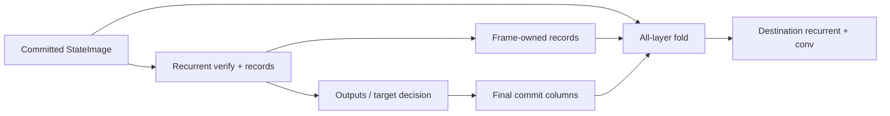

# KDA ReplaySSM 实现设计

性质：待落地的 record/fold 接口与组合设计，首个实例为双 Spark GLM5Next。
决策、实现状态和任务范围见[设计索引](README.md)。模型转移与历史依赖见
[模型参考](../../maintainer/glm5next-model.md#3-kda)，表示和精度见
[数值政策](../../maintainer/glm5next-quantization.md#4-投影控制量与-latent-attention-边界)。

本设计与[现有 GDN ReplaySSM](../../maintainer/replayssm-gdn.md)对齐状态管理：verify 从只读基准状态
产生输出和 records，最终接受长度确定后，在本轮内完成 fold。提交后的 recurrent state
始终代表最新接受前沿，不保留跨轮待 fold 的已提交 log。

计算输入保持[现有 KDA 数学接口](../../../include/ninfer/ops/kimi_delta_attention.h)的约定：
调用者仍传 BF16 raw forget/beta logits、FP32 A_log/dt_bias 和 lower_bound；gate 在
KDA 内部生成。对齐 GDN 不改变这个边界，也不要求调用者准备 FP32 gate tensors。
现有通用入口用于算法和性能验证，其分派不作为生产约束。Ordinary decode、verify
record 和 fold 使用 recurrent 状态转移；decode 不走 chunked。长 prefill 的算法选择
不在本文中收敛。

## 1. 分工与持久状态

| 层次 | 责任 |
|---|---|
| Core | StateImage 字段、record planes 的布局和非 owning views |
| KDA input Op | QKV projection/conv/SiLU 以及实际 conv history records |
| KDA recurrence Op | 内部 gate 生成、recurrent 输出和 transition records |
| KDA fold Op | 从指定 source 重放接受前缀，写 destination 的 recurrent/conv 状态 |
| RankProgram | 持有 frame/records、prepared plans、CUDA Graph 和物理执行依赖 |
| ModelSession | 选择源和目的、最终采用长度、前沿、checkpoint 与跨 rank 提交 |

沿用 [LinearAttentionState](../../../src/core/linear_attention_state.h) 和
[StateImage](../../../src/core/state_image.h)。每层包含：

- FP32 recurrent `[Dk,Dv,Hv,Slots]`，逻辑为 `S[value,key]`，key 轴连续；
- BF16 conv history `[C,3,Slots]`，列顺序为最旧到最新；
- layer stride 与 slot stride 显式给出，不能假设不同字段或层紧邻。

一个 checkpoint 保存已 fold 的这两项状态及完整模型所需的其他字段和历史前缀。
Records 属于未退役执行 frame，不进入长期 checkpoint，也不进入 growing KV pool。
Active image、不可变 checkpoint 和正在写入的目的 image 仍由现有目录分别管理。

## 2. 计算输入、输出与数学

### 2.1 保留的计算边界

下表给出 verify 的 batched 视图；ordinary batch update 使用 `T=1`。
Native Tensor 的第 0 维连续，`Hq` 表示 query/key heads，`Hv` 表示 value heads。

| 操作数 | 类型与形状 | 含义 |
|---|---|---|
| q、k | BF16 `[128,Hq,T,B]` | conv/SiLU 后、L2 normalization 前 |
| v | BF16 `[128,Hv,T,B]` | conv/SiLU 后的 value |
| g | BF16 `[128,Hv,T,B]` | raw forget projection logits，不是 log-decay |
| beta | BF16 `[Hv,T,B]` | raw beta logits，不是 sigmoid 后的系数 |
| A_log | FP32 `[Hv]` | 每个 value head 的固定参数 |
| dt_bias | FP32 `[128,Hv]` | 每个 head/key channel 的固定参数 |
| lower_bound | FP32 scalar | 有限且属于 `[-5,0]`；GLM 使用 -5 |
| scale | FP32 scalar | `1/sqrt(128)` |
| states | FP32 `[128,128,Hv,Slots]` | 完整 state pool 的本层视图 |
| out | BF16 `[128,Hv,T,B]` | 更新 state 后的 scaled query readout |

`Hq>=1`、`Hv>=Hq`、`Hv%Hq==0`；value head h 使用
`qh=floor(h/(Hv/Hq))` 的 q/k。首个生产 profile 为 `Hq=Hv=32`。
输出不含后续 gated RMSNorm、output gate 或 O projection。

### 2.2 数学输入与实际 records

第 2.1 节的 q/k 是 L2 normalization 前的 BF16 值，g/beta 是 raw logits；
按[模型 KDA 数学](../../maintainer/glm5next-model.md#3-kda)完成内部归一化、gate
和 state 转移。接口中的 lower_bound 代替模型实例值 -5，head 映射与 scale 使用
第 2.1 节的显式参数。Decay 在 prediction 内逐 key channel 生效，不能作为一个
scalar 移到整个归约之外。完整公式不在此重复维护。

两处记号的对应关系是：接口 g 对应模型的 forget logit f，接口 beta 对应 `W_b*x`；
record.log_decay 对应模型公式中已激活的 g，record.beta 对应其 sigmoid 后的 beta。

Verify 在内部形成 log_decay/beta_value 时，将实际用于转移的 FP32 words 写入
records。Fold 消费这些 words，不再运行 sigmoid、A_log 或 dt_bias 计算；从
log_decay 到 alpha 的 exp 仍属于 recurrent 转移，并与 verify 保持一致。
这项内部记录不会把外部 g/beta 的 BF16 输入改成 FP32，也不增加投影输入精度。

## 3. 几何、行身份与 record 布局

### 3.1 域与身份

- `L`：本 rank 的 KDA 层数，首个 profile 为 34；按 Main 中 KDA 层出现顺序编号。
- `C=2*Hq*128+Hv*128`：Q/K/V conv channels；首个 profile 为 12288。
- `R=record_capacity`：一个 frame 预留的物理 record 行容量，范围 1..8。
- `B`：本次活动行数，`1<=B<=R`，不同于 StateImage slot 数。
- `T=width`：本次 prepared 布局的物理窗口宽度，正整数。
- `n[b]`：verify 的有效列数，`1<=n[b]<=T`；空 valid_columns 表示 `n[b]=T`。
- `m[b]`：最终提交列数，`0<=m[b]<=n[b]`。

不把短窗口 kernel 的优化范围定义为 T 的语义上限。实际窗口由启动配置与已准备
容量限定。每个执行 variant 绑定自己的 T/record 布局；短行通过有效列数表达，
不把固定 T 的内存直接重解释成更短 T。

Records 不拥有 sequence、frontier 或 slot policy。ModelSession/RankProgram 在 frame
中保存原始 physical row 到 sequence、source image/version 的映射。Record 产生后
直到 fold 退役，不能重新压缩 batch、改变行顺序、覆盖源内容或重用 records。

### 3.2 五个独立 planes

| Plane | 完整分配形状 | 单层有效 B 行视图 | 内容 |
|---|---|---|---|
| conv | BF16 `[C,T,L*R]` | `[C,T,B]` | 每步最新的 Q/K/V history 列 |
| key | BF16 `[128,Hq,T,L*R]` | `[128,Hq,T,B]` | L2 norm 前的实际 key words |
| value | BF16 `[128,Hv,T,L*R]` | `[128,Hv,T,B]` | 实际 value words |
| log_decay | FP32 `[128,Hv,T,L*R]` | `[128,Hv,T,B]` | 内部生成的逐 channel log-decay |
| beta | FP32 `[Hv,T,L*R]` | `[Hv,T,B]` | 内部 sigmoid 后的 beta |

统一外层索引为 `outer=layer*R+b`。五个 planes 各自连续、256 B 起始对齐、互不重叠；
规划检查 extent/byte size 溢出，寻址的乘积使用足够宽的整数。`layer(l,B)` 选择
`[l*R,l*R+B)` 的行；不能把 stride 中的 R 替换成当前 B。

沿用 GDN 的容器结构，新增 `KdaReplayRecordSpec`、`KdaReplayRecordLayout`、
`KdaReplayRecordLayer`、`KdaReplayRecords` 和 `plan_kda_replay_records`。Spec 字段
与 GDN 同形：layers、record_capacity、width、conv_channels、qk_heads、value_heads、
key_dim、value_dim；KDA 的两个 state dimensions 均为 128。

`KdaReplayRecordLayer` 持有上述五个 Tensor。Recurrence 的 record 子视图只有后四个
planes；conv 由输入准备 Op 生产。GDN 的 `[2,Hv,T,B]` scalar gate plane 不扩展成
多义布局；KDA 的 log_decay 与 beta 分开，保持 128-channel 行连续，不重复存 beta。
GDN 公开合同不因新增 KDA 而改动。

## 4. Conv record 生产

接口与 `gdn_input_proj_conv_record` 对应，保留 KDA 的投影/卷积特点：

```cpp
struct KdaConvOutputs {
    Tensor query, key, value;
};

struct KdaConvSourceState {
    Tensor history;      // Read-only BF16 [C,3,Slots].
    Tensor source_slots; // Device I32 [B], absolute source slots.
};

void kda_input_proj_conv_record(
    const Tensor& x, const ProjectionWeights& weights,
    const Tensor& conv_weight, KdaConvSourceState state,
    const Tensor& valid_columns, KdaConvOutputs outputs,
    Tensor& conv_record, MemoryArena& workspace,
    CudaExecutionView execution);

std::size_t kda_input_proj_conv_record_workspace_capacity_bytes(
    const ProjectionProfile& weights, std::int32_t batch,
    std::int32_t min_tokens, std::int32_t max_tokens);
```

首个 profile 消费 BF16 x `[4096,T,B]`、A16Only Q8-G32/FP16 QKV parent
`[12288,4096]`，行顺序为 `[Q4096,K4096,V4096]`。Conv weight 为 FP32 `[C,4]`，
四 tap 顺序为 `t-3,t-2,t-1,t`。Q/K/V 的 BF16 输出各为 `[4096,T,B]`，可无复制
view 为 recurrence 的 `[128,32,T,B]`。KDA output gate 属于另一分支，不在此输出 Z。

数学为 `p=concat(Wq*x,Wk*x,Wv*x)`，将旧三列 history 与本窗口 p 拼接，逐 channel
做四 tap causal convolution 和 SiLU，分成 Q/K/V。历史不足由请求初始化时补零。
Conv 不消费未来列。输入准备和 recurrence 使用同一 physical row、有效长度与源 image。

数值与 effects：

- Projection、conv、SiLU 是完整组合；published history 和 Q/K/V 为 BF16。
  不因需要 conv_record 而强制物化私有 BF16 projection 中间量。
- conv_record 为 BF16 `[C,T,B]`，保存同一物理执行各步实际会发布的最新 history 列。
  Record 不可由缩短 T、改变 B 或重跑 projection 得到。
- 源 history 始终只读；有效 outputs/records 被完整写入。无效 Q/K/V 后缀写精确 +0，
  无效 record 后缀不变。
- Projection 可以处理全部安全的 `M=T*B` 列；调用者提供完整物理输入。只有有效前缀
  参与 conv/history 语义，不把 padding 变成历史。
- History 各 slot 内 `[C,3]` 连续，slot 起点至少 16 B 对齐、stride 显式给出。
  其余 Tensor 连续且至少 16 B 对齐；I32 selectors 至少 4 B 对齐。
- 所有输入、输出、records、selectors、权重 parents 和调用 scratch 互不重叠。
  Source slots 的值属于 `[0,Slots)`；不同只读行可以读取同一个源。
- Workspace 由 caller arena 提供；capacity query 覆盖完整组合及指定 T 区间。
  算子没有持久 allocation，不决定 history 的采用或发布。

Conv history 与同一完整物理 T/B 执行的逐位置 history reference 按 words 比较。
该 reference 可以是测试/测量中的 snapshot instrumentation，不要求生产保存 conv
trajectory。普通 T=1 输入准备的 source/destination history 更新需遵守同样的最新列
定义，其完整融合清单与 KDA 其他输入准备一起安排。

Query 不进入 recurrent replay record，但 Q 的卷积前列必须进入 conv_record，供
后续 Q convolution 续接。FP32 conv weights 不参与 fold，fold 只做 history words 提取。

## 5. Recurrent record 接口

```cpp
struct KdaRecurrenceRecords {
    Tensor key;        // BF16 [128,Hq,T,B].
    Tensor value;      // BF16 [128,Hv,T,B].
    Tensor log_decay;  // FP32 [128,Hv,T,B], generated inside KDA.
    Tensor beta;       // FP32 [Hv,T,B], generated inside KDA.
};

void kimi_delta_attention_replay_record(
    const Tensor& q, const Tensor& k, const Tensor& v,
    const Tensor& g, const Tensor& beta,
    const Tensor& A_log, const Tensor& dt_bias,
    float lower_bound, float scale,
    const Tensor& ssm_states, const Tensor& valid_columns,
    const Tensor& initial_state_slots, KdaRecurrenceRecords records,
    Tensor& out, CudaExecutionView execution);
```

`g/beta` 参数严格采用第 2 节的 BF16 raw-logit 输入，不是 records 中同名含义的
FP32 控制量。`initial_state_slots` 为 device I32 `[B]`，是绝对 source slots。
Valid_columns 为空或为 device I32 `[B]`。

每行从 source state 开始，顺序执行 n[b] 次完整 recurrent 转移并产生 outputs。
运行轨迹可以驻留寄存器/共享区，算子不写任何 state slot，也不保存逐位置 recurrent
snapshots。Key/value records 是实际 BF16 输入 words 的 side copy；log_decay/beta
records 是内部 gate 计算结果的 FP32 side copy，不经过额外低精度编码。

有效 record 前缀必须完整覆盖；无效后缀不变，无效 out 后缀为 BF16 +0。每个有效
record 元素由唯一写者发布，不依赖多个 state tiles 重复写相同值。不同 record rows
可以读取同一只读源，但具有独立 outputs 和 records。

State slots 内 `[128,128,Hv]` 连续，slot 起点至少 16 B 对齐；slot stride 显式给出。
Q/K/V/g/out 和 BF16/F32 向量 records 连续且至少 16 B 对齐；beta、A_log、dt_bias、
beta record 和 selectors 至少按其元素类型对齐。All-layer planner 使用第 3 节的更强
plane 对齐。所有有存储的 operands 两两不重叠，包括源 state、metadata、records 与 out。

不创建持久或调用者不可见的 Device allocation；该 recurrent record 入口不需要
全局 workspace。调用者保证 device selectors/valid lengths 合法，wrapper 验证 dtype、
shape、stride、alignment、device 和地址域，不为检查 device 值增加同步读取。

## 6. Ordinary 单列更新与数值参照

生产 ordinary update 保留全部计算参数，仅对齐 GDN 的源/目的状态选择：

```cpp
void kimi_delta_attention_batch_update(
    const Tensor& q, const Tensor& k, const Tensor& v,
    const Tensor& g, const Tensor& beta,
    const Tensor& A_log, const Tensor& dt_bias,
    float lower_bound, float scale, Tensor& ssm_states,
    const Tensor& source_state_slots, const Tensor& destination_state_slots,
    Tensor& out, CudaExecutionView execution);
```

这里 T=1、B=1..8，两个 selectors 均为 device I32 `[B]`。允许同一行 source=destination；
各行 destinations 互异，且不能覆盖其他活动行的 source。Source slots 可以重复，
前提是所有相关写入都满足上述限制。只写 destination 的 recurrent state 与本行 out；
源/目的以外的 slots 和其他 StateImage 字段不变。Conv history 由输入准备的状态效果负责。
其他计算输入/输出、state stride 与 alias 约束沿用第 2、5 节。

该 source/destination 扩展属于状态管理对齐，不修改 raw gate 输入。现有只接受一组
in-place selectors 的 batch 入口在实现时随其 callers 一并替换，不保留旧签名作为兼容别名。
生产 decode 不借用实验通用入口的自动分派。

Record、ordinary update 和 fold 共享同一个 KDA finite-precision transition 核心。
以同一物理 verify 的实际 represented inputs 做逐步 ordinary recurrent reference，
有效 outputs 必须逐 bit 一致；record 自身不发布最后的 state。

## 7. Prepared all-layer fold

```cpp
struct KdaReplayFoldRow {
    std::int32_t source_state_slot;
    std::int32_t destination_state_slot;
    std::int32_t commit_columns;
};

class KdaReplayFoldPlan {
public:
    KdaReplayFoldPlan(
        const KdaReplayRecords& records,
        LinearAttentionStateAllLayersView states);

    void execute(
        std::span<const KdaReplayFoldRow> rows,
        CudaExecutionView execution) const;
};
```

构造期验证固定 records/state 的 geometry、device、alignment、地址范围、field/layer
strides 与不重叠。每次 execute 验证 active row count、source/destination slots 和
`0<=commit_columns<=T`。调用者另外保证 `m[b]<=n[b]`，且 source 与产生该行 records
时的内容版本相同。Plan 借用已有稳定 backing，不拥有 allocation 或 record lifetime。

`rows[b]` 始终对应 physical record row b；rows.size() 属于 `[1,R]`。Source/destination
均为绝对 state slots，不要求与 b 相等。状态布局与 records 的 L、Hq/Hv、C、Dk/Dv
匹配，conv_width=3。各层/字段必须有互不重叠的实际数据块，独立 layer strides 不能
由某一层大小猜测。Core 规划的 field/layer/slot 起点沿用 256 B 对齐。

### 7.1 正接受前缀

对 m>0 的每行、每层，从 source recurrent state 开始：

```text
for t in [0,m):
    k_hat = normalize(record.key[t])
    alpha = exp(record.log_decay[t])
    按第 2 节执行 decay → prediction → delta → rank-one update

destination.recurrent = 最终 FP32 state
destination.conv = tail_3(source.conv || conv_record[0:m])
```

Fold 不读取 q、raw g/beta logits、A_log、dt_bias、lower_bound、scale 或 projection
weights，不执行 readout、sigmoid、conv、SiLU、output gated RMSNorm 或 O projection。
它只重算 state transition 中的 key normalization、exp(log_decay)、prediction 和 update。
Delta 必须由 fold 当前 state 重算，不能把 verify 的 state-dependent delta 当成输入。

Conv 更新是精确 words 提取：m=1 取旧 history 后两列和 record[0]；m=2 取旧末列及
record[0:2]；m>=3 取 record[m-3:m]。原位更新时先保留所需旧列，再执行写入。

### 7.2 零提交与 alias

m=0 是该行严格 no-op：不读任何 record 或 state payload，不写 recurrent 或 conv。
即使 source!=destination，也不隐式复制旧 state。该行继续采用旧 image；若其他组合
操作确实需要一份副本，由调用者显式安排，不将未写的 destination 视为有效新状态。

允许单行原位 fold。活动行 destinations 互异，且不能覆盖其他活动行的 source；
校验方式与 GDN 一致。Records 五个 planes 均只读，彼此以及与全部 state 数据块不重叠。
只写正提交行的 destination recurrent/conv；不触碰其他 slots、Index tails、hidden
或 metadata。拒绝后缀不被读取。

一次 fold 调用覆盖本 rank 全部 KDA layers 和 conv history，不由 Host 逐层循环提交。
公开合同不固定 kernel 数量，也不引入临时完整 state trajectory；没有额外全局 workspace。

## 8. 精确提交合同

记内部实际 FP32 gate words 为 d/b，record 为 `R_t=(k_raw,v,d,b)`，实现采用的有限
精度转移为 `F_fp`。Verify 和 fold 必须满足：

```text
S_verify[0] = S_source
S_verify[t+1] = F_fp(S_verify[t], R_t)

S_fold[0] = S_source
S_fold[t+1] = F_fp(S_fold[t], R_t),  0<=t<m

bits(S_fold[m]) == bits(S_verify[m])
```

Conv 同时满足同一次完整物理 record-producing block 的第 m 份 history words 相等。
Record 前的 projection/conv 在同一个 T/B 下只执行一次。不能缩短 T/B 重新算输入，
也不能把更短一次 forward 的结果当作该次 verify 的精确 prefix reference。

逐 bit 关系覆盖 normalization、exp、prediction reduction、乘加与 state-store 边界。
公开合同不指定 CUDA 指令、warp/CTA 或某个 reduction tree；实现可以调整它们，
但 decode/record/fold 必须作为一致的数值组合重新验证。不能按接受长度切换到另一套
代数等价、却产生不同 represented state 的 fold 路径。

这一精确关系不代替数学资格。生产 recurrence 还需对独立数学 oracle 验证完整输出
与 state。Constant-per-channel decay 可在实数域退化为 scalar GDN，但不要求两种
Op 的不同数值实现逐 bit 相等。长 prefill 的 chunked 实现不作为 decode/verify/fold
的数值参照；它产生的实际 FP32 末端 state 可以作为下一轮 source。

## 9. 提交、checkpoint、Graph 与 TP2



1. Session 保留 source image 的版本/读依赖，并预留必要的目的 image、pages 和 frame。
   Retained checkpoint 不可原位覆盖；可独占写入时才允许原位采用。
2. RankProgram 用同一 source、T/B、行顺序完成输入 records 与 recurrent records。
   下一层正常消费本层输出，records 存活到采用结束。
3. 后端验收与 Frontend 截断给出最终 m。它是采用的 verify 输入数；通常包含旧 anchor
   和接受的 drafts，即 accepted_drafts+1，再受实际发布边界限制。
4. RankProgram fold 每个正提交行，并完成模型其他 state/cache 的接受前缀采用。
   Correction/bonus 成为下一轮 pending anchor，其输入转移不在本轮提前提交。
5. Session 将 StateImage、各 pool coverage、输入身份及完成依赖作为同一次逻辑提交
   采用。物理结果按依赖就绪后可消费；Op 不自行推进 frontier。
6. Fold、其他消费者和执行依赖退役后，frame 的 records 才能重用。下一轮直接从已
   fold 的 committed state 开始；取消的行不发布候选。

TP2 下每台对本地 32 heads、34 层独立 record/fold，无需传输 KDA records 或 state。
两台采用同一逻辑 batch/长度；本地物理 state slot 可以不同。模型层维护逻辑层号到
紧凑 KDA layer ordinal 的映射。GLM MTP 没有 KDA；本 records 存储服务 Main verify，
不另加 MTP KDA 层。MLA DP owner 的 cache/tail 由模型自己的采用操作处理。

StateImage 仍按 active/checkpoint/destination 实例计费。Pause/restore 保存已 fold
的 KDA state/conv 及模型其他必要状态；本轮暂存 records 不成为 checkpoint 依赖。
长窗口若只产生末端 state，其他 checkpoint 边界仍需拆分执行或显式捕获，不能靠截短
MLA cache 从较深 KDA state 倒推。

Prepared plan 的 records/state backing、geometry 和 strides 保持稳定。Record 的
device selectors/valid_columns 在 replay 时读取内容。Fold 沿用 GDN 的 Host row
descriptors 按值捕获语义：修改 Host vector 不会改变已捕获调用；改变 descriptors
必须重新 capture 或走既有非捕获提交路径。方案不增加为读 metadata 而进行的同步。
多个未退役 frame 各自持有 records，互不覆盖。

部署容量和 snapshot/records 成本对照集中在
[并行资源设计](parallel.md#5-kda-records-容量与成本)；容量查询仍由本设计的完整
record layout 和 prepared fold plan 决定，不以示例表格代替实际 sizing。

## 10. 资格与性能验收

### 10.1 独立数学与精确关系

- 使用独立数学 oracle，从 represented BF16 inputs 和 FP32 参数计算 normalization、
  bounded gate、key-axis decay、delta、update 和 readout。按 KDA 数学误差合同验证，
  不以 kernel parity 或可读生成结果替代。
- 用非均匀逐 channel decay 检查 key/value 轴，覆盖零 key、零/非零 initial state、
  gate 饱和边界以及 constant-decay 的实数退化关系。
- 在同一次完整物理 T/B producer 的实际 outputs/records 上取得 recurrent prefix
  references；对每个 m 检查 fold recurrent/conv 的逐 word 一致性。
- 覆盖 m=0/1/2/3、全接受、部分接受、混合 n/m、原位/异位、非连续 slots、共享只读源
  向不同目的分叉，以及跨行非法覆盖的拒绝。无活动行时不调用本 Op；活动行 m=0 则
  保留记录行并执行严格 no-op 语义。
- 检查 valid record bits、无效 output 零、无效 record 后缀、源/非活动 slots、其他
  StateImage fields 和记录区保护；改写拒绝后缀不能影响 committed state。
- 将 Q8 projection＋FP32 conv 的 record producer 接入后，比较同一物理窗口的实际
  history words；覆盖旧 history 与新 records 的三列拼接。
- 多轮改变采用长度并逐轮核对 state/history；包括满接受、短接受、取消与恢复后的轮次。
  资格直接覆盖生产 record/fold 路径和 Graph 调用。

### 10.2 测量口径

首个目标为 Spark `sm_121a`、34 层/32 heads，B=1/2/4/8；重点窗口 T=1/2/4/6/8/16，
并检查配置允许的其他宽度。接受长度覆盖 0、短前缀和全前缀；均匀/混合行长度分列。
这些是测量点，不是 T 的公共上限。

对照为相同 represented inputs、相同 recurrent 数值轨迹的单次窗口 verify＋完整
state snapshots/reference 采用。固定 projection/conv 计算、量化、T/B、起始 state、
采用长度和运行条件。用于资格的逐 token Host 调用不直接当作延迟基线。

分别报告输入准备/conv record、recurrent record、全层 fold 和完整 verify＋commit
单元；同时列出临时容量、实际状态流量、Eager/Graph、分布和最差变化。样例聚合所用
的 workloads、权重和采用长度分布在测量前固定。报告 fold 的额外计算及所有退化，
不能用存储压缩比代替实测。

本阶段是新增生产 ReplaySSM 能力。尚无 GLM 端到端或 record/fold 性能结果；完整
Main/MTP 周期的收益由后续模型接入测量确认。

## 11. 落地位置与后续边界

| 内容 | 落地位置/复用 |
|---|---|
| 五 plane records 的规划与 views | 新增 `src/core/kda_replay_records.*`，复用 Core Tensor/Layout |
| 持久 state | 复用 `linear_attention_state.*`、`state_image.*` |
| Record/update 计算合同 | `include/ninfer/ops/kimi_delta_attention.h` |
| 全层 fold 合同 | 新增 `include/ninfer/ops/kda_replay.h` |
| Conv record 合同 | 新增 `include/ninfer/ops/kda_input_proj.h` |
| 生产 recurrence/record/fold | 现有 `src/ops/linear_attention/kimi_delta_attention/` family 内组织 |
| 源/目的、frame 与采用 | GLM 原生模型执行和 Session，复用上下文目录与完成机制 |

实施时先建立 KDA recurrence 的数学资格和共用数值核心，再接 record/fold、conv
record 和全层组合验证；普通更新的 source/destination callers 同步完成。GDN/KDA
可以共享行描述校验、寻址和 conv 提取等内部逻辑，但保留各自有明确 decay 含义的
强类型 records 与入口，不通过模型名或 Tensor shape 猜测语义。

本文不决定 MLA/Indexer codec、MTP 接受策略、output gated norm 或整个 KDA block
的最终融合。已有[基础 Op 清单](op-checklist.md)继续按其
范围执行；本设计需要的 KDA 实现、验证和调优另行形成执行任务，不自动追加到旧清单。
对应接口、records 与测试落地后，由实际 Op 头文件、Core layout 和资格测试接管；
组合执行及状态交接接入模型后，由实际执行代码与当前执行说明接管。未落地部分继续
保留；全部接管后删除本文，不将接口草案作为第二份长期规范。

参考现有合同：[GDN recurrence/record](../../../include/ninfer/ops/gated_delta_net.h)、
[GDN input record](../../../include/ninfer/ops/gdn_input_proj.h)、
[GDN fold](../../../include/ninfer/ops/gdn_replay.h)、
[GDN records](../../../src/core/gdn_replay_records.h)。通用所有权与资格遵循
[Engine 架构](../../maintainer/engine-architecture.md)、[资源与上下文缓存](../../maintainer/resource-scheduling-and-context-cache.md)
及[Op development](../../maintainer/op-development.md)。
