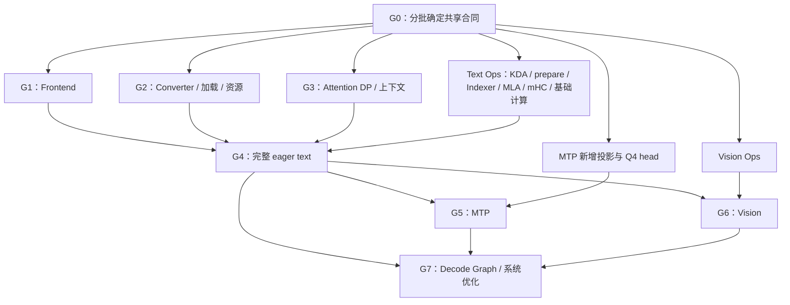

# GLM5Next 双 Spark 支持与优化路线

目标：通过公共 Engine、CLI、serve 和 ninfer-bench，在两台 DGX Spark 上完成
GLM-5.3-Flash 的加载、Text、原生 MTP、Vision、工具调用、约束输出、上下文复用
和 decode CUDA Graph，并针对实际推理负载优化。并行策略采用 TP2、EP2、
MLA/Indexer ADP2；KDA 使用 TP2。完整执行副本数为 DP1。

本文维护实施步骤、依赖、任务交接和阶段产出。模型数学与已有数值选择引用
[模型语义](../../maintainer/glm5next-model.md)、
[量化与数值表示](../../maintainer/glm5next-quantization.md)；模块放置参考
[并行设计](parallel.md)。具体接口在 G0 收敛后交给对应实现，不在路线文档重复公式。

## 1. 起点与目标组织

用于本路线的已有基础：

| 部分 | 起点 | 后续工作 |
|---|---|---|
| Engine、集中调度、分布式 Executor、worker、NCCL、提交与退役 | 主线已有双机 Qwen4Exp 实现 | 复用执行基础，接入 GLM 模块放置与调度 |
| 统一 Context 池与目录 | 已有 State variants、rank-local history placement、成组预留、搬移和执行视图 | 绑定 GLM 字段／页布局，接入 owner 选择及跨 owner 来源转换 |
| Artifact、编码权重切片、TP/EP 加载 | 已有通用基础 | GLM converter、绑定、并行物化及容量规划 |
| 基础 Linear/split、clamped SwiGLU、sigmoid router、本地 EP MoE | 主线已有 GLM 相关实现 | 对照实际调用补缺，迁入剩余优化，不按旧清单的未勾选状态重做 |
| `.50` 的 `feat/glm5next-dev-reorg` | 另有 NVFP4 MoE vector/load schedules、编译组织与测试整理 | 按主线 family 组织审查迁入 |
| KDA | 有通用 recurrent、batch update、chunked 入口 | 生产输入链、record/fold、Spark 分派和完整链路优化 |
| Kpool Sparse MLA、mHC | 有详细设计 | 实现、数学验证与调优 |
| GLM 模型入口、Frontend、Vision | 尚未集成 | 新架构接入 |

当前量化方案以已下载的 NVIDIA checkpoint 为来源：Main routed experts 和前三层
dense MLP 导入 NVFP4；KDA Q/K/V/O、Main/MTP MLA O 和 shared gate/up/down
使用 Q8 A16；MTP experts 转 block-FP8。Main head 保持 BF16，额外生成完整词表
Q4-G64 A16 optimized draft head。其余表示与编码由数值文档维护，G0 落实对应绑定。

模型层的执行分工如下；embedding、MTP stem 和 Vision 按已定
[并行设计](parallel.md#1-首版并行分工)放置。

| 模块 | 计算与历史归属 |
|---|---|
| KDA | 两侧处理全部请求，各计算 head 分片、保存本地 recurrent/conv state；O 局部输出求和 |
| MLA/Indexer | 请求 owner 计算完整 heads；latent、pooled keys、tail 归该 owner，完整输出汇集回两侧 |
| Dense/shared MLP、routed experts | intermediate TP2、expert EP2；shared 与 routed 的本地贡献合并后归约 |
| mHC | 权重与四流 residual 复制；消费完整分支输出，临时系数归执行 frame |
| Main/MTP head | vocabulary TP2；Main BF16，按配置选用额外 Q4 draft head；沿用分片 logits、采样、约束与 acceptance 的公共计算基础 |
| Main/MTP 历史 | MLA owner 相同，history pool、tail 与 frontier 独立 |

共享与特化按以下位置组织，实际文件数量随职责规模确定：

```text
src/text/、src/media/             文本与媒体处理基础
src/models/common/               Frontend 共用机制、权重与上下文机制
src/runtime/、src/distributed/    集中策略、资源合同、执行与通信
src/core/                        page/state/record 布局和非 owning views
src/ops/                         Linear、KDA、Kpool MLA、mHC 等数学 family
src/models/glm5_next/             config/definition/load、parallel、frontend/vision、
                                 execution/state、session/program
tools/convert/                   GLM 映射、recipe 与通用编码
```

Op 拥有数学、支持域和分派；Core 拥有物理布局；模型计划拥有切片和模块分布；
Session 拥有完整历史、前沿和恢复需求；共享调度/缓存策略选择可行候选；RankProgram
拥有设备资源、Op/通信顺序与 Graph。产品协议层消费标准输出事件。

## 2. 阶段与并行关系

| 阶段 | 工作 | 前置依赖 | 阶段产出 |
|---|---|---|---|
| G0 | 收敛接口、布局、模块放置与任务边界 | 现有设计和代码盘点 | 可供 converter、算子与运行时共同使用的合同 |
| G1 | 整理共享 Frontend，接入 GLM 文本输入输出 | G0 的 Frontend 合同 | GLM tokenizer/template、thinking/tools/constraints 可独立验证 |
| G2 | Converter、分片加载与执行资源基础 | G0 的权重和物理布局；最终准备使用实际 Op 容量查询 | 实际产物、可运行的双机加载与资源准备 |
| G3 | Attention DP、资源管理与前缀缓存 | G0 的 placement/context 合同 | 按 owner 分配、恢复和回收完整请求上下文 |
| G4 | 组装完整 eager text | G1/G2/G3；O-KDA、O-PREP、O-INDEX、O-MLA、O-HC 的可调用实现及所需基础 Op | 双机 prefill/decode、并发、缓存及完整生命周期 |
| G5 | 接入原生 MTP 和 optimized draft head | G4；record/fold、history-only 与 draft head | draft/verify/commit 和规范化后的 MTP 历史 |
| G6 | 接入 Vision 与媒体服务流程 | G4；O-VISION | 图像/视频进入同一 Engine、缓存和请求生命周期 |
| G7 | Decode Graph、端到端优化与收尾 | G4 后开始；最终汇合 G5/G6 和各 Op 的优化结果 | 完整 Graph 路径、性能与精度结果、集中整理文档 |



G0 按任务包交付接口，不等待所有主题同时结束。mHC 等独立算子的合同先完成即可
先交接；Indexer、Sparse MLA 在 page/selection views 确定后可以与 prepare 并行。
G1/G2/G3 的逻辑开发与 Op 工作并行，G2 的最终资源准备使用实际 Op 容量查询。
G5 与 G6 可以并行，ordinary decode Graph 在 G4 完成后即可开始。

每个 Op 包先提供正确、完整的可调用实现，再在同一合同下调优，模型组装可先消费
前者。GPU 性能测量按空闲设备排期。

## 3. G0：形成可交接的接口与布局

### 3.1 需要先收敛的共同决策

1. **模块放置与边界**：按[并行设计](parallel.md)复制 embedding、MTP stem 与 Vision
   权重；Vision 按完整 attention segment 分配任务。复制 hidden、owner 局部行、
   TP/EP 局部贡献之间的交接分别见 [MTP](mtp.md) 与 [Vision](vision.md)；执行接入
   继续落实实际 collective 和资源绑定。
2. **完整上下文**：区分两侧 KDA 分片、owner-local Main/MTP history/tail、conditioning；
   按[State variants](parallel.md#12-state-variants-与字段布局)绑定公共字段和 owner tails，
   checkpoint 记录同一次执行的完整前沿，声明各 rank 统一 Context 中的完整需求。
3. **物理布局**：确认 KDA conv/replay records、MLA page planes、tail/raw records、
   selection、权重 parents 和因子布局；提供共享的类型与布局计算实现。
4. **输入输出基础**：公共 prepared prompt 的归属、Frontend 合同、tokenizer pipeline、
   模板边界、工具语法与媒体身份；明确 Qwen 保留的特化和可抽取的共同机制。
5. **新增调用**：按 [MTP](mtp.md) 和 [Vision](vision.md) 的接口补齐 norm、bias、
   D64 attention 等需求。History-only 仅生成所需 latent/index/tail，不执行 readout/FFN/head。

### 3.2 每个 Op 包交接时必须明确的内容

| 项目 | 交接内容 |
|---|---|
| 数学与数值 | 公式组合、表示、计算许可、必要舍入、精确提交关系；引用相应权威定义 |
| 输入输出 | 轴含义、dtype、shape 范围、stride、alignment、有效列和输出写域 |
| 权重 | 编码及 parent 顺序、切片/view、标量 metadata、source 到本地参数的映射 |
| 状态 | State 字段／页记录 views、source/destination I64 offsets、frame record/selection 行映射、alias、零采用及无效行效果 |
| 执行资源 | caller-owned workspace 查询、执行借用、frame lifetime、搬迁后映射更新与 Graph 使用合同 |
| 工作负载 | 本地几何、T/B/context 范围及重点调优点；区分全局 batch 与 owner-local batch |

复用 Core 的 StateFieldView／PagedPlaneView 和布局计算，先落地 family 的读写类型
与绑定，再让消费者依赖；内部 helper 与 kernel 由该包自行组织。涉及跨包的合同修改先同步
生产者、消费者和 converter；tile、launch decomposition 和 shape policy 留给实现者。

已有设计入口：[KDA](replayssm-kda.md)、[Kpool MLA](kpool-sparse-mla.md)、
[mHC](mhc.md)、[MTP](mtp.md)、[Vision](vision.md)、[基础 Op](op-checklist.md)。
具体数学和接口由相应设计维护，shape 清单由基础 Op 任务维护。

## 4. 可并行交接的 Op 任务

| 包 | 工作范围与产出 | 开始条件与交接对象 |
|---|---|---|
| O-BASE：基础成果与 FFN/MoE | 迁入 `.50` 剩余有效候选；补齐 Q8 shared 完整 FFN，以及 NVFP4/FP8 routed＋Q8 shared 的完整 MoE | 可先盘点；新增 shared 路线依赖 O-LINEAR 的 Q8 GU/down。供 G2/G4/G5 使用 |
| O-LINEAR：新增投影 | Q8 shared GU/down 与 clamped GU、Q8 MLA O、BF16 MLA query/MTP stem、Q4 full-vocabulary draft head；先纯 Linear，再 split/epilogue | G0 的权重与输出布局；普通 BF16 Linear 出口不替代 prepare 的 FP32 norm 输入。供 O-BASE/O-PREP/G4/G5 使用 |
| O-KDA：完整 KDA 本地链 | 输入 projection/conv、控制投影、output gated norm；recurrent update/record、all-layer fold、长 prefill chunked；对齐 source/destination | KDA 权重、state/record views 确定；复用已有纯投影。供 G4/G5 使用 |
| O-PREP：MLA 准备与状态 | W_A 三种连续前缀的 prepare、BF16/FP8 latent 编码、learned pooling、update/record、tail 提取；history 三段一次投影 | W_A、page/tail/record 合同确定；与 converter 共用布局。供 O-INDEX/O-MLA/G4/G5 使用 |
| O-INDEX：Kpool Indexer | BF16 pooled-key scoring、精确 Top512、短上下文全选、selection_end；不同请求长度和有效行 | index cache 与 selection 合同确定；可直接构造合法输入，不等待 prepare 完成 |
| O-MLA：Sparse MLA | U_K/U_V 因子、latent attention、BF16/FP8 cache 读取、完整 BF16 heads；四 token 分组读取和冻结 tail | latent/selection/factor views 确定；可独立构造选择集合，不等待 Indexer 完成 |
| O-HC：mHC | expand_pre、pre、post、post_pre、post_mean_norm 五个入口及 Spark 调优 | residual/系数布局和数值边界确定即可启动；供 G4 使用 |
| O-VISION：视觉计算 | patch/downsample 的数据重排与投影、Q/K norm/RoPE、非因果 attention、带 bias 的 clamped FFN、merger | processor patch/grid 顺序与各计算边界确定；供 G6 使用 |

包是分工单位，不是新增目录层级。O-KDA 保持在线性注意力 family 内，纯投影仍归
Linear；prepare/Indexer/sparse MLA 使用明确的独立 Op，模型负责组合。已有符合
数学与性能要求的实现直接使用。

任务交付包含生产接口、实现、对应 tests/bench 和必要构建注册。数学资格遵循
[Op 开发规范](../../maintainer/op-development.md)；性能结果给出耗时、实际流量/
FLOPs 口径和 roofline，使用已有 bench。完成候选审查和有意义的验证后合入，
具体工作区与提交操作在下发任务时安排。

调优覆盖 decode 小列数、MTP/verify 的 T×B 以及 prefill。Linear 的 M 覆盖到
2048/4096，重点保留 1..8；KDA 分开测 recurrent/record/fold 与长 prefill；
Indexer/MLA 同时改变输入长度与已有上下文，覆盖短上下文、64K/256K/1M 及混合长度。
先检查已有 test/bench 的数学和流量口径，再用代表点定位，按瓶颈扩展测量。

## 5. 主工作区的集成步骤

### G1：共享 Frontend 与 GLM 文本输入输出

将 Engine 中直接绑定 Qwen 的 PreparedPrompt/Frontend 使用改为对应模型的正式合同。
抽取 BPE merge/字节处理、Jinja、输出与约束的共同机制，保留各模型的输入语言和
状态解释。GLM 按实际 tokenizer 的无 normalizer、数字 1..3 位切分处理，接入角色、
EOS、thinking、模板续接与语义 checkpoint 边界。

完成 GLM tool-call 参数序列化/流式解析、tool choice、JSON/schema 约束与 forced
control 的协作。serve 继续使用统一输出事件；GLM 标签及不支持行为由 Frontend
处理。使用真实 tokenizer/template 和已有协议测试验证，无需等待模型权重转换。

**产出：输入 token、模板边界、thinking/tool/constraint 输出语义已具备集成条件。**

### G2：权重产物、分片加载与执行资源

新增 GLM config、definition、converter 和 binding；采用已有流式转换基础，补齐
block-FP8 编码、Q4 proposal head 与源资源封装。按 G0 的布局生成权重，加载期执行
TP/EP 分片及必要组合；模型配置与并行计划是本地几何的共同来源。

声明 Main/MTP/Vision 组件和使用关系，建立 page/state/frame/record/workspace 规划。
每 rank 注册 owner/non-owner State 与 Main/MTP 页记录，规划一份共享 Context backing；
权重、frame、执行表、workspace 和 Graph 另外计费。最终准备消费实际布局及 Op 容量查询，
按完整启动工作集检查各候选 owner 的容量，与 G3 一起确定部署预算。

**产出：真实 `.ninfer`，双机按计划加载及准备/销毁资源，实际预算与绑定可检查。**

### G3：Attention DP、上下文与请求放置

本阶段在一个执行实例内接入 ADP2，完整 DP 副本路由后续实施；命名与所有权边界见
[DP 与 ADP 合同](../attention-dp-placement.md#11-dp-与-adp)。

使用现有 State variants 与 history placement 表达两侧 KDA 分片、owner-only tails
和 Main/MTP histories。同一 rank 的全部记录共享 Context 容量；短缺、回收和成组
预留通过已有目录针对具体 rank／存储域评估，GLM 不另建可用容量账本。

具体合同与实施顺序见 [Attention DP 放置与上下文管理](../attention-dp-placement.md)。
请求来源候选包含 checkpoint 与目标 attention owner。Session 提供合法恢复组合、
资源需求、传输及重建工作；共享策略先检查完整资源可行性，再按 token 负载与本地
前缀亲和选择。扩展按需求身份取回的预留合同，支持混合 variant 和 history owner。
一次请求普通执行期间 owner 稳定，Main/MTP 共用 owner。全局 batch 与 owner-local
行映射在一次执行中固定，KDA/TP/EP 继续处理完整 batch。

先接通同 owner 的共享/COW、capture/restore、暂停恢复和释放，再接 admission 时
的跨 owner 来源转换及容量压力下的请求转换。前缀索引保留不同放置的可恢复实例，
副本由实际请求恢复和正常 checkpoint 保存产生。转换需新建相应 State variant 和
history placement，复制公共字段、传输 owner history/tail，全部参与 rank 退役后
发布；现有同 variant／placement 恢复不能直接执行此转换。普通 decode 不为负载
均衡迁移活动请求；峰值无法容纳转换时，沿用有年龄优先级的暂停／Replay 保证进展。

**产出：统一 Context 余量可用于请求和前缀缓存，完整上下文的采用与回收遵循同一事务。**

### G4：完整 eager text

注册 `glm5_next`，实现 Session、RankProgram 和实际层序：embedding → mHC →
KDA/MLA → mHC → dense/MoE → 最终 hidden/head。接通 TP 求和、MLA owner 输出
汇集、分片采样/评分及输出交接，通信按模型边界组织。

从 prefill、ordinary decode 接到并发、混合长度、前缀恢复、强制控制、取消和
EOS 结束；验证两侧 owner 分布不均以及一侧无 MLA 行的执行。BF16 latent 先接通，
随后在同一运行与状态路径接入 FP8 latent。逐层数值检查用于定位，最终通过公共
Engine/serve 验证；保留当前 Qwen 的受影响路径。

**产出：可实际使用的双机 eager text，后续功能在同一执行和状态基础上加入。**

### G5：原生 MTP 与 optimized draft head

按 [MTP 设计](mtp.md)接入 stem、独立 MLA/MoE、最终 norm、分片 draft head、verify 与 acceptance。
首步产生 selection，后续 draft 复用冻结的 pools 和 selection_end；provisional
cache 仍按真实输入维护。Main hidden 与递归 draft hidden 保持各自含义。

采用最终接受长度时，完成 KDA fold、MLA coverage 和 tail 提取；以真实 Main
conditioning 建立 canonical MTP history。History-only 从连续权重 view 计算必要
投影与状态，不重跑完整 MTP。Q4 head 使用完整词表，参与现有配置、加载与决策合同。

覆盖不同 draft 长度、ragged batch、部分接受和终态前缀，实际测量 draft/target/commit
开销及接受情况。

**产出：普通和 speculative 执行共用完整状态合同，实际 decode step 能体现优化收益。**

### G6：Vision 与媒体流程

按 [Vision 设计](vision.md)实现 GLM processor、图像/视频 patch 与 grid 排列、encoder、
downsample/merger；复用媒体解码和处理任务池。按完整 segment 分配计算及特征交接，token
展开、特征顺序、媒体身份和 prefix cache 一致。

在 G4 的服务路径中完成图像/视频、多轮和媒体前缀复用，并与 MTP、工具与约束输出
组合检查。Vision 使用自己的空间位置，Text 历史按 GLM 的 token ordinal 解释。

**产出：媒体请求通过相同 Engine 生命周期使用，资源和缓存归属完整。**

### G7：Decode Graph、系统优化与收尾

G4 后先接 ordinary decode Graph，G5 后接 MTP draft/verify/commit；Vision 进入
已有 prefill 流程，prefill 本轮保持 eager。固定 frame/backing 和 collective 次序，
按需要的全局/局部 batch 几何准备 Graph，长度、I64 record/page offsets 与 selection 通过正式
输入或 Op 更新合同变化。避免按每个请求身份组合复制 Graph。

汇合各 Op 的最终优化后，通过 ninfer-bench 和必要的 nsys capture 检查 prefill chunk、
实际 batch 下的 decode step、draft/target/commit、通信等待和两侧 attention 工作。
结合真实 expert 分布、不同上下文、owner 不均衡和缓存命中场景优化；检查 per-owner
容量与缓存/执行观测能解释行为。数值与精度评测覆盖新架构和量化产物。

最后集中整理源码与稳定文档，将已落地合同归位，删除被替代的接口、设计与重复说明。

**产出：完整目标功能及深度优化结果，性能、资源和剩余限制都有实际证据。**

## 6. 执行清单

阶段完成时在此勾选；各 Op 的详细进度留在实际任务材料中，避免多处重复维护。

- [ ] G0：模块放置、上下文、权重与各任务包接口已收敛并交接。
- [ ] G1：共享 Frontend 与 GLM 文本输入输出完成。
- [ ] G2：实际权重产物、双机分片加载和资源基础完成。
- [ ] G3：Attention DP、请求放置、前缀缓存和完整上下文管理完成。
- [ ] G4：完整 eager text 及目标 latent profiles 完成。
- [ ] G5：原生 MTP、最小 history 重建及 optimized draft head 完成。
- [ ] G6：Vision 与媒体服务流程完成。
- [ ] G7：Decode Graph、最终 Op 优化合入、系统性能/精度及代码文档收尾完成。
