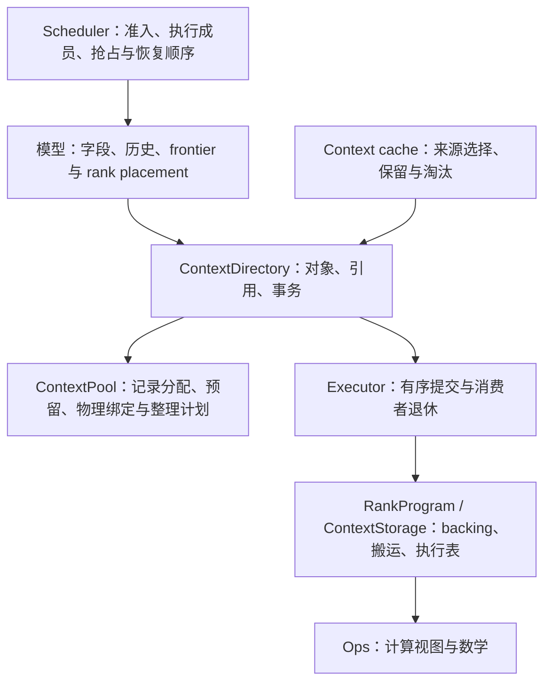

# 统一 Context 存储池

本文记录 KV history 与请求 State 共用底层容量的设计决策、容量论证与验证要求。
当前存储和执行视图合同见 [Context 存储](../maintainer/paged-kv-cache.md)，
准入、缓存与回收合同见 [Context 缓存](../maintainer/resource-scheduling-and-context-cache.md)，
所有权与执行生命周期见 [Engine 架构](../maintainer/engine-architecture.md)。

模型数学、量化编码及 checkpoint 的数学条件由各自合同维护。GLM 待实现设计采用相同的资源
合同；其 KDA、mHC、MLA 数学定义和既定并行策略仍以对应设计为准，完整模型验证随集成进行。

## 1. 目标、对象与边界

每个 rank 的 Device Context 有一份固定 backing 和总容量。KV 与 state 按实际对象需求占用，
不在启动时分别预扣 KV 页数和 state 数量。RTX 5090 的 Host Context 是另一个容量域；
Spark 不建立重复的 Host Context cache。不同 rank、不同存储域的空闲量不能相加冒充本地可用量。

| 对象 | 语义 | 分配与修改 |
|---|---|---|
| KV history | 按原 token ordinal 增长；前缀共享、分叉、截断；不同 backend 可以有不同 frontier | 按逻辑页增量申请；引用保护共享内容；写入冲突时做必要的尾页 COW |
| State | 表示某个 token 位置的完整续算状态 | 单份大小由布局确定；当前版本可以更新；checkpoint 冻结；后续独立写入需要独立对象 |

State 可以包含 GDN/KDA recurrent state、convolution history、Indexer tail、PLE convolution history、
续算 hidden、DFlash cyclic KV 等。字段不是内存池单独调度的对象；分布式时，一份逻辑 State 由
placement 指定的各 rank-local image 共同组成。

不进入本池的内容包括权重与 expert cache、PLE embedding 表及其 I/O cache、Vision 临时 K/V、
activation/workspace、ReplaySSM transition records、draft 临时 tail/hidden/selection、采样缓冲。
它们有独立的数学或执行生命周期，仍由原 owner 显式规划。PLE 的跨 token convolution history
属于 State；PLE 的大表属于权重放置。

本设计保持三种独立粒度：逻辑 KV 页、逐 token 的有效 frontier、模型允许恢复的 checkpoint。
池内大块不改变其中任何一种。当前逻辑 KV 页仍为 64 token；每个模型实例的尺寸来自 config、
selected backend 与 rank placement，不成为引擎中的架构常数。

## 2. 所有权



| 所属模块 | 唯一负责的事实 |
|---|---|
| 模型 Definition / Session | 字段与 history 几何、放置、Main/backend 前沿关系、完整恢复条件、启动工作集与执行链的峰值需求 |
| ContextDirectory / KV、State 管理 | 对象身份、rank-local 部分、引用、写权限、版本与覆盖、副本、成组预留、执行绑定和事务 |
| ContextPool | 某个容量域内的记录位置、空位、大块归属、预留、可行性与物理整理计划 |
| ResourceManager | 根据实际恢复价值和可回收结果选择 checkpoint/continuation；不解释池内大块 |
| Scheduler / EngineCore | 活动集合、请求优先顺序、准入、抢占与恢复机会；消费 Session 的需求评估，不推导模型前沿或记录大小 |
| Executor | frame 与后续提交额度、ticket、依赖、维护窗口、各 rank 完成与退休；不选择缓存受害者 |
| RankProgram / ContextStorage | RankProgram 拥有 backing，ContextStorage 借用并执行本地字节操作与视图更新；报告完成，不选择物理位置、淘汰对象或发布逻辑对象 |
| Op | 计算语义、视图和 alias 合同、支持范围、实现分派；不拥有对象或分配器 |

集中调度下，ContextDirectory 持有各 rank 的分配账本；rank 仅执行确定的 offset/length 动作。
本地执行采用相同关系。池中的记录不保存 token、模型层号、checkpoint 价值或并行策略。
模型向存储声明布局，存储向池提供字节数和对齐，是公开合同；池的块编号、增长方向与空闲链表
不进入模型、缓存策略或 kernel。

模型的无地址 schema 声明 State 字段、各 history 的记录布局和所需 rank 集合；Session 从原生
工作生成语义需求。Directory 统一解析对象复用、COW、缺失副本和容量请求。Qwen3.5、Qwen4Exp
与后续 GLM 共用这些机制，各自保留数学前沿和执行组织。错误由无法履行合同的模块报告，Runtime
传递模型/存储的需求评估和原因，不复制它们的支持规则。

## 3. 身份、存储布局与借用

### 3.1 逻辑对象、rank-local 部分与副本

```text
StateId / PageId                     逻辑对象与 generation
  └─ placement 指定的 rank-local 部分  本地布局、数据分片或复制字段
       ├─ Device replica             AllocationId、内容版本/覆盖、就绪依赖
       └─ Host replica               AllocationId、内容版本/覆盖、就绪依赖
```

`HistoryId` 带 generation，标识逻辑 PageId 序列及其覆盖；history 种类区分 Main、MTP 等语义，不再标识独立
物理容量。每个 rank-local 部分按 schema 保持一份连续记录。TP 的两个数据分片不能互作恢复
来源；同一个分片在 Device/Host 的内容才是存储副本。复制的字段也计入各自所在 rank 的记录。

一个逻辑 StateId 可以拥有多个本地 image。Qwen4Exp 的完整 State 需要两侧 shard；GLM 两侧
都有 KDA shard，而 raw index tail 只在 owner image 中。相应 PageId 可以需要两侧 head shards，
也可以仅需要 owner 的 MLA/index history。完整 checkpoint 的所需部分由模型 schema 决定，
Directory 按这份声明管理引用、就绪和释放，不依赖两侧编号、大小或物理位置相等。

每份物理副本持有其容量域内带 generation 的 `AllocationId`；搬移不改变该 ID。
分配器维护 `AllocationId → {class, byte_offset, binding_epoch}`，只管理物理绑定。
对象的内容版本、有效覆盖与生产依赖属于 Directory，模型的 token frontier 属于 Session。
相同 `{bytes, alignment}` 可以共用分配类别，不能据此把不同 schema 的对象互相解释。

调度、缓存和请求长期持有逻辑身份；物理地址仅在执行准备或传输准备时解析。容量域由 rank 与
存储位置确定，Device/Host 空闲量及不同 rank 的空闲量分别评估。

引用保证对象存在并维持读写语义；执行借用保证消费者期间地址稳定。普通 checkpoint 引用
不永久锁住物理位置。GPU 计算、Host DMA 和物理复制的借用延续到相应 ticket 完成。
最后一个逻辑引用结束时，仍被执行借用的记录进入待退休集合；Directory 在借用结束后才调用池的
`release`。释放对象身份、归还物理位置和内容提交是三个不同动作。

### 3.2 内容版本、有效覆盖与就绪

| 变化 | 逻辑内容与副本规则 |
|---|---|
| State 数学提交 | 产生新的完整内容版本；checkpoint 保留所引用的旧版本，各必需 shard 共同采用 |
| State 复制/冻结 | 保留内容版本；复制目标完成前处于 pending，冻结只改变修改权限 |
| KV 合法追加 | 扩展对应副本的有效 coverage，保留未修改前缀的内容身份；其他副本较短但仍有效的前缀不失效 |
| KV 后缀重写/截断 | 根据写区间与 retained/protected coverage 判断；受保护内容有冲突时先分支/COW，各副本覆盖只保留仍有效的前缀 |
| 同域物理搬移 | 仅更新 allocation 的 binding epoch；逻辑身份、State 版本、KV coverage 和恢复资格不变 |

State 的完整版本与 KV 的前缀覆盖采用不同规则。KV page 的 content epoch 用于标识所属内容代次，
覆盖描述该代次的有效前缀；不能在每次追加时递增整页版本、使旧 Host 前缀全部失效。例如 Host
保存页内 `[0,20)`，Device 合法追加到 30 后，Host 仍可恢复所需覆盖不超过 20 的旧前缀。
重写开始于 20 时，仍然保留 `[0,20)`，更深 coverage 按实际修改范围撤销。COW 目标获得独立
PageId，已有来源及其受保护前缀不被覆写。

就绪与版本分开记录。CommitReceipt 允许 Session 采用已经有序接受的逻辑结果，物理写入可以
尚未退休；后续消费者必须继承生产依赖。对外发布 checkpoint、归还旧副本或移动记录，分别满足
各自的完成条件，不能仅因逻辑 frontier 已更新就认为地址可以复用。

QSA/MLA 的 KV 与 pooled index plane 共用原 token coverage，各 plane 的有效行数仍按自身
`tokens_per_row` 解释。以 GLM 从 63 执行到 69、只采用到 65 为例：latent 有效到 65，pooled
keys 有效到 `floor(65/4)`，raw tail 由 State 保留位置 64；已写入的拒绝后缀不扩大恢复覆盖。

### 3.3 自然对象布局

State 的每个 rank-local 部分采用一份连续 image。字段及层内矩阵保留固定相对偏移与自然连续轴；
允许复制指定字段组。是否需要复制、哪些字段由下一次计算覆盖，由模型执行语义决定。

KV 管理将同一逻辑页组内、共享 frontier 与生命周期的全部 planes 打包为一个连续记录。
记录内按 layer/plane 保存 codes、scales、K/V 或 latent、pooled index keys；每个 plane 的布局
来自对应 codec。此选择便于页复制和搬移，属于 KV 存储实现，不是分配器要求。
Main、MTP、Draft Full 保持独立 history 与记录布局，不为凑大块而合并生命周期。

每个 plane 在记录内保留 feature 连续、token 次之、head 再外的页内排列和原有 codec。
原 PageMajor 路径主要改变页组定位；原 Draft Full 的 HeadMajor 路径还要将跨整个物理页池的
head stride 改成记录内的 head stride，移除 `physical_pages × head` 寻址。消费者统一通过
plane 几何解释记录，不保留依赖物理容量的张量轴。

对于固定层，跨页访问将跨过其他层的 payload，区别于原先按 plane 分开分配的数组。每个 head
页内的连续读取可以保留，但跨页地址局部性与 TLB 行为需要在长上下文 Attention/Indexer 中
验证，不能只凭逻辑表相同就认定性能相同。

首版字段/plane 对齐为 256 B，沿用现有布局生成与 packed Host page 的规则。
记录布局必须计入 plane 间 padding，不能只累加每 token 的数值载荷。
Device/Host 使用同一记录字节表示，迁移不重新量化。

GPU 执行表与 valid frontier 不放进 KV payload；请求/版本元数据也不放进 State payload。
State 中只有数学消费者需要持久化的字段。已有 CPU token ledger 能恢复的 PLE token IDs
继续作为 frame 输入准备，不额外复制进每份 StateImage。

### 3.4 控制侧接口轮廓

以下为目标职责与类型关系；完整声明由对应模块实现，不引入公共 SDK：

```cpp
struct RecordSpec {
    std::size_t bytes;
    std::size_t alignment;
};

struct RecordRequest {
    RecordClassId record_class;
    std::uint32_t count;
};

struct RecordMove {
    AllocationId allocation;
    std::uint64_t source_offset;
    std::uint64_t destination_offset;
    std::uint64_t bytes;
};

class ContextPool {
public:
    PoolAssessment assess(std::span<const RecordRequest> demand,
                          std::span<const AllocationId> releases) const;
    PoolReserveResult reserve(std::span<const RecordRequest> demand);
    void release(AllocationId allocation);
    RecordBinding resolve(AllocationId allocation) const;
};
```

`assess` 只预览可行性与搬移需求，不删除对象、不提交 GPU 工作。结果关联本次账本修订及其
释放前提。`reserve` 对整个 demand 全成或全败；成功返回拥有实际放置能力的 `PoolReservation`，
可能需要先执行整理，才允许物化记录。消费预留取得 AllocationId 时不再竞争公共容量。
`resolve` 只在对应域的有效执行借用内使用，不隐式分配、搬移、同步或改变权限；未就绪记录不能
解析为可使用的绑定。预留的使用、调整、取消和退休转换由同一池实现，职责见 §5。
缓存策略通过 Session 查询这些结果，不直接持有 `RecordClassId` 或 `AllocationId`。
逻辑需求可以列出 State/history，但这些用途不再对应独立的物理容量或 shortage 计数。

连续性以单个记录为单位：一份 StateImage 或一个 KV 页组连续，多个记录可以离散放置。整个 demand
不要求一个总长度连续区间，连续 run 只用于改善搬运。评估必须在同一临时放置状态中为整组记录分配
位置；不能检查 `can_allocate(total_bytes)`，也不能将各记录独立探测的结果合取，重复使用同一空位。

`assess` 与 `reserve` 共用放置规划。在账本没有计划外变化、所列释放条件已经兑现时，评估通过的
完整方案必须能够预留；需要整理的方案先取得其整理预留。评估本身不产生释放或占位副作用，Directory
在提交前重新确认引用与账本条件。条件变化则重新评估；条件一致却不能兑现时报告存储合同错误，
不将其作为普通容量不足交给缓存删除来兜底。

Session 对 Runtime 返回语义需求及其评估，不返回物理类别或 allocation 列表。一次需求评估固定
来源、版本/coverage、引用保护、placement 和实际执行范围；Directory 将这份需求解析为各域的
放置方案。缓存回收使用同一需求，累积可释放对象后重新查询可行性。模型不自行维护一份可用字节账本。

## 4. 统一池的分配算法

### 4.1 固定记录尺寸、动态大块归属

模型实例准备时注册有限的 `{bytes, alignment}`，相同规格复用尺寸类别。运行时增加对象数量，
不临时增加格式类别。类别 ID 是分配器内部身份，不代表 KV/State 的语义类型。
记录 bytes 为正，alignment 为二的幂；backing 基址与块起点满足所有已注册对齐。

令类别 i 的对齐后记录跨度为 `s_i`。首版采用：

```text
A = max(record alignments)
B = align_up(max(s_i), A)
N = floor(context_capacity / B)
q_i = floor(B / s_i)
r_i = B - q_i * s_i
```

每个大块是以下两种状态之一：公共空块，或属于某个尺寸类别、容纳 `q_i` 个记录的块。
不要求同类大块相邻，不存在 Main/MTP/State 区域顺序。`B`、`q_i`、大块编号仅由池解释。
最大记录一块一份，因而现有模型的完整 State 通常无需为整理而移动。

每个容量域按自身注册的规格计算 B。运行时可成为 GLM attention owner 的 rank 预先注册 owner
与 non-owner 两种 State 记录，以及本地 MLA histories；创建一个请求只占用其实际 placement
需要的记录。未启用的 backend 不注册空记录，也不预占空间。

该 B 是确定的首版算法，后续可以仅在分配器内改进选块规格；不能把 B 传给算子，或要求模型
为提高装载率调整矩阵、KV 页大小、checkpoint 位置。首版不增加可变大块、跨块记录或多套后备分配器。

### 4.2 普通分配与释放

1. 在同类别已有空位中分配，优先填充占用较高的块；批量申请在块内尽量形成连续 run。
2. 不足时，从公共空块取得任意块并赋予该类别。
3. 普通释放只归还记录；块内没有 live、reserved 或 pending-retirement 占用时立即回到公共集合，
   不做 payload 复制。
4. 同一类别可保留多个有空位的块，但不能为了未来可能的需求私扣空块。
5. 未完成消费者或未完成迁移占据的记录仍计为占用，不作为现在可用的容量。

索引按类别维护非满块、空位及占用计数。正常分配不扫描全部对象；物理整理的候选搜索只在压力时进行。
元数据按记录管理，不建立逐层、逐 head 的物理分配记录。

未物化预留锁定可兑现的类别位置或等价块内容量，并参与占用计数。它没有已发布 payload，位置可以
由同一放置计划调整；其容量承诺不能被其他申请使用。Directory 的逻辑 State/Page ID 可以在物化时
取得，但所需描述符已纳入许可。缩减预留立即归还尚未使用的位置，已提交动作涉及的记录等到退休。

### 4.3 整理与容量交换

当公共空块不足，且某类别的总空位允许归还完整块时，选择该类别中需搬移载荷较少的块作为 donor。
先确定 donor 集，再将其记录安排到保留块的空位；目标不能又成为本批 donor。
所有源区间与目标区间互不重叠，复制可批量并行，没有重叠 `memmove` 或搬移循环。

这里的空位不包含已有预留或未退休占用；donor 中的未物化预留一起重新安置，只更新元数据。
维护窗口中的物理占用按可移动记录处理，仍被消费者使用的记录必须先等其退休。对一个类别，
若总空位至少为 q，选定 donor 中有 h 个空位，则外部至少有 `q-h` 个空位，足够承接 donor 的
`q-h` 个占位。存在非满候选，按最少载荷选出的 donor 的 payload 搬移量 `< B`。
回收 k 块时搬移量 `< kB`；这是可移动记录满足条件时的上界，不包含等待、表更新和提交成本。

整理只为满足当前成组需求执行足够数量的块，不在每次释放后全池压实。正在使用的对象不能边写边搬。
如果空间只有在消费者退休后才能使用，返回等待条件；如果缺少足够的可转换空位，返回回收压力。

### 4.4 空间损失与可行性

类别 i 的互斥占用计数为 `live + reserved + pending-retirement`。在一个放置阶段，以 n_i
表示需要同时存在的总占位数，充分整理后需要：

\[
m_i=\lceil n_i/q_i\rceil,
\qquad C_{used}=B\sum_i m_i.
\]

损失包含各块 `r_i`、各类别最后一个未满块，以及 backing 的不足一块尾部。
类别尾部损失在可充分整理时每类小于 B；每块 r_i 则随容量累积。借用未结束时，暂不可转换的空位可能更多。
源/目标同时存在的迁移或 COW 分别计费；同一个记录附带的退休后接管权不再额外计一个占位。
执行链按各依赖阶段检查峰值，不把不同时间才能使用的空间提前记为公共空闲。

本方案不保证任意空闲字节立即互换。例如 Qwen4Exp TP2/BF16 下，Main 空出 40×816 KiB，
MTP 空出 500×68 KiB，合计 65.078 MiB，仍不足以分别清空一个 69-record 或 832-record 的块。
没有公共空块时，不能据此承诺一份 55.268 MiB State 的申请成功。

因此准入和回收使用池的成组可行性，不使用 `free_bytes >= requested_bytes` 代替。

## 5. 执行需求、事务与异步管理

### 5.1 完整执行需求

一次需求对应可独立提交并完成的工作，而非某次底层 `allocate`。Session 根据原生工作与当前来源
给出 State 的读写关系、各 history 的实际读写前沿、恢复与迁移目标及生命周期；Directory 据此解析
现有对象复用、实际 COW、新增记录和需要保护的来源。两种模型共享这个管理过程，各自保留数学需求生成。

| 需求内容 | 约定 |
|---|---|
| 已有对象 | 借用已有 allocation，不重复计费；同一物理对象的多个引用去重 |
| State 写入 | 区分原位 writer、接管、读源写目的、Host 恢复；不统一假设每次都新增一份 image |
| History 写入 | 按最大实际写入 frontier 计算增长和受保护范围冲突产生的 COW；不只计算提交后的长度 |
| 后续阶段 | 包含本轮 draft、target、决定、fold、canonical 补齐和 commit 所需的 Context 资源 |
| 物理生命周期 | 源和目标同时存活的期间都计费；仅在真实消费者退休后才允许复用其空间 |
| 控制元数据 | 对象描述符、history 分支/成员、执行绑定及提交所需的目录变化在不可撤销准备前取得容量 |
| 执行资源 | frame、后续 supply/commit/discard、复制描述符和 staging 由 Executor/RankProgram 保障 |
| 可选保存 | 单独作为可撤销附加需求，不混入必要执行的最低需求 |

Session 保留模型相关的需求描述；Directory 将其转换为各容量域的记录请求。执行许可持有对应的
owning reservation 和逻辑对象保护，Work 只携带已确定的值描述。一次需求可以包含已有分配、
新增位置与依赖退休后的接管，按实际重叠存活关系规划。许可取得后，commit/discard 所需的
Context 空间和目录变更都已保障；后续阶段只消费或转换原许可，不重新参与准入与缓存回收。

| 容量承诺 | 兑现方式 |
|---|---|
| 已有记录复用 | 保持其所有权与实际读写权限，按同一 allocation 去重，不再次扣容量 |
| 未物化增长 | 在 PoolReservation 中保留类别位置及描述符额度，物化不再查询公共余量 |
| 退休后接管 | 将明确记录的后续使用权交给原许可；直到前消费者退休才可用，期间不归还公共容量 |
| 预留调整 | 先评估完整新方案，成功后替换原承诺；失败保留原许可和可执行状态 |
| 未消费余额 | 工作结束或恢复保护解除后归还；涉及在途动作的部分延迟至对应退休 |

退休后接管只表达确定的依赖顺序，不能依赖未来尚未选定的缓存淘汰。若下一用途需要换类或整理，
其完整放置与维护动作也必须已被保障，并安排在前一执行 ticket 退休后的独立 Context 操作中。
同一个未退休计算的后续阶段使用已保障的记录，不等待需要它先退休的维护窗口。不能将待退休
记录同时计作可用容量和已消费的新目标，也不能把一次确定的接管重复计成两份物理占用。

例如恢复链某一步裁剪的临时尾页，在消费者退休后可以重新成为同一许可尚需的增长预留：其物理占位在
`pending-retirement → reserved` 间直接转换。原 `reserve_after_retirement` / `publish` 中
重新调用 `reserve_growth` 的做法由这种所有权转移替换；不会先释放，再尝试从公共池抢回。

缓存来源、引用保护、执行窗口或成员改变后，重新评估受影响的需求。不能先按未共享尾页取得许可，
再添加 checkpoint 引用，使已承诺执行突然需要额外 COW。没有这些变化的普通 step 只计算实际增量，
不扫描全部缓存或重建整个 history。

### 5.2 分配与整理的提交顺序

```text
语义需求 → 成组预留 → 必要的存储整理 → 绑定/初始化就绪 → 数学执行 → 内容提交 → 释放
```

成组预留先取得全部当前目标、后续容量承诺、搬移目的和待回收块的独占权。独立的未提交准备
可以完整取消，原有对象与许可保持有效。进入已接受工作的活动目录 mutation 后，执行侧必须兑现
其 COW/mapping 等动作至退休；此处失败沿实例失败流程排空，不再解释成普通准入失败。

整理提交后，即使请求取消，也要完成已经提交的字节移动和位置发布，再释放不再需要的预留。
取消撤销的是请求采用/发布意图，已经完成的 relocation 对仍存活对象继续有效；不会回滚 CPU
地址记录、假装设备没有执行过移动。

Executor 的执行额度与 Context 预留在一次不等待的准备尝试中协调取得。必要资源未取得时，撤销该次
未提交的临时占位，交回明确的压力或等待原因。需要整理/交换时，先保障该存储操作的执行资源，再提交；
不能占着计算 frame 等待一个必须借用同一额度才能完成的回收操作。受保护恢复的长期预留见 §6.6。

预留与执行 ticket 分开管理，避免把一次计算的多个后续动作误认为多次独立准入：

| 阶段 | 所有权与允许动作 |
|---|---|
| Assessed | 只读评估，不占资源；来源/引用/账本变化后重新评估 |
| Reserved | Directory 持有容量和元数据；无需存储动作的部分立即可用，未提交部分可取消 |
| Preparing | 已提交初始化、复制或整理；来源、目的、地址及描述符保持到消费者退休 |
| Ready / In use | 按依赖消费记录并转交实际 owner；执行借用保护地址，未消费余额仍归许可 |
| Settled | 实际对象由 State/history owner 持有，余额归还；后续接管按原许可转换 |

同一许可可同时含处于不同阶段的部分。Executor 持有 ticket 与依赖，不接管分配账本；Directory
消费完成事件后发布绑定或结算占位。被选作 donor 的块及其目标空位期间不接受普通分配，物理复制
不与后续数学写入并行。

物理整理完成顺序固定为：复制 payload → 更新受影响执行绑定 → 确认完成 → 发布新位置、归还旧块。
期间旧位置不能交给其他 writer，新位置也不能提前给计算使用。内容版本与 coverage 保持不变。
物理执行错误沿现有实例失败/排空路径传播，不在地址状态未知时继续调度。

Submitted、ResultReady、CommitReceipt、DeviceRetired 沿用现有执行事实。ResultReady 不释放
许可或借用；CommitReceipt 允许采用逻辑前沿；DeviceRetired 才结束最后消费者的地址保护。
正常输出提交不额外等待全设备同步，物理回收也不提前到逻辑提交时执行。

### 5.3 借用与整理窗口

首版在该 rank、该存储域的既有计算/传输消费者退休后执行整理。Executor 用已有 ticket/event
建立顺序，整理期间取得该池的独占维护权；不逐页创建事件，不在普通 decode 中增加全设备同步。
没有整理需求时不获取独占维护权，原来的计算与传输调度继续适用。

取得执行借用先于解析地址和填充 frame。进入维护窗口时，先关闭该域的新借用，再等待既有借用退休；
已经准备但尚未提交的物理 frame 同样持有借用，取消时显式释放。期间可以继续准备不含物理地址的
逻辑计划，不能提前解析后续执行的 State offset。整理发布后重新开放借用。
既有已准备 frame 必须按原依赖提交或取消，不能等待维护结束才处理，从而阻止自身借用退休。

维护权属于对应容量域的一次显式 Context 操作，由 Directory 的地址借用门与 Executor 的完成事实
共同兑现。等待对象必须是已经存在且能退休的工作，维护自身的复制不再请求被它关闭的普通借用。
维护执行描述符与 staging 提前准备，不向正在整理的 Context 池申请临时 payload。涉及 Host DMA
时同时保护两端，任一端整理都等待这次传输退出。

这项选择避免为每次 decode 遍历整个历史来 pin/unpin 所有物理页。执行借用以 frame/history binding
为单位登记，State 的源/目的按当前 batch 登记。逻辑引用仍按对象维护，不与维护窗口混用。
维护需要等待尚未结束的传输，是明确的成本；首版不增加边计算边重定位的复杂路径。

### 5.4 执行绑定与地址表

只有 active execution row 持有 GPU KV 页表，inactive cached history 只保存逻辑 PageId 序列与覆盖信息。
新绑定/恢复建立一次执行表；增长、COW、截断和搬移只更新受影响位置。

存储绑定维护 `(PageId, rank-local 部分) → active table locations` 的反向关系，记录 table row
generation 与逻辑页位置。它只覆盖当前绑定，不为缓存中的每个共享前缀复制一份 GPU 表。
搬移修改该页的已登记位置；row 解绑/复用时撤销旧关系，防止 patch 写入另一请求的表。
State 只需在后续 frame 准备中解析新地址。
不在每个 step 重新翻译全部 cached pages，也不让 kernel 逐层追踪 AllocationId。

映射数组和 State offsets 由提交它们的 frame/Context 操作拥有，上传源保持到 H2D 完成。
可执行 frame 同时绑定 residency、内容依赖和物理借用；只保存一组裸 offset 不能延长对象生命周期。
搬移完成后按最终 mapping patch，再开放新绑定；排队但未持有地址的逻辑工作使用新 binding。

### 5.5 控制元数据的容量

目录使用稳定 ID 与可增长的分段元数据。元数据预算由总池容量、最小记录规格和请求/目录合同估算并计费，
统一分配记录描述符，不为每个尺寸类别分别预分配“独占整个池”时的最大数组。
原先固定 state slots、physical pages 派生的逻辑目录上限同时退出。

| 元数据 | 预算与生命周期 |
|---|---|
| Pool 块与 allocation 描述符 | 每域按块数与最大可容纳记录数规划；描述符随 live、reserved、待退休占位计费 |
| State/Page 对象与本地副本 | 共同描述逻辑身份和实际副本；合并计算各域的物理上界，不为每个 history 类别另留一整池 |
| History 共享节点、checkpoint、prefix/recovery 索引 | 单独声明目录预算和入口上限；同一 payload 的别名仍消耗这些元数据 |
| Active row、反向映射、frame 描述符与 staging | 按最大活跃绑定、逻辑上下文和有界存储批次规划，与 inactive 缓存数量分开 |

Pool 的单域物理记录上界可以按 `N × max(q_i)` 计算，登记本次搬移的目标也计入相应位置；
具体对象描述符按用途分段物化，物理 allocation 描述符共用。共享 history 节点与 checkpoint
数量不能仅由这个上界推出，目录实现须给出自身预算和必要执行峰值，并将其纳入同一启动规划。
发布、分叉、捕获及提交前取得所需元数据容量，避免设备计算完成后因目录扩容失败无法采用结果。

分段增长只在已预算范围内进行，稳定 ID 不依赖容器地址。空逻辑记录、失去引用的 history 节点
和索引分支及时回收。目录不足时可撤销仅占元数据的无用入口；可选 capture 无额度则跳过，必要
工作按其目录需求回收或等待，不以 payload 仍有空闲为由绕过限制。

Spark 在创建 Device backing 前计入全部控制预算；协调主机承担跨 rank 账本，远端仅承担自己的
执行数据。实际分配量与承诺上限分别观测。逻辑目录耗尽、payload 不足和执行额度忙分别报告，
回收一个元数据入口不等于释放了它引用的共享页。

## 6. 请求准入、缓存与持续推进

### 6.1 State 与 KV 的申请、归还

StateDirectory 管理逻辑版本与 writer；HistoryDirectory 管理前缀覆盖、分叉与写入范围；两者的
物理记录都来自 ContextDirectory 持有的统一池。模型提交完整需求后才物化这些记录，不再由两个
子目录各自消耗一份独立配额。

| 操作 | State | KV | 结束时的处理 |
|---|---|---|---|
| Root 绑定 | 申请 writer 并建立模型初值 | 申请首个合法执行窗口所需页 | 预留移交实际执行 |
| 接管已有 continuation | 权限允许时接管原 writer；不增加 image | 接管 history，补齐增长/COW | 来源 owner 的移交与绑定一起提交 |
| 共享前缀分叉 | 保护不可变来源，取得独立写目标 | 共享前缀，实际写入冲突才 COW | 原来源继续由剩余引用持有 |
| 普通 prefill/decode | 独占 writer 可原位；已有独立目标则使用目标 | 预留本次写入峰值的增量 | 提交真实前沿，退休未使用预留 |
| 中途 capture | 先取得后续 writer 的资源，再冻结当前版本 | 保留精确历史前缀 | checkpoint 与下一 writer 同时取得正确所有权 |
| Speculative round | 保护 committed source 和必需写目标；逐 token records 留在 frame | 为候选执行、补齐与 COW 预留峰值 | 采用前缀后裁剪；最后消费者结束后释放其余记录 |
| 请求结束并保留 | 当前 writer 可直接冻结并移交 | 移交 prefix 引用 | 不为结束事件强制复制整份数据 |
| 取消、放弃保留 | 释放 writer/引用 | 释放 owner、增长预留及不再需要的覆盖 | 在途借用进入待退休集合 |
| Host 迁移/恢复 | 源、目标 replica 在传输期间同时计费 | 同样按实际覆盖与副本计费 | 完成后按事务保留或移除源副本 |

State 最后一个 owner 结束且没有 reader/writer/transfer 借用时，归还其记录。KV 只有在所有相关
history/prefix 都不再需要相应覆盖、且物理消费者退休后才能归还；请求结束不代表共享页可以释放。
截断部分尾页只改变可见覆盖，仍有需要的内容时不释放整页。

模型拥有 Main/MTP/DFlash 的前沿关系；GLM 的 `MTP frontier=max(F-1,0)` 不进入池。现有读源、
写目的的 GDN/KDA 路径保留，不能因新存储形式无条件增加一次完整 State 复制。QSA/MLA 本轮未选中
的活跃历史页仍可能被后续 query 选中，不属于可以按本轮 selection 随意丢弃的缓存。

### 6.2 必需资源与可撤销缓存

管理区分活跃请求必需对象、在途借用、已承诺预留、可撤销缓存与空闲空间。这些是生命周期和权限，
不建立物理分区。同一对象既被缓存引用又被实际执行依赖时，执行依赖优先；不能按两个用途重复计费，
也不能仅删除缓存引用就声称得到该对象的全部容量。

当前执行和受保护恢复已经取得的 reservation 不被新请求或可选 capture 消耗。尚未提交的可选
保存可以取消；已经提交的动作必须先完成其退休流程。缓存保留优先级只影响受害者选择，不形成永不可撤销
的额外容量承诺。

空闲容量允许用于 checkpoint、共享前缀及 continuation，不长期空置一个固定 State/KV 安全区。
启动工作集保证见 §10.1；运行时依靠真实预留、可撤销缓存和必要抢占实现该保证。

### 6.3 来源选择与准入

空 lane 只是请求绑定的必要条件。ResourceManager 提供有恢复价值的候选，Session 对每个候选生成
完整绑定需求：需保留的 source、State 接管/分叉/恢复、各 history 覆盖及首个实际执行单元。
被抢占请求从旧 checkpoint 重建时，同时遵循 §6.6 的恢复范围。初次请求从命中前缀继续 prefill，
仍按下一合法单元增量预留，不把尚未计算的整个 prompt 作为受保护恢复范围。

来源比较继续使用已有复用证据和恢复成本，并计入实际传输、COW 和新增记录。较长命中不自动代表
该候选可行；暂时被其他活跃请求阻挡，也不直接把有价值来源丢弃并改为从头 prefill。Session 区分
等待容量变化与该来源方案本身超出容量，ResourceManager 再选择等待、回收或其他合法来源。

绑定的 Context 预留可以移交后续执行；frame 额度按实际提交取得，绑定期间不长期占用未来计算 frame。
等待请求持有的来源选择是可撤销保留，不等同于已提交消费者的地址借用。正式绑定/迁移开始时才取得
相应读 lease，防止等待队列把整个缓存永久钉住。

来源方案与 placement 一起评估：同一语义前缀在不同 owner 上重算或恢复，是不同的完整方案。
来源有效性、方案独立可行性和当前资源是否就绪分别返回；命中长度不代替这三项判断。

每轮先保障已选择的必要执行，再评估新请求与可选保存。Scheduler 决定成员，Session 汇总其实际需求；
目标 batch 放不下时，可以先执行已能取得完整许可的成员。失败成员不留下零散 State/KV 占位，也不
取消其他成员已有的许可。没有为每个请求提前占满 `max_context` 的要求。

### 6.4 统一压力评估与回收

Session 对外提供以下结果和涉及的容量域；Pool 的类别与块位置留在存储内部：

| 结果 | 后续动作 |
|---|---|
| 可立即预留 | 原子取得完整需求，包括目录元数据 |
| 等待消费者/操作完成 | 返回实际 ticket 或释放依赖；完成后重新评估 |
| 需要物理整理 | 取得维护执行资源，完成足够数量的局部搬移 |
| 需要回收或减少活跃工作集 | ResourceManager 选择可撤销对象；必要时 Scheduler 抢占 |
| 独立工作集超出总容量 | Session/资源实现报告该方案不可行；选择其他合法来源或向调用方传播原因 |

另行区分执行 frame 忙、目录元数据不足和 payload 不足，不能全部报告为“缺 KV”。只有存在具体
完成条件时才等待。某个请求被其他活跃请求阻挡，不等于它独立运行也超出总容量。
评估保留对应需求及目录/池修订；Runtime 可以携带该评估并查询候选释放后的结果，不能把它降为
一个 shortage 字节数后丢失 State 写权限、history 覆盖和 placement 前提。

迁移保留与删除来源是独立的策略候选。迁移未取得完整预留时，来源引用及有效副本保持不变，并返回
放置不足、评估过期或执行资源未就绪等具体原因。ResourceManager 据此等待或重新评估回收方案，
不能由迁移启动的含义不明的失败返回值隐式触发同一来源的 Release。Release 仍可被选用，但必须
依据其自身的恢复损失、引用权限和仍然有效的评估；不能沿用保留型迁移的损失判断。
提交后的复制执行错误按 §5.2 处理，不作为普通回收候选失败继续尝试删除。

回收流程如下：

1. 撤销妨碍必要执行的未提交可选预留；退休已完成的消费者，更新真实可用量。
2. ResourceManager 按保留价值、近期复用和恢复损失排列可撤销 checkpoint/continuation 或副本动作。
3. Directory 为候选组合建立释放 inventory，纳入全部 State 和 history；按所需 rank-local 部分、
   真实副本及其持有者去重，排除执行来源、在途消费者及其他仍存活 owner 的内容。目录不足时还计入
   可释放元数据，不要求候选一定释放 payload。
4. 累积评估候选集合，调用统一池判断完整需求是否可满足，同时取得必要整理/迁移的工作描述。
5. 一旦可满足就停止扩展受害者集合，完成释放、预留和存储动作。状态在评估后改变或异步返回后，
   重新取得有效评估；准备提交在协调侧串行完成，其他准入不能抢走刚为本次需求回收的容量。

保留现有 `ReleaseInventory` 对共同持有者的证明能力，去掉按 `shortage.state_slots` 或某个
`kv_page_groups` 过滤对象的做法。单个候选暂时不能归还公共块，不代表其释放无用；几个候选的合计
可能刚好让一块可归还。不能只按独立候选的即时通用空闲增量过滤，也不能累加共享对象的名义大小。

停止条件是原完整需求已经可满足，不是释放了指定数量的 State 或某类页。用于排序的容量收益采用
相关容量域内的真实释放结果，并结合完整组合的可行性；某 rank 的释放不能抵扣另一 rank 的不足。
不用固定“先 State、后 KV”的顺序，也不在每删除一个 checkpoint 后立即整理全池。
总空闲字节达到需求载荷仍可能需要回收或整理；ResourceManager 消费存储评估，不根据空闲总量
直接返回“无需受害者”，也不解释空洞位置和尺寸类别的装载规则。

### 6.5 checkpoint 与剩余容量

语义 checkpoint、稀疏中间 checkpoint、共享 system prefix 和最终 continuation 使用同一容量。
`checkpoint_interval` 仅产生保存机会，不再导出启动 State 数量。保留决策使用恢复价值与新增的真实
物理占用；多个 checkpoint 共享的 KV 只计一次，同时考虑它们延长覆盖和引入未来 COW 的影响。

中途 capture 按以下顺序准备：

1. 确定合法 frontier、需要保留的完整 State/history 及其来源身份。
2. 预览冻结来源后，当前请求的后续 writer、实际写入范围和 COW 需求。
3. 在已有必要许可之外取得附加资源；若改变已有许可的前提，先完成许可的原子调整。
4. 资源和执行条件都具备后才冻结/发布；失败时保留原先可执行的 writer，跳过保存或按保留价值替换旧点。

Device capture 可以冻结当前 image，并让后续数学直接读源写目的；Host capture 的接管方式见 §9.1。
都不要求无条件预复制整份 State。请求最终结束时不再需要下一 writer，可以直接移交当前版本。
保存价值不足或无法取得附加资源时，跳过本次机会，不要求抢占活跃请求来完成可选保存。

原有按各独立池占用比例保护缓存的规则退出。近期被复用的内容仍可优先保留，但执行压力下保留等级
不能成为不可撤销引用。大 State 较多的短请求负载可以占用更多统一容量；长历史负载可以通过撤销
低价值 checkpoint 将容量交回 KV。比例来自实际请求和引用关系，不再预先固定。

热度与命中证据只参与来源/受害者排序，不再用“State 或 KV 池达到某个比例”改变保护资格。
同一 checkpoint 的多种逻辑用途共用 payload 引用；入口数量及共享 history 节点仍计入 §5.5 的目录预算。

一个直接恢复命中仍需完整 State、各 history 的必要覆盖以及正确的模型/backend/media 身份和 placement。
撤销 checkpoint 时同步撤销相应恢复资格；共享 KV 若还被其他合法来源持有则继续保留。物理搬移只改变
位置，不改变 hash、frontier、命中长度或数学版本。

### 6.6 压力抢占与恢复进展

若可撤销缓存仍不足，Scheduler 减少活动集合，优先保障较早请求的必要执行。暂停只发生在已退休的
提交边界；Directory 先撤销其未提交许可和可选预留，再按模型支持的恢复方式处理对象。

- Host 可用且保存方案可行时，预留完整 Host 目标，完成快照迁移后释放 Device 副本。
- Spark 或无法完成快照保存时，释放相应计算状态，保留逻辑请求与重放所需信息，后续从合法来源 replay。
- 保存快照若需要 backend normalization 或新增页，也必须先取得完整许可；无法取得时采用模型支持的
  重算恢复，不以“为了回收”作为越过预留的理由。

恢复的保护范围为：从选定来源恢复到被抢占时的进度，再完成至少一个新的必要执行单元。Session 计算
这一范围内各 history、State 与转换阶段的峰值，Directory 持有相应预留；不能每次只保留一个 replay
chunk。可以逐步物化已经预留的记录，但保护不能在刚恢复旧进度、尚未完成新工作时消失。
已经终止或达到输出/上下文限额的请求走结束路径，不为它预留超出语义上限的新 token。

受保护恢复期间跳过会增加 State/COW 需求的可选 capture。保留现有较早请求优先、恢复优先于较年轻
请求抢占的关系；资源条件没有变化的失败不忙重试。被抢占请求重新准入时再次检查完整恢复范围，
避免恢复/抢占同一请求却没有新增进度。

持续推进的条件是：已提交消费者能够退休，可撤销 owner 按权限释放，必要时其他活跃请求可以暂停，
而至少一个剩余合法请求的独立执行路径满足启动工作集保证。Source 方案若因必须并存的副本过大而
无法成立，允许选择其他模型支持的来源，包括重算；不能把某个缓存分叉方案不可行当成所有请求都不可运行。

### 6.7 其他执行与结束路径

| 路径 | 必须保持的行为 |
|---|---|
| MTP / DFlash / DFlash2 | 提交采用的真实前沿；canonical 补齐的容量已取得；未采用页和临时 writer 在消费者退休后归还 |
| Vision 请求 | 按模型合法窗口和 checkpoint 边界规划；释放 Context 后仍保留重放所需媒体/位置来源，其内存由原 owner 计费 |
| Causal scoring | 通过相同 State/KV 成组预留完成每个工作单元；不能继续在独立 score 路径直接向各页池申请 |
| EOS / 正常完成 | 按策略移交最终可保留来源，释放其他 owner 与未消费预留；完成通知不代替设备退休 |
| 取消 | 未提交预留可撤销；已提交事务完成其复制/整理与退休，再决定发布或丢弃 |
| 执行错误 / 退出 | 沿既有失败与排空流程终止提交；地址或内容状态不确定时不继续复用记录 |

Token ledger、位置和媒体身份、已输出内容、采样及协议状态由各自 owner 保留。它们不随 Context
payload 释放而清除，replay 不重新发布已经输出的 tokens。PLE token IDs 仍可从 ledger 准备；
GDN/KDA、Indexer tail、PLE convolution history 等数学状态随完整恢复来源或重算建立。

## 7. Op 访问合同

### 7.1 通用视图

Tensor 继续表示普通仿射张量。混合存储池不能伪装成一个覆盖所有 allocation 的固定 slot Tensor。
新增的非拥有视图表达记录寻址；其内容不包括分配器 ID、slab 大小或引用计数。
StateFieldLayout 只描述一个 image 内的字段，移除物理 slot 轴；PagePlaneLayout 只描述一页记录
内的 plane。对象容量、StateId 与引用管理不进入这些布局。

```cpp
struct RecordBatchView {
    MemorySpan storage;    // Stable rank-local arena.
    Tensor byte_offsets;   // Device I64 [B], one resolved record offset per row.
};

struct StateFieldView {
    RecordBatchView records;
    StateFieldLayout field; // Dtype, inner shape/strides, layer stride and record-relative offset.
};

struct PagedRecordView {
    MemorySpan storage;
    Tensor page_offsets;   // Device I64 [logical_page_capacity, table_rows].
    std::uint32_t page_tokens;
};

struct PagedPlaneView {
    PagedRecordView records;
    PagePlaneLayout plane; // Dtype, record-relative offset, rows/heads and byte strides.
};
```

State 批量输入直接提供本轮 B 行的地址，不再附加“对象 ID → 物理 slot”的 kernel 查表。
KV 表直接存整页组的 arena byte offset，K/V/scale/index planes 共用该表，通过固定 plane 偏移解释。
记录内部的 head/feature/row 连续性仍由数学布局约束，池内大块大小完全不可见。
kernel 在已有行/页定位处读取一次 offset，再按原 tile 访问；不能在逐元素内层重复查表。
以 B=8、262144-token 上限计，一种 history 的整张活跃 I64 页表为 256 KiB；1M 上限为 1 MiB。
这是活跃执行表的大小，与池中保留多少 inactive histories 无关。

```text
state(row, layer, element) = arena + row_offset[row] + field_offset(layer, element)
kv(row, page, plane, item) = arena + page_offsets[page,row] + plane_offset(plane,item)
```

只读接口使用 ConstMemorySpan 等对应的只读视图；源、目的状态提供独立 offset 表，合法原位更新
时两者可以相同。Offset 从 wire、Host staging、Device 表到 kernel 地址计算全程使用 64 位，
固定字段/plane 偏移与它做字节运算，不经过旧 I32 page/slot 编号的隐式转换。

无效 offset 为 `-1`。仅在 Op 合同规定该行不访问对应存储时允许使用；消费者先按有效行/列屏蔽，
再取得地址。零接受长度不统一等于无效行：GDN fold 为严格 no-op，QSA/PLE tail extract 则可能
仍需把 source 复制到独立 destination，各自遵守原合同。有效行的所有字段访问必须落在已借用记录内。
Op 校验 Host 可见的 dtype、shape、stride、对齐与布局；生成设备索引的调用方保证值域、权限和写入分离，
不通过 D2H 检查每轮设备索引。池与目录不复制 Op 的数学支持限制。

共享 arena 的两个视图可以合法共存。Alias 判断针对实际访问的记录和字段，而非整个 arena 的包围区间。
独立 writer 的目标记录必须互不重叠；共享只读来源允许复用；源/目的能否原位由具体 Op 合同决定。

单序列 eager 可以在借用内解析为真实连续字段 Tensor，继续调用相应数学入口；这不意味着整个
池可表示为一个大 Tensor。Graph 与设备选择的 batch 路径使用固定地址的 offset 表。一般 Tensor
gather/scatter 保留原有语义，状态字段读写在 Op 层提供对应记录视图入口，不在模型目录私写 kernel。

### 7.2 必须迁移的消费者

| 消费者 | 改动 |
|---|---|
| Dense GQA append、causal/context attention、Draft Full attention | 页号乘固定 page stride 改为页记录 offset；所有 KV 类型一致迁移 |
| QSA prepare、Indexer、sparse GQA、tail extract | 共享页记录表；tail 改为 StateFieldView；selection 仍是原逻辑位置 |
| Kpool prepare、Indexer、sparse MLA、tail extract | 采用同一资源视图；latent 与 pooled key 共享逻辑页组；owner-only 执行不变 |
| GDN input-proj-conv、causal conv、recurrent/chunked、record/fold | 初始/最终 state 解析为字段视图；内部连续矩阵与数值语义保留 |
| KDA 前置、recurrent/chunked、ReplaySSM record/fold | 使用同一 State 字段/批量地址合同，不复制 GDN 的模型流程 |
| DFlash/DFlash2 cyclic KV、context KV materialize | 循环字段属于 State，按 State 行地址取得各层 K/V；投影后的原位写入、窗口和 ordinal 算法不变 |
| PLE history 更新与 tail 提取 | 跨 token history 使用字段视图；来自 token ledger 的短 token tail 仍是 frame 输入 |
| continuation hidden、MTP conditioning gather/scatter | 使用实际字段地址，不再把 slot 当作物理位置 |
| copy、clear、Host transfer、Graph 初始化 | 消费 allocation 绑定或字节区间，不遍历旧固定 typed pool |

Replay fold 的长期 Plan 绑定记录缓冲、字段几何及固定地址的设备 offset 表，不缓存某份 State 的永久 payload 地址。
Host 便利调用可接收解析后的地址；Graph 生产路径消费设备 offset 表的当前内容。
Verify/fold 的有限精度等价、zero-commit no-op、source/destination alias 合同必须保持。

GDN/KDA 的逐 token conv snapshots、recurrence records 和 draft 临时状态保留在 frame/workspace。
它们的 token/record row 与持久 image 的地址是不同轴：前者按原数学合同连续输出，后者使用字段
视图。原 snapshot 接口同时描述 source pool 与一段连续 destination slots 的地方，应拆明源字段
和实际输出视图；不要求为每个 token 申请一份完整 StateImage，也不把临时记录登记进 ContextDirectory。

迁移覆盖 RTX 5090、Spark 的全部已选 route，以及相应 Op tests/bench 的输入构造。
纯 linear、HC/mHC、MoE、Vision 数学内核不因 Context 池重写而增加池依赖。
需要改变的是 I/O 访问器与资源视图，不预先要求改变 MMA tile、数值算法或既有 shape 分派。
Fixtures 使用实际非等间距记录、不同 source/destination 与合法原位情况，避免新接口仍只用
`slot × stride` 的地址分布，掩盖生产路径中残留的固定池寻址。

### 7.3 初始化与字节搬运

池不默认清空整个 backing。模型声明 Root State 的数学初值，由显式存储/初始化动作建立；
新 KV 记录沿用消费者对未写入区域的初始化要求，不能仅因 coverage mask 存在就假定所有 kernel
都不读取未写区域。完整 COW 复制覆盖目标时不重复清空。搬移复制原 bytes，包括布局 padding，
不触发 codec、norm 或数学版本变化。

共享 `core/transfer` 提供有界描述符的批量独立字节复制，扩展现有 batch-copy 基础即可。
连续 run 合并；离散记录用批量提交，不逐记录创建 event。D2D 整理的源、目的全集必须 disjoint。
CUDA 端可采用批量 memcpy 或一个共享字节复制 kernel；表示、调用合同与统计相同，具体 dispatch 属于复制实现。
描述符、staging 和 event 由执行资源预先准备，Op 内不隐藏 Device allocation。
大规模恢复或整理按这些资源的有界批次提交；批次之间保留整个事务的目标和源借用。只在记录复制、
映射更新及就绪条件全部满足后发布该事务，不能因为一批 DMA 结束就提前归还尚被其他批使用的资源。

## 8. CUDA Graph 与实际执行

Graph 固定的是 arena 基址、执行表地址、frame/workspace 地址和计算几何；实际记录 offset 是输入数据。
decode 的设备计算不查询分配器；Host 准备仅处理必要的增量预留，不遍历全部缓存或重新捕获 Graph。
页表增长/修订使用已有准备阶段提交。
QSA 等节点参数更新机制继续由 Op 自己实现，与池整理分开。

Eager 与 Graph 消费相同的执行需求和 owning reservation；Graph 不形成单独的 State/KV 配额。
进入 replay 前，各 rank 的资源、地址表与依赖必须就绪。后续决定与提交继续使用本轮许可，不能在
Graph 完成数学计算后再尝试申请尚未保障的 canonical 目标。

整理发生在 graph replay 之外的显式 Context 操作中。旧消费者退休后，复制、patch、完成发布依次进行；
后续 replay 使用更新后的执行表。Graph 对象存在本身不持有历史 payload 的永久地址借用。

长期 Graph/Op plan 只保留 arena、表和几何；执行借用归属于本次提交 ticket。验证需要在同一个
Graph 实例上更换非等间距记录、共享映射和 source/destination，并在一次完成的 relocation 后
继续 replay，确认没有捕获旧 payload 地址。Node 参数更新继续遵循各 Op 的既有更新合同。

Graph 校准/准备只取得该次 capture 真正需要的 dummy records 与执行缓冲，保持合法 alias 和有效行约定。
不得为了 warmup `clear_all` 整个 Context arena，也不得把校准时记录保留成一套额外长期 KV/state 池。
正式 Graph 准备使用正式 arena 中的临时预留，结束消费者后释放；执行表地址继续保留供真实请求使用。
退出仍先停止提交、drain tickets，再销毁 Graph、执行表、池 backing 和 DeviceContext。

## 9. Host 与分布式

### 9.1 RTX 5090 Host Context

Host KV 与 State 使用同一个 Host 容量域和同一记录分配合同，backing 为显式拥有的 pinned memory。
同一个 rank-local 部分的 Device 与 Host replica 可以共存，按各自真实 allocation 计费。
传输期间两端均有借用，完成后再按事务决定是否移除源 replica。Host 整理用字节复制，不重新
生成模型状态；维护窗口同时排除未结束的 CPU 复制与 CUDA DMA。

每份 Host State image 或 KV 页记录直接持有自己的 AllocationId。相邻记录可以临时组合成
DMA run，run 只描述本次传输，不拥有这些页。旧 HostAllocator 的可变 extent 分裂/合并、
HostDirectory 的多页 extent owner 与 membership 分割由统一记录所有权替换；页副本的版本、
coverage 和 reader 继续由对象目录管理。释放其中一页不需要拆分另一份长期传输容器。

迁移方案同时评估源端保护、完整目标和必要执行增量。Directory 汇总本次动作实际缺少的目标记录，
复用内容版本一致、覆盖足够的已有副本。“完整目标”以所选迁移动作为边界，不要求每次迁移几页时
把整个会话搬到 Host，也不要求一个 batch 的 KV 页彼此连续。

长历史可以分多个迁移动作，每个动作的全部目标先取得预留，再按 run 或分块提交复制。该动作完成、
目标副本有效后，才发布并归还其所替代的源副本；尚未搬运的内容继续由已有 Device/Host 副本覆盖。
每个已发布状态都必须保持所承诺的恢复覆盖。暂停方案要归还某组 Device 副本时，也必须先保障这组
内容所需的全部目标；仅完成 State 迁移不代表整个暂停保存已经完成。

目标域不足时，可以回收该域的可撤销缓存；不能建立“为了腾出目标，又必须迁回等待被本次操作释放
的源域”的循环依赖。保存方案不可行时，按 §6.4 由缓存/调度选择其他保留、释放或重算方案。

Host checkpoint 允许保留旧逻辑版本的 Host 副本，并在权限允许时让新 writer 接管原 Device
allocation。接管必须等待复制完成，且没有其他不允许写入的消费者；此路径不需要额外 Device image。
否则仍需独立写目标。Source 的引用、Host 目标以及后续 KV/COW 一起计入需求，不因接管省去生命周期检查。

传输按记录/run 计划，更新原先依赖 plane-separated Device layout 的 transfer profile。
Run 合并要求本次源、目标和字节跨度都允许连续复制，否则使用离散批量复制。搬移只改变实际
复制段数和地址，不改变对象引用关系。日志分别统计数值 payload、padding、实际复制字节、
copy segments 与等待；不再使用旧的“每页固定 N 个 plane copy”估算。
Expert Host 来源和 Context Host cache 仍是不同资源所有者，共同受启动时的实际 RAM 预算约束。

### 9.2 单 Spark 与双 Spark

Spark 的 Device pool、权重、pinned/ordinary 控制数据都消耗同一物理 RAM，启动预算只计算一次。
不再添加一个“CPU cache”扩大统计容量。PLE Disk page cache 可被 OS 回收，按现有 MemAvailable 预算语义处理。

各 rank 的 backing 独立且固定，大小可以不同。协调侧的一份 ContextDirectory 持有各域分配器
和逻辑对象，不要求相同物理 slot/page 编号，不向 rank 发送 CUDA 指针。启动采用各 rank 的
schema、容量和控制资源描述，公共逻辑合同与本地物理计划分别保存。

跨 rank 准备按以下顺序进行：

1. Session 根据工作与请求 owner 声明所需 rank-local 部分，Directory 解析各域完整需求。
2. 协调侧一次准备全部域的容量和元数据；某域不足时撤销本次其他域的新增申请，保留原有许可。
3. 对需要恢复、初始化或整理的域生成各自的值动作；先取得维护额度，再提交存储工作。
4. 各必需部分就绪后发布共同执行许可，才允许对应模型工作进入 collective。
5. 本轮 commit/discard 消费原许可，逻辑采用和物理退休按完整参与集合完成。

这是一处集中账本上的成组预留，不要求 worker 另行进行一次分配协商。移动只发生在本 rank 内，
不改变 owner 或 TP 放置；已提交存储事务取消时仍完成位置发布与退休。部分 rank 提交后发生执行
错误，沿整个实例的失败/排空路径处理，不让其余 rank 继续采用不完整 checkpoint。

| 执行接口 | 目标合同 |
|---|---|
| 启动容量 | 每域独立字节预算与元数据预算；语义几何一致性由模型检查，不比较完整 SessionPlan 是否相等 |
| Work / Commit | 包含共同逻辑成员及按 rank 解析的记录 offsets、State 绑定和 ContextActions；codec 使用 rank 参数选择对应描述 |
| Context scope | 取实际参与本次存储或 residency 绑定/释放动作的 rank；结果收集者属于该集合，与采样/输出 owner 无必然关系 |
| Compute scope | 继续由模型数学与通信拓扑确定，所有必需存储域先取得许可 |
| 完成与观测 | 按 rank 保留实际搬移、等待和字节量，集合全部完成后发布；不要求各 rank 的传输数量、大小相等 |

协议沿用现有有序 command/ticket 机制，不增加面向存储的第二套通信协议。单 rank 通过相同值
动作与退休合同直接调用本地执行；跨 rank 控制准备不进入逐层 Op 的数学路径。逻辑操作耗时按
共同完成事实观测，各 rank 的物理字节分别计费，不把并行执行的时长直接相加。

| 模型放置 | 申请规则 |
|---|---|
| 单 rank | 一份本地 KV 与 State 需求 |
| Qwen4Exp TP2/EP2 | 每条请求在两 rank 都有 head-sharded KV 与 GDN state；Indexer 历史按现有计划复制；两侧都必须满足 |
| GLM TP2/EP2 + attention DP2 | KDA state 分片在两 rank；Main/MTP MLA、Indexer KV 与 tail 仅在请求 owner；conditioning 按既定计划复制 |

GLM 建立 owner 前，用完整 checkpoint 所在 owner 与各 rank 的可行性选择恢复/放置；执行中 owner 保持稳定。
池不自行把 KV 搬到另一 rank。一个 owner 的长请求不能使用另一 rank 的空闲 KV 字节。
全局 snapshot 继续关联全部所需 State shards 和 owner histories，不把单 rank 命中当成完整命中。

ResourceManager 比较候选的命中、恢复成本和容量评估；Session 负责产生该候选在各 rank 的需求。
另一 owner 上从合法输入重算是不同来源方案，不视为现有 checkpoint 的原地恢复。准入、回收、暂停
和恢复都按相同容量域集合评估，不用两 rank 的字节和或一个固定共同页数代替。
本轮建立这些 placement 与资源合同，GLM 的实际 owner 选择、模型调度和完整推理随其集成实现；
控制流程验证覆盖 owner-only histories 与两侧 State shards，不以尚未接入的 GLM 整模型作为本轮前置。

## 10. 启动、配置与观测

### 10.1 启动工作集保证

启动分别规划固定执行资源、Context 总容量和必须可执行的工作集。模型提供无地址的对象布局、
每域需求及各阶段同时存活的关系，存储使用与运行时一致的记录规格和装载规则检查；不能只检查原始
payload 字节和。检查同时包括 §5.5 的必要目录额度与固定执行表。需要保证的是以下工作集各自
可行，而非把所有场景的峰值相加。

| 必须可执行的工作集 | 保证范围 |
|---|---|
| 单个合法最大上下文请求 | 在 `max_context` 内，从合法初始来源推进到结束；包含所选 backend 的实际写入与提交峰值 |
| 基本并发工作集 | `max_concurrency` 条独立短请求具备合法输入后，能执行所选 backend 的基本批次；包含同时存活的 State 与写入峰值 |
| 必需转换和恢复 | 必需的读源/写目标、补齐、恢复至旧进度并执行新单元的可行路径；可使用模型支持的重算方案 |
| 实例 purpose | CausalScoring 等 purpose 按自身执行链声明需求，不借用 Generation 中不会执行的回收流程 |

`max_context` 是单请求语义上限，`max_concurrency` 是并发执行上限；不承诺所有并发同时达到最大长度。
可选 checkpoint、某一个必须保留大 source 的分叉方案、Host 保存和额外缓存不构成启动最低保证。
这些方案在运行时按自身完整需求准入；不可行时可以跳过可选保存或选择其他合法恢复来源。

基本并发与单请求长上下文的保证可在不同池占用状态下实现，不保留固定的 B 份 State 加 L 页 KV
区域。启动工作集保证也不永久锁住空位：缓存可以使用这些字节，执行需要时按 §6 回收。
其他活跃请求占据容量时由 Scheduler 减少活动集合，才能兑现单请求进展保证。

模型用解析上界及会达到峰值的边界位置描述工作集，包括跨页、verify 窗口和 source/destination
重叠存活；不要求启动逐 token 执行模拟。通用启动层消费声明，不重新推导模型前沿或默认“两份 State”。
双机对每个声明可承载请求的 owner 和所有相关 rank 检查完整需求向量，不以总 RAM 通过检查。
无法满足时由资源实现报告失败工作集、容量域和所需容量，启动层保留该原因。

### 10.2 准备顺序与预算

1. 从无地址模型 profile 取得 schema、placement、记录类别与启动工作集，规划权重、固定
   workspace/frame、通信、PLE/Vision、执行表和各资源 owner 的必要容量。
2. 按 §4 的真实装载规则求各域 Context 最低可行容量及控制元数据预算；生成候选权重/执行放置。
3. 按现有机制加载权重并完成 Graph 校准。校准使用临时小型 Context backing；销毁校准资源后
   重取可用内存，计入正式 Graph 重建预算。执行变体改变时沿原机制选择对应校准结果。
4. 按下表分配各域正式 Context 与可选资源预算，联合求解 Context 大小、块数和控制预算，
   再检查 §10.1 的全部工作集。auto 结果允许各 rank 不同。
5. 创建正式 backing、Directory、执行表和 Graph，检查整个实例的实际占用；需要纠偏时先释放
   控制 owner，再释放其借用的 rank 资源，然后重建，不同时保留两套完整 Context。

| 放置/配置 | 容量分配规则 |
|---|---|
| 所有模式的必要资源 | 先保障固定权重、执行 frame/workspace、通信、headroom、PLE/Vision 及选定 MoE 路径的必需 backing，同时满足 Context 最低工作集 |
| 显式 Context 容量 | 作为硬要求纳入候选；可选 expert 驻留让出预算，不静默缩减用户指定 Context |
| RTX MoE offload，Context auto | 以完整工作集求得的最低 Context 及其元数据为底，剩余按原生 MoE owner 的既有缓存/window 优先策略分配，最终余量再扩展 Context |
| 全权重驻留，Context auto | 必要资源与控制开销之外的可用预算用于 Context，服务活动工作集与可撤销缓存 |

Context 最低工作集替代旧的固定 KV 加若干 State slots 基数，不再通过隐藏的额外 slot 配额留
安全区。MoE 的必需/可选资源及其执行变体由 MoE owner 声明，通用预算层不解释窗口数量或专家
数量。Context auto 不抢先占满其余资源尚需使用的预算；运行中也不将 expert cache/window
纳入本池的大块交换。此轮不改变 PLE、Vision、权重缓存各自的所有权。

每 rank 预算使用同一内存快照，已经反映在可用量中的 allocation 不重复扣除。基础 headroom
沿用现有至少 1 GiB 的规则；Vision live media 等显式预留继续单独计入。RTX 的 Host Context
与 CPU expert 来源受实际 Host RAM 约束；Spark 的 Device、pinned 和普通控制数据共同计入
物理 RAM，不能把 MemAvailable 全交给 arena 后再增加另一份未计费目录。

控制元数据随 Context 容量和目录合同共同求解：协调主机计入各 rank 的账本，远端只计入本地
执行资源。正式准备后的纠偏只调整自动容量或可选资源，保留用户显式容量、功能及启动工作集
保证。正式 Graph 不引用校准 backing；无压力 decode 不执行预算求解或 backing 扩容。

### 10.3 配置

- `engine.context_capacity = "auto"`，或显式字节容量；CLI 对应 `--context-capacity`。
  表示每 rank 的 Device Context backing 字节预算，显式值分别应用于每个 rank，auto 可因剩余
  资源不同而不同。可分配容量按完整块计算，尾部余量如实报告；未满足启动工作集则由资源规划报错。
- 删除 `engine.kv_capacity` / `--kv-capacity` 与 `context_cache.extra_state_slots` / `--extra-state-slots`，
  不保留换算别名。`max_context`、`max_concurrency` 仍是各自语义上限。
- `context_cache.host_capacity` 保留字节语义；`prefix_reuse`、`checkpoint_interval` 保留缓存策略语义。
- `NINFER_VRAM_BUDGET_MIB` 仍约束总 Device 预算，不等于 Context pool 大小。

实施时一起迁移 `ninfer.example.toml`、CLI/serve/bench/perplexity、相关工具和配置 fixtures。
配置层只解析容量语义，模型/资源规划判断自身可行性；本设计不提前修改当前程序行为。

### 10.4 观测口径

启动报告显示每域总字节、块大小、各记录规格与装载率，以及通过检查的工作集和最低需求；运行报告显示：

| 指标 | 含义 |
|---|---|
| allocated / reserved / pending-retirement bytes | 按记录跨度计算的已持有、已预留、待退休占位，口径互斥；退休后接管权不重复计费 |
| free shared blocks / bytes | 可以立即交给任意类别的容量 |
| class free records / padding | 类内可用记录、块尾及未满块空间，不能混称立即通用容量 |
| live State / KV records | 用途统计，不是固定配额 |
| metadata allocated / reserved / budget | 实际控制内存、必要操作的预留及其预算上限；分别标明实际所在主机 |
| relocation bytes / batches / wait / execution time | 区分容量整理、数学 COW、Host 交换 |
| allocation pressure | 完整需求的可满足性、涉及 rank/存储域、等待原因；区分 payload、目录与执行额度 |
| cache retention / reclaim | 保存与跳过原因、实际唯一对象释放量、Host 迁移或来源撤销；不以 checkpoint 名义大小当释放量 |
| preemption / recovery | 暂停方式、恢复来源、受保护恢复范围及新工作是否已完成 |

不再报告一个脱离 State 用量的“固定最大 KV token 容量”。如需要估算可增长 token 数，必须说明当前
状态数量、表示、rank placement 与假设，不能作为可保证的准入结果。
物理分配状态按互斥口径统计；活跃/缓存用途和共享引用作为属性统计，不与物理占用相加。若最后引用
已释放但消费者未结束，仍计为待退休占用，不提前记入可用容量。

每域分别报告 backing 总量、记录占位、类内空位、块尾 padding、公共空块及不足一块的尾部，
这些量能解释总容量去向。搬移期间源和目标都占物理位置，目标计 reserved；位置发布后旧位置
才释放，AllocationId 的逻辑记录数不因这次复制翻倍。跨 rank 汇总保留域明细，汇总字节不作为
任何单域申请的可用量。

## 11. 当前模型的对象几何

以下核算于 2026-10-22。Qwen 数据来自当前本地 artifact config、StateImage builder 和 KV codec；
GLM 来自已经选定的量化/并行/Op 设计。MiB、GiB 分别为 2^20、2^30 B。
“27B”以当前 Qwen3.8-27B 为主；Qwen3.6-27B 的 Main GDN/KV 几何相同，draft 配置仍须读各自 artifact。

### 11.1 State

| 模型 / 放置 | 无额外 cyclic draft 的完整 State | 启用相关 backend 后 |
|---|---:|---:|
| Qwen27B，单 rank | 146.822266 MiB | MTP 相同；DFlash2 为 186.822266 MiB |
| Qwen35B，单 rank | 61.410156 MiB | MTP 相同；DFlash 为 141.410156 MiB |
| Flash Next，单 rank | 110.301758 MiB | MTP 为 110.322266 MiB |
| Flash Next，TP2，每 rank | 55.247070 MiB | MTP 为 55.267578 MiB |
| GLM5Next，TP2 + attention DP2，MTP | owner 70.416016 MiB | non-owner 70.398438 MiB |

Qwen27B 为 48 层×48 heads 的 FP32 recurrent（144 MiB），加 BF16 conv history 和 continuation hidden。
35B 为 30 层×32 heads（60 MiB）加对应字段。DFlash2 的五层 2048-position cyclic K/V 增加 40 MiB；
35B DFlash 的五层 4096-position cyclic K/V 增加 80 MiB，其另一个 full-attention 层属于 growing KV。

Flash Next 的 State 计入 GDN、QSA raw tail/coordinates、PLE 九列 history、sample hidden 与选定 MTP 字段。
TP2 只切分声明分片的字段，不把整个 StateImage 简单除二。

GLM 目标布局：每 rank KDA recurrent 68 MiB、conv history 2.390625 MiB，保存一份 BF16 `[4096]`
实际 Main final hidden（8 KiB），供续算与 MTP conditioning 共用；owner 另有 12 层 raw K/gate tail 共 18 KiB。
共同字段在两类 image 中采用相同偏移，owner-only tails 位于末端。两种大小可以注册两个记录类别；
都一块一份，non-owner 仅产生 18 KiB/份的块内余量。数学 frontier/phase 保存在模型 metadata，
不为无 RoPE 的 GLM 增加 QSA 三轴坐标字段。此处是待实现布局的字节推算，不是 GLM 启动测量。

### 11.2 64-token 页组记录

表中均为记录跨度，含 256 B plane 对齐。Qwen BF16 profile 保留既有 BF16 K / FP16 V 语义；
GLM BF16 保存 BF16 latent，不沿用 GQA 的 V 表示。

| 模型 / rank 放置 | Main BF16 | MTP BF16 | Main FP8 | MTP FP8 |
|---|---:|---:|---:|---:|
| Qwen27B | 4096 KiB | 256 KiB | 2064 KiB | 129 KiB |
| Qwen35B | 1280 KiB | 128 KiB | 645 KiB | 64.5 KiB |
| Flash Next，单 rank | 1584 KiB | 132 KiB | 822 KiB | 68.5 KiB |
| Flash Next，TP2，每 rank | 816 KiB | 68 KiB | 438 KiB | 36.5 KiB |
| GLM5Next，attention owner | 748 KiB | 68 KiB | 407 KiB | 37 KiB |

Flash Next 含每层 BF16 pooled index keys；TP2 时它们仍复制。FP8/TP2 的单-head scale plane
只有 128 B，256 B 对齐使每层记录另有 padding，不能直接用纯 payload/token 替代表中跨度。
GLM FP8 是 512 codes＋四个 FP32 scales，Indexer 仍为 BF16。

Qwen35B DFlash 的 Draft Full 页组为 256 KiB，采用自身 D128/BF16 表示；不能套用 Main D256 FP8 codec。
Qwen27B DFlash2 当前全为 cyclic layers，没有额外 growing Draft Full 页组。
其他现有 KV 表示的记录跨度如下，单元格为 `Main / MTP`，单位 KiB：

| 模型 / rank 放置 | INT8 | NVFP4 | K8V4 |
|---|---:|---:|---:|
| Qwen27B | 2112 / 132 | 1152 / 72 | 1608 / 100.5 |
| Qwen35B | 660 / 66 | 360 / 36 | 502.5 / 50.25 |
| Flash Next，单 rank | 840 / 70 | 480 / 40 | 651 / 54.25 |
| Flash Next，TP2，每 rank | 444 / 37 | 264 / 22 | 351 / 29.25 |

这些格式使用同一布局生成路径，按当前 code/scale 规格注册记录，不另设池实现。
GLM 本阶段只定义 BF16/FP8 latent，不把现有 GQA codec 的支持范围扩展到 MLA。

### 11.3 大块装载实例

| 模型，MTP，BF16 | B | 每块 Main 记录 | Main 块尾 | 每块 MTP 记录 |
|---|---:|---:|---:|---:|
| Qwen27B | 146.822266 MiB | 36 | 2890 KiB | 587 |
| Qwen35B | 61.410156 MiB | 49 | 164 KiB | 491 |
| Flash Next，单 rank | 110.322266 MiB | 71 | 506 KiB | 855 |
| Flash Next，TP2 | 55.267578 MiB | 69 | 290 KiB | 832 |
| GLM5Next，DP owner | 70.416016 MiB | 96 | 298 KiB | 1060 |

27B 的大 State 使整理一块的搬运上界也更大，且每块重复 padding 比 Flash Next 明显。
这是真实代价，应在该模型的容量压力场景中验收，不能只用 Flash Next 的数字代表全部模型。

## 12. 部署可行性

### 12.1 硬件、权重与已有证据

5090 的现有启动记录报告 34,162,016,256 B CUDA total，约 31.816 GiB；单 Spark 的物理 RAM 为
130,661,203,968 B，约 121.688 GiB。实际可用预算须扣除系统/其他进程、权重、固定执行资源、Graph 和 headroom。

以下权重数值按当前绑定引用的物理对象去重，选用 Vision、MTP 和 optimized proposal head；
不包含 Context、workspace、Graph 或 Host 控制数据：

| 模型 / 放置 | 常驻权重依据 |
|---|---:|
| Qwen3.8-27B groupwise，单 rank | 16.948 GiB，artifact payload 核算 |
| Qwen3.8-27B NVFP4，单 rank | 20.004 GiB，artifact payload 核算 |
| Qwen3.6-35B-A3B，单 rank 全驻留 | 20.825 GiB，artifact payload 核算 |
| Flash Next，单 Spark，PLE Disk | 73.854 GiB，artifact 去除 27.127 GiB PLE 表后的核算 |
| Flash Next，双 Spark，每 rank | 52.244 GiB，已有启动实际 allocation，包含本地 PLE 分片 |
| GLM5Next，双 Spark，每 rank | 约 91.462 GiB，选定量化/placement 的估算 |

完整 `.ninfer` 文件大小不等于选定 backend 的常驻权重。Flash Next 当前
[`rank_plan`](../../src/models/qwen4_exp/parallel/plan.cpp)明确单 rank 使用 PLE Disk，双 rank 使用 Device 分片。
5090 的 Flash Next 另使用现有 expert offload，不能把 73.854 GiB 全部列为 Device 权重。

已有运行证据：27B 的 5090 FP8 KV、ordinary/MTP/DFlash2 见
[服务测量](../performance/qwen3.8-27b.md)；35B 5090 的一份 MTP3/Vision/BF16 启动记录中，
Device 权重为 20.691 GiB（full proposal head），workspace 为 0.404 GiB。
Flash Next 的单/双 Spark 启动记录证明现有执行路径可运行；本设计尚未运行新池。

GLM 全量目标权重约 178.313 GiB；它在当前方案下不能全驻留单 Spark，更不能全驻留 5090。
当前 5090 主机约 93.854 GiB 系统 RAM，也不能据现有 Host offload 就宣称可容纳该模型全部权重。
此设计不会新增 GLM 单机 offload 或改变已选定双 Spark 目标。

### 12.2 相同工作集的池容量

下面按八条互不共享 KV 的请求、每条 8192 个 canonical tokens、16 份 State 计算。
16 是用于比较的实际对象数量假设，包含 working/retained/reserved images，不是启动配额。
GLM 按 owner 各四条请求分配，但两 rank 都保存全部请求所需的 KDA shards。
数字已按整大块向上取整，未计新一轮追加/COW 的额外峰值、控制元数据和 backing 最末尾余量。
这些表验证既定对象组合的装载量；启动与准入仍按 §5、§10.1 的完整执行需求检查。表中的 State 数
不是每请求固定两份的实现要求，也不能用 canonical 容量表替代 speculative/恢复峰值规划。

| 模型 / 放置，每 rank | BF16 池需求 | FP8 池需求 |
|---|---:|---:|
| Qwen27B + MTP | 6.739 GiB | 4.588 GiB |
| Qwen35B + MTP | 2.399 GiB | 1.739 GiB |
| Flash Next + MTP，单 rank | 3.555 GiB | 2.693 GiB |
| Flash Next + MTP，TP2 | 1.781 GiB | 1.349 GiB |
| GLM5Next + MTP，TP2/attention DP2 | 1.582 GiB | 1.375 GiB |
| Qwen27B + DFlash2 | 7.115 GiB | 5.108 GiB |
| Qwen35B + DFlash | 3.867 GiB | 3.176 GiB |

真实执行的增长页数由前沿决定：`ceil(write_end/64)-ceil(old_end/64)`，另加实际尾页 COW。
例如短 spec 窗口也可能跨页，同时复制共享尾页；必须预留二者，不能只按接受后的 token 数分配。
prefill chunk、verify width 不直接扩大 StateImage；对应临时记录已计入执行资源。

### 12.3 5090

- **27B**：FP8/MTP 的上述工作集与 NVFP4/Vision 权重合计约 24.593 GiB，仍需为全部固定资源、
  Graph、系统及 headroom 留空间；groupwise 权重进一步减少约 3.057 GiB。已有服务测量验证过
  ordinary 262k 与 MTP/DFlash2 的相应配置，不能把它扩展成所有 Vision/batch/backend 组合的保证。
- **35B**：BF16/MTP 示例的权重加池约 23.223 GiB；Host Context 可继续服务缓存交换。
  降低显存预算时仍由现有 MoE 放置策略选择 offload，Context 内部不干预 expert 集合。
- **Flash Next**：小工作集 Context 本身为约 3.56/2.69 GiB。全模型可行性依赖已有 GPU/Host
  expert 分工、PLE Disk 和 CPU RAM 预算。新池只在最终分给 Context 的字节内工作，不挤占 streaming window。
- **GLM5Next**：当前量化、硬件和已选执行计划不支持该单机部署，不能归因于或通过此池解决。

单条 262144-token、两份 State、MTP 的 canonical 池需求为：27B BF16 **17.636 GiB**、FP8 **9.033 GiB**；
35B BF16 **5.697 GiB**、FP8 **2.999 GiB**；Flash Next BF16 **7.003 GiB**、FP8 **3.771 GiB**。
这说明 27B 的 BF16 长上下文在 5090 上即使统一池也放不下；FP8/MTP 是否留足固定资源须由实际启动规划确定。
表中 L 是已持有长度；到达模型上限后不能再承诺额外输出空间。

### 12.4 单 Spark

27B、35B 沿用单 rank 模型路径。其工作集远小于物理容量，统一池主要增加长期前缀与 state 的
弹性保留机会。八条各 262k、16 份 State、MTP 时，27B FP8 池约 71.834 GiB，35B BF16 池约
45.098 GiB；加上述权重后分别约 91.838 / 65.923 GiB，尚有固定运行资源的预算空间。
27B BF16 的相同工作集仅池就要 140.944 GiB，超过单机物理 RAM。

Flash Next 当前单机 PLE 在 Disk，权重按约 73.854 GiB 核算。八条各 262k 的 BF16 池约
55.700 GiB，加权重已超过单 Spark RAM；FP8 池约 29.735 GiB，加权重约 103.589 GiB，
还剩约 18.10 GiB 承担固定执行资源、系统及 headroom，属于有明确预算余量的容量候选。
这不是新池的整模型运行结果；必须按实际准备后的剩余预算决定并发准入。

GLM 的 178.313 GiB 权重不适合本阶段单 Spark 全驻留目标。Spark 统一内存不能被当成
“GPU 128 GB 再加 CPU 128 GB”重复计算。

### 12.5 双 Spark

**Qwen27B/35B**：当前 Qwen3.5 架构没有同一模型实例的 TP2 执行实现。可以在两台各运行一个
独立单 rank 实例，各用本地池；不因此获得一个请求的双倍容量。若以后加入模型 TP，本池只需消费
新 placement 和记录布局，相关模型/通信支持仍需单独实现。

**Flash Next**：现有 TP2/EP2 路径适用。八条各 262k、16 份 State、MTP/BF16 时每 rank 的池约
28.659 GiB，加权重约 80.903 GiB；FP8 对应池约 15.814 GiB。两 rank 的 head shards 表示同一批
逻辑 tokens，不能将两侧 token-equivalent 容量直接相加。

**GLM5Next**：模型尚未完成集成。按每 rank 91.462 GiB 权重，若最终能给 Context 分到 16 GiB，
单机剩余约 14.226 GiB 承担全部其他资源。按 16 份 State：

| 每个 owner 持有的长请求 | 每 rank 池需求 | 对 16 GiB 预算的判断 |
|---|---:|---|
| BF16，一条 1048576-token 请求 | 13.959 GiB | canonical 工作集可容纳，池内剩余约 2.041 GiB |
| FP8，两条各 1048576-token 请求 | 15.060 GiB | canonical 工作集可容纳，池内剩余约 0.940 GiB |
| BF16，四条各 1048576-token 请求 | 52.331 GiB | 不成立 |
| FP8，四条各 1048576-token 请求 | 28.950 GiB | 不成立 |

因此双机容量上可分别容纳两条 BF16 1M、或四条 FP8 1M 的候选工作集；前提是 owner 分布对应表中
情形，且实际固定资源开销满足上述预算。GLM 的 workspace/Graph 尚未通过完整启动测量，不能把
16 GiB 当成已确认的自动池容量。KDA State shards 在两台都占空间，只有 owner KV 可在总容量中相加。

### 12.6 用现有双 Spark 启动记录校验收益边界

读取 `.51:/home/neroued/ninfer/.agent-tmp/qwen3_8fn-eval-20261021/requests.jsonl` 中的一份
实际启动记录：BF16、MTP3、optimized head、Vision、Graph、B=8、chunk=4096；Main KV 为
2,503,488 token-equivalents、State 322 份。每 rank KV payload **32.978 GiB**，State **17.379 GiB**，
合计 **50.357 GiB**。这是已运行实现的 allocation，既不是新池结果，也不是当前占用快照。

将相同 50.357 GiB 作为候选池 backing，保留 MTP 比 Main 多八页的余量，按当前整块规则计算：

| 实际 State 份数 | 可容纳 Main token-equivalents |
|---:|---:|
| 16 | 3,735,936 |
| 64 | 3,541,632 |
| 128 | 3,281,088 |
| 322 | 2,490,624 |

最后一行比旧布局略少，反映大块与 padding 的真实成本；不能隐藏。前面几行说明在 State 需求较低时，
原本锁在 State 配额里的容量能够转给 KV。反向负载则允许更多 State 占用。这里未计新旧元数据的差异，
也未假定缓存策略一定保留这些数量。大于单请求或活跃 batch 上限的部分用于多个 inactive histories。

## 13. 对比与性能目标

[vLLM 的统一固定块](https://docs.vllm.ai/en/latest/design/hybrid_kv_cache_manager/)通常不需为分配碎片
搬移活对象，分配确定性优于本方案；其混合布局、分组与 padding 在形状匹配良好时也很高效。
[SGLang unified pool](https://github.com/sgl-project/sglang/blob/main/python/sglang/srt/mem_cache/unified_memory_pool.py)
的字节区域组织可以有更细的容量利用，代价是边界和重定位协调。本方案用可归还的任意位置大块，
避免区域顺序依赖，并保留细粒度 KV 与完整 State。

本方案的收益目标是：取消固定配额导致的闲置；普通执行只消费已准备的地址；压力下整理量局部有界。
并不预先声称优于其他引擎的 decode 延迟。按读写合计带宽 W，搬移 D 字节的下限为 `2D/W`，
实际需另计提交、映射 patch 和等待；不能用未测量的峰值带宽代替数据。

验收同时看稳定 prefill/decode 与负载切换时的整理量/停顿。没有压力时不应出现整理；普通 decode
不应新增全历史表重建、逐页 Host readback、逐页 event 或隐式 Device allocation。
控制侧的无压力路径只做批次需求的增量计算与成组预留；释放 inventory 和缓存候选搜索在需要回收时建立。
压力路径同时记录有用执行与 replay、暂停、搬移的开销，避免只看单步 kernel 时间而漏掉恢复振荡。
性能差异按原本的负载与误差尺度解释，不把少量波动当成回退反复重测。

Op 验收关注地址消费的实际生产路径：GDN/fold 的 State 读写、QSA 长历史 indexer/sparse GQA、
dense GQA 及 cyclic KV。KV 页内数值布局保持，但跨页从 plane-separated 变为 record packing，
需要观察长上下文的带宽、地址计算与 TLB 代价。报告绝对耗时和实际流量对应的 roofline，不将
新增存储能力直接表述为算子提速。整个请求的收益另看命中、重放、迁移与整理之后的真实耗时。

## 14. 实施组织与完成条件

目标文件组织保持现有语义边界：

```text
src/core/
    context_pool.h/.cpp        # 无 CUDA 地址的记录/大块分配与整理计划
    record_view.h              # 非拥有记录视图与字段/plane 几何
    state_image.*              # 单 image 的字段布局，不再拥有 slots 布局
    paged_kv_*                 # KV 记录几何与消费视图，不再定义固定容量分区
    transfer.*                 # 通用独立字节 batch copy
src/models/common/context/
    directory.* / directory/*  # 对象、本地部分/副本、预留、借用、事务及逻辑发布
    contract.h                # 各 rank 的值动作、映射更新和绑定描述
    storage.* / transfer.*     # 借用 rank backing，执行复制/初始化/patch 并报告完成
    physical_reclaim.*         # 真实释放 inventory 与成组需求适配
    release_inventory.h       # 共同持有者与候选组合释放证明
src/models/<architecture>/
    state/ / session/ / program/ # schema、placement、工作集、数学前沿与原生执行
    parallel/ / wire.*         # 分布式模型的本地计划与按 rank 编码
src/runtime/
    contract/resources.h      # 容量域、完整需求评估与预留结果；用途统计独立
    engine/context_capacity.* # 固定资源、元数据与统一 Context 的启动预算
    engine/engine_schedule.inl # 准入、执行成员、抢占与受保护恢复
    engine/context_cache/     # 来源、保留、释放集合选择与缓存价值
    executor/                 # 执行额度、参与集合、依赖、维护工作与退休
src/ops/<family>/              # 视图消费、数值实现与设备分派
```

不为每个模型写一套分配器，也不把模型 Session 重写成统一 forward 模板。
ContextPool 实现归 Core，实例与分配账本由 Directory 持有；RankProgram 拥有实际 backing，
ContextStorage 借用它执行动作。存储执行端不维护第二份 free list，也不发布逻辑 replica。
State/Page/History 按各自语义组织；Host 副本直接复用这些对象与记录分配，不保留另一套 extent
成员所有权。小型视图和布局辅助放入现有对应文件，不为每种状态或每个 rank 增加独立模块。

### 14.1 必须替换的现有假设

| 现有位置 | 替换内容 |
|---|---|
| `ContextCapacityCurve` / `ContextCapacityResolution` | 从固定 pages/slots 曲线改为容量域预算、控制开销和模型声明的工作集可行性 |
| `resolve_group_context_capacity` / 双机 SessionPlan 相等检查 | 每 rank 独立容量和物理计划，共同检查模型语义与完整工作集 |
| `ContextResources::useful()` / `first_kv_deficit()` 及相关分支 | 不再按首先短缺的物理类型衡量释放收益；消费完整需求与相关域评估，数量仅保留逻辑需求/用途统计 |
| `StateDirectorySpec`、State/Page 对象中的单一 Device slot、各 KV `PageAllocator` | 逻辑对象关联所需 rank-local 部分与各自副本，统一记录分配；删除独立 slots/pages 配额 |
| CheckpointStore、HistoryDirectory、PageDirectory 与索引的启动容量推导 | 分段元数据、独立目录预算及必要工作元数据预留；不沿用固定物理 slot/page 上限 |
| `start_binding` / `reserve_units` / `release_units` | State、全部 history、source 保护与后续提交需求共同取得和释放 |
| `ContextTransaction::publish` / `reserve_after_retirement` | 未采用页与恢复额度在原许可内转换；消费者退休后不重新竞争公共容量 |
| `prepare_capture` / `reclaim_capture_reservation` | 预览冻结后的写入需求；未提交保存可为同域任何必要需求让出容量 |
| `PhysicalReclaim` / `ReleaseInventory` | 保留共同持有者证明；去除按 shortage 类型过滤，返回可供池评估的真实释放集合 |
| `ResourceManager::reclaim()` / `balance_reused()` | 回收停止条件改为完整需求可满足；独立池容量占比与按页/slot 的收益比较退出 |
| Host 受害者选择、demotion/capture/pause 目标规划 | 使用记录集合及释放对象的真实放置评估；完整预留目标；区分迁移未就绪与主动删除来源 |
| HostAllocator extent、HostDirectory membership、旧传输 profile | 每份 replica 直接拥有记录，连续 run 只用于复制计划；按实际地址与复制段计费 |
| StateImage slot Tensor、PagedKV planes、cyclic/fold plan、状态 gather/scatter | 改用字段/页记录视图和 I64 offset；Draft Full HeadMajor 迁为记录内 head stride；普通连续 Tensor 与临时 records 保持数学用途 |
| `ExecutionCodec::encode_work/encode_commit` / `merge_context_results` | 按 rank 编码物理描述，按参与集合完成；保留不相等的本地传输观测 |
| Graph preparation 的 slot/page 假数据与 `clear_all` | 临时记录预留、稳定地址表、合法 alias，完成后归还 dummy records |
| pause / replay / scoring / 分布式准备 | 消费同一预留基础，保留恢复至旧进度加新单元的保障及跨 rank 提交关系 |
| 配置、观测、测试及工具 | 迁移容量和压力口径，删除被替代配置、别名、固定 slot 输入及其专用测试 |

### 14.2 实施步骤

按四个有完整产出的部分推进；后两层的调用关系在第一阶段确定，避免各层分别实现自己的容量解释。

| 阶段 | 实施与完整产出 | 阶段核对 |
|---|---|---|
| 1. 基础合同与存储 | 无地址 schema 与 rank-local 对象关系；State 版本/KV coverage；记录布局、统一池、成组放置、未物化预留和退休接管；借用、搬移计划、字节复制与执行视图；目录元数据预算 | 能证明完整许可可兑现、评估无副作用、实际搬移保值；覆盖不等容量的 rank 及 owner-only history 控制流程 |
| 2. 物理执行迁移 | 两种现有架构的资源布局、State/KV views、全部 KV 表示、GDN/PLE/DFlash 与状态小 Op；rank 按值动作执行；Graph、fold plan 和测试/bench 输入迁移 | 独立数学参考、非等间距地址、合法 alias、零行语义；同一 Graph 在重绑定和搬移后继续正确执行 |
| 3. 引擎完整切换 | 启动工作集、Context/MoE 预算关系、Session 完整需求、准入/capture/score、统一回收、Host、副本与分批传输、抢占恢复、按 rank 动作与共同提交；配置和观测一起切换 | 现有产品入口贯通；每个请求及消费者的结束路径释放正确；必要执行、目录与物理存储只有一套账本 |
| 4. 集成收尾 | 真实部署的正确性、前缀命中与容量压力、稳定性能核对；删除被替代的分配器/配置/输入与实现残留；集中更新当前实现文档 | §14.3 的合同成立；按 §14.4 选代表场景，报告实际数据与尚未接入的 GLM 验证边界 |

第二、三阶段沿完整调用链推进：布局/视图、调用参数、Session 绑定、rank 动作与完成结算一起
审查。阶段内的新基础可以先独立验证，最终产品不保留旧 slots/pages 模式、临时适配器或双轨
选择。GLM KDA/Kpool 的待实现合同同步采用新视图；独立 Linear/MoE、mHC 任务不依赖本轮迁移。

### 14.3 完成条件

| 合同 | 必须成立的结果 |
|---|---|
| 启动保证 | 固定资源、目录和池共同满足预算；声明工作集按真实装载可行，失败原因归属正确 |
| State/KV 容量交换 | 必要 State 可以利用回收 KV 让出的容量，反向同样成立；覆盖不足一整块的中间状态 |
| 放置单位 | 空闲字节足够但不能直接放置时不误报就绪；离散记录可放置时不要求总长度连续；逐项独立探测不会重复计算同一空位 |
| 评估与预留一致性 | 指定对象释放后的实际预留兑现整组评估；评估无副作用，账本变化后重新评估 |
| 成组执行 | State、多个 history、COW 和目录需求全成或全败；未物化增长已有真实容量承诺，commit/discard 不再竞争空间 |
| 退休接管 | 后续使用权延续原许可，记录不经过公共空闲；同一占位既不重复计费，也不提前可用 |
| 内容与覆盖 | State 提交更新完整版本；KV 追加保留旧副本有效前缀；搬移保持版本/coverage，COW 不覆写共享来源 |
| 缓存保留 | 可选 capture 不破坏已承诺执行；无空间时仍能继续计算；共享引用只按实际最后释放计费 |
| 迁移保留 | 预留失败或暂未就绪时来源有效；目标完成前不释放对应源副本；分批发布保持恢复覆盖；删除来源经过独立策略判断 |
| 持续推进 | 无 Host、活跃工作集过大时可抢占与重算；受保护恢复能越过旧进度，未因新增 capture 再次失去保障 |
| 异步结束 | source/target、副本和地址在消费者期间有效；取消、EOS、迁移及整理不会提前释放或留下失去 owner 的预留 |
| 维护窗口 | 已准备 frame 能提交或取消，已有消费者能退休；无等待环，普通 decode 不增加全池扫描或全设备同步 |
| 元数据 | 物理容量与目录预算共同满足必要工作；缓存别名受限，失败与回收不留下无主对象/共享节点 |
| 多 rank | 不等容量、位置、局部动作可独立表达；任一域不足不部分进入数学提交，完整来源覆盖 TP shards 与 DP owner history |
| Graph 与寻址 | I64 地址链路完整；不等间距与重定位后使用当前表，零行、字段 alias 和 prepared plan 满足各 Op 合同 |
| 入口完整性 | 普通/spec、Vision、scoring、eager/Graph、Host 恢复与 CLI/serve/bench 使用同一资源合同 |

数学消费者按 Op 合同使用独立参考验证，不能仅靠新旧输出相同证明数学正确。调度与缓存验证关注
同一来源仍可恢复、共享页不被覆盖、State/各 history frontier 一致、释放后没有残留 writer/reader。
物理搬移要求 bytes 不变、逻辑 identity/content epoch 不变；源/目的与 padding 边界单独检查。

### 14.4 集成验证范围

| 层级 | 代表性证据 |
|---|---|
| Pool/Directory | 双向容量交换、需组合释放才能放置、共享引用、未物化预留、退休接管、取消与失败；同一需求的 assess/reserve 一致 |
| Op/Graph | 全部受影响生产 route 的独立数值参考；非等间距地址、source/destination、尾页/pooled tail、offset 表更新后 replay |
| RTX 5090 | Qwen27B/35B 覆盖 Main、MTP、DFlash/DFlash2 与 Host 迁移；Flash Next 覆盖现有 expert offload 路径与 Context 预算共存 |
| 单/双 Spark | Flash Next 的普通/spec、Vision、评分、前缀复用与压力恢复；双机覆盖局部不足和按 rank 存储操作 |
| 缓存与稳定性能 | 相同输入和配置下的命中资格、共享 prefix、恢复进展；稳定 prefill/decode、长历史读取及压力整理的实际耗时 |

按合同选择代表组合，Op 的格式/route 数值验证与整模型场景验证分开，不把所有模型、KV 类型、
backend、batch 和部署做笛卡尔积。两个编译目标完成全量构建，实际推理和缓存压力的大规模验证
集中在集成收尾。采用足够的既有基线或开工前一次采样，集成后同口径核对；命中变化与显著异常
才进一步定位，少量时延波动不触发反复测量。

实际运行选择 §12 中已经存在的部署，不把尚未实现的 Qwen3.5 TP2 或 GLM 集成计为已验收。
GLM 在本阶段完成布局/容量向量/Op 视图及纯控制流程验证，整模型验证随其正式接入完成。
对正常 decode 的访问成本、压力整理延迟和 prefix-cache 行为都保留证据，文档推算不替代这些结果。

## 15. 依据

- 现有 [StateImage](../../src/core/state_image.h)、[KV 几何](../../src/core/paged_kv_geometry.h)、
  [KV 表示](../../src/core/paged_kv_storage.h)、[统一目录](../../src/models/common/context/directory.h)、
  [资源向量](../../src/runtime/contract/resources.h)与 [GDN fold](../../include/ninfer/ops/gdn_replay.h)。
- 现有 [启动容量规划](../../src/runtime/engine/context_capacity.cpp)、
  [请求调度](../../src/runtime/engine/engine_schedule.inl)、
  [来源与回收策略](../../src/runtime/engine/context_cache/resource_manager.h)、
  [共同持有者释放证明](../../src/models/common/context/release_inventory.h)、
  [Qwen4Exp 绑定与执行预留](../../src/models/qwen4_exp/session/context.cpp)及
  [Qwen3.5 checkpoint](../../src/models/qwen3_5/session/capture.cpp)。这些实现用于确认迁移范围，目标合同见正文。
- 现有 [事务退休与增长预留](../../src/models/common/context/directory.cpp)、
  [KV 内容与覆盖](../../src/models/common/context/directory/pages.cpp)、
  [双机物理描述与结果合并](../../src/models/qwen4_exp/parallel/codec.cpp)、
  [MoE/Context 预算次序](../../src/models/qwen4_exp/program/planning.cpp)及
  [配置示例](../../ninfer.example.toml)。
- [GLM 并行与预算](glm5next/parallel.md)、[KDA](glm5next/replayssm-kda.md)、
  [Kpool Sparse MLA](glm5next/kpool-sparse-mla.md)、[MTP](glm5next/mtp.md)。
- 当前 artifact：`out/qwen3_8_27b.ninfer`、`out/qwen3_8_27b_nvfp4.ninfer`、
  `out/qwen3_6_35b_a3b.ninfer`、`out/qwen3_8_flash_next.ninfer` 及其目录声明的 continuation files。
- 现有启动观测：本机 `.agent-tmp/observability/rtx-mtp/requests.jsonl`、
  `.agent-tmp/observability/spark-updated-single/requests.jsonl`，以及 §12.6 的 `.51` 记录。
  关键数值已写入本文，不依赖临时目录永久保留；路径用于核对其测量范围。
- [#378：Host 放置评估与迁移保留](https://github.com/Neroued/ninfer/issues/378)和
  [#379：Host arena 碎片](https://github.com/Neroued/ninfer/issues/379)：纳入记录集合评估、迁移保留
  和长期容量交换的合同。本文保持连续 StateImage，使用 §4 的大块管理，不采用 #379 提议的非连续 State 分块。
- [vLLM Hybrid KV Cache](https://docs.vllm.ai/en/latest/design/hybrid_kv_cache_manager/)、
  [vLLM 分组实现](https://github.com/vllm-project/vllm/blob/main/vllm/v1/core/kv_cache_utils.py)、
  [SGLang unified pool](https://github.com/sgl-project/sglang/blob/main/python/sglang/srt/mem_cache/unified_memory_pool.py)、
  [SGLang 共享容量下的回收](https://github.com/sgl-project/sglang/pull/33091)。比较以实现为准，不以旧设计文档的限制代表全部新代码。
