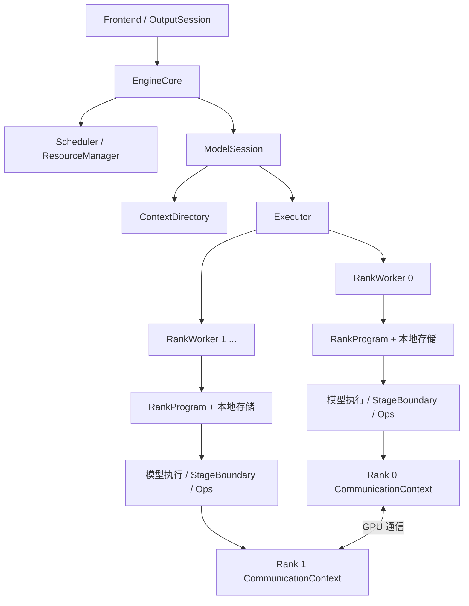

# NInfer 分布式执行设计

状态：D1 单 rank 的执行所有权拆分已实现；D2–D6 尚未实现。
本文定义集中调度下的多机目标合同、所有权及实施边界。已实现的 LocalExecutor、Session、
RankProgram 与上下文管理由[引擎架构](maintainer/engine-architecture.md)维护。

首个分布式部署为同构 DGX Spark 上的 Qwen4Exp，两 rank、attention/GDN TP2、routed
experts EP2。架构使用任意长度的 rank/group 描述，后续四机及其他并行组合沿用这些合同。
本地 RTX 5090 与 Spark 执行继续使用相同的模型数学接口和各自的 Op 分派。

## 1. 已确定的架构决策

1. 每个模型副本只有一个 EngineCore、Scheduler、ResourceManager 和原生 ModelSession。
   它们集中产生调度计划、资源变更和提交决定。Worker 消费计划，不独立调度请求。
2. 引入统一的 `Executor<Types>` 接口。`LocalExecutor` 在本进程直接调用；
   `DistributedExecutor` 驱动一组 rank workers。两者使用同一执行与完成合同。
3. 将现有 Program 拆为控制侧 `ModelSession` 与设备侧 `RankProgram`。
   模型前沿和事务属于前者，本地权重、State/KV backing、workspace 和 Graph 属于后者所在实例。
4. ContextDirectory 集中管理上下文身份、槽位与租约；Executor 管执行额度，RankProgram
   管 frame、workspace 和本地 backing。Session 组合两类预留，一次普通调度不远程查询逐页容量。
5. `ParallelPlan` 是不可变的模型并行计划，同时驱动权重加载、本地计算几何、状态布局、
   通信边界和容量规划。原始 Config 保留全局模型含义。
6. 层边界显式声明布局、局部和及 residual 消费语义，准备期绑定执行路径。普通通信与
   通算融合实现共用边界合同，本地 Op 继续拥有自己的 kernel 和 shape policy。
7. 控制消息采用有序的类型化协议，计算通信通过 GPU collective/P2P 接口。
   首个数据通信 backend 为 NCCL；组、缓冲和完成语义独立于 backend。
8. 提交、结果可用、逻辑提交和设备完成分别建模。运行期的依赖由命令顺序及完成凭证表达，
   不为每个执行步骤增加全组 Host barrier。
9. 首版每个 sequence 最多一轮生成事务在途；接口表达设备结果依赖和有限提前执行所需的
   前沿关系。在途深度由执行策略和资源容量确定，不作为永久接口限制。

Spark 保持 GPU 模型计算与 Device State/KV，采用现有 Device 前缀复用和 Replay。
现有 RTX 5090 的 CPU expert、Host cache 和传输功能由本地执行实现继续提供。

## 2. 所有权与实例结构



| 对象 | 所有权 |
|---|---|
| EngineCore | 请求生命周期、取消、deadline、输出发布、Engine availability |
| Scheduler | 执行成员、顺序、预算、公平性和抢占选择 |
| ResourceManager | prefix 索引、保留价值、source 选择及回收策略 |
| ModelSession | 模型逻辑 continuation、Main/backend 前沿、执行窗口、生成事务和 checkpoint 语义；组合上下文与执行预留 |
| ContextDirectory | 逻辑 State/KV/history 身份、槽位、引用、coverage、ContextLease 及有序上下文变更 |
| Executor | worker 生命周期、命令顺序、执行额度与 frame 预留、输入分发、事件汇总、ticket 与故障状态 |
| RankWorker | 一个 CUDA device、CommunicationContext、RankModelInstance、命令执行与完成观察 |
| RankModelInstance | 不可变 ModelShard、const LocalParameters、RankProgram |
| RankProgram | 本地 context storage、frame backing、workspace、调用者通信缓冲、采样/spec 临时数据、Graph 和执行中的资源引用 |
| CommunicationContext | 通信组、backend 实例、内部通信资源；为调用者提供注册与完成机制 |

协调侧从 artifact 的 metadata 与 Frontend resources 建立 `ModelDefinition`，包含全局
Config、逻辑参数描述、所选组件和公开词表等，不持有 GPU 权重。每个 rank 独立建立
`ModelShard` 与 `LocalParameters`。Frontend 由协调侧持有，其 tokenizer、matcher、
工具解析与请求输出状态不进入 worker。

`ModelSession`、`RankProgram` 使用原生架构类型，例如 `qwen4_exp::Session` 和
`qwen4_exp::RankProgram`；启动时按架构作有限分派，内部继续类型化调用。Executor 是
执行机制的抽象，不承担 GDN/QSA 前沿推导、层遍历或 speculative 数学。

现有 Program 的 `plan_request`、`unit_end`、逻辑 commit/checkpoint 决策迁入 Session；
设备 forward、record/fold、物理复制、buffer 绑定和 Graph 操作迁入 RankProgram。
`RuntimeTypes` 分别声明 Session、RankProgram 及原生执行载荷，不再让 EngineCore
穿透单个 Program 取得 CUDA 环境和物理存储。

上下文预留按请求的原生状态需求计算；执行预留按组批后的 variant、T/B 和参与 ranks
计算。ContextDirectory 不解释 batch workspace、通信算法或 kernel shape policy。
RankProgram 报告已经准备的执行容量，Executor 据此管理可提交数量与稳定 frame 槽位。

## 3. 进程与启动入口

### 3.1 进程布置

单设备部署使用 LocalExecutor，协调逻辑与一个 RankWorker 位于同一进程，直接调用。
本地执行沿用 Engine 执行线程，由 LocalExecutor 在进入 RankWorker 的所有者边界绑定
设备，后续传递已有执行视图。
分布式部署的协调进程负责 Engine/Frontend；每个 GPU rank 使用独立 worker 进程，
包括协调节点上的 GPU。每个 worker 有一个负责 CUDA 提交的执行线程。

节点入口负责启动本节点的 workers、转发退出状态并收尾子进程。分布式 worker 在
CUDA 初始化前通过独立 executable 启动。一次部署的成员、rank 映射和模型副本固定。

定义 `DeploymentSpec`：

| 字段 | 含义 |
|---|---|
| `coordinator_node` / `rendezvous` | 协调节点与控制连接入口 |
| `nodes[]` | node ID、连接地址、本地 artifact 路径 |
| `ranks[]` | global rank、node ID、本地 CUDA ordinal |
| `parallel` | 请求的模型并行配置，交给原生并行规划器解析 |

部署描述采用 JSON，所有节点读取相同成员与策略描述，通过 `node_rank` 选择本地条目。
global rank、node ID、CUDA ordinal 和 group 内 rank 是不同字段。

目标启动接口如下；这是待实现接口，不是当前 CLI 已支持的命令：

```text
协调节点：ninfer / ninfer-serve MODEL --deployment FILE --node-rank 0
其他节点：ninfer-worker --deployment FILE --node-rank N
单设备：  原有 ninfer / ninfer-serve MODEL
```

协调节点入口启动本地 rank workers，其他节点入口启动自己负责的 ranks。SSH launcher
只将这些命令自动化，不参与执行协议；前端服务仅在协调节点开放。

### 3.2 启动协议

启动按相同 phase ID 协调推进：

1. **Join**：建立控制连接，交换构建/协议版本、模型定义身份、rank/device 信息和本地资源事实。
2. **Resolve**：原生规划器产生完整 ParallelPlan，各 rank 解析所需本地参数与 Op profile。
3. **Connect**：创建通信组、初始化 backend 并完成代表性通信准备，建立初始内存快照。
4. **Materialize**：按分片计划加载本地权重，并发读取各节点自己的 artifact。
5. **Prepare**：协调容量规划、必要的 Graph 校准和最终 backing 分配；每次尝试分为
   本地资源准备、全组允许进入通信、执行与完成发布，见第 10.3 节。
6. **Ready**：所有 ranks 发布同一计划版本的准备结果后，Engine 接受请求。

启动控制只检查其负责的部署、协议和分片关系。具体计算格式/shape 的支持仍由本地
Parameters 和 Op 的容量/准备入口判断，错误随 rank 与准备阶段返回。
Connect 中的通信准备也遵守相同的阶段推进与失败规则。

## 4. ParallelPlan 与本地计划

并行规划分为两个结果：

- `ParallelPlan`：无地址、不可变，描述整个模型副本的分工。
- `RankExecutionPlan`：从 ParallelPlan、实际权重表示和本地设备资源解析，描述一个
  rank 的本地几何、物理布局、frame 容量与寿命、workspace、通信缓冲及 Graph profiles。

ParallelPlan 至少包含：

| 部分 | 内容 |
|---|---|
| Groups | 有序成员、group ID、模型角色；同一批 ranks 可以服务不同的计算分工 |
| Parameters | 每个逻辑角色的本地切片/复制、global expert ID 与本地 bank 映射 |
| Geometry | 本地 heads、维度、矩阵行序、词表范围、层范围 |
| Activations | stage 间 token/feature 布局、局部和、复制与消费关系 |
| State/cache | 必需字段、各 rank 的字段分片、pool owner 集合、逻辑页组关系 |
| Decisions | 路由、selection、输出 token 等共享决定的生产者与消费协议 |
| Execution variants | 有限的原生执行拓扑、命令阶段及跨 group 的通信提交顺序 |

规划器读取全局 Config 和绑定，产生本地几何，不将局部 head 数写回 Config。
同一权重切片必须同时对应正确的 activation、norm/control、State/KV 分片。
合并矩阵按逻辑段切片，编码 planes 在加载期按目标布局物化；执行期直接消费稳定视图。

本地 Op 接收实际 tensors、weight views 和执行资源。ParallelPlan 不持有它们的私有
kernel 选择；TP 改变几何后，仍由所属 Op 的 Spark/5090 shape policy 选择实现。

引擎不把 rank 数写成二机常量。四机时 group 构造和资源协议保持相同，原生规划器
处理 head 复制、非均匀角色及其他模型放置。新的本地几何仍需相应 Op 支持。

## 5. Executor 与执行消息

### 5.1 接口

`runtime::Executor<Types>` 是粗粒度执行接口，Local/Distributed 两个实现共享：

```cpp
std::optional<ExecutionReservation> try_reserve(FrameKind kind);
ExecutionTicket submit(ExecutionReservation reservation, Types::Work work);
void supply(ExecutionTicket ticket, DecisionInput input);
CommitReceipt commit(ExecutionTicket ticket, Types::Commit decisions);
void discard(ExecutionTicket ticket);
std::optional<ExecutionEvent<Types>> poll();
void flush();
void drain();
```

`try_reserve` 根据已准备的执行 profile 取得参与 ranks 的 frame 与提交额度，使用控制侧
容量记录，不向 worker 发起即时容量查询。预留区分 Compute 与 Context frame；每个 frame 已覆盖
原生执行计划的形状范围。variant、T/B 和数学操作由 owning Work 描述，在 rank 的原生入口校验，
不在预留接口重复描述。Compute 的结果需要 commit/discard；Context 在完成后直接退役。
ExecutionReservation 是未提交执行的独占预留，放弃时归还额度。

`submit` 在本地完成验证与载荷准备后，原子接收完整命令及预留，返回 ticket，不等待
GPU。接收前失败不下发执行；接收后的传输或执行错误进入执行组失败流程。
`supply` 补充同一事务需要的约束等决策输入。
`commit/discard` 解析未决事务并排入有序执行；`poll` 消费完成与需求事件。
`flush` 发送已接受的命令；`drain` 关闭执行入口并等待所有相关工作实际完成，不能用作
普通轮次的等待接口。正常执行通过完成事件推进。
初始化、容量协商与 shutdown 使用独立的生命周期入口，不经过模型步进接口。

Executor 使用虚接口选择 Local/Distributed 实现；原生模型和 Op 保持直接的类型化调用。
LocalExecutor 直接移动/借用对象，DistributedExecutor 才进行编码。提交后的载荷及其
共享大对象至少保留到所有相应消费者结束，不依赖 submit 调用栈的寿命。

### 5.2 标识与载荷

| 标识 | 含义 |
|---|---|
| `SessionEpoch` | 一次执行组生命周期，启动后固定 |
| `CommandSequence` | 协调侧单调递增的有序命令编号 |
| `ExecutionId` | 一个模型 unit 的身份，由 ticket 关联其多个命令段 |
| `SequenceId + generation` | 请求执行状态的稳定身份，独立于 lane |
| `ContextId + generation` | image/history/checkpoint 等逻辑对象身份 |
| `FrameId + generation` | 执行预留的 frame 身份，映射到参与 ranks 的稳定本地槽位 |

`ExecutionRequest` 由共同 envelope 和原生载荷组成：

- envelope：执行 ID、阶段、前置命令与结果依赖、成员及顺序、计划/variant ID、frame 和上下文预留描述；
- 请求增量：新增/恢复/释放状态、输入 token 与位置变化、采样配置变化；
- 资源增量：逻辑页/slot 分配、COW、mapping 更新、状态来源与目的；
- 原生 work：prefill/Replay 窗口、ordinary/speculative 调用、valid extents、后端前沿和
  execution envelope；
- 决策输入：已知的 sampling/grammar 内容，或本次执行声明的后续输入阶段。

后续跨 rank、跨 ticket 的输入增加 `DeviceResultRef`，与已知 token 并列。它标识 producer ticket、成员、结果
字段及其版本，不携带地址；rank 解析成本地结果视图或计划规定的通信交接。结果引用
保持相应存储存活，并建立读依赖。当前单 rank 的同 ticket 阶段交接由 RankProgram 持有
结果和 frame，跨 ticket 结果引用与提前执行按第 6.3 节扩展。

Bind、Capture、Restore、Pause、Reclaim 等独立上下文操作使用相同 envelope，work
携带类型化的 `ContextWork`。它们可以只执行存储动作，不要求附带一次模型 forward。
这类操作的结果按必需 owner ranks 汇总后，交给 Session 采用。

worker 保留已绑定请求的执行副本，后续只接收增量。副本记录执行已使用的前沿与映射，
不拥有调度、保留或提交选择。进程内 owner 指针、Tensor 地址和回调对象不进入协议。

原生 work 使用有限的类型化 variant。架构编码/解码在对应模型模块中实现，transport
只处理消息帧与字节；不传方法名、任意函数或模型调用图。

### 5.3 顺序与事件

每个 rank 接收相同的全局命令序列；命令可以带有 rank-local 载荷和参与者集合。
原生执行计划同时规定组内 collective 次序和跨 communicator 的提交次序，见第 8.2 节。
worker 先应用资源/input 增量，再提交相应 GPU work。

事件包含以下类型：

- `DecisionInputNeeded`：原生执行需要约束等后续输入，携带 ticket、阶段和小规模输入事实。
- `ResultReady`：决定结果的 rank 已产生可供控制侧消费的候选 token/接受信息。
- `ContextReady`：上下文操作所需分片均达到其发布条件，携带完整的资源操作结果。
- `Progress`：本 rank 已应用命令和已完成命令段的 watermark、资源退役结果和按需统计。
- `Failed`：该执行组不能继续执行的错误。

普通输出只从计划指定的 output rank 返回；需要多个 rank 结果的资源操作由 Executor
汇总。其他 ranks 的进度可合并报告，不要求每步返回完整结果。

需要 `supply` 的原生阶段在已提交当前 GPU 段后返回 worker 控制循环，不阻塞调用栈
等待输入。后续阶段作为带 ticket/stage ID 的有序命令提交；参与 ranks 依照同一个
阶段协议推进，允许无冲突 ticket 的工作在这些阶段之间交错。

watermark 描述已编号的命令段，不等待该 ticket 的后续阶段。例如 A 的 forward、B 的
forward、A 的采样分别是命令 10、11、12；A 等待约束输入时，命令 10 仍可完成。
每个命令段的完成条件覆盖其实际参与的 compute/copy/communication streams；连续
完成的命令前缀推进 watermark，无本地工作者按有序空操作推进。
同一个 ticket 的 records 和结果引用另行保持到最后消费者结束，不能仅凭 forward
命令完成就归还整个 frame。Executor 按所需 owners 汇总退役事实，output rank 的
ResultReady 不代替其他 rank 的资源完成。

执行队列和 frame pool 均有界，容量进入启动计划。新执行的预留同时保留该 ticket
后续有限阶段所需的控制消息和结果交接容量。`supply/commit/discard` 使用原有预留，
不再竞争普通执行 frame；完成与退役事件也有独立的推进容量。普通提交背压不能阻止
已有 ticket 结束。消息仍按命令顺序发送，终结动作无需等待下一次普通执行才 flush。

设备工作默认按本 rank 的有序计算流推进，Host 可以提前准备与提交无冲突工作。
首版每个 sequence 最多一轮生成事务在途；不同 sequence 可使用独立 frame 交错。
原生阶段集合在准备期确定，Executor 不承担任意任务的挂起和依赖调度。

### 5.4 执行存储寿命

RankProgram 按消费者寿命划分存储，不将所有临时数据统一复制到每个 frame：

| 存储 | 所有者与复用条件 |
|---|---|
| State/KV backing | RankProgram 的 context storage；身份和引用由目录管理，复用继承所有消费者依赖 |
| 计算 scratch | RankProgram；有序执行且生命周期不交叠的阶段共享，独立并行路径按其峰值另行规划 |
| pending hidden、conditioning、verify records | 对应执行 frame；保留到 sampling、accepted-prefix fold 或丢弃处理结束 |
| Host ingress、约束输入 staging | 对应阶段或 frame；保留到异步传输结束，不能因 Host 提交返回而覆盖 |
| 输出 staging 与设备结果 | 对应 frame；保留到设备写入、D2H、Host 消费及 DeviceResultRef 消费结束 |
| 通信调用缓冲 | 按上述寿命归入 frame 或共享区；通信完成前不得覆盖 |
| backend scratch / 注册 | CommunicationContext 管 scratch 与注册，注册借用实际 backing |

Graph 准备绑定固定 frame 槽位和允许共享的区域，其执行实例与绑定关系由 RankProgram
保存。重复使用同一 Graph 绑定必须满足这些区域的寿命；多个在途 frame 所需的 records、
staging 和 Graph 实例计入容量。只改变 FrameId 不会自动改变已捕获的地址。

当一个设备槽位的最后消费者已经排定，且没有未解析的结果借用时，Executor 可以将
该槽位带着 generation 和前置依赖预留给后续有序执行。物理复用仍排在旧消费者之后，
无需每轮等待所有 rank 回报 DeviceRetired。尚未解析的 ticket、已排队命令和实际
backing 分别受各自容量限制，物理销毁仍等待实际退役。

Host staging 与 CPU 元数据独立保留；复用设备槽位不能提前覆盖尚被传输或设备读取
的 Host 区域。D1 按本节拆分现有单套 pending buffers、ingress/egress、映射与计数，
并确定各 frame 的 Graph 绑定。

## 6. 模型事务、完成与输出发布

### 6.1 四种完成事实

| 事实 | 可以做什么 |
|---|---|
| Submitted | Executor 已拥有命令与载荷，可以异步下发 |
| ResultReady | Frontend 可以 preview 候选结果，Session 可以形成 commit 决定 |
| LogicallyCommitted | 接受前缀和所有有序后续动作已经确定，OutputSession 可以采用并发布 |
| DeviceRetired | 所需 ranks 对指定资源/命令的设备消费已完成；配合 Host 消费和注册引用解除后可退役 backing |

逻辑提交与设备完成之间携带 `CommitReceipt`，标识提交命令及其完成依赖。基于已提交
状态的后续执行继承该依赖；提前执行使用第 6.3 节的 provisional 状态与结果引用。
跨 stream 的消费者继承对应 event，设备完成之前不得无依赖地复用 backing。
这些事实作用于不同范围：某个 forward 命令段可以先完成，整个 ticket 仍等待采样或
提交；ticket 退役需要全部阶段、结果借用和 Host 消费结束。

### 6.2 提交协议

```text
ResultReady
  → Frontend preview
  → Session 检查接受前缀，准备 CommitBatch 和逻辑目录变更
  → Executor 接受完整 commit 命令，返回 CommitReceipt
  → Session 原子采用逻辑前沿、身份与目录变更
  → generation budget / OutputSession commit
  → 发布输出
```

commit 在纳入有序队列前完成所有 Host 可判定检查，并准备好目录变更所需的存储；
接收后的逻辑采用是无分配、不会失败的发布动作。队列接收失败时，逻辑状态和
Frontend preview 均不提交；接收后由 worker 执行已确定的状态动作。逻辑提交是对
后续有序执行的承诺，设备完成凭证负责证明实际物理工作结束。
fold、tail 提取及其他提交动作消费该 ticket 预留的状态目的和执行资源，不在 worker
提交阶段发起可能因容量不足而正常拒绝的申请。需要物化副本的上下文操作单独返回
ContextReady，再由 Session 采用。

这一合同将当前部分 Program commit 中的 GPU 等待移到明确依赖点。snapshot 物化完成、
Host 副本发布、跨流迁移结束、终态资源结算及 backing 销毁仍等待各自所需的设备与
Host 消费完成。

对仍在执行中的 GPU commit，Session 可以准备后续命令；前一 commit 的依赖会随同
资源绑定一起传入 worker。commit 可以和下一份执行消息合并传输；无下一份执行时
立即 flush。通信或设备执行失败使整个执行组失效，不回退已经发布的输出。

每行接受规则保留现有约定：非终态采用完整 produced span，终态可采用其前缀，取消
采用零 token。整个 ticket 的成员一起解析。取消、失败和释放动作由协调侧下发，各
rank 不自行改变已经排定的计算/collective 次序。

### 6.3 前沿与有限提前执行

Session 区分已逻辑提交的生成账本、Main/backend 的已提交执行前沿，以及获准执行的
provisional 窗口。三者的对应关系由模型定义；尚未得到设备结果的窗口只记录依赖和
有效范围，不虚构已经确定的 token 数或接受长度。

接口允许下一轮引用上一轮设备结果，并沿有界依赖链使用 provisional State/KV。
启用提前执行时，Session 按顺序采用每轮结果，保证：

- 上一轮接受前缀及下一输入成立时，才能采用依赖它的后续结果。
- 终止截断、取消或工具控制改变输入时，受影响的后续结果统一丢弃；已经提交的
  collective 仍按共同顺序执行完，不能由单 rank 跳过。
- 已提交恢复点与待决定的 records 保留到依赖解析；提前写入不得破坏需要恢复的状态。
- RNG、采样计数、grammar 和公开输出只按实际采用前缀推进。设备推演使用对应版本，
  provisional 状态不进入共享前缀缓存。

首版调度仅允许每个 sequence 一轮生成事务在途。后续有限提前执行由原生执行策略
声明可续接条件及深度，再按 frame、状态目的和记录容量启用；grammar 或控制决策
尚不允许续接时等待对应输入。PLE 本地准备、传输及结果消费沿同一依赖推进，
不会因设备结果引用而省略。D1 已分开稳定 continuation、未决执行和 frame 寿命；
跨 ticket 的 provisional 窗口及其结果引用在 D6 按本节合同实现。

## 7. 集中上下文目录与本地存储

### 7.1 拆分现有存储职责

ContextDirectory 管理逻辑身份与分配，ContextStorage、ContextMigration 执行本地
存储动作。StateImage 连续布局、typed KV planes、COW 和 record/fold 数学保持各自
的原生合同。多 rank 扩展为这些动作增加 owner 集合与完成汇总。

| 控制侧 ContextDirectory | Worker 侧 ContextStorage |
|---|---|
| 对象身份、generation、content epoch | 本地 backing、typed views、CUDA events |
| history 目录、prefix 引用、逻辑 coverage | 按命令更新页表、复制和写入 |
| active/checkpoint owner、读 lease、目的预留 | 执行中的物理借用及最后消费者 |
| 逻辑槽额度、分配/释放顺序 | 逻辑槽到本地物理地址的绑定 |
| checkpoint 分片清单及依赖 | 本 rank 分片的就绪事实 |

集中逻辑分配器为各 owner 分配共同槽位，各 rank 用本地 schema 和 stride 解析地址。
ResourceManager 决定保留和回收价值，调用 Session/目录取得实际逻辑可行性。
ContextDirectory 只管理上下文资源；frame、workspace 与通信资源按第 5 节管理。

### 7.2 容量与预留

每个逻辑 pool 声明 owner ranks；一个页组代表这些 ranks 上同一 token 区间的必需
分片。启动时选择共同的逻辑槽容量，各 rank 按自己的每槽字节数分配 backing。
其可用逻辑容量受 owner 集合中的最紧约束限制，不能把不同 rank 的页数相加。

`ContextLease` 覆盖源读取、目的 image 和 KV 增长/COW。Session 先按行取得上下文
许可，再按候选 batch 的原生 variant 和 T/B 向 Executor 取得 ExecutionReservation。
两者齐备后才提交整份执行；组批调整或提交失败时释放未采用的预留。上下文租约在
Session 的事务中持有，worker 接收其动作描述；提交后执行预留转由 ticket 持有。

计算 scratch 和通信 staging 按实际 batch 及重叠关系规划，不能把单行需求简单累加
成 frame 或 workspace 数量。两类预留都使用已经建立的容量记录，普通执行不发起
远程逐页查询或临时 Device allocation。

释放分为逻辑退役与物理消费结束。一个 slot 再分配给后续有序命令时携带 generation
及前置依赖；rank storage 在最后消费者之后安装新内容。真正释放 Host allocation、
device allocation 或注册窗口时等待 DeviceRetired。

单机的 Host 副本使用固定 backing，由 ContextDirectory 分配 extent，ContextMigration
按动作执行传输；reservation 和 pin 保持到物理退役。Host/Device buffers 与 arena
由本地资源 owner 持有。多 rank 下，各 owner 完成对应物化后，协调侧才发布完整副本。

### 7.3 前缀与 checkpoint

一个 checkpoint manifest 记录：模型逻辑前沿、StateImage 身份、各 pool 前缀、分片
owner 集合、输入身份及完成依赖。GDN、Indexer tail、PLE、MTP conditioning 等字段
是否复制或切片，由 ParallelPlan 和原生状态 schema 共同描述。

Prefix 索引集中匹配一次，产生一个共同恢复方案。所需分片必须来自同一逻辑执行状态；
ResourceManager 选择保留与恢复来源，Session 决定原生恢复和 Replay，目录执行引用、
COW 与回收变更；各 rank 消费同一恢复前沿。
已逻辑提交且带有依赖的源可以由后续有序命令消费；异步复制/恢复形成的新 checkpoint
在所需物理结果完成后才发布为完成态。

Main 与 MTP 的前沿关系、GDN replay fold、QSA tail 提取等规则继续由原生 Session
定义，RankProgram 执行其具体状态动作。全局身份相同不要求各 rank 的实际地址相同。

## 8. 层边界与通信实现

### 8.1 StageBoundary

每条模型执行边显式描述三类事实：

| 内容 | 示例 |
|---|---|
| 布局 | token 复制/分片、完整 feature / head shard、对应 partition ID |
| 结果含义 | Complete，或 `PartialSum(group)` |
| 消费关系 | residual 更新、normalization、变换次序、额外分支贡献及其所有者 |

原生模型声明 producer/consumer 合同，准备期生成 `BoundaryPlan`，绑定 collective、
必要布局转换和适用融合 Op。执行只选择已经准备的有限 variant 并绑定本次 views。
各数学 Op 的 token-dependent 私有调优仍由该 Op 维护。

例如 `PartialSum(attention_group)` 到完整 HC block 输入，可以解析为 AllReduce
后调用 HC combine/norm，也可以绑定同语义的融合计算。Shared contribution 的归属
与加入次序必须在边界声明中确定。边界不会假定 norm、gate 或舍入可以穿过归约重排。

StageBoundary 描述原生模型实际使用的有限布局和结果语义，准备期绑定具体路径。
它不扩展为通用分布式 Tensor 或模型图；每轮 residual、临时 Tensor 和实际结果状态
由对应执行 frame 绑定，backing 按第 5.4 节复用。本地 shape policy 保留在 Op 内，
具体融合计算拥有独立的数学、表示和状态效果合同。

### 8.2 Group 与 backend

`CommunicationContext` 拥有 `Group` 与 backend。Group 暴露有序成员、group 内 rank、
本地 device 及已解析能力。ParallelPlan 保存 group ID 和成员，rank 准备期绑定稳定
本地 Group 引用，执行不从进程全局变量查找拓扑。

公共 collective Op 定义输入/输出类型、布局、归约及 stream 效果；backend 提供具体
enqueue、buffer registration 和 capture 机制。首版实现 AllReduce、Broadcast、
AllGather、ReduceScatter 及必要 P2P，使用 NCCL。size-one group 解析成本地语义路径。

原生模型通过 collective Op 或完整融合 Op 使用通信。NCCL 句柄、网络队列、注册窗口
和协议选择属于内部实现。未来专用通信及 device-initiated 融合沿用相同的 group、
数据含义、生命周期和完成约定。

同一个执行 variant 规定各阶段的通信提交顺序，包括跨 communicator 的相对次序。
一个 rank 的执行所有者按共同顺序提交本地参与的操作；多 stream 执行显式建立
所需依赖，capture 与 replay 使用相同顺序。rank-local kernel 选择可以不同，
通信协议、消息几何及是否捕获的选择须在参与者之间匹配。某 rank 没有本地 expert
贡献时仍履行该 variant 的通信合同。

NCCL communicator 使用 nonblocking 配置。初始化进度、异步错误及终止由本 rank 的
执行所有者处理；控制线程发送停止意图，执行所有者在结束当前 Host NCCL 调用后
停止新提交并终止 communicator，避免在不同线程并发调用 abort 和提交接口。
backend 在 NCCL 返回 `ncclInProgress` 时继续观察进度，确认通信操作已经入队后，
才允许调用者提交依赖它的 CUDA 操作或记录完成凭证。这里等待的是入队完成，
设备执行完成仍由 stream/event 表达；该机制封装在通信层内。

### 8.3 缓冲与数值

通信输入/输出由 RankProgram 的执行 frame 或持久区提供；backend 内部 scratch
由 CommunicationContext 拥有并报告容量。两者都计入启动预算。注册产生 RAII lease，
其生命周期短于 backing、长于所有借用它的 Graph 和在途操作。

分片 Linear 与 EP 本地贡献继续使用已选定的 BF16 输出合同；通信不额外要求 FP32。
需要改变通信表示或数值策略时，在相应 collective/fused Op 合同中明确并验证。
已有 GDN FP32 state 和 controls 不因模型并行而改变。

### 8.4 MoE 的分布式执行

MoE 的输入交换、本地 expert 计算和结果合并由模型侧 MoE 执行部分组织。它拥有
global/local expert 映射、token 排列、结果回填和 shared contribution 的组合语义；
本地 expert Op 继续消费其数学接口，通信 backend 只处理通信描述。

首个 TP2/EP2 路径使用复制的 token 输入，各 rank 计算自己的 routed experts，形成
局部加权贡献后归约。Shared contribution 的计算位置及加入次序由 D0 确定，保证其
只计入一次。现有融合 expert 实现继续作为本地计算路径。

后续若引入按 token 分发的 EP，dispatch/combine 的计数、排列、完成依赖与结果语义
归入同一 MoE 执行边界，所用 collective/P2P 由通信层提供。当前不实现通用 All-to-All
调度或运行期 expert 重分布。

## 9. 普通执行与 speculative 执行

### 9.1 首版普通执行

```text
Scheduler 选择成员与预算
  → Session 取得各行 ContextLease 并形成候选 batch
  → Executor 为整体 batch 取得 ExecutionReservation
  → Session 提交完整请求，Executor 下发增量与 work
  → ranks 应用输入/资源变化并执行本地模型与通信
  → output rank 产生 ResultReady
  → preview / logical commit / 输出发布
  → 后续执行继承 commit 依赖，完成后退役临时资源
```

Prefill、Replay、ordinary decode、forced control 共享命令与资源机制；它们的模型
调用和状态效果由原生 work 区分。执行策略仍消费实际 T/B、几何与语义参数。
后续跨轮提前执行沿第 6.3 节扩展，普通路径继续使用提交状态和明确的 commit 依赖。

### 9.2 采样与约束输入

输出决策由 ParallelPlan 指定的 owner 执行，RNG 的逻辑位置由 Session 统一推进。
词表分片后的 argmax、分布式采样或 logits 汇集属于该决策路径的实现，不能把完整
词表作为 Executor 的固定输入要求。
候选 token、draft 和有效长度通过已声明的设备结果交接路径送给下一阶段；Host
结果回传用于输出与控制决策，不承担所有设备中间结果的转发。

协调侧 OutputSession 拥有 grammar matcher。普通 mask 可以与 forward 并行准备，
通过 `supply(ticket, input)` 送入决策阶段。输入持有自己的 mask 数据和字段描述；
DecisionNeeded 请求输入，DecisionConsumed 确认实际传输已提交，Frame 保持数据至消费结束。

### 9.3 MTP / DFlash 类事务

一个 ticket 覆盖 proposal、verification、输出决策及 accepted-prefix 解析。
GPU 内部中间 token、hidden 和通信由 RankProgram 的原生流程衔接。
若 grammar 输入依赖 drafts，output owner 发布 `DecisionNeeded`，协调侧准备
mask；独立的 target forward 可以继续执行，决策阶段等待 mask。

最终 `CommitBatch` 携带每行接受长度、终态与 prefix provenance。各 rank 对本地
GDN/卷积 records、QSA tail、KV 及 backend 状态执行同一逻辑前缀的提交。不同接受
长度通过原有 valid/accepted metadata 表达，不产生各 rank 独立的控制选择。

MTP 在本轮执行 Draft → Verify → Commit。稳定边界的 Main/backend 前沿为
`F/max(F−1,0)`，提交后按实际接受长度建立下一稳定边界；不在前一轮预先生成并保存
下一轮 drafts。DFlash 的 conditioning 和 context 提交继续遵循自己的数学定义。

Vision 的获取/预处理仍在 Frontend，GPU 编码及特征分发进入原生 work；PLE 的
准备资源和结果消费也进入对应 rank 的资源计划。具体 owner 放置由模型并行策略
确定。CausalScoring 使用同一 Executor 与 RankProgram，保持独立的评分调度目的。

## 10. 容量规划与 CUDA Graph

### 10.1 规划顺序

各 rank 的资源报告分开列出权重、State/KV、共享 scratch、按在途数量持有的 records/
staging、通信 scratch/注册相关容量、Graph 和已知 Host 准备区。frame 槽数和实际
并行阶段决定峰值，不按每个 ticket 重复计入可以共享的区域；增加 Graph 绑定或
实例带来的保留量计入同一计划。
协调进程自身的 Frontend/media 常驻与 live 额度计入其所在节点的物理预算；Spark
按节点共享物理内存核算。

通信环境先初始化，再取得规划快照。后续才创建的显式通信缓冲继续计入计划；Graph
校准中的新增保留量与重建量沿用现有有符号测量方法，避免重复扣费。

各 rank 报告局部容量约束，Session/原生 planner 解析共同逻辑 pool 容量。自动 KV
容量收敛采用组内共同选择；显式容量保持用户要求。执行 profiles 同时给出可供
Executor 预留的 frame 容量和阶段交接上界。准备失败按第 10.3 节分类处理。

### 10.2 Graph 合同

Graph 由每个 RankProgram 持有；Graph profile key 包含 ParallelPlan 版本、本地
执行拓扑/通信协议、T/B 和状态效果，执行实例另外绑定明确的 frame 槽位与 backing。
Context envelope 的调优档位可以是已安装的本地计算 profile，不要求每个档位都
复制完整 executable；容量覆盖该绑定允许的全部 profiles。
各 rank 的地址、节点和本地 kernel 可以不同，但对应 group 的通信顺序、count、dtype、
root/peer 及 collective 语义必须匹配；跨 communicator 的提交顺序同样属于 variant。

参与通信的 capture/replay 按原生计划协调进行。CommunicationContext 提供 capture
scope 与注册 lease，Program 把通信和本地计算一起捕获。具体 eager/graph variant
在 submit 前解析，不由各 rank 因本地缓存状态自行切换。

已支持的 QSA envelope 更新等本地 Graph 机制继续保留。只有改变通信合同或执行
拓扑的变化需要新的组内执行 variant；本地 kernel 更新规则仍由所属 Op 维护。

完整设备段的计算与通信可以在同一外层图中捕获；需要更新的纯本地计算可作为 child
graph 插入，仅更新该 child，保持捕获的通信节点和缓冲绑定稳定。Child 的更新遵守
CUDA 拓扑和参数要求，由本地 Graph 封装提供绑定句柄，模型不通过 kernel 名称匹配节点。
这不改变 Op 的数学接口，也不将原生执行流程转为通用模型 DAG。

图的切点由实际外部输入和状态采用边界决定。Main 消费稳定的 PLE lookup Tensor、
就绪依赖及有效寿命；表的驻留位置由 producer 管理，不决定 Main 的抓图粒度。
可捕获的 GPU producer 能进一步与 Main 合为整轮图；Host producer 也能为完整 Main
图提供输入。依赖 drafts 的 Host 约束输入在输出决策前交接，target forward 可先
推进。原生计划明确需要 Host 提前观察的图内结果、copy 分支及其事件和 staging 寿命。
Qwen4Exp 的具体组合、表分片和执行顺序见
[计算与 Graph 组织](qwen4_exp-parallel-design.md#10-计算组织与-graph-组装)。

### 10.3 协调准备、失败与销毁

Graph 校准采用同一计划的有限 profile 集合，各 rank 可报告不同的内存结果。每次
尝试有共同的 attempt/phase ID，按以下顺序推进：

1. 各 rank 完成本地 backing、frame、测试输入和通信调用缓冲准备，报告可进入下一阶段。
2. 协调侧收齐必需参与者的准备结果后，统一允许进入对应的通信 warmup/capture/replay。
3. 各 rank 执行该阶段并报告完成和资源事实；全部完成后才发布可用 variant，或进入
   校准资源释放和最终容量重建。释放 backing 前先销毁借用它的 Graph 并撤销注册，
   正式地址重建后重新建立对应 Graph 绑定。

首次通信、每个准备阶段及重试均遵守相同次序。进入通信前的本地容量失败，以及已经
确认所有参与者通信完成后的本地容量失败，可以协调清理并有界重试。准备错误发生时，
若参与者仍可能停留在 collective 中，或通信状态已受错误影响，终止执行组和通信环境。
首版由重新启动恢复，不在存活 ranks 中各自重试。

普通退出先停止新执行，集中解析或丢弃未决 ticket 并 flush，随后 drain 所有在途
消费，再销毁 Graph、注销借用窗口、释放 RankProgram/ModelShard，最后销毁通信环境
和 DeviceContext。失败退出先停止提交并处理 communicator abort，避免等待已经无法
完成的正常退役条件；进程收尾按失败生命周期释放资源。

## 11. 控制传输、错误与观测

协调进程到本机 worker 使用 Unix domain socket，到远端使用持久 TCP 连接；共用
消息帧编码与有界收发队列。后续共享内存控制传输可以实现同一接口。
GPU 张量通过 CommunicationContext 传输，Host 控制连接只搬运执行描述及必要的
Host 输入/结果。
收发队列按第 5.3 节为继续执行、终结和完成事件预留容量，transport 背压不改变
命令顺序，也不让释放资源的消息依赖新的普通执行额度。

消息头包含协议版本、SessionEpoch、CommandSequence、消息 kind 与长度。
整数采用明确的线格式；payload 逐字段编码，不复制 C++ 对象内存。协议是仓库内
合同，同一执行组要求匹配构建与 schema，不维护跨版本兼容分支。

Transport I/O 与 CUDA 提交分离。网络线程负责有序收发，RankWorker 执行线程负责
原生命令、CUDA 提交和完成观察；收发线程不修改模型状态。

错误区分请求局部拒绝与执行组失败。输入或请求输出格式错误沿用 Engine 的请求级
处理；通信断开、CUDA 错误、命令/状态不变量损坏使 Executor 进入 Failed，协调侧
停止新提交，终结未决请求，通知各 worker 结束并清理。首版采用固定成员，不做
运行期重组或透明恢复。

日志与 trace 带有 rank、ExecutionId、CommandSequence 和 stage 标识。公共请求
延迟由协调侧统计，各 rank 的执行/通信时间分别报告；组执行耗时按实际完成边界
度量，不相加各 rank 的设备时间。内存既报告 per-rank，也报告共享物理内存节点
的总预算和实际占用。

## 12. 代码与构建组织

```text
apps/worker/                         节点 worker 启动与收尾入口
src/runtime/executor/                Executor、ticket、共同消息与 Local/Distributed 实现
src/runtime/contract/                调度、提交、资源与观测的共同合同
src/distributed/                     bootstrap、控制传输、groups、NCCL backend
src/models/<arch>/session/           ModelSession、原生事务和 work 编码
src/models/<arch>/parallel/          并行策略、切片及本地几何规划
src/models/<arch>/program/           RankProgram、backing、frames、Graph
src/models/<arch>/execution/         原生模型执行与 stage 边界组合
src/models/common/context/           集中逻辑目录与共享存储动作描述
src/models/common/parallel/          共享的 layout / boundary 描述与绑定机制
src/models/common/moe/               共享 MoE 执行、本地计算与输入交换/结果合并的组合
include/ninfer/ops/collective.h       collective 数学与执行合同
src/ops/collective/                  公共入口、分派与通信 backend 连接
src/ops/<family>/                    对应 family 的完整通算融合实现
src/core/                           本地物理存储和执行基础
```

目录表达职责，具体文件数量按实现规模决定。复用现有布局、CPU 线程基础、frame/
arena 和错误处理机制，不按每个类型或 helper 创建独立文件。

依赖方向：Core → Distributed 通信基础 → Collective/Fused Ops → Model execution；
Runtime executor 组合 transport、原生 Session 和 RankProgram。Distributed 不依赖
模型或 Runtime 调度；模型不通过 transport 直接接收请求。

新增独立的 `NINFER_ENABLE_DISTRIBUTED` 构建选项，默认关闭，启用时发现 NCCL 并
编译分布式 backend、collective 实现及 worker 应用。`NINFER_TARGET` 继续只选择
`rtx5090` 或 `dgx_spark`；单机/多机属于运行部署。通用 Executor 合同与 LocalExecutor
始终存在，现有 Ops-only 构建不因本轮要求 NCCL。

通信基础使用独立 target 链接 Core/CUDA/NCCL；启用通信的 Ops 和 Engine 显式链接。
保持已有 CUDA device-link、RDC/non-RDC 和 shared-library 边界。

## 13. 实施分段

### 13.1 D0：完整模型并行策略设计

具体模型选择与逐项可行性审查维护在[Qwen4Exp 并行策略](qwen4_exp-parallel-design.md)。

Qwen4Exp 首版 TP2/EP2 的角色放置与基础路径已收敛，按上述模型计划实施。
D0 是模型策略设计，其物化和执行代码在后续阶段实现。设计结果覆盖：

| 部分 | 必须确定的内容 |
|---|---|
| 层计算 | attention/GDN 的 head 与投影分片、合并矩阵逻辑段、本地 controls 与 norm |
| QSA | Indexer 的计算与 selection 分工、score/TopK 交接、sparse GQA 与 KV/indexer 状态 owners |
| Residual / MoE | HC 的输入输出布局、归约边界、routed expert 映射、shared contribution 的计算与加入位置 |
| PLE / Vision | 准备与编码 owners、输入和结果分发、本地 I/O/传输的推进与存储寿命 |
| 输出 / MTP | head 与输出决策分工、token/draft/约束交接、验证与 accepted-prefix 提交 |
| 状态与执行 | Main/backend 前沿、StateImage/KV schema、frame 寿命、跨 communicator 顺序及 Graph 分段 |

用 ordinary decode、MTP 和 prefix restore 三条完整执行流程检查计划闭合，明确各
阶段的输入来源、输出消费者、资源预留与完成条件。结果收敛为原生角色/边界表和
执行顺序，据此确定 D1 合同的具体载荷；局部 Op shape 调优继续使用独立清单。

### 13.2 实施顺序

| 阶段 | 交付 |
|---|---|
| D0：模型并行策略设计 | 完成第 13.1 节的原生分工、完整执行流程与资源/通信合同，作为后续实现依据 |
| D1：执行所有权 | 拆出 Session/RankProgram 和 LocalExecutor；分开 ContextLease/ExecutionReservation、逻辑目录/本地存储、scratch/frame；落实命令完成、设备结果依赖及 Graph 绑定寿命，迁入现有单机功能 |
| D2：分布式执行基础 | Node/rank 启动、控制协议、DistributedExecutor、groups、NCCL collective、跨 communicator 顺序、推进额度与失败传播；具备独立双机执行能力 |
| D3：并行物化与资源 | 实现 D0 的 ParallelPlan、权重分片加载、State/KV/frame/通信容量与本地绑定，接入协调准备及失败分类 |
| D4：Eager Text | 接入 TP2/EP2 的原生层边界、PLE 准备与消费、输出决策及提交，贯通普通生成、prefix reuse、暂停/恢复和 Replay |
| D5：完整模型流程 | 接入 Vision、MTP、约束输入及 CausalScoring，保持完整请求与 speculative 提交语义 |
| D6：Graph 与性能 | 按既定 frame/通信合同接入协调捕获与校准、已有动态 profile；测量真实开销后推进有限提前执行、overlap 和边界融合 |

每段直接检查其改变的数学、状态和实际执行路径；本地 Op 的新增 shape 调优沿用
独立任务，不重复开展。单机迁移使用现有推理与缓存场景确认行为和性能；分布式
执行分别观察本地计算、通信等待、Host 提交与实际输出速度。

D1 完成后移除旧 Program 的混合所有权接口和 EngineCore 对本地 CUDA 资源的直接
访问。后续各段扩展新合同，不再保留一套仅供旧调用使用的 Program 转发层。

首版采用固定成员、集中目录、一轮在途的 sequence 策略和有限执行 frames。D1 建立
后续扩展所需的所有权与依赖合同，D6 再启用跨轮提前执行；D6 使用的 Graph 地址寿命、
通信顺序和失败规则在 D0/D1/D2 阶段已经确定。

## 14. 参考实现

本设计依据本地源码阅读，采用职责与合同，不复制其 Python 对象模型：

- `~/vllm/vllm/v1/executor/{abstract,uniproc_executor,multiproc_executor}.py`：统一
  Executor、直接调用与进程执行、指定 output rank 和异步结果。
- `~/vllm/vllm/v1/core/sched/output.py`、`v1/engine/core.py`：集中调度、请求增量、
  forward/grammar/sampling 交接，以及 worker 资源报告到共同容量的解析。
- `~/vllm/vllm/v1/core/sched/async_scheduler.py`、`v1/worker/gpu/input_batch.py`：在途
  输出占位、设备结果续接及请求前沿更新；首版不照搬其全部异步调度策略。
- `~/vllm/vllm/distributed/parallel_state.py`、`device_communicators/cuda_communicator.py`：
  group 与具体通信实现的分层、capture 与缓冲生命周期。
- `~/sglang/python/sglang/srt/layers/layer_boundary/`：输入/输出布局、未完成归约、
  residual 更新/readout，以及构建期绑定 stage 路径和融合实现。
- `~/sglang/python/sglang/srt/managers/scheduler.py`：overlap、延迟采样、跨轮引用保留
  与共享区域读写依赖。
- `~/vllm/vllm/model_executor/layers/fused_moe/modular_kernel.py`、
  `~/sglang/python/sglang/srt/layers/moe/token_dispatcher/`：MoE prepare/finalize、
  dispatch/combine 与本地 expert 计算的分工。

NCCL 的跨 communicator 次序与终止遵守[communicator 合同](https://docs.nvidia.com/deeplearning/nccl/user-guide/docs/usage/communicators.html)，
nonblocking 入队遵守[group 合同](https://docs.nvidia.com/deeplearning/nccl/user-guide/docs/usage/groups.html)，
捕获和 replay 遵守[CUDA Graph 合同](https://docs.nvidia.com/deeplearning/nccl/user-guide/docs/usage/cudagraph.html)。

本地权重和模型语义继续以[模型与权重](maintainer/qwen4_exp-model.md)、
[执行与状态](maintainer/qwen4_exp-execution.md)、[资源与上下文缓存](maintainer/resource-scheduling-and-context-cache.md)
及具体 Op 合同为依据。
