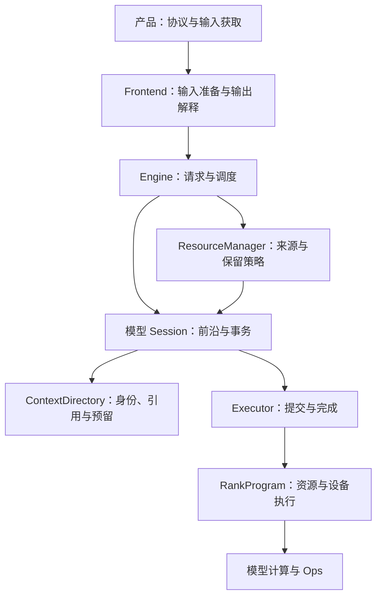

# Engine 架构

NInfer 由公共 Engine 组织模型执行。CLI、Serve、推理基准和 PPL 使用同一入口；
原生模型保留自己的层序、状态数学和 Op 组合。Checkpoint 名称与量化 recipe 不创建另一套执行架构。
本文说明跨模块关系；具体类型与行为以所属代码的合同为准。

## 所有权

| 所有者 | 决定与持有的内容 |
|---|---|
| 产品层 | 协议、输入获取、连接、启动配置呈现和结果编码 |
| Frontend | Tokenizer、模板、媒体准备、输入身份；每请求的输出解析与 grammar 状态 |
| Engine / Scheduler | 请求生命周期、输出预算、执行成员、公平性、取消与暂停恢复机会 |
| ResourceManager | 恢复来源、前缀索引、缓存保留价值与回收权限 |
| 模型 Session | Token 账本、Main/backend 前沿、工作需求、checkpoint 与生成事务 |
| ContextDirectory | 逻辑 State/history/page 身份、内容覆盖、引用、分配预留和迁移事务 |
| Executor | Frame 额度、ticket、命令顺序、决策交接和参与 rank 的完成条件 |
| RankProgram | Context backing、frame、workspace、Graph、原生计算与物理存储动作 |
| ModelDefinition / ModelShard | 全局配置与绑定描述 / 本 rank 不可变权重及其 backing |
| Ops / Core | 数学与局部状态变换 / 通用存储、设备执行和传输机制 |

配置解析只解释自身结构。模型准备入口解释并行策略；加载器解释存储表示；Op 决定实际几何与
计算表示是否支持。调用方通过合同组织输入和传播原因，不维护另一份下层支持表。

Session、Work 和 RankProgram 保持原生模型类型。Executor 的抽象位于一次执行及其生命周期边界，
逐层计算仍由模型直接调用 Op。单 rank 使用进程内 LocalExecutor，多 rank 使用
[分布式执行](distributed-execution.md)，共享提交与完成语义。

## 启动与资源准备

启动从 artifact 建立无设备权重的 ModelDefinition，再由模型计划确定本地权重、状态布局和执行资源。
转换、绑定与分片物化的分工见[权重与加载](weights-and-loading.md)。

模型提供记录布局、必要工作集和执行资源需求；公共启动层据此选择容量。必要工作集覆盖单请求
最大上下文、基本并发和所选 backend 的执行峰值，不承诺所有并发同时达到最大长度。
State 与 KV 使用[统一 Context 容量](context-management.md)，固定权重、workspace、records、
Vision 窗口和通信资源分别由其 owner 计费。互斥 scratch 取峰值，跨阶段存活的数据按真实重叠计费。

启动预算区分三件事：

- 规划 headroom 为未精确计入的启动增长留余量，可以在正式准备中消耗。
- 必须保留的 Host 容量保障媒体等已声明的运行需求，初始化后仍需满足。
- 最终预算检查针对整个实例的实际占用；不能再次要求规划 headroom 完整空闲。

容量求解接收已经扣除保留量的净额度。准备分配使用允许消耗 headroom 的额度，避免重复扣费。
独显分别核算 Device 与 Host；共享物理内存目标把 Host backing、控制元数据和媒体额度计入同一
物理预算。容量可以按 rank 不同，不以两机内存之和证明某个 rank 的工作集可行。

权重和必要通信资源准备后，以小型合法 Context 绑定准备实际 Graph 集合。先预热、捕获并释放，
再测重建捕获的增长；释放后重新取快照，用重建估计规划正式容量。仍被驱动保留的内存已经在
快照中，不重复扣费。正式资源与控制侧目录建立后再核验总预算，自动容量允许有界纠偏，
显式容量保持原要求。模型、Op 和实际分配错误保留自身原因。

实现入口：[启动预算](../../src/runtime/engine/startup_memory.h)、
[容量求解](../../src/runtime/engine/context_capacity.h)、
[Graph 准备](../../src/models/common/graph_preparation.h)。

## 请求与执行

Frontend 产生拥有自身输入和媒体寿命的 PreparedPrompt；请求独占 OutputSession。
Engine 的控制 worker 是调度状态、缓存策略与 Session 的修改者。Ingress、输出消费者和网络线程
通过队列、取消标志和完成事件交接，不直接操作模型存储。

请求可以等待、绑定、执行、暂停、恢复和结束。一次执行冻结 sequence、residency 与 batch 行映射；
lane 的复用不改变旧 ticket 的成员身份。暂停保存请求的输出会话、账本、预算和恢复目标，
恢复可以绑定新的 lane。Replay 重建数学状态，不重复发布旧输出、采样或计入生成预算。

调度先消费完成和终态事件，为必要恢复及已驻留请求取得执行许可，再以余量接纳新请求。
Control、紧凑 Decode 和分块 Prefill/Replay 共享这套生命周期。Prefill 内部的媒体和数学分段
由模型推进，不自动形成新的调度轮次。缓存与抢占规则见[Context 管理](context-management.md)。

Session 组合 Context 预留与 Executor 额度后，才进入不可撤销的目录准备。许可包含后续决定、
提交或丢弃所需的资源；不能计算完再竞争用于提交的空间。尚未提交的独立预留可以撤销；
已经接受的 COW、映射和传输必须履行到完成边界。

## 提交、发布与退役

| 执行事实 | 含义 |
|---|---|
| Submitted | 执行方接管拥有型 Work 和 frame |
| ResultReady | 候选结果可供控制侧解释；提交数据和 frame 仍在使用 |
| CommitReceipt | 最终提交已被有序接受，Session 可以采用逻辑结果 |
| DeviceRetired | 最后消费者结束，可以结算租约和复用存储 |

生成先产生 provisional 结果。Frontend preview 确定符合 EOS、停止、预算和取消要求的实际前缀；
模型接受提交后，Session 更新账本与前沿，OutputSession 才正式接受并发布输出。
提交失败不能留下已经对外发布却没有模型状态支持的 token。

接受长度驱动 State fold、history 覆盖、conditioning 和计数更新。未采用后缀可能仍留有物理字节，
但不成为可恢复内容。可观察结果返回、逻辑采用与最终异步退役各有边界；
[观测与测量](observability.md)沿用这些事实。

Context 事务则在复制、映射和必要参与者退役后发布副本或绑定。取消撤销结果采用意图，
不提前结束 DMA、Graph、Host producer 或来源借用。不可恢复的设备、通信或账本错误使实例失败；
清理保留首个原因，停止提交并结束在途消费者，再释放资源。

## 设备执行与 Graph

设备视图从 owning DeviceContext 向下传递；Tensor、Weight 和 Arena 表达实际位置与借用。
Host scope 结束不意味着设备完成。跨 stream 的存储复用由 owner 建立依赖。
CPU 任务池处理独立任务，CPU collective 团队服务算术；模型调度拥有它们与 CUDA 的交接。

Eager 与 Graph 使用同源数学组合。图绑定稳定 backing、frame 和执行表，实际请求通过 offsets、
positions、有效长度和行映射进入。图变体只表达必要的物理几何与计算主体；采样配置、实际采用长度
和请求身份作为数据输入。Attention 的局部节点更新遵循 Op 合同，不改变外层通信次序。

需要 Host grammar、CPU expert 或最终接受结果的边界显式交接。可捕获的连续设备段保持完整，
PLE 的数据来源本身不决定 Main 切图。图、事件和注册视图先于其借用的 backing 销毁。
各模型的组合差异见模型文档和[Speculative 执行](speculative-decoding.md)。

## 维护入口

- [Runtime](../../src/runtime/engine/)负责生命周期、启动、调度和发布。
- [Executor](../../src/runtime/executor/)负责执行与完成合同。
- [Models](../../src/models/)各自维护配置、绑定、Session、Program 和层计算。
- [Frontend](frontend.md)、[Context](context-management.md)、[分布式](distributed-execution.md)
  与[观测](observability.md)分别维护跨模块设计。

CausalScoring 使用同一模型与执行基础，但有独立 purpose 和串行评分生命周期，
使用临时上下文，不进入生成调度或前缀保留策略。
