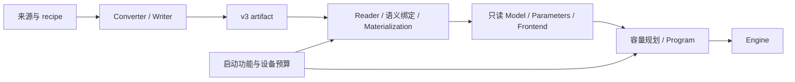
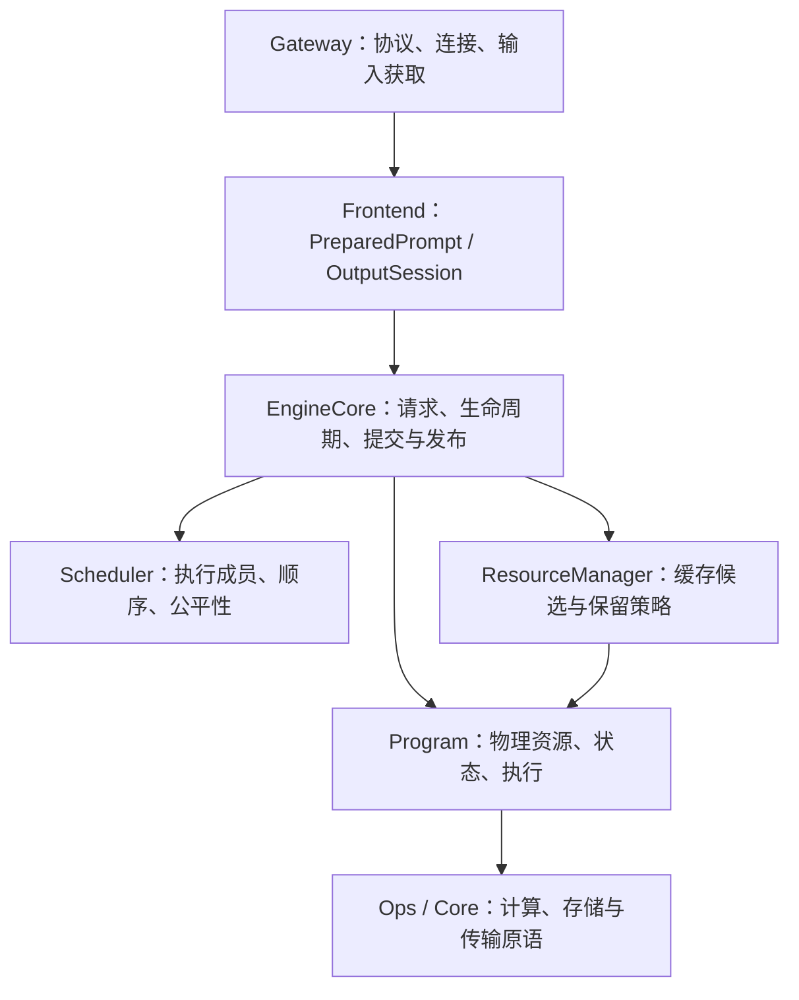
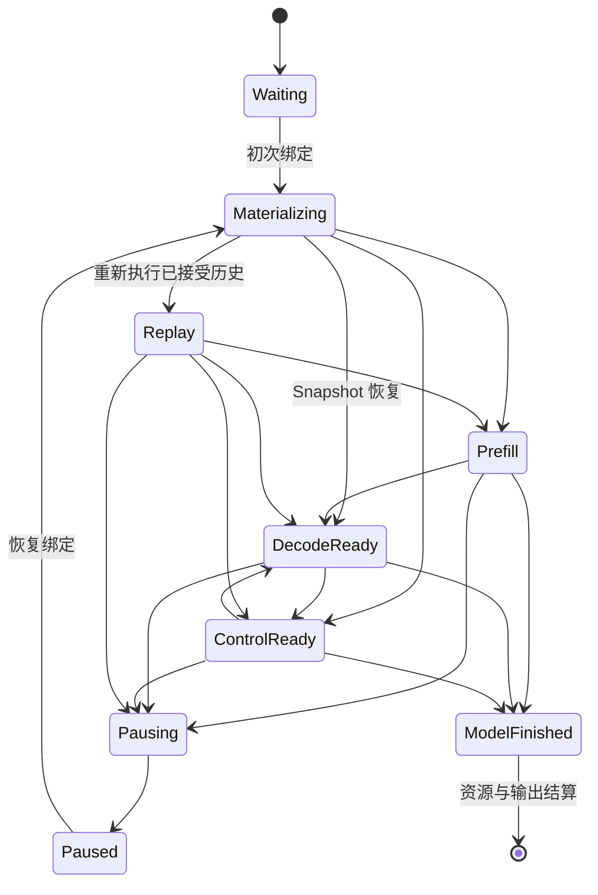

# NInfer Engine 架构

本文定义模型实例、执行所有权、请求生命周期及跨模块提交关系。
[资源调度与上下文缓存](resource-scheduling-and-context-cache.md)定义缓存与抢占策略；
[Paged KV Context Store](paged-kv-cache.md)定义物理页、replica、地址空间与 consumer 合同。

## 1. 产品执行模型

编译目标由 [Build system](build-system.md)定义。目标选择在编译时完成，决定源码与依赖的组合；
模型 Config 与 Op 数学接口保持独立，模型调度调用所选目标提供的实现。

Generation Engine 使用一张 GPU、一个常驻模型和启动时确定的 `max_concurrency=1..8`。
有界等待队列按提交顺序组织；resident 请求按有限执行单元增量取得资源，资源压力下可以暂停与恢复。
每轮将具备执行许可的 decode-ready 请求组成一个紧凑批次，prefill 与 Replay 分块穿插执行。

Text、Vision、prefix reuse、MTP、DFlash/DFlash2、CLI 和 HTTP serving 都通过公共 `ninfer::Engine`。
Speculative backend 属于 Program 内部执行路径，与 ordinary 共用请求调度、提交及结果发布机制。
Artifact 必须提供 Text；启动独立选择 Vision，以及 none 或一个 spec 后端，只绑定和准备所选功能
及其共享依赖。

Engine 的 purpose 在启动时固定。CausalScoring 用于离线文本评分，`CausalScoreCore` 串行调用
Program，窗口使用临时 State 与 Main KV，不进入 Generation Scheduler 或上下文缓存。
评分专用 staging 只在 CausalScoring 启动时分配。

### 1.1 架构、实例与权重

模型代码拥有数学公式、调用顺序、组件交接和状态转移。Config 提供层数、维度、Attention/GDN
分布和 expert 几何等实例参数。架构入口为 `Qwen3_5ForCausalLM`、`Qwen3_5MoeForCausalLM`
与 `Qwen4ExpForCausalLM`；后者当前支持 Text/Vision/MTP。
训练实例和物理权重分配作为数据进入对应实现。

V3 artifact 保存配置、物理对象、逻辑参数 Binding、使用位置的 Use 和 Frontend 资源。
Converter 负责源映射、量化或保值导入、融合存储、packing 和 layout 转换；loader 根据实际绑定
验证、读取并上传原字节。相同架构和可处理的配置更换训练权重或组合已有表示，沿用同一模型代码。



`metadata.name` 提供公开实例名称，缺省使用架构名称；服务可以用 `--model-id` 覆盖公开别名。
执行选择依据架构、配置和实际绑定。文件合同见[容器规范](artifact-container.md)，权重的数值解释
与 planes 见[数值格式](tensor-formats.md)和[存储布局](storage-layouts.md)。

## 2. 所有权与调用边界



### 2.1 Gateway 与 Frontend

Gateway 拥有协议解析、transport、media acquisition、response schema 和连接生命周期。
它将 product/protocol input 转为公共 owning input，调用 Engine，读取输出与统计。

Frontend 拥有 tokenizer、chat template、Vision preprocessing、MRoPE prompt construction 和
owning `PreparedPrompt`；每个请求独占一个 `OutputSession`，解释 stop、thinking/content channel、
detokenization 及模型私有结构化输出。它还提供能够由模板历史精确重建的输出边界语义。

现有 Qwen 架构共用 `models/common/qwen/frontend`，直接执行产物或启动覆盖指定的模板。
模型侧明确提供采样默认值、embedding 词表范围和启用的媒体几何；Frontend 不根据架构名称
推断这些参数。媒体预处理与 Program 消费同一组 `VisionItem`、grid、token span 描述。

Frontend 可以预览一次模型输出的语义效果，Engine 提交后才发布。等待顺序和物理缓存均由下层拥有。

GBNF、JSON、JSON Schema、choice、regex 和工具约束的 compiled grammar 在 Frontend 内按词表共享，matcher 由每请求的 OutputSession 持有。
Engine 在 submit 调用线程完成编译，再入队；Program 借用当轮的 mask provider，将 mask 送给
GPU 采样及 spec 验收。Matcher 与输出一起 preview/commit，抢占和 Replay 保留其已提交状态。
执行时序及语义见[约束解码设计](constrained-decoding.md)。

### 2.2 EngineCore 与 Scheduler

EngineCore 拥有 request record、等待队列、resident slots、paused queue、cancellation、deadline、
response event 和 Engine availability。它编排 admission、资源事务、有限执行单元和终态结算，
保证模型提交、输出提交及用户可见事件的顺序。

Scheduler 拥有执行成员与公平性规则：fresh admission 的有限绕过、prefill 轮转、紧凑 decode/control
批次、抢占受害请求及恢复机会。它使用请求状态和提交顺序做决定，暂停请求局部等待容量事件。

Lane 是 resident 请求位置；StateImage slot、KV execution row 和 compact batch row 是独立身份。
暂停释放 lane 后，请求仍由 EngineCore 拥有；恢复可以取得另一 lane。

### 2.3 ResourceManager

ResourceManager 拥有私有 continuation owner、其恢复点、共享前缀索引、session 提示、保留优先级
与可选保存准入。它向 Program 查询实际 checkpoint 内容、传输需求和有限物理动作，选择 source，
按恢复损失、当前缺口和真实需求证据选择回收动作，再采用 Program 返回的结果。

State slots、Device pages、Host bytes、共享引用和 pin 的实际占用只存在于 Program stores。
ResourceManager 的索引和保留记录不构成第二份物理账本。

### 2.4 Model 与 Program

Model 拥有 config、绑定、Use、权重 backing 和只读资源。ModelInstance 的 const Parameters 借用
这些资源，规划和执行消费同一份参数。`ModelInstance<RuntimeTypes>` 使用原生 Model、Parameters
和 Program 类型；Engine 在构建入口按架构作有限分派，执行循环继续静态调用原生 Program。
公共 PreparedPrompt 承载共享 Qwen 输入合同，不引用具体 Text 架构。

`models/common` 只提供明确的可复用能力：权重 ID/Use 与绑定、Qwen Frontend/Vision、逻辑上下文
存储和 MoE 执行。Vision 编码器接收自己的 config、参数、workspace 和 CUDA 执行视图；特征交接
按请求建立，资源由 Program 持有。架构声明 StateImage 的字段、dtype、形状与层数；Core
`StateImageStorage` 将每个 slot 的完整 image 连续存放，Host 使用相同内部布局。类型化的
GDN、循环 KV 等视图只表达计算几何，Op 从 Tensor 的实际 slot stride 寻址。

公共 `StateImageStore` 管理逻辑身份、写入预留及 Device/Host 副本，Host 副本直接持有共享
arena 的 allocation。预留、原生初始化、写入完成与副本物化是不同动作；分支目的在完成写入前
不成为活动内容。唯一写入者原位推进，共享来源通过独立目的或保留 Host 副本后的 Device 交接
继续执行。完整复制为一次连续 image 复制，DFlash local 字段组可独立复制。

`Continuation<Metadata>` 将 image 身份与原生续算 metadata 放在一起，供活动执行、候选提交和
checkpoint 使用；lane 不持有可能随换槽失效的状态 Tensor。Replay 中的 Continuation 记录
实际已重建的输入位置，恢复目标单独保存在请求控制中；已提交的账本与采样计数保持不变。
各历史前沿的数学关系仍由模型决定。
`KVHistory` 是单个 pool 的唯一可写历史，`KVPrefixRef` 持有该历史的精确只读前缀。
`KVHistoryStore` 随引用增减局部维护保护和有效 coverage，保存前缀不复制尾页；独立写入发生
冲突时才分支目录并 COW。Device 与 Host 可以覆盖不同长度，迁移按实际所需前缀检查副本。
`ContextSnapshot<Metadata, Identity>` 一起持有 Continuation、各 pool 的前缀与输入身份，
`CheckpointStore` 管理用途记录的发布、generation 与读者 lease。原生模型决定各 pool 的位置关系、
保存机会和采用规则；公共层不推导 Main/MTP/DFlash 的数学前沿。
具体层连接、状态推进及 speculative 提交保留原生实现。

每个 Program 独占：

- active sequence、committed prefix identity、执行 ledger 和 backend 状态；
- StateImage、KV history、Device/Host replicas、leases 和 reservations；
- prefill、ordinary/speculative decode、forced control 与 Replay；
- provisional model state、accepted-prefix commit/rollback；
- workspace、CUDA Graph 和固定模型调用。

Program 将具体状态和物理可行性通过原生合同提供给 runtime。请求顺序、缓存价值和输出发布由 runtime
与 Frontend 决定。

### 2.5 实例生命周期与固定执行

Binder 按架构/config 解析所选功能的逻辑需求，`LoadPlan` 不决定位置。
`resolve_load` 建立显式放置与 Host/Device 容量，Materializer 按原编码建立稳定 backing。
同一物理 parent 在各位置分别去重；CPU/GPU 双端需求可由同一次有界 I/O 分发。
Engine 在大权重读取前消费无地址的 `ModelProfile`，规划固定权重与必要的 KV/State、workspace、
MoE backing。权重加载后以少量物理 KV 页校准完整的 Graph 集合，保留实际 context、batch、
speculative 配置与拓扑共享关系；临时 Host context cache 为零。校准资源销毁后重新取得可用显存，
扣除 Graph 重建估计，再确定正式 KV 与 expert cache 容量。静态容量曲线只计算显式 backing。
Qwen3.5 MoE 与 Qwen4Exp 均优先尝试全量 GPU 放置；5090 的候选还包括 Host Main experts
及 Program 所有的 GPU 副本。Spark 提供全量 GPU 放置。候选由原生 Startup 提供，
ModelProfile 只记录表示与几何；Runtime 不解释 MoE cache/team 计划。候选不同时持有模型，
见[Expert 权重缓存](expert-weight-cache.md)。
`NINFER_VRAM_BUDGET_MIB` 限定引擎 Device 预算，实际可用显存构成另一上限。
Spark 的 GPU 与 Host 分配共享物理内存，预算快照采用 Linux `MemAvailable`，并以 CUDA
总容量为上限；CUDA 可以在分配时回收其空闲查询没有计入的文件缓存。容量规划还计入 PLE
准备区及 pinned ingress/egress 等已知 Host 分配。启用 Vision 时，另为 Frontend 的
`media_live_bytes` 留出容量；该上限已包含 retained cache，不重复加 `media_cache_bytes`。
这部分预留在正式 Program 建立后仍须保留，计入报告的总 headroom。5090 继续使用 CUDA 空闲容量。
Spark 不建立 Host State/KV cache，保留 Device 前缀复用和 Replay；PLE 磁盘准备缓冲独立计费。
Runtime 的 `model_startup.h` 统一预算、候选选择、校准收敛和有界重建；模型侧 `Startup` 提供
权重放置、容量计划、Frontend 构造和 Graph 校准合同。公共启动流程不解释具体层布局，
只传递模型拥有的准备描述；实体执行布局移交 Program 后，
校准与重试所需的描述仍然有效。PLE 规划使用独立几何，不借用可能被销毁的候选 Model。
ModelInstance 持有 Model、const Parameters、Frontend 与 Program；Parameters 持有与最终
容量计划相同的不可变执行 profile。纯逻辑加载不要求建立执行 profile。

权重、State/KV backing、block-table matrices、workspace 和 CUDA Graph resources 在接受请求前建立。
运行期改变 ownership、mapping、frontier 与 replica placement。每个 Program 独占可变状态和 Device
allocation；销毁时先结束 Engine worker 与未决设备工作，再销毁 Program、Frontend、Parameters 和 Model。

模型代码维护有限调用写法、跨 Op 融合和阶段关系。纯分段投影统一调用 LinearSplit；Parameters 保存
逻辑输出行顺序及单/双 parent 参数。例如 Q4 的 Q/K 与 Q5 的 gate/V 按逻辑行拼接，完整
FP8 parent 和 NVFP4 矩阵视图直接提供同一行序。通用权重准备解析存储视图，实际 Op 检查可执行的格式与分段。
View 保留 parent 几何、planes 和元素范围，共享对象在同一 Device 只驻留一次，各使用位置保留独立 Use。
激活许可为 `A16Only={A16}`、`AllowA8={A16,A8}`、`AllowA4={A16,A8,A4}`；融合调用取相关许可交集。

Reader、binder、原生参数准备、容量查询、warmup 和执行各自检查所消费的合同。可执行范围由实际
消费者决定。数学公式、权重表示值和实现精度分别解释；不同量化、batch、prefill 或 speculative 路径的
数值与状态正确性按 [Op 合同](op-development.md)及独立 oracle 验证。

### 2.6 内存位置与执行环境

`Device` 描述 CPU 或具体 CUDA ordinal；`None` 只用于未绑定的描述符和容量规划。
`Tensor`、权重 parent 及其派生视图记录实际位置，reshape、slice、permute 和 layout binding
保留该位置。数值格式、逻辑形状与内存位置独立，运行时位置不写入 artifact。

`HostBuffer` 拥有对齐的普通 CPU 内存，`PinnedHostBuffer` 拥有可用于 CUDA 异步传输的锁页内存，
`DeviceBuffer` 拥有指定 GPU 的分配。`MemorySpan` / `ConstMemorySpan` 借用 backing，记录容量、
位置及 host pinned 属性。`MemoryArena` 只管理 span 上的分配游标；Program 分别持有 backing
和 workspace arena，scope 退出只回退游标，不等待设备工作。容量规划使用无 backing 的描述符。

`CudaHostRegistration` 拥有已有 Host 范围的 CUDA 注册，借用其 allocation。
`CudaHostView` 分别记录 CPU 范围、CUDA 映射地址和目标 GPU；注册不改变 CPU residency。
模型的长期传输来源由 Model 同时持有 backing 和 registration；Program 完成使用后先注销，
再释放 backing。有界批量 H2D 描述符及 pitched 字节复制属于 Core transfer 基础。

`DeviceContext` 拥有 CUDA streams 和设备属性，并创建只读的 `CudaExecutionView`。Program、
模型上下文及组合 Op 沿调用链传递该视图；Op 入口检查实际操作数和 workspace 属于执行 GPU，
私有 launcher 再取出 stream。借用外部 stream 时在其所有者边界核对设备，调用点不得从 Tensor
位置和裸 stream 拼装执行环境。额外 stream 使用 `CudaStream` 持有，资源 owner 负责
完成所有借用 buffer 的异步消费后再释放。Engine worker 在执行前绑定设备。

通用字节传输通过 `copy_bytes` / `copy_bytes_async` 表达。CPU copy 同步完成；CUDA async copy
要求 CPU 端为 pinned memory，CUDA 端属于执行 GPU。调用者持有 backing，负责 stream/event
排序及完成后的复用；Tensor 和 span 不携带“已就绪”状态。KV 等有专用布局的传输保留其专用接口。
MoE 混合执行借用 CPU/CUDA 两端视图。共享专家及其余固定权重留在 GPU，Main routed
experts 可以使用注册的 CPU 来源；其副本、预取、bridge 与完成依赖由 Program 管理。

`models/common/moe` 提供跨模型的 bank 绑定、缓存规划、混合执行和资源组件。每个 Program
独占其资源实例；组件消费有序 MoE 调用、计算 profile 和明确策略。模型负责权重角色、
Main/MTP 放置、整机预算及层连接。`Write` 产出独立 block 输出，`AddResidual` 加回已有
输出；HC 等模型连接留在对应架构。计算格式、shape 分派和 activation Use 准备归 Ops。

### 2.7 CPU 执行基础

`CpuTopology` 记录发现线程允许使用的 OS CPU、物理核和可见缓存关系，不改变线程绑定。
线程数量与 affinity 在创建资源前解析；Core 消费明确配置，不自行选择模型计算分工。
媒体的自动线程数使用允许的 CPU 数量，保持最多 16 个 worker。

`TaskPool` 为独立任务提供固定线程和有界 FIFO。Frontend 媒体准备与 HTTP 使用同一实现的
独立实例；HTTP 可以等待媒体，二者不共享队列。立即提交被拒绝时不消费任务；阻塞提交在
等待容量时允许调用方检查取消。任务拥有结果和异常通道，池不额外创建 future。关闭先停止
新提交，再排空已接受任务并 join；拥有者在销毁前结束所有外部调用。

`CpuExecutor` 拥有固定绑核计算团队，由它产生借用的 `CpuExecutionView`。团队实际 ISA 是
各 worker 绑核后检测结果的交集。同步 collective 向全队发布同一次工作，返回时全部写入
对调用者可见；提交线程不参与计算。同一团队不接受嵌套或并发 collective。worker 使用
nearest-even、屏蔽异常和 gradual underflow，计算保留控制模式，算法的指令数值特性由 Op
负责。团队只提供 rank、连续范围分工与全队 barrier；scratch 由调用者用现有 HostBuffer、
MemoryArena 和布局类型管理，进入团队前完成划分。

`CpuExecutionView::keep_active()` 返回借用团队的独占作用域，在相邻 collective 之间保持
worker 轮询；退出后恢复有限自旋与休眠。它不提交工作，也不改变 collective 的完成语义。
是否启用由调用方依据实际计算频率决定，空闲请求期间不持有该作用域。

两种执行器共享启动确认、初始化失败清理和线程回收机制。CPU 团队不调用 CUDA，也不持有
传输槽、模型状态或权重副本。Engine/Scoring 的控制线程继续拥有各自的工作循环。
CPU 团队用于 MoE 混合执行；每个 Program 持有固定团队和交接缓冲。
MoE 按实际 token 列数选择混合计算或整层流式 GPU 计算，prefill、Replay、decode、
control 与 verification 共用这个选择。权重副本不属于请求 StateImage，不随回滚或暂停恢复。

## 3. 请求生命周期



`Materializing` 包含 source lease、必要传输和 destination 安装；完整绑定采用后才暴露 SequenceHandle。
Capture 是 resident 请求上的暂时执行门，capture 未完成的请求不进入模型 unit。
`ModelFinished` 表示模型已经结束，Engine 仍持有 lane，直到 finish/release 和缓存索引更新完成。
取消与失败可以从相应稳定边界进入终态。

### 3.1 暂停与恢复

暂停由 Program 在已提交 GPU 边界完成，返回 owning `ResumeState`：

- Snapshot 保存可直接恢复的完整 State/KV coverage；
- Replay 保存继续请求所需的输入、accepted ledger、RNG 和 backend 控制状态，恢复时重新执行缺失历史。

Engine 保留同一个 request record、OutputSession、generation budget 和已发布结果。Replay 重建物理状态时
不重复发布历史输出，也不重新消费用户生成预算。Snapshot 是可回收的加速资源；撤销后该请求仍能 Replay。
恢复绑定取得“重建至旧 frontier + 首个真实新单元”的完整许可，Native 跨 chunk 保持实际预留。
同时最多一个请求处于这段受保护恢复中；真实新进展或终态结束许可，随后再尝试其他恢复。
这期间跳过可选 capture，其他已获许可的请求仍可执行。

### 3.2 Outstanding capacity

非零输出请求成功 submit 后占一个 outstanding 名额，暂停不归还该名额。释放同时要求：

```text
response_done       worker 已形成最终 result 或 error
consumer_released   wait 已结束，或 GenerationHandle 被放弃
```

两者可以任意先后，capacity 只释放一次。放弃句柄只设置 cancellation 和 `consumer_released`，
consumer thread 不调用 Program。

### 3.3 Continuation 与 session

Active continuation 是可写模型状态；checkpoint 为不可变的恢复点。完整 checkpoint 对齐 State、
Main KV、selected backend KV 及继续执行所需 metadata。一个私有 owner 可持有多个恢复点并共享 KV history。

Session key 提供 continuation 查找提示。每个请求拥有单调 `publication_order`；较早提交的请求晚结束时，
不会覆盖较新结果的 session binding。具体恢复点与共享发布规则由
[上下文缓存](resource-scheduling-and-context-cache.md)定义。

## 4. Worker、资源与执行

只有 Engine worker 修改请求运行状态、Scheduler、ResourceManager 和 Program。Ingress、consumer 与
transport 通过队列、原子 cancellation flag 和 response event 交互。

一个 worker cycle 先推进资源事务、capture 与终态并处理取消，在容量事件上尝试最老 paused 请求
的完整恢复。随后按恢复优先、原票号优先为 resident 逐行取得 unit 许可，用余量尝试 fresh admission，
再执行可运行的 control、decode 和一个 prefill/Replay chunk。受保护恢复优先取得 chunk；其余 prefill
在 resident 间轮转，decode 批次使用实际 `B`。

Program 的 `reserve_units` 原子取得一个调用集合的 typed 增量需求；Engine 逐行调用，组成可运行
子集。取得许可后，fresh admission 仍可能增加尾页复制等依赖；control、decode、prefill 成批时
重新检查 Program 当前的 `context_blocks`，受影响的 writer 等待复制完成。一行缺资源不会阻止
其他已许可且无依赖的行执行。普通 unit 结算释放未用 reservation 与 provisional
suffix；恢复许可保留未来重建及首新单元尚需的 reservation。压力可以回收 optional cache、撤销
paused Snapshot 或暂停年轻 resident，具体准入与公平性见核心缓存文档。

一次资源事务可以与不受影响的 resident 执行交错，但同一 sequence、source/destination lease、
block table 和 transfer buffer 的依赖由 Program 冻结。任意时刻只有一个上下文资源事务，任意 GPU unit
访问的 mapping 在完成前保持稳定。

Admission 检查由等待队列、容量释放、资源事务完成等事件启动有界扫描。普通 decode 前进本身不重启
失败的 admission 扫描。恢复失败不关闭 fresh admission；更老 resident 仍在时，paused 请求不会
为试探恢复而盲目暂停年轻 borrower。普通 active 请求不预留整个剩余生成长度。

## 5. 提交与发布

### 5.1 上下文事务

Bind、Capture、Demote、Pause 是独立的原生操作，由一个固定操作槽驱动：

```text
选择操作与 source
  -> Program 取得 destination reservation 和 source lease
  -> 分步传输与完成检查
  -> 发布完整物理结果
  -> Engine / ResourceManager 采用结果
```

公共 `MigrationBatch` 持有 State/KV 来源读者、目的 reservation、复制计划、execution row 与完成
依赖。`MigrationContext` 在启动时准备可复用的事件与计时存储。恢复、尾页 COW 和 mapping 上传
在同一 stream 顺序提交；未发布的恢复页可以被本批次的 COW 使用，外部消费者只取得已完成结果。

Program 返回新 sequence、恢复点、已退役 checkpoint、暂停状态和实际传输观测。取消先撤销发布
意图，worker 继续轮询本批次的事件；事件完成后才释放空间和 lane、通知容量变化。取消中的
批次继续占用唯一操作槽，不阻塞无依赖的 resident。普通取消与资源析构不做 stream 同步；
部分提交异常和销毁路径显式结束实际设备访问，再退役所持资源。

State 采用方式用 Root、Move、Fork、Restore、Split、BackupSplit 表达。目的 image 由 owning reservation
管理，采用后才转交 continuation。Pause 在释放活动状态前结束可能尚未完成的 hidden-tail
publication；DFlash normalization 也保留独立的数学完成边界，其共享 Host ingress 与执行行在
producer 完成前不能复用。迁移完成不代替 MTP bridge 或模型接续。
已安全完成的回收或降级可以保留，结果必须与最终实际占用一致。

### 5.2 模型 unit 事务

Prefill finalization、decode 和 control 可以产生 move-only `PendingBatch`，包含冻结的 sequence
membership、provisional token、每行 produced extent 和 accepted-prefix 执行 metadata。
Engine 使用 Frontend preview 形成每行 decision，再一次性 `Program::commit` 或 `abort_pending`。
Program 提交或回滚对应 Main/backend KV、recurrent state、RNG 和 speculative state。

非取消行满足：

```text
1 <= accepted_tokens <= produced_tokens
nonterminal -> accepted_tokens == produced_tokens
terminal    -> accepted_tokens 可以是 produced prefix
```

取消行使用零 accepted token。整个 PendingBatch 必须被消费，不能逐行遗弃未决状态。

### 5.3 输出顺序

```text
Frontend preview
  -> Program 提交 accepted model state 与 prefix execution provenance
  -> generation budget 与调度记账
  -> OutputSession 提交 preview
  -> 发布输出事件
```

Frontend 的 boundary metadata 只描述 accepted span 内的相对位置；Engine 验证范围并随 row 搬运。
Program 根据 base frontier 转为绝对位置，与 accepted token、State/KV 和 prefix digest 原子提交。
Program commit 失败时，OutputSession preview 也不提交。

Forced control 使用同一提交机制，token 由 Frontend 提供，不调用 sampler 或推进 sampling RNG。
初次 admission 确立后，在任何输出 delta 前发布一次 `GenerationStart`；抢占恢复不重复发布它。
最终 response 等待 terminal 资源及缓存 owner 结算完成。

公共 OutputEvent 包含正文/思考增量、工具调用开始、参数增量和调用结束。Qwen OutputSession
在 commit 后推进请求独占的增量工具 decoder；Engine 将这些事件按顺序交给 wait() 的消费线程，
HTTP 写入不在 GPU worker 上执行。聚合与 Streaming 使用同一参数转码结果。工具序号在请求内
稳定，协议 call/item/block ID 由各适配器从开始事件分配。调用状态区分 InProgress、Complete
和 Incomplete，未完成参数保留已经发布的 JSON 前缀。

工具 decoder 通过结构化 output_error 区分自由生成格式错误与受约束输出合同违规；worker 在
本批提交完成后 abort 该 sequence、释放其所有权，分别结算 InvalidToolOutput 或内部错误。
正常可隔离的解析失败不进入 Engine 全局异常清理。工具参数名称状态与静态 matcher 一起参与
每个 speculative 位置的 mask、preview、confirm 和 discard；它不消费 Replay 的历史 token。
暂停保留 decoder 状态，Replay 不再次消费或发布历史参数；最终调用状态与实际结束原因分别保留。


## 6. 结束、取消与失败

成功结束时，Program 将可保留 continuation 交给 ResourceManager，或释放 sequence；ResourceManager
更新私有 owner、共享索引和 session，然后 Engine 释放 lane、完成 response。

取消在 worker 边界生效：Waiting 直接结束；绑定或传输中的请求先结算/中止事务；resident 请求在
GPU unit 稳定后 abort；paused 请求释放 ResumeState 及相关 owner。取消不改写 in-flight mapping，
已提交输出不回退。

Queue timeout、overload、输入超限和 request 无法表示属于请求级拒绝。Handle generation/owner
错误、PendingBatch membership 错误、物理 mutation 无法稳定 commit/abort，以及完整性或 adoption
不变量损坏会使 Engine 失败。Cleanup 先结束未决上下文和模型事务，再释放 resident/paused 资源与
缓存，最后完成全部 response。内部状态损坏不能解释成 cache miss。

## 7. 物理执行与 CUDA Graph

Startup planner 根据与执行同源的逐层 Parameters、Use 和设备容量建立 State/KV、workspace 与
Graph 资源。顺序互斥 scratch 取峰值，跨阶段存活的数据保留到最后消费者：Vision handoff 保留至
Text/所选 MTP 消费结束，speculative features 和 verify records 保留至提交边界。

Growing KV 使用共享 typed paged pools，物理页与逻辑 token frontier 分离。所有预留、mapping 更新、
COW 和 replica publication 在 GPU 稳定边界完成。消费者只拿 non-owning typed views。

CUDA Graph 按合法 exact-`B` topology 建立，page ID、请求身份、state selectors 是输入而非 graph key。
Op 拥有声明执行范围内的 Graph 更新兼容性，Program 在启动时捕获并验证同类更新。
Program 按真实数据依赖组织计算与决策 Graph；CPU 在决策前准备约束 mask，并可与 target
forward 重叠。Qwen4Exp resident Main 包含 PLE 消费和 head；Host PLE producer 在 Main
提交前提供本代次输入，MTP draft chain 增量回传 IDs。所有设备段共享同一个资源预留和提交边界。
长度档位限制资源范围；Program 不复制 Attention Op 私有 kernel 的分派边界。

MoE offload 使用分段 GPU Graph，控制线程负责 CPU contribution、缓存快照及传输交接。
稳定缓存合并 mixer 与 MoE GPU 提交；恢复和流式加载时分开，保留 mixer 与上传重叠。
`models/common/moe/schedule` 向模型提供图交接接口，`offload/graph` 实现 GPU subset 图及
CPU/cache 交接；调用方提供 mixer、MoE 和
可选 feature 的 GPU body。Text 与 speculative 的 prefix/suffix、层遍历及跨拓扑共享关系仍由原生
Program 定义。
Graph 校准记录准备前、准备完成、仅销毁 Graph 后的显存快照。释放后仍保留的驱动开销
已进入新的可用显存基准，不能与重建估计重复扣费。差值使用有符号数；允许重建增量为零。
`MemorySummary.cuda_graph` 分别报告校准增长、校准释放后的保留量、重建估计和正式准备增长；
`startup_retained_bytes` 记录正式 Program 分配前、扣除已拥有权重后的总增长。
这些差值包含 CUDA 延迟加载和驱动缓存，不作为纯 Graph allocation 的精确归因。
`runtime_reservation_bytes` 仅包含显式 Program backing。
正式准备的增长单独报告，以实际总占用是否满足 Device 预算判断启动，不要求它小于估计值。
显式与自动 KV 容量统一使用至少 1 GiB 基础 headroom，自动容量显式要求更大余量时取其值。
基础 headroom 用于容纳未精确计入的开销，不要求初始化后仍完整空闲，也不按拓扑类重复预留。
Spark Vision 的 live media 预留另行计入总 headroom，正式 Program 建立后仍保留这部分容量。
正式分配不足时最多进行一次容量纠偏重建；只调整自动 KV 或可选 expert cache，保持显式容量与执行功能。
Device 分配不足可以回收，
执行错误与 Host 内存分配失败不作为缩减 GPU 容量的理由。
Graph 只记录 GPU 工作，warmup 不绑定运行期控制线程；结束异步工作后先销毁 Graph，
再释放其引用的 bridge 和 events。具体依赖见 [Expert 权重缓存](expert-weight-cache.md)。

Source 排序使用硬件与实际绑定对应的传输成本、prefill 成本；缺省值用于没有匹配测量的配置。
实际 reservation 和 stores 决定物理可行性。

Serve warmup 使用公共 Engine，但关闭请求级 context cache；结束后不留下可供外部请求命中的
continuation 或 checkpoint。

## 8. 核心不变量与实现位置

1. Engine worker 是请求运行状态和物理 mutation 的唯一执行者。
2. Scheduler 决定顺序，ResourceManager 决定逻辑保留，Program 决定物理可行性与状态操作。
3. Unit 执行前取得完整许可；恢复许可跨 chunk 保留至真实新进展，执行中的资源和 mappings 稳定。
4. Checkpoint 必须对应同一次实际执行的完整 State/KV coverage。
5. 暂停保留请求语义和已发布输出，恢复不重复输出与生成记账。
6. PendingBatch 完整消费后才能发布对应输出；终态结算前请求保有资源所有权。
7. 每个请求、资源事务和模型事务均有唯一终态。

| 职责 | 主要位置 |
|---|---|
| 公共 Engine facade | `include/ninfer/engine.h`, `src/runtime/engine/engine.cpp` |
| 请求生命周期、调度与观测 | `src/runtime/engine/engine_core.h`, `request_record.h`, `scheduler.h`, `engine_metrics.inl` |
| 实例构造与启动策略 | `src/runtime/engine/model_construction.*`, `model_instance.h`, `model_startup.h` |
| 缓存 owner、索引与成本 | `src/runtime/engine/context_cache/` |
| 公共请求、执行与资源合同 | `src/runtime/contract/` |
| 模型 config、绑定与只读数据 | `src/models/{qwen3_5,qwen4_exp}/config.*`, `load/`, `model.*` |
| 原生参数与固定模型调用 | `src/models/{qwen3_5,qwen4_exp}/execution/` |
| Program 规划、存储、上下文及模型事务 | `src/models/{qwen3_5,qwen4_exp}/program/` |
| Qwen Frontend、Vision 与输入身份 | `src/models/common/qwen/` |
| 逻辑上下文存储 | `src/models/common/context/` |
| 原生启动与状态布局 | `src/models/{qwen3_5,qwen4_exp}/startup.*`, `state/` |
| 共享权重绑定与 MoE | `src/models/common/bindings.*`, `weights.*`, `moe/` |
| Tensor、arenas、graphs、物理 KV 与 raw transfers | `src/core/` |
| 通用 artifact framing 与 materialization | `src/artifact/` |
| 闭合计算与状态转移 Ops | `src/ops/`, `include/ninfer/ops/` |
| 输入转换、media acquisition 与 HTTP Gateway | `src/product/`, `src/media/decode/`, `src/serve/` |
| Converter 与 Python 容器工具 | `tools/convert/`, `tools/artifact/` |

公共 C++ 接口服务仓库内应用；NInfer 不安装或导出 C++ SDK。V3 `.ninfer` 是唯一 C++ 产品 artifact，
CLI、server 和 inference benchmark 均通过公共 Engine，converter 不提供 Python model-inference 路径。
