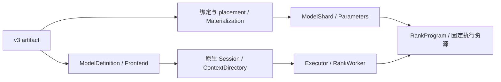
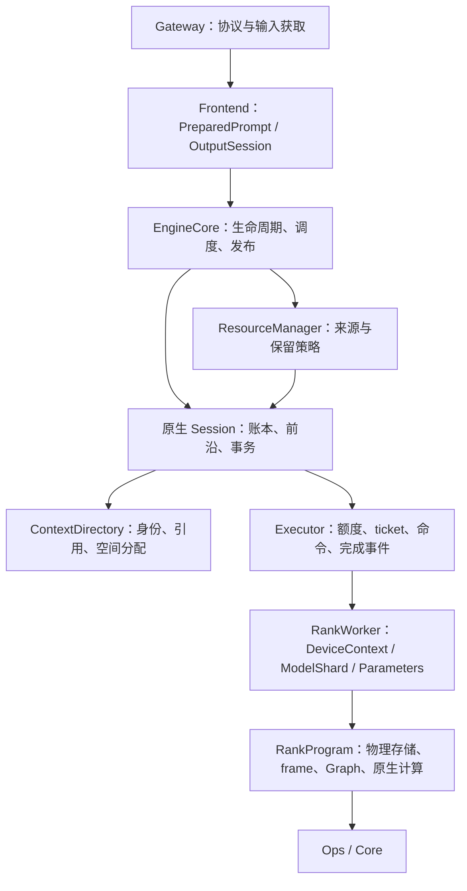
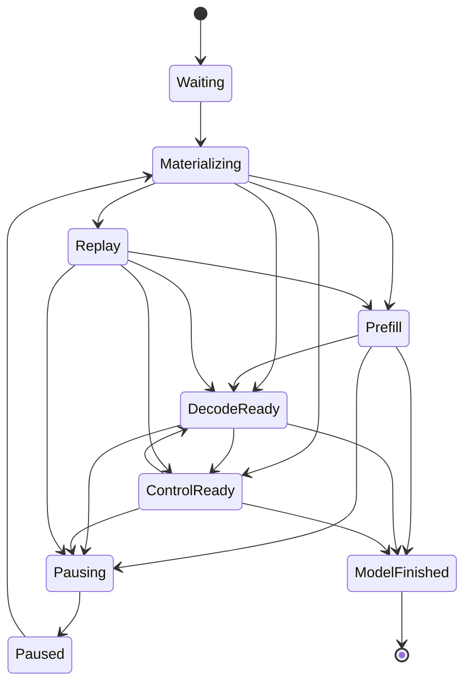

# NInfer Engine 架构

本文定义模型实例、执行所有权、请求生命周期及跨模块提交关系。
[资源调度与上下文缓存](resource-scheduling-and-context-cache.md)定义缓存与抢占策略；
[Paged KV Context Store](paged-kv-cache.md)定义目录、物理页、副本和消费者合同。

## 1. 产品执行模型

编译目标由 [Build system](build-system.md)定义：`rtx5090` 与 `dgx_spark` 各自选择本地源码和
优化实现，模型 Config 与 Op 数学接口保持独立。一个模型实例由协调侧 Session 和一个或多个
RankWorker 组成，启动时固定 `max_concurrency=1..8`。单 rank 由 LocalExecutor 在进程内执行；
多 rank 由 DistributedExecutor 分发统一执行计划，通信与分片由对应模型实现。
各 rank 独立拥有设备权重、固定执行资源和 Context backing。

Generation 使用有界等待队列，resident 请求按有限执行单元取得资源；压力下可以暂停与恢复。
紧凑 decode/control 批次与分块 prefill、Replay 共用调度、提交和结果发布机制。
Text、Vision、prefix reuse、MTP、DFlash/DFlash2、CLI 和 HTTP serving 均通过公共 `ninfer::Engine`。
Artifact 必须提供 Text；启动独立选择 Vision，以及 none 或一个 speculative backend，只准备所选功能。

Engine purpose 在启动时固定。CausalScoring 也通过原生 Session 和 Executor 执行，串行处理评分 job，
使用临时 State 与 Main KV；不进入 Generation Scheduler 或上下文缓存，评分 staging 只在该 purpose 下分配。

### 1.1 架构、定义与权重

原生模型代码拥有数学公式、层连接、Op 调用顺序和状态转移。Config 提供层数、维度、
Attention/GDN 分布及 expert 几何。架构入口为 `Qwen3_5ForCausalLM`、`Qwen3_5MoeForCausalLM`
与 `Qwen4ExpForCausalLM`；后者当前支持 Text/Vision/MTP。Checkpoint 与可处理的表示组合使用同一架构入口。

V3 artifact 保存配置、物理对象、逻辑参数 Binding、使用位置的 Use 和 Frontend 资源。
Converter 负责源映射、量化或保值导入、合并投影、packing 与 layout；loader 验证并按存储表示物化权重。
全局 ModelDefinition 拥有配置、模型身份、绑定描述和 Frontend 资源，独立于设备权重实例存活。
ModelShard 拥有本 rank 的不可变权重与 backing；const Parameters 借用这些权重和执行 profile。



`metadata.name` 提供公开实例名称，缺省使用架构名称；服务可用 `--model-id` 覆盖公开别名。
执行支持由实际 Parameters、规划和 Ops 决定。文件合同见[容器规范](artifact-container.md)，
数值解释与 planes 见[数值格式](tensor-formats.md)和[存储布局](storage-layouts.md)。

## 2. 所有权与调用边界



### 2.1 Gateway 与 Frontend

Gateway 拥有协议解析、transport、media acquisition、response schema 和连接生命周期，
将协议输入转成公共 owning input，调用 Engine 并消费输出。

Frontend 拥有 tokenizer、chat template、Vision preprocessing、MRoPE prompt construction 和
owning PreparedPrompt。每个请求独占 OutputSession，解释 stop、thinking/content channel、
detokenization、工具输出及模板边界。它可以 preview 本轮输出的语义效果，只有模型提交被接受后才 commit。
Frontend 不持有模型 State、页池或 CUDA stream。

现有 Qwen 架构共用 `models/common/qwen/frontend`。模型明确提供采样默认值、词表范围和启用的
媒体几何；Frontend 不按架构名称猜测参数。媒体预处理、Session 的输入窗口和 rank 的视觉计算消费
同一组 VisionItem、grid、token span 和位置身份。

GBNF、JSON、JSON Schema、choice、regex 和工具约束的 compiled grammar 按词表共享，matcher 由
每请求 OutputSession 持有。Engine 在 submit 调用线程完成编译再入队。执行侧通过 DecisionNeeded
交回实际 draft prefix；协调侧生成 owning DecisionInput，包括 mask words 与逐位置 dead-end bits。
DecisionConsumed 在实际提交上传后记录字节；输入存储仍保持到传输结束。Matcher 与输出一起 preview/commit，
Replay 保留其已提交状态。数学和协议细节见[约束解码](constrained-decoding.md)。

### 2.2 EngineCore 与 Scheduler

EngineCore 拥有 request record、等待和 paused 队列、resident lanes、cancellation、deadline、
response events 和 availability。Scheduler 决定执行成员、fresh admission 的有限绕过、
prefill 轮转、紧凑批次及抢占/恢复机会。两者不持有设备 Program 或物理页分配器。

SequenceId 标识一条逻辑序列，跨暂停恢复保持；ResidencyId 标识当前 lane 绑定，重新绑定时换代。
State record offset、KV execution row、compact batch row 和 Engine lane 是不同身份。
每个在途执行冻结 request、sequence、residency、row order 与取消快照，结果不能通过当前 lane 反查旧成员。

请求的输出预算和外部生命周期归 Engine；真实模型账本、Main/backend 前沿、Replay 目标及未决生成事务归
原生 Session。调度状态可以记录阶段，但不成为另一份模型前沿。

### 2.3 ResourceManager 与 ContextDirectory

ResourceManager 拥有私有 continuation owner、共享前缀索引、session 提示、需求证据、保留等级及回收权限。
它向原生 Session 查询 checkpoint、恢复成本和有限动作，选择 source 与受害者，再采用 Session 的完成结果。

ContextDirectory 是唯一的逻辑空间和引用账本：State/Page/History 身份、rank-local records、物理绑定、row、
Host offset/length、coverage、writer、read leases 和 reservations 都由它管理。Host/Device backing 在 rank，
rank 不重新选择页号或缓存命中。ResourceManager 的索引不重复拥有物理空间。

StateDirectory 区分预留、初始化、数学写入、冻结和 replica materialization。复制沿用 content epoch，
数学提交产生新 epoch。不可变来源与活动写入者分开；Both replica 可以把 Device record 交给新 identity，
旧 identity 保留 Host 内容。完整 StateImage 连续存放，DFlash local 字段组可以独立复制。

HistoryOwner 是一个 pool 的唯一可写 owner，HistoryPrefix 持有其精确前缀。HistoryDirectory 随引用变化
维护 required/protected coverage，保存前缀不复制尾页；发生写入冲突时才分支并 COW。
Host 和 Device 可以覆盖不同长度，恢复以实际所需 coverage 为准。

Continuation 将 StateId 与原生 metadata 组合。ContextSnapshot 同时保留 State、各 pool 前缀与输入身份，
CheckpointStore 管理发布、generation 和读者 lease。Main/MTP/DFlash 的前沿关系由模型决定，公共目录不推导。

### 2.4 Session、Executor 与 RankProgram

InferenceInstance 持有 ModelDefinition、Frontend、Executor 与原生 Session。
LocalExecutor 持有一个 RankWorker；DistributedExecutor 协调各 worker 的提交、结果与退休。
每个 RankWorker 持有 DeviceContext、ModelShard、const Parameters 和 RankProgram。
DeviceContext 地址从启动到销毁保持稳定，所有借用其 stream 的 owner 先于它销毁。

| 所有者 | 内容 |
|---|---|
| 原生 Session | 请求规划、token/位置账本、恢复目标、checkpoint 数学、接受前缀、ContextDirectory |
| Executor | compute/context 执行额度、ticket、CommandSequence、decision 交接、提交与完成顺序 |
| RankProgram | 原生 forward/draft/verify/commit、State/KV backing、input/output staging、frame、workspace、Graph |
| ModelShard | 不可变权重、Host/Device backing、长期 registration 与所需文件 backing |
| Parameters / Profile | 实际表示与计算几何、已绑定视图、Op activation policy |

两个模型保持原生 Session、Work、Result、Commit 与 RankProgram 类型；入口按架构作有限分派。
Executor 抽象位于执行单元和生命周期边界，原生层遍历及 Op 分派仍由模型直接编排。
Work 拥有输入和纯值存储动作，不借用 Engine 调用栈中的 matcher、请求对象或 CUDA 地址。

Qwen4Exp 的 `WorkContract` 校验无地址的形状、成员、前沿、决策 masks 和提交前缀；
RankProgram 再校验实际 residency、物理容量、存储动作和当前设备阶段。两类校验共用
同一数学与状态要求，协调侧无需持有本地 Parameters 或 Device Storage。

模型准备入口拥有自身并行策略的解析与支持范围；Runtime 只编排构造过程并传递配置。
loader、通信和 Op 对各自实际实现的要求负责，上层传播其错误，不复制或提前猜测这些限制。

执行许可先保留 frame 和该 ticket 后续的 supply/commit/discard 容量。
Session 建立 pending 事务后进入不可撤销的目录准备；此后即使取消，也必须执行已接受的 COW/mapping 动作至退役。
准备失败使执行实例失败并排空，不能把已改变的活动目录当成一次可回滚的准入失败。
尚未提交的独立 context binding reservation 可以正常撤销。

### 2.5 实例生命周期与固定执行

Binder 根据架构/config 建立 ModelDefinition 中的逻辑需求；resolve_load 建立 placement，
Materializer 按原编码建立稳定 backing。同一物理 parent 在各位置分别去重，CPU/GPU 双端来源可由一次有界 I/O 分发。
Frontend 的资源由 Definition 拥有，不借用稍后可能被销毁的权重候选。

启动在大权重读取前消费无地址 ModelProfile，规划权重、State/KV、workspace 与 MoE backing。
权重加载后，用少量物理 KV 页准备完整 Graph 集合，保留真实 context、batch、speculative 配置与拓扑共享关系；
临时 Host context 容量为零。销毁校准资源并重取可用内存后，扣除 Graph 重建估计，确定正式容量。

正式准备依次建立 RankProgram 和 PreparedSession。模型计划提供 State/KV 记录布局、各 rank
backing 容量和控制预算；PreparedSession 建立目录与 checkpoint catalog，再检查整个实例预算。
成功后把这批 owner 移入 Session，不重复分配。容量纠偏先销毁 PreparedSession，再销毁 rank 资源；
控制侧回收量与 Graph/rank 回收量分别计算，避免漏计或重复扣除统一内存。

Qwen3.5 MoE 与 Qwen4Exp 优先尝试全量 GPU 放置；RTX 5090 还可选择 Host Main experts 与 rank 管理的 GPU 副本。
Spark 使用全量 GPU 路径。候选由原生 Startup 提供且不同时持有多个模型；通用启动代码不解释 MoE cache/team 规则。
详见[Expert 权重缓存](expert-weight-cache.md)。

`NINFER_VRAM_BUDGET_MIB` 限定 Device 预算。RTX 5090 以 CUDA 可用显存作另一上限；Spark 以 Linux
MemAvailable 计入可回收文件缓存，并以 CUDA 总容量为上限。统一内存预算包含准备区、pinned staging 和控制元数据。
Vision 的 media_live_bytes 另行保留，已包含 retained media cache，不重复计算 media_cache_bytes。
Spark 不建立 Host State/KV cache，PLE 准备缓冲独立计费。

权重、State/KV backing、block-table matrices、workspace、frame 和 Graph 在接受请求前准备。
退出先停止提交、解析或丢弃未决事务、drain 所有设备和 Host producer，再释放 Session owners，
随后销毁 rank Graph、frame、存储、参数、权重和 DeviceContext。

表示支持仍由实际消费者检查。纯分段投影调用 LinearSplit；Parameters 保存逻辑行序及 parent 视图。
共享权重不在执行时重新 packing。激活许可为 `A16Only={A16}`、`AllowA8={A16,A8}`、
`AllowA4={A16,A8,A4}`，融合调用取交集。数学与精度验证遵循[Op 合同](op-development.md)。

### 2.6 内存位置与执行环境

Device 描述 CPU 或具体 CUDA ordinal；None 用于未绑定描述和容量规划。
Tensor 与权重视图记录实际位置，reshape/slice/permute 保留该位置；运行时位置不写入 artifact。

HostBuffer 拥有对齐普通内存，PinnedHostBuffer 拥有异步 CUDA 传输用锁页内存，DeviceBuffer 拥有指定 GPU 分配。
MemorySpan/ConstMemorySpan 借用 backing 并记录位置和 pinned 属性。MemoryArena 只管理分配游标，
scope 退出不等待设备。rank Resources 持有 backing 与 workspace arena，规划使用无 backing 描述。

CudaHostRegistration 拥有注册而不拥有 allocation；CudaHostView 记录 CPU 范围、映射地址和目标 GPU。
注册不改变 CPU residency，必须先结束借用、注销，再释放 backing。
CudaExecutionView 由 owning DeviceContext 产生，沿 RankProgram、数学实现和 Op 调用传递。
Op 核对操作数/workspace 所属 GPU；不能从 Tensor 位置和裸 stream 在调用点临时拼装执行环境。
额外 stream 由 CudaStream 持有，所有者负责消费者完成后的复用。

copy_bytes/copy_bytes_async 表达通用字节传输；CUDA async 的 CPU 端须为 pinned memory。
KV 保留自己的布局传输接口。Tensor 和 span 不携带就绪状态，顺序由执行事件和 owner 管理。

models/common/moe 提供 bank、cache、混合执行和资源组件，实例归 RankProgram。
共享专家及其余固定权重驻留 GPU；Main routed experts 可使用注册的 CPU 来源。缓存、预取和 bridge
不属于请求 StateImage，不随请求回滚或暂停。模型负责 Main/MTP 放置和层连接，Ops 负责格式、shape 分派和数学。
`Write` 输出独立 block，`AddResidual` 加回已有输出，HC 等连接保留在模型中。

### 2.7 CPU 执行基础

CpuTopology 发现允许的 CPU、物理核和缓存关系，启动解析线程数与 affinity；媒体自动线程数至多 16。
TaskPool 为独立任务提供固定线程和有界 FIFO，Frontend 媒体与 HTTP 使用独立实例，避免相互等待同一队列。
立即提交被拒绝不消费任务；阻塞提交可以检查取消。任务拥有结果和异常通道，关闭停止新提交后排空并 join。

CpuExecutor 拥有固定绑核团队并产生 CpuExecutionView，团队 ISA 为各 worker 的交集。
同步 collective 向全队发布工作，返回时写入对调用方可见；提交线程不参与，团队不接受嵌套或并发 collective。
worker 使用 nearest-even、屏蔽异常和 gradual underflow。团队只提供 rank、连续范围分工与 barrier，
scratch 由调用方分配。keep_active() 在相邻 collective 间维持轮询，退出后恢复有限自旋与休眠，空闲请求期间不持有。

CPU 团队不调用 CUDA，也不拥有传输槽、模型状态或权重副本。RTX 5090 的 MoE offload 由 RankProgram
取得 GPU 输入就绪事实后调用现有团队，再提交 GPU 汇合。MoE 策略由实际 token 列数决定，
prefill、Replay、decode、control 和 verify 共用该选择。

## 3. 请求生命周期



Materializing 包含来源 lease、传输和目的安装；完整采用后才使序列可执行。
Capture 是 resident 请求的暂时执行门，未完成时不进入该请求的模型 unit。
ModelFinished 后 Engine 仍持有 lane，直到设备退役、finish/release 和缓存结算完成。

### 3.1 暂停与恢复

Session 在已提交执行边界完成暂停，返回 owning ResumeState。Snapshot 保留完整 State/KV；
Replay 保留输入、accepted ledger、RNG 与 backend metadata，恢复时重建缺失历史。
Engine 保留同一个请求、OutputSession、生成预算和已发布结果；恢复可使用另一 lane。

Replay 不重复发布历史、不重复计数或采样。Snapshot 是可回收加速资源，撤销后仍可 Replay。
恢复取得“旧 frontier + 首个真实新单元”的完整许可，跨 chunk 保留；同时最多一条受保护恢复。
到达旧 frontier 本身不结束保护，真实新进展或终态才结束；期间跳过可选 capture。

### 3.2 Outstanding capacity

非零输出请求成功 submit 后占一个 outstanding 名额，暂停不归还。释放同时要求 response_done
与 consumer_released；两者任意先后，容量只释放一次。放弃 GenerationHandle 只设置取消与 consumer_released，
consumer 线程不调用 Session 或 RankProgram。

### 3.3 Continuation 与命名 session

活动 continuation 可写，checkpoint 是不可变的完整恢复点。一个私有 owner 可以持有多个恢复点并共享 KV history。
产品 session key 是查找提示，与原生 ModelSession 对象不同。单调 publication_order 防止较早请求晚结束时
覆盖较新 session binding。具体来源和共享发布规则见[上下文缓存](resource-scheduling-and-context-cache.md)。

## 4. Worker、资源与执行

Engine worker 是控制状态、Scheduler、ResourceManager、Session 和本地执行推进的唯一修改者。
Ingress、consumer、transport 通过队列、原子取消标志和响应事件交互。LocalExecutor 直接调用本进程
RankProgram，不增加消息编码、远程队列或额外执行线程。

每个 worker cycle 先消费执行与上下文完成、处理取消和终态，再按恢复优先及原票号为 resident 取得 unit 许可，
用余量尝试 fresh admission，然后安排 Control、一个 compact Decode batch 和一个 Prefill/Replay turn。
同周期已执行 Control 的行不得再次 Decode；异步事件到达不重新获得整轮调度机会。

Session 原子取得一个调用集合的 typed 需求，Engine 逐行形成可运行子集。Fresh admission 可能新增
共享尾页依赖，因此最终提交仍核对 context_blocks。一行不足或等待复制不阻止其他已许可且无依赖的行。
普通 unit 增量预留，恢复许可保留尚需覆盖；回收策略由 ResourceManager 决定。

当前 rank 有一套 Compute frame 和独立 Context frame。Compute 等待决策或提交时不覆写其 records；
Context 事务可以与无冲突工作交错。每条 sequence 的源、目的、mapping、传输窗口和执行输入被冻结到相应完成边界。
PLE 的 producer/upload/consumer、MoE 的输入就绪/CPU contribution/汇合由 rank 内部推进，控制侧不调度逐层算子。
执行预留只取得 frame 及其后续控制命令额度；原生 Work 描述形状和数学变体，由 rank 校验。
所有 Compute 结果需要 commit/discard，Context 完成后直接退役。

Admission 由队列变化、容量释放、事务完成等事件启动有界扫描，普通 decode 前进不反复重启失败扫描。
未完成工作由 Executor poll 推进；空闲等待不能给每个 decode 完成固定增加一次定时器延迟。
只有 Context 在途且没有进展时不重跑空调度周期；完成事件、队列通知及到期请求触发下一次边界处理。

## 5. 提交、完成与发布

### 5.1 四个执行事实

| 事实 | 含义 |
|---|---|
| Submitted | ticket 已建立，执行侧接管 owning Work 与 frame |
| ResultReady | provisional token、每行 extent 或原生结果可被控制侧读取 |
| CommitReceipt | 最终提交命令已被有序接受，Session 可以采用已准备的逻辑前沿 |
| DeviceRetired | 最后设备消费者结束，目录可以归还延迟租约，frame 才可复用 |

SessionEpoch、ticket、FrameId generation、SequenceId/ResidencyId 和 CommandSequence 共同界定事件归属。
ResultReady 不归还 frame。supply/commit/discard 使用原 ticket 的许可，不因其他普通工作占满额度而无法完成。
结果和 decision handoff 拥有自己的数据，不能在下一次 D2H 后失效。

### 5.2 上下文事务

Bind、Capture、Demote、Pause 使用独立 Context slot：

```text
Session 选择来源与取得目的/读者
  → ContextTransaction 准备 owning 值动作
  → rank ContextMigration 执行复制、COW、mapping
  → DeviceRetired
  → Session 发布 replicas、采用绑定及 checkpoint
  → Engine / ResourceManager 更新目录入口
```

ContextTransaction 拥有控制侧 leases、pending replicas 和 row；ContextMigration 只持 rank 的 events、
固定 pinned staging 与实际传输观测。已恢复但未对外发布的尾页可以在同一有序批次中继续用于 COW。
相同 row 的重叠 mapping 更新合并成最终片段，在复制后上传；H2D 源保持到传输完成。

State 采用方式为 Root、Move、Fork、Restore、Split、BackupSplit。暂停先结束 hidden publication 和必要
DFlash normalization，再备份或释放活动状态。取消只撤销未完成结果的发布意图，事务继续占用原 slot，
实际消费者结束后才释放来源、目的和 row。部分提交异常及退出路径显式 drain，不能析构在途 backing。

### 5.3 模型 unit 与输出

产生 token 的执行返回 PendingBatch，冻结成员、provisional tokens、每行 produced extent 和数学提交 metadata。
Engine preview 后一次性调用 Session commit 或 discard，不能逐行遗弃未决状态。

非取消行满足 `1 <= accepted <= produced`；非终态采用全部 produced，终态可以采用其前缀。取消行为零 accepted。
接受长度决定 Main/backend KV、GDN/QSA/PLE state、tail conditioning、计数和 RNG 的实际采用范围。

```text
Frontend preview、必要 Host 容量检查
  → Session 准备 accepted-prefix 逻辑与物理提交
  → Executor 接受提交，返回 receipt
  → Session 采用账本与前沿
  → Engine 生成预算记账
  → OutputSession commit 并发布输出
  → DeviceRetired 后完成资源结算
```

提交前检查生成缓存容量、相对 boundary metadata 和成员身份。模型提交被拒绝或失败时，OutputSession preview 不提交。
KV 的提交准备只整理 provisional 页与退役租约，不推进 committed frontier；接收后才采用前沿、State epoch、
token identity 与恢复保护状态。采用所需的 Host 容量在接收前准备，后续设备完成再归还旧页及补足增长预留。
后续工作继承执行顺序，terminal response 仍等待资源与缓存 owner 结算。
Forced control 使用相同事务，token 由 Frontend 给出，不调用 sampler 或推进采样 RNG。
初次 admission 后、任何输出 delta 前发布一次 GenerationStart，恢复不重复发布。

工具输出包含正文/思考增量、调用开始、参数增量和调用结束。请求独占 decoder 在 commit 后推进，
HTTP 写入由消费线程完成。聚合与 streaming 共用参数转码，工具序号在请求内稳定，协议 ID 由适配器产生。
InProgress、Complete、Incomplete 分开表示，未完成参数保留已发布 JSON 前缀。

output_error 区分自由生成格式错误与受约束合同违规。已完成该批提交后结束相关 sequence，分别结算
InvalidToolOutput 或内部错误；可隔离的解析失败不使整个 Engine 失效。工具参数状态与 matcher 一同参与
mask、preview、commit/discard，暂停保留，Replay 不再次消费历史参数。

### 5.4 MTP 的统一轮间状态

设 Main 已计算 `[0,F)`，账本有待输入的已确认 anchor `x[F]`。稳定边界为：

```text
Main frontier = F
MTP history frontier = max(F-1, 0)
saved conditioning = H[F-1]
```

MTP 在位置 p 消费 `H[p] + embedding(x[p+1])`。Qwen3.5 conditioning 为 target hidden，
Qwen4Exp 为 HC conditioning，具体数值运算由各自数学实现定义。

本轮先 Draft，再以 `[anchor, drafts...]` 执行 Main Verify，然后 Decision/Commit。
最终采用 A 个输出时，Main 前沿为 `F+A`，MTP history 为 `F+A-1`，保存 target 第 A−1 列 conditioning。
Draft 第一步写出的真实 history 可以保留；后续使用 draft conditioning 的 provisional history
按真实 target conditioning 重建，不直接作为 committed history。

Prefill、Replay、Control 采用相同的 backward alignment：根块跳过首 token；后续块先使用保存的
上一位置 conditioning，再使用本块 target conditioning。它们只建立 history，不生成跨轮携带的 drafts。
精确前缀命中先从 tail hidden 采样 anchor，下轮正常进入 Draft。K=0、ragged draft extent、部分终态采用
都遵守相同前沿；Vision embedding 的 token 位置与 conditioning/RoPE 位置分别解释。

## 6. 结束、取消与失败

正常结束由 Session 将可保留 continuation 交给 ResourceManager，或释放序列；缓存索引、命名 session
与终态资源结算完成后，Engine 归还 lane 并形成最终 response。

Waiting 请求可直接取消；绑定和传输中的请求先完成或撤销对应事务；resident 在 accepted 工作退役后结束；
paused 释放 ResumeState 和相关 owner。取消不改写 in-flight mapping，已发布输出不回退。

Queue timeout、overload、输入超限和不可表示请求属于请求级拒绝。身份/generation 不一致、错误成员、
不可稳定提交的物理 mutation、目录完整性损坏或执行错误使整个实例失败，不能解释为 cache miss。
Cleanup 停止提交，保留最初错误，尝试排空各执行和 producer，再释放 resident/paused/cache owners 并完成响应。
实际资源不足返回策略层；不可撤销准备之后的内部失败不作为普通准入不足重试。

## 7. 物理执行与 CUDA Graph

RankProgram 按同源 Parameters、Use 与容量计划准备资源。互斥 scratch 取峰值；跨阶段存活的
hidden、conditioning、verify records 和 Vision handoff 保留到最后消费者。Host ingress、decision mask、
accepted lengths 和 mapping staging 在 H2D 完成前不覆写；egress 在 D2H 与控制侧消费都结束后复用。

Graph 绑定固定 frame 和 backing。合法 exact-B topology 在启动准备，page IDs、sequence、State selectors
作为输入变化；长度档位描述资源范围，不复制 Attention Op 私有分派边界。同类 Graph 更新合同由 Op 提供。
Qwen4Exp resident Main 包含 PLE 消费和 head，Host PLE producer 在提交前准备本代次输入；
MTP draft chain 可以增量交回 IDs。需要约束或 Host producer 的边界通过显式交接推进。

MoE offload 保留分段 GPU Graph 和已优化的融合路径。mixer、GPU experts、CPU contribution、cache snapshot
及上传根据实际依赖组织；权重稳定时合并 GPU 提交，流式或恢复时保留上传重叠机会。
层遍历、speculative prefix/suffix 与拓扑共享关系仍由原生 RankProgram 定义。

Graph 校准记录准备前、准备完成和仅销毁 Graph 后的显存快照。销毁后保留的驱动开销已进入可用内存基准，
不与重建估计重复扣费；差值使用有符号数，重建增量可以为零。
MemorySummary.cuda_graph 分别报告校准增长、保留量、重建估计和正式准备增长；这些包含 CUDA 延迟加载与
驱动缓存，不能当作纯 Graph allocation 精确归因。runtime_reservation_bytes 表示 rank 的显式资源预留；
共享物理内存目标还计入 pinned staging、PLE Host 准备区等共享容量，独显目标仅计入 Device backing。

显式与自动 KV 容量都至少保留 1 GiB 基础 headroom；自动策略要求更大值时取其值。
基础 headroom 容纳未精确计入的开销，不要求初始化后仍完整空闲，也不按拓扑重复预留。
Spark Vision live media 另行保留。正式准备以整个实例的实际占用判断预算，不要求正式增长小于估计。
最多一次容量纠偏重建，只缩减自动 KV 或可选 expert cache；显式容量与功能不变，Host 分配失败和执行错误
不作为缩减 GPU 容量的理由。

Graph warmup 使用 rank 的临时 slot/page 绑定，不建立正式 Session checkpoint 或 prefix entries。
结束异步工作后先销毁 Graph，再释放它引用的 bridge/events。Serve warmup 使用公共 Engine，关闭请求级
context cache，结束后不留下外部请求可命中的 continuation。

## 8. 核心不变量与实现位置

1. Session 解释模型前沿，ContextDirectory 是唯一空间与引用账本，rank 执行已确定的动作。
2. Scheduler 决定顺序，ResourceManager 决定保留，实际分配与 Op 决定物理可行性。
3. 完整执行许可先于不可撤销准备；恢复许可跨 chunk 保留至真实新进展或终态。
4. ResultReady、逻辑提交和 DeviceRetired 不混用；最后消费者结束前不复用 backing。
5. Checkpoint 对应同一次实际执行的完整 State/KV coverage，暂停恢复不重复输出或生成记账。
6. PendingBatch 被完整消费后才能发布输出；终态结算前保留资源所有权。
7. 单 rank 的 LocalExecutor 使用正式执行合同，逐层计算继续使用原生实现与现有 Op 分派。

| 职责 | 主要位置 |
|---|---|
| 公共 facade | `include/ninfer/engine.h`, `src/runtime/engine/engine.cpp` |
| 生命周期、周期与发布 | `src/runtime/engine/engine_core.h`, `engine_{requests,schedule,execution,metrics}.inl` |
| 实例与启动 | `src/runtime/engine/instance.h`, `startup.*`, `startup_memory.*` |
| 执行合同、frame 额度、本地 worker | `src/runtime/executor/` |
| 缓存策略、索引、成本 | `src/runtime/engine/context_cache/` |
| 模型定义、绑定、只读 shard | 各架构 `definition.*`, `load/`, `model.*` |
| 原生控制与 checkpoint | 各架构 `session/` |
| rank 资源、执行推进与 Graph | 各架构 `program/` |
| 数学实现和参数 | 各架构 `execution/`、`state/` |
| 集中目录与值动作 | `src/models/common/context/directory/`, `directory.*`, `contract.h` |
| 本地存储、动作槽与传输 | `src/models/common/context/storage.*`, `transfer.*` |
| Qwen Frontend、Vision、输入身份 | `src/models/common/qwen/` |
| 共享权重与 MoE | `src/models/common/bindings.*`, `weights.*`, `moe/` |
| Tensor、buffer、arena、Graph、物理布局 | `src/core/` |
| Artifact 与 Converter | `src/artifact/`, `tools/convert/`, `tools/artifact/` |
| Ops | `src/ops/`, `include/ninfer/ops/` |
| 协议、输入获取与 HTTP | `src/product/`, `src/media/decode/`, `src/serve/` |

公共 C++ 接口服务仓库内应用，不安装或导出 SDK。V3 `.ninfer` 是唯一 C++ 产品 artifact；
CLI、server 和 inference benchmark 均通过 Engine，converter 不提供 Python model-inference 路径。
