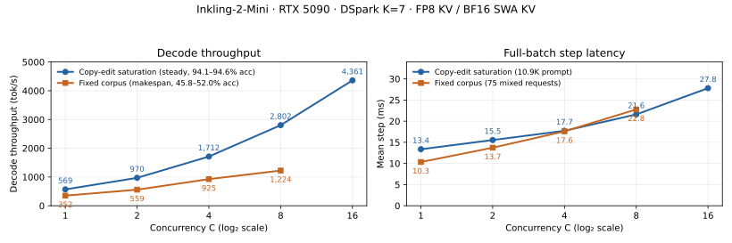
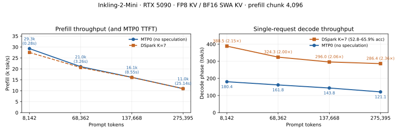

# Inkling-2-Mini serving performance

[Performance index](../performance.md) · [Measurement method](methodology.md)

Measured on November 27, 2026 (Asia/Shanghai), using one RTX 5090.
Copy-edit DSpark (`K=7`) decode saturation reaches **568.8 tok/s at C=1 and 4,360.8 tok/s at C=16**
(94.1%–94.6% acceptance, 7.67× scaling), while fixed-corpus serving reaches **352.0 tok/s at C=1 and
1,224.5 tok/s at C=8** (3.16× makespan speedup). A supplementary C=32 wave with FP8 SWA KV sustains
**6,439.6 tok/s** across 28 full-length active streams (peak 1s interval **6,804.0 tok/s**, full-batch
C=32 step **34.56 ms**).

## Configuration

All runs use the same RTX 5090 serving binary (`build/rtx5090-dev/apps/ninfer-serve`) built from
NInfer revision `b2514a7ae` (the copy-edit saturation waves use the `--saturation-messages` runner
option in `tools/bench/run_serve_concurrency.py`). Hardware is one NVIDIA GeForce RTX 5090 (SM 12.0,
32 GiB), NVIDIA driver 617.14, and CUDA 13.4 compile/runtime/driver API.

The artifact is `/home/neroued/ninfer/out/inkling2_mini.ninfer` (artifact ID
`2f56511438ec42298bfa359cf6f54fd3`, 18.89 GiB single-file v3 artifact): calibrated `nvfp4_mul`
routed MoE experts (layers 0–19, 40 tensors), `mxfp8` routed MoE experts (layers 20–23, 8 tensors), BF16/FP32 retained weights,
the PE-Lang vision encoder, and the 3-layer DSpark draft model (`block_size=8`, Markov RNN head).
Vision is disabled during text serving; resident device weights are 17.58 GiB (`MTP0`) and
18.27 GiB (`DSpark K=7`), with a 656.2 MiB workspace arena.

| Setting | Value |
|---|---|
| Route | Public OpenAI Chat Completions over loopback, `stream=false` |
| Speculation | DSpark K=7 (`--spec dspark --draft-tokens 7 --proposal-head full`, adaptive); additional MTP0 context profile |
| Full-attention KV (Main) | FP8 E4M3FN, groups of 128 with UE8M0 scales (`--kv-dtype fp8`) |
| Sliding-window KV (Main) & DSpark KV | BF16 K / FP16 V (`--swa-kv-dtype bf16`; supplementary C=32 wave uses `--swa-kv-dtype fp8`) |
| Prefill chunk | 4,096 tokens |
| Context capacity | Automatic shared KV/State Device pool (512 MiB headroom); Host cache disabled (`0 B`) |
| Engine concurrency | Equal to the measured C |
| CUDA Graph / GPU timing | Enabled |
| Vision / prefix reuse | Disabled |
| Sampling | [Common stochastic profile](methodology.md#common-serving-profile) |
| Startup and warmup | Excluded; fresh server per configuration |

| Workload | Modes | Logical context limit | C | Requests per point | Automatic Context pool (GiB) / KV estimate (tokens) |
|---|---|---|---|---|---|
| Decode saturation (copy-edit) | `dspark7` | 24,576 | 1, 2, 4, 8, 16 | C | 10.61–10.12 / 262,144–249,856 |
| Context profile | `mtp0`, `dspark7` | 327,680 | 1 | 4 lengths × 5 seeds | 11.38 / 674,084 (`mtp0`); 10.61 / 511,500 (`dspark7`) |
| Fixed corpus | `dspark7` | 131,072 | 1, 2, 4, 8 | 75 | 10.61–10.28 / 441,505–427,708 |
| Supplementary C=32 (FP8 SWA) | `dspark7` | 16,384 | 16, 32 | C | 10.25 / 316,757 (`C=16`); 9.89 / 305,834 (`C=32`) |

KV and State share the per-rank Context pool; zero preemptions, Snapshot restores, or Replay
restores occurred across every measured point.

## Decode saturation

One wave per C using a deterministic verbatim C++ refactoring prompt (`copy_edit_cpp.json`,
10,910-token prompt from `src/models/common/speculative/controller.cpp`, thinking disabled,
8,192-token output budget, distinct fixed seeds). All 31 requests reach the 8,192-token budget with
0 reasoning tokens and 1,069–1,077 full-batch steps per point. Steady throughput selects complete
one-second intervals whose actual batch equals C; full-batch step latency uses all recorded steps at
batch C; acceptance covers the full wave. See the
[measurement boundaries](methodology.md#decode-saturation).

| C | Steady (s) | Steady decode (tok/s) | Speedup vs C=1 | Full-batch steps | Step (ms) | DSpark acceptance | Decode tokens | Wave makespan (s) |
| --- | --- | --- | --- | --- | --- | --- | --- | --- |
| 1 | 13.00 | 568.8 | 1.00× | 1,077 | 13.37 | 94.6% | 8,191 | 14.93 |
| 2 | 16.00 | 970.2 | 1.71× | 1,076 | 15.54 | 94.5% | 16,382 | 17.61 |
| 4 | 18.00 | 1,711.6 | 3.01× | 1,075 | 17.73 | 94.1% | 32,764 | 20.91 |
| 8 | 22.00 | 2,802.3 | 4.93× | 1,069 | 21.60 | 94.1% | 65,528 | 26.91 |
| 16 | 29.00 | 4,360.8 | 7.67× | 1,069 | 27.81 | 94.3% | 131,056 | 36.96 |



**Note on `scenario_structured_jsonl` and supplementary C=32 scaling:**

- Under the default `scenario_structured_jsonl` fixture (151-token prompt, thinking disabled,
  8,192-token budget), Inkling-2-Mini frequently stops early after 239–494 tokens on C≥4 waves
  (1/4 at C=4, 3/8 at C=8, 11/16 at C=16) due to anti-fabrication / abbreviation behavior, which
  leaves zero full-batch one-second intervals at C≥4. On the fully saturated short-prompt waves,
  `scenario_structured_jsonl` reached **645.7 tok/s** (11.81 ms step, 94.6% acceptance, 11.00 s
  steady) at C=1 and **1,097.8 tok/s** (14.10 ms step, 96.7% acceptance, 13.00 s steady) at C=2,
  with pre-stop full-batch step latencies of 15.27 / 18.70 / 22.05 ms at C=4 / 8 / 16 (91.0%–95.8%
  wave acceptance). The verbatim C++ copy-edit fixture eliminates early stops while retaining ~94%
  speculative acceptance.
- At C=32 on one RTX 5090, BF16 SWA state images (169.8 MiB each, two copies per lane) exceed the
  available Context pool. Switching Main SWA to `--swa-kv-dtype fp8` fits C=32 in 9.89 GiB
  (~305,834 KV tokens) with zero preemptions. Using a 320-line 4,751-token copy-edit prompt and
  4,096-token budget, full-batch C=32 recorded 25 steps at **34.56 ms** (93.2% wave acceptance;
  paired C=16 wave: 24 steps at 24.47 ms, 93.4% wave acceptance). Because the truncated input ended
  mid-function, 4 of 32 seeds stopped early; the remaining **28 active streams** ran uninterrupted
  for 15.00 s at **6,439.6 tok/s** (33.06 ms mean step, 94.7% acceptance, peak 1s interval
  **6,804.0 tok/s**; paired C=16 with 15 active streams sustained **4,447.2 tok/s** over 12.00 s).

## Context profile

The four Long NIAH fixtures use five fixed seeds each, thinking disabled, and a 128-token output
budget (`0` reasoning tokens across all 40 requests). Tables show actual Inkling-2-Mini prompt
lengths and per-request mean ± sample standard deviation. Server TTFT follows the production
first-token boundary; step latency is the mean decode execution time.

### DSpark K=7

| Prompt tokens | Prefill (tok/s) | Server TTFT (s) | Decode phase (tok/s) | Step (ms) | DSpark acceptance | Tokens/round |
| --- | --- | --- | --- | --- | --- | --- |
| 8,142 | 27,526.6 ± 351.5 | 0.30 ± 0.00 | 388.5 ± 14.9 | 11.2 ± 0.4 | 65.9% ± 2.6% | 4.73 ± 0.15 |
| 68,362 | 20,632.7 ± 544.7 | 3.33 ± 0.09 | 324.3 ± 60.9 | 11.4 ± 0.4 | 54.5% ± 14.0% | 3.94 ± 1.00 |
| 137,668 | 16,083.0 ± 10.5 | 8.58 ± 0.01 | 296.0 ± 56.5 | 12.1 ± 0.5 | 52.8% ± 12.0% | 3.77 ± 0.96 |
| 275,395 | 10,945.2 ± 33.2 | 25.20 ± 0.08 | 286.4 ± 50.9 | 13.8 ± 0.6 | 60.8% ± 8.8% | 4.23 ± 0.97 |

### MTP0

| Prompt tokens | Prefill (tok/s) | Server TTFT (s) | Decode phase (tok/s) | Step (ms) |
| --- | --- | --- | --- | --- |
| 8,142 | 29,279.1 ± 122.2 | 0.28 ± 0.00 | 180.4 ± 0.4 | 5.5 ± 0.0 |
| 68,362 | 21,014.1 ± 28.9 | 3.26 ± 0.00 | 161.8 ± 0.5 | 6.2 ± 0.0 |
| 137,668 | 16,139.4 ± 20.1 | 8.55 ± 0.01 | 143.8 ± 0.4 | 7.0 ± 0.0 |
| 275,395 | 10,969.5 ± 11.8 | 25.14 ± 0.03 | 121.1 ± 0.4 | 8.3 ± 0.0 |

DSpark K=7 accelerates single-request NIAH decode by **2.15×** (8K), **2.00×** (64K), **2.06×**
(128K), and **2.36×** (256K) relative to MTP0, while keeping prefill throughput within 0.2%–1.8%
from 64K to 256K.



## Single-request speculative decode

These phase statistics reuse the C=1 fixed-corpus run. Each reasoning fixture has five samples with
thinking enabled and a 65,536-token output budget. Each other category pools three fixtures × five
seeds, with thinking disabled and a 4,096-token budget. Rates and ratios are per-request mean ±
sample standard deviation; category deviations include differences between fixtures.

| Scenario | Samples | Completion tokens | Decode phase (tok/s) | DSpark acceptance | Tokens/round |
| --- | --- | --- | --- | --- | --- |
| AIME26 #1 | 5 | 1,614.8 ± 169.5 | 362.1 ± 10.6 | 42.3% ± 0.4% | 3.81 ± 0.13 |
| AIME26 #15 | 5 | 65,536.0 ± 0.0 | 335.6 ± 51.9 | 49.5% ± 7.4% | 3.49 ± 0.54 |
| AIME26 #30 | 5 | 45,593.0 ± 18,779.9 | 407.8 ± 96.3 | 55.7% ± 12.1% | 4.32 ± 1.18 |
| Code | 15 | 4,058.0 ± 140.7 | 412.3 ± 24.6 | 55.5% ± 3.6% | 4.65 ± 0.35 |
| Story | 15 | 2,423.9 ± 916.1 | 194.1 ± 40.3 | 22.3% ± 10.3% | 1.87 ± 0.45 |
| Translation | 15 | 826.5 ± 187.9 | 275.6 ± 102.8 | 36.2% ± 15.5% | 2.97 ± 1.35 |
| Structured | 15 | 3,141.3 ± 1,370.2 | 453.9 ± 142.3 | 62.0% ± 22.9% | 5.14 ± 1.79 |

## Corpus makespan

Each point submits the same 75 requests using fixed shuffle seed `20260811` and ordered HTTP sends.
Every point computes 17,075 prompt tokens. Makespan spans worker release through the last complete
HTTP response; corpus throughput divides actual decode tokens by makespan. Full-batch step
statistics include only executions at the requested batch C. Acceptance is summed accepted / summed
drafted tokens.

| C | Decode tokens | Makespan (s) | Requests/s | Corpus decode (tok/s) | Avg batch | Full-batch steps | Step (ms) | DSpark acceptance |
| --- | --- | --- | --- | --- | --- | --- | --- | --- |
| 1 | 720,390 | 2,046.58 | 0.0366 | 352.0 | 1.00 | 197,216 | 10.34 | 51.2% |
| 2 | 700,287 | 1,253.55 | 0.0598 | 558.6 | 1.94 | 85,867 | 13.73 | 50.9% |
| 4 | 827,244 | 894.13 | 0.0839 | 925.2 | 3.68 | 44,818 | 17.59 | 52.0% |
| 8 | 793,308 | 647.87 | 0.1158 | 1,224.5 | 6.13 | 20,044 | 22.78 | 45.8% |

Relative to C=1, C=8 achieves a **3.16×** makespan speedup (`2,046.58 / 647.87`) and **3.48×**
higher corpus decode throughput (`1,224.5 / 352.0`). All 60 `thinking=false` scenario requests emit
direct response text with 0 reasoning tokens; reasoning tokens (77.5%–79.8% of total corpus output)
originate exclusively from the 15 `thinking=true` AIME26 requests.

## Completion outcomes

All 371 formal requests (31 copy-edit saturation + 40 context profile + 300 fixed corpus), as well
as the 48 supplementary C=16/32 FP8-SWA requests and 31 reference JSONL saturation requests,
completed without request, CUDA, or allocation errors.

- **Decode saturation (copy-edit)**: all 31/31 requests reached the 8,192-token output limit (`0`
  reasoning tokens).
- **Context profile**: stop-token / output-limit counts are `18 / 2` (`MTP0`) and `15 / 5`
  (`DSpark K=7`), all with `0` reasoning tokens.
- **Fixed corpus**: stop-token / output-limit counts across concurrency points are:

| C | Stop / output limit | Repetitive-suffix samples (retained) |
| --- | --- | --- |
| 1 | 45 / 30 | 4 (`aime26_15` × 2, `aime26_30` × 2) |
| 2 | 45 / 30 | 5 (`aime26_15` × 3, `aime26_30` × 2) |
| 4 | 36 / 39 | 6 (`aime26_15` × 1, `aime26_30` × 5) |
| 8 | 37 / 38 | 5 (`aime26_15` × 2, `aime26_30` × 3) |

At C=1, stop-token / output-limit counts by workload are: `AIME26 #1` (`5 / 0`), `AIME26 #15`
(`0 / 5`), `AIME26 #30` (`3 / 2`), Code (`2 / 13`), Story (`13 / 2`), Translation (`15 / 0`), and
Structured (`7 / 8`). All repetitive-suffix detections occurred inside the 65,536-token reasoning
chains of `long_decode_aime26_15` and `long_decode_aime26_30` under the fixed benchmark stochastic
profile (`temperature=0.6`, cooler than Inkling-2-Mini's default `1.0`). Every detected sample is
retained in the published corpus statistics.

## Reproduction and reports

Build `rtx5090-dev`, then run from the repository root with Python 3.11 and a fresh output
directory (wrapped in `gpu-run -r 5090` on shared hosts):

```bash
ninfer_perf_python=/home/neroued/miniconda3/envs/py311/bin/python
ninfer_perf_serve=build/rtx5090-dev/apps/ninfer-serve
ninfer_perf_model=/home/neroued/ninfer/out/inkling2_mini.ninfer
ninfer_perf_out=.agent-tmp/inkling2-perf-rerun

perf_common=(
  --serve "$ninfer_perf_serve"
  --artifact "inkling2_mini=$ninfer_perf_model"
  --sampling stochastic --proposal-head full
  --kv-dtype fp8 --swa-kv-dtype bf16
  --context-capacity auto --prefill-chunk 4096
  --device 0 --thinking fixture
)

# 1. Context profile (MTP0 and DSpark K=7, C=1, 8K-256K)
"$ninfer_perf_python" tools/bench/run_serve_concurrency.py "${perf_common[@]}" \
  --mode mtp0 --mode dspark7 --suite context-profile --concurrency 1 \
  --max-context 327680 --output "$ninfer_perf_out/context-profile"

# 2. Decode saturation (Copy-Edit C++ verbatim refactor, C=1..16, 8,192 tok/req)
"$ninfer_perf_python" tools/bench/run_serve_concurrency.py "${perf_common[@]}" \
  --mode dspark7 --suite decode-saturation \
  --concurrency 1 --concurrency 2 --concurrency 4 --concurrency 8 --concurrency 16 \
  --decode-tokens 8192 --max-context 24576 \
  --saturation-messages .agent-tmp/inkling2-perf-20261127/v2/copy_edit_cpp.json \
  --output "$ninfer_perf_out/decode-saturation-copyedit"

# 3. Fixed-corpus makespan (DSpark K=7, C=1..8, 75 requests/point)
"$ninfer_perf_python" tools/bench/run_serve_concurrency.py "${perf_common[@]}" \
  --mode dspark7 --suite corpus-makespan \
  --concurrency 1 --concurrency 2 --concurrency 4 --concurrency 8 \
  --max-context 131072 --output "$ninfer_perf_out/corpus-makespan"
```

Raw reports for this campaign are stored under `.agent-tmp/inkling2-perf-20261127/v2/`:

| Evidence | Location relative to campaign root |
|---|---|
| Context profile (`mtp0`, `dspark7`) | `context-profile/` |
| Decode saturation (copy-edit, `C=1..16`) | `decode-saturation-copyedit/` |
| Decode saturation (`scenario_structured_jsonl` reference) | `decode-saturation/` |
| Supplementary `C=16, 32` FP8-SWA wave | `decode-saturation-copyedit-c32/` |
| Fixed-corpus makespan (`C=1..8`) | `corpus-makespan/` |

Each point retains its command, startup resources, Engine measurements, server logs, request seeds,
complete responses, and termination records. C=1 corpus summaries also supply the single-request
speculative decode table.
