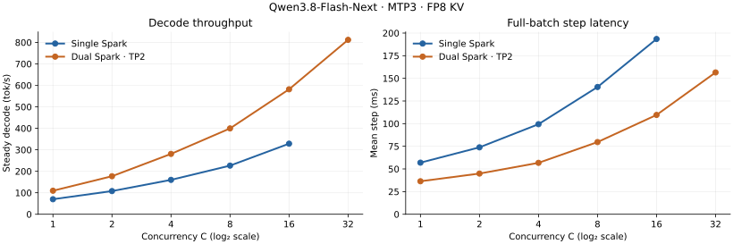
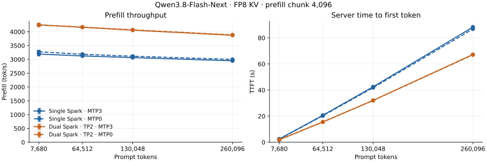

# Qwen3.8-Flash-Next serving performance

[Performance index](../performance.md) · [Measurement method](methodology.md)

Measured on November 15–16, 2026 (Asia/Shanghai), using one and two DGX Sparks.
MTP3 decode saturation reaches **70.0 tok/s at C=1 and 328.5 tok/s at C=16** on one Spark,
and **109.5 tok/s at C=1 and 811.9 tok/s at C=32** on two Sparks.

## Configuration

The decode-saturation and fixed-corpus runs use NInfer revision `a107b983`. Context profiles
were remeasured on November 16 using revision `72d72df3`, with HC sequence parallelism on dual Spark.
Hardware is NVIDIA GB10 (SM 12.1), with CUDA 13.4 compile/runtime/driver API.
Dual Spark uses TP2, including expert TP, and the Native communication backend over the 200 Gb/s
RDMA interconnect. Single Spark uses GPU experts and disk-backed PLE; dual Spark shards PLE across
Device memory.

The artifact is [Qwen3.8-Flash-Next-NInfer](https://huggingface.co/neroued/Qwen3.8-Flash-Next-NInfer),
recipe `qwen3_8_flash_next`: NVIDIA NVFP4 Main experts, Q8 large projections, BF16 retained weights,
NF4 PLE, block-FP8 MTP experts, and the full-vocabulary Q4 optimized draft head.
The measured entry file is
`/home/neroued/models/Qwen3.8-Flash-Next-NInfer/qwen3_8_flash_next.ninfer`.

| Setting | Value |
|---|---|
| Route | Public OpenAI Chat Completions over loopback, `stream=false` |
| Speculation | MTP3 with optimized head; additional MTP0 context profile |
| KV | FP8 E4M3FN, groups of 128 with UE8M0 scales |
| Logical context limit | 262,144 tokens per request |
| Prefill chunk | 4,096 tokens |
| Context capacity | Automatic shared KV/State pool; Host cache disabled |
| Engine concurrency | Equal to the measured C |
| CUDA Graph / GPU timing | Enabled |
| Vision / prefix reuse | Disabled |
| Sampling | [Common stochastic profile](methodology.md#common-serving-profile) |
| Startup and warmup | Excluded; fresh server per configuration |

Automatic MTP3 Context pools ranged from 37.92–39.00 GiB on one Spark, and from
58.94–60.34 GiB on rank 0 / 60.83–61.69 GiB on rank 1 for dual Spark. The reported
KV token-capacity estimates were 2.71–2.79M and 7.95–8.14M, respectively; KV and State share
this capacity. Per-rank startup allocations are retained in the reports.

| Workload | Modes | Single C | Dual C | Requests per point |
|---|---|---|---|---|
| Decode saturation | MTP3 | 1, 2, 4, 8, 16 | 1, 2, 4, 8, 16, 32 | C |
| Context profile | MTP0, MTP3 | 1 | 1 | 4 lengths × 5 seeds |
| Fixed corpus | MTP3 | 1, 2, 4, 8 | 1, 2, 4, 8 | 75 |

## Decode saturation

One wave per C using `scenario_structured_jsonl`: a 130-token prompt, thinking disabled,
an 8,192-token output budget, and distinct fixed seeds. All 94 requests reach that budget.
Throughput selects complete intervals whose actual batch equals C; step latency uses all recorded
decode steps at batch C. Acceptance covers the full wave. Each point contains 2,023–2,057
full-batch steps. See the [measurement boundaries](methodology.md#decode-saturation).

| C | Single tok/s | Single step (ms) | Single acceptance | Dual tok/s | Dual step (ms) | Dual acceptance |
| --- | --- | --- | --- | --- | --- | --- |
| 1 | 70.0 | 56.96 | 99.5% | 109.5 | 36.42 | 99.6% |
| 2 | 107.9 | 73.86 | 99.5% | 177.1 | 44.92 | 99.3% |
| 4 | 160.1 | 99.41 | 99.3% | 281.0 | 56.75 | 99.6% |
| 8 | 226.4 | 140.45 | 99.3% | 399.6 | 79.67 | 99.4% |
| 16 | 328.5 | 193.45 | 99.1% | 581.6 | 109.62 | 99.5% |
| 32 | — | — | — | 811.9 | 156.53 | 99.1% |



## Context profile

The four Long NIAH fixtures use five fixed seeds each, thinking disabled, and a 128-token output
budget. Tables show actual prompt lengths and per-request mean ± sample standard deviation.
TTFT follows the server's first-token boundary; step latency is the mean decode execution time.

### MTP3

| Prompt tokens | Single prefill (tok/s) | Single TTFT (s) | Single step (ms) | Dual prefill (tok/s) | Dual TTFT (s) | Dual step (ms) |
| --- | --- | --- | --- | --- | --- | --- |
| 7,680 | 3,219.2 ± 66.3 | 2.45 ± 0.18 | 57.1 ± 0.7 | 4,783.1 ± 86.2 | 1.69 ± 0.20 | 39.2 ± 2.0 |
| 64,512 | 3,144.6 ± 2.9 | 20.55 ± 0.02 | 57.2 ± 0.6 | 4,673.4 ± 10.7 | 13.84 ± 0.03 | 37.6 ± 1.2 |
| 130,048 | 3,085.1 ± 2.8 | 42.21 ± 0.05 | 58.3 ± 0.5 | 4,501.4 ± 28.9 | 28.96 ± 0.18 | 37.9 ± 0.6 |
| 260,096 | 2,975.0 ± 0.7 | 87.54 ± 0.03 | 59.9 ± 0.4 | 4,303.8 ± 2.7 | 60.55 ± 0.05 | 39.3 ± 0.3 |

### MTP0

| Prompt tokens | Single prefill (tok/s) | Single TTFT (s) | Single step (ms) | Dual prefill (tok/s) | Dual TTFT (s) | Dual step (ms) |
| --- | --- | --- | --- | --- | --- | --- |
| 7,680 | 3,221.1 ± 45.3 | 2.45 ± 0.16 | 35.2 ± 0.3 | 4,799.5 ± 57.9 | 1.71 ± 0.26 | 24.5 ± 0.5 |
| 64,512 | 3,148.0 ± 1.8 | 20.52 ± 0.02 | 35.6 ± 0.1 | 4,691.6 ± 15.1 | 13.79 ± 0.05 | 25.6 ± 0.3 |
| 130,048 | 3,092.1 ± 1.4 | 42.12 ± 0.03 | 35.8 ± 0.1 | 4,543.1 ± 5.9 | 28.67 ± 0.04 | 26.3 ± 0.2 |
| 260,096 | 2,983.9 ± 1.4 | 87.27 ± 0.05 | 36.3 ± 0.3 | 4,318.9 ± 3.0 | 60.33 ± 0.05 | 28.3 ± 0.3 |



## Single-request speculative decode

These statistics reuse the C=1 fixed-corpus runs. Each reasoning fixture has five samples with
thinking enabled and a 65,536-token output budget. Each other category pools three fixtures × five
seeds, with thinking disabled and a 4,096-token budget. Rates and ratios are per-request mean ±
sample standard deviation; category deviations include differences between fixtures.

### Single Spark

| Scenario | Samples | Completion tokens | Decode phase (tok/s) | MTP acceptance | Tokens/round |
| --- | --- | --- | --- | --- | --- |
| AIME26 #1 | 5 | 1,478.2 ± 281.5 | 56.7 ± 1.8 | 71.1% ± 3.2% | 3.13 ± 0.10 |
| AIME26 #15 | 5 | 65,536.0 ± 0.0 | 45.2 ± 0.7 | 50.2% ± 1.4% | 2.51 ± 0.04 |
| AIME26 #30 | 5 | 34,205.4 ± 2,458.2 | 46.9 ± 0.4 | 52.4% ± 0.8% | 2.57 ± 0.02 |
| Code | 15 | 3,566.1 ± 1,398.5 | 64.2 ± 1.4 | 84.4% ± 4.1% | 3.53 ± 0.12 |
| Story | 15 | 3,605.9 ± 431.0 | 38.4 ± 2.5 | 34.8% ± 4.7% | 2.04 ± 0.14 |
| Translation | 15 | 820.5 ± 259.5 | 57.4 ± 4.5 | 71.8% ± 8.3% | 3.15 ± 0.25 |
| Structured | 15 | 4,030.6 ± 253.3 | 66.8 ± 4.0 | 91.1% ± 8.9% | 3.73 ± 0.27 |

### Dual Spark

| Scenario | Samples | Completion tokens | Decode phase (tok/s) | MTP acceptance | Tokens/round |
| --- | --- | --- | --- | --- | --- |
| AIME26 #1 | 5 | 1,338.6 ± 104.5 | 92.6 ± 2.2 | 73.4% ± 2.4% | 3.20 ± 0.07 |
| AIME26 #15 | 5 | 65,536.0 ± 0.0 | 71.0 ± 1.3 | 50.0% ± 1.8% | 2.50 ± 0.05 |
| AIME26 #30 | 5 | 39,818.4 ± 9,821.9 | 75.0 ± 1.9 | 53.5% ± 2.5% | 2.61 ± 0.07 |
| Code | 15 | 3,316.5 ± 1,613.8 | 101.6 ± 4.4 | 83.6% ± 5.6% | 3.51 ± 0.17 |
| Story | 15 | 3,718.3 ± 345.7 | 59.5 ± 3.9 | 33.9% ± 4.7% | 2.02 ± 0.14 |
| Translation | 15 | 945.5 ± 253.4 | 88.1 ± 8.3 | 68.0% ± 9.8% | 3.04 ± 0.29 |
| Structured | 15 | 3,891.0 ± 515.5 | 107.2 ± 6.7 | 91.0% ± 8.5% | 3.73 ± 0.26 |

## Corpus makespan

Each point submits the same 75 requests using fixed shuffle seed `20260811`. Every point computes
15,460 prompt tokens. Makespan includes prefill, decode, admission, request transitions, and drain;
corpus throughput divides actual decode tokens by that makespan. Step statistics include only
executions at the requested batch C. Acceptance is summed accepted / summed drafted tokens.

### Single Spark

| C | Decode tokens | Makespan (s) | Corpus decode (tok/s) | Full-batch steps | Step (ms) | MTP acceptance |
| --- | --- | --- | --- | --- | --- | --- |
| 1 | 686,368 | 14,417.26 | 47.6 | 261,606 | 55.03 | 54.1% |
| 2 | 720,782 | 10,445.56 | 69.0 | 126,577 | 72.46 | 53.8% |
| 4 | 729,519 | 7,581.15 | 96.2 | 61,845 | 100.16 | 54.2% |
| 8 | 755,030 | 5,666.66 | 133.2 | 28,114 | 146.78 | 55.8% |

### Dual Spark

| C | Decode tokens | Makespan (s) | Corpus decode (tok/s) | Full-batch steps | Step (ms) | MTP acceptance |
| --- | --- | --- | --- | --- | --- | --- |
| 1 | 711,460 | 9,491.84 | 75.0 | 271,864 | 34.86 | 53.9% |
| 2 | 722,179 | 6,048.90 | 119.4 | 135,525 | 44.02 | 54.8% |
| 4 | 725,452 | 4,324.55 | 167.8 | 61,891 | 58.31 | 53.9% |
| 8 | 690,549 | 3,125.86 | 220.9 | 28,911 | 86.85 | 52.6% |

## Completion outcomes

All 774 published formal requests completed without request execution errors.
All 80 refreshed context-profile requests stopped naturally. The 94 saturation requests reached
their 8,192-token budget.
The fixed-corpus stop-token / output-limit counts are:

| C | Single: stop / limit | Dual: stop / limit |
| --- | --- | --- |
| 1 | 38 / 37 | 40 / 35 |
| 2 | 37 / 38 | 36 / 39 |
| 4 | 42 / 33 | 41 / 34 |
| 8 | 37 / 38 | 39 / 36 |

All C=1 AIME26 #15 samples reached 65,536 tokens. A dual C=8 AIME26 #30 sample
(seed `912910298659544128`) also reached that limit after developing a repeated reasoning suffix.
It remains in the corpus statistics. The other automatic suffix match was a CUDA comment separator.
Token accounting, termination, and suffix screening are retained with the complete responses.
Capability evaluation is reported separately in the
[model card](../../model-cards/Qwen3.8-Flash-Next-NInfer/README.md#evaluation).

## Reproduction and reports

Build `dgx-spark-dev`; dual Spark needs the distributed build and matching workers on both nodes.
Create `perf-single.local.toml` with the common configuration below. Create `perf-dual.local.toml`
from the same content and append the `[distributed]` section from
[`spark2-qwen3_8-flash-next.toml`](../../examples/configs/spark2-qwen3_8-flash-next.toml),
setting local worker/artifact paths and RDMA addresses. Leave `ep` unset for expert TP.
The runner selects the speculative mode and Engine concurrency for each point.

```toml
[model]
path = "/srv/models/qwen3_8_flash_next.ninfer"
vision = false

[engine]
max_context = 262144
prefill_chunk = 4096
kv_dtype = "fp8"
context_capacity = "auto"
cuda_graph = true

[context_cache]
prefix_reuse = false
host_capacity = "0B"

[observability]
gpu_timing = true
```

Run from the repository root with Python 3.11 and a new output directory:

```bash
ninfer_perf_python=/home/neroued/miniconda3/envs/py311/bin/python
ninfer_perf_model=/srv/models/qwen3_8_flash_next.ninfer
ninfer_perf_output=.agent-tmp/flash-next-serving

for perf_deployment in dual single; do
  perf_common=(--serve build/dgx-spark-dev/apps/ninfer-serve
    --artifact "qwen-fn-$perf_deployment=$ninfer_perf_model"
    --config "perf-$perf_deployment.local.toml"
    --sampling stochastic --proposal-head optimized --port 8081)
  perf_counts=(16 8 4 2 1)
  if [[ "$perf_deployment" == dual ]]; then perf_counts=(32 16 8 4 2 1); fi

  for perf_c in "${perf_counts[@]}"; do
    "$ninfer_perf_python" tools/bench/run_serve_concurrency.py "${perf_common[@]}" \
      --suite decode-saturation --mode mtp3 --decode-tokens 8192 \
      --concurrency "$perf_c" --engine-concurrency "$perf_c" \
      --output "$ninfer_perf_output/$perf_deployment/decode-c$perf_c"
  done

  for perf_spec in mtp0 mtp3; do
    "$ninfer_perf_python" tools/bench/run_serve_concurrency.py "${perf_common[@]}" \
      --suite context-profile --mode "$perf_spec" --concurrency 1 --engine-concurrency 1 \
      --output "$ninfer_perf_output/$perf_deployment/context-$perf_spec"
  done

  for perf_c in 8 4 2 1; do
    "$ninfer_perf_python" tools/bench/run_serve_concurrency.py "${perf_common[@]}" \
      --suite corpus-makespan --mode mtp3 --concurrency "$perf_c" --engine-concurrency "$perf_c" \
      --output "$ninfer_perf_output/$perf_deployment/corpus-c$perf_c"
  done
done
```

The recorded campaigns cleared filesystem caches on participating nodes before each server start.
Decode-saturation and fixed-corpus reports are under `.agent-tmp/qwen-fn-serving-perf-20261115/`
on the coordinator:

| Evidence | Location relative to report root |
|---|---|
| JSONL saturation | `saturation-jsonl/{single,dual}/decode-c{C}/` |
| Fixed corpus | `{single,dual}/corpus-c{1,2,4,8}/` |

Refreshed context profiles are under `.agent-tmp/qwen-fn-prefill-refresh-20261116/` on the
coordinator: `{single,dual}/context-mtp{0,3}/`, with deployment summaries in
`{single,dual}/summary.*`.

Each point retains its command, startup resources, Engine measurements, server logs, request seeds,
complete responses, and termination records. C=1 request summaries also supply the scenario tables.
